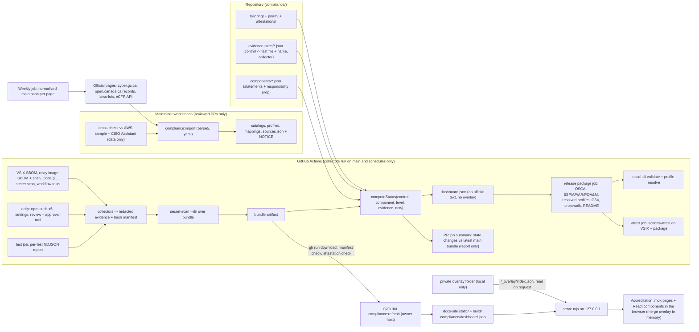

# Phase 44: Accreditation evidence and compliance dashboard - Research

**Researched:** 2026-11-21
**Domain:** OSCAL compliance-as-code in a Node and TypeScript monorepo, a Docusaurus 3.10 static dashboard, GitHub Actions evidence and release integrity, Canadian (Cyber Centre, Treasury Board, PSPC) and US (NIST, eCFR) sources
**Confidence:** HIGH for sources, source structure, tool versions, repository facts and gate behaviour (read or run this session); MEDIUM for exact CLI flags of `oscal-cli`, `grype` and `gh attestation` (documented, not run); LOW only where tagged `[ASSUMED]`

Provenance tags used below: `[VERIFIED: x]` read or run this session; `[CITED: x]` taken from official documentation fetched this session (often through a summarizing fetch, so the planner should re-read the page when a value is load-bearing); `[ASSUMED]` training knowledge or inference, listed in the Assumptions Log. Quotes of repository values are verbatim. Nothing downloaded was executed; the only third-party code run was `ajv` (pinned, scripts off) against data, and a throwaway Node reporter written for this research.

<user_constraints>
## User Constraints (from CONTEXT.md)

### Locked Decisions

### Accepted from the designs (owner)
- **D-01 (owner):** The successor series is authoritative: ITSP.10.035 (overview), ITSP.10.033 (catalogue) and ITSP.10.033-01 (Medium profile, the Protected B reference). ITSG-33 identifiers are kept only as a crosswalk for assessors still using them.
- **D-02 (owner):** ITSG-33 Annex 4A Profile 3 is the only published Secret baseline and is used as the Classified reference until a successor is published. The Classified page lists it and says the product makes no claim; it is for the appliance only.
- **D-03 (owner):** Control text is stored in the repository under the Open Government Licence - Canada with the attribution statement, an "unofficial representation, not reviewed or endorsed by the Cyber Centre" notice, the source address, the retrieval date and the SHA-256 of what was retrieved (DESIGN D2). Emailed spreadsheets, cloud profiles, logos and the Canada wordmark are never committed.
- **D-04 (owner):** OSCAL JSON in `compliance/` is the one source; our own small TypeScript tooling generates and checks it; `oscal-cli` validates and resolves profiles in CI; Compliance Trestle is the recommended hand-off tool and a test fixture, never a build dependency.
- **D-05 (owner):** Six states, with these shown words: Met, Partly met, Not met, Stale, Not applicable (always with a reason), Your organization's responsibility. Nothing generated ever says the product is compliant, accredited or certified.
- **D-06 (owner):** Protected B (ITSP.10.033-01) is built first; Protected A and Unclassified are derived from it; the Classified page comes last.
- **D-07 (owner):** The `compliance` job is not blocking at first (DESIGN D5). The switch to blocking on a drop from Met without a reviewed tailoring or POA&M change is a later one-line change the owner makes.
- **D-08 (owner):** Gaps G1 to G13 are the design's list (DESIGN section 14), with X1 to X12 from `CGP-ITAR.md` section 11 on the overlay pages.
- **D-09 (owner):** Freshness windows are the design's D6: test and check evidence, the current `main` head (or the release tag); audits, 24 hours; repository settings, 7 days; harness scans, 30 days; documents and signed attestations, 365 days.
- **D-10 (owner):** ITSP.10.171 and CPCSC are an overlay on the Protected A and Protected B pages from the start (DESIGN D10); the organization's private overlay view is local only and read-only (D11); the Controlled goods (Canada) and ITAR overlays are two pages (D12, CGP-ITAR E12 and E13).

### Reuse terms, checked before any text is committed
- **D-11 (licence gate, an invariant not a judgement):** `compliance/sources.json` lists every source with its address, licence id, the evidence for that licence (for Government of Canada publications, the open.canada.ca record id and its `license_id`), the retrieval date and the hash. The importer writes control text only for a source whose recorded licence is in an allow list (`ca-ogl-lgo`, US public domain for NIST and the eCFR, the Reproduction of Federal Law Order for federal enactments); for any other source it writes ids, titles it may cite, and a link, never text. A test refuses a catalogue file with text from a source outside the allow list. The first import task re-reads each open data record's licence through the open.canada.ca API before committing anything, and stops if a record no longer says `ca-ogl-lgo`.
- **D-12 (per source):** Text stored: ITSP.10.033, ITSP.10.033-01, ITSP.10.171, ITSP.10.171-01 and ITSG-33 (for Annex 4A Profile 3 and the Annex 3A crosswalk) under `ca-ogl-lgo` if their records still say so; NIST SP 800-53 Rev. 5 from `usnistgov/oscal-content` (public domain); the Defence Production Act Part 2 and the Controlled Goods Regulations under the Reproduction of Federal Law Order (accurate, not presented as official); 22 CFR 120 to 130 (US government work). Ids and links only: the Cyber Centre's baseline controls for small and medium organizations and CAN/DGSI 104 (unless the research step finds an open licence record for them), CPCSC Level 1 (canada.ca terms), PSPC and Treasury Board guidance pages (cited and paraphrased). The CSE website terms are noted in `NOTICE` as narrower; the publication-specific open licence is the grant relied on.
- **D-13:** The French text of ITSP.10.033 and -01 is imported beside the English (DESIGN D3) and kept in the same OSCAL files as a second `prose` part with `lang`; pages show English first with a link to the French. If the French page structure blocks a clean parse in the import plan, French ships as a POA&M item rather than delaying the English.

### Package and source layout
- **D-14:** `compliance/` is its own package like `docs-site/` and `relay/`: own `package.json` and lockfile, exact versions, `npm ci --ignore-scripts`, TypeScript compiled with the root's pinned compiler version, tests run through the repository's `node scripts/run-tests.mjs`. Folders as DESIGN section 5.2 plus `catalogs/cgp/`, `catalogs/itar/` and `sources.json`. Runtime dependencies: none beyond Node built-ins; development dependencies: TypeScript and a JSON Schema validator pinned exactly (the research step picks one).
- **D-15:** Generated files (resolved profiles, evidence bundle, dashboard JSON, package) are build outputs under `compliance/out/` (git-ignored), never committed, so nothing on `main` can drift from what CI computed.
- **D-16:** The OSCAL JSON Schemas for the pinned OSCAL version are vendored into `compliance/schemas/` with their source and hash (public domain), so per-PR validation runs offline.

### Status engine (ACCR-06)
- **D-17:** `computeStatus(control, component, level, evidence, now)` is a pure function in `compliance/src/status.ts`. Inputs are statements, responsibility values, tailoring records, evidence results and the clock; no input carries a status. The source schemas reject any `status`, `state` or `met` key anywhere under `compliance/` sources, and a test proves it.
- **D-18:** Rules (DESIGN section 9): Your organization's responsibility is never Met in the public view; Not applicable needs a tailoring record with a reason and a reviewer, otherwise Not met; Met needs a statement, every rule with a result, every result passed and fresh; Partly met when some statements are Met and others are not, or the statement declares a known limitation that SECURITY.md's "Known limitations" table also lists (a test checks the two agree); Stale when it would be Met but a result is too old; Not met otherwise. Level summaries count Stale as not met.
- **D-19:** Rows that depend on unsettled questions (the TEE question, encrypted storage at third parties, CGP-ITAR section 10.3) carry an `unsettled` reason and can never be Met; a self-signed decision counts as Not met for any row that requires an official's signature.
- **D-20:** A risk acceptance is a signed statement by a named person with an expiry (at most 365 days), using the existing signed-payload format verified with Node's built-in crypto; it is shown as "Risk accepted until {date}", never as Met, and an expired one reopens the gap.

### Evidence (ACCR-04, ACCR-05)
- **D-21:** Tests are tied to controls in one place, `compliance/evidence-rules/*.json` (control and statement to test file and test name), never by comments in tests. The check fails when a mapped test is missing, skipped, renamed or was not run.
- **D-22:** Per-test results come from a machine-readable report that `scripts/run-tests.mjs` writes when asked (an opt-in flag and output path; default behaviour unchanged). The CI `test` job uploads it as an artifact; the compliance job reads it. If the research step finds that Node's built-in reporters give this without a runner change, that is used instead.
- **D-23:** Collectors (DESIGN section 8): CI checks, mapped tests, dependency audits (JSON for root, relay, hub, docs site), SBOMs (VSIX now, relay image from G5), secret scan, workflow hardening (the existing `scripts/test/workflow-files.test.mjs`), architecture test and copy lint (Phase 41), the hub CI job (Phase 32), repository settings (read-only fine-grained token in its own environment, daily), review and approval trail, release integrity, documentation checks (required documents present with a "Last reviewed" date inside 365 days), crypto inventory. Each is a small module in `compliance/src/collectors/` with fixture tests; none needs network access in its unit tests.
- **D-24:** Evidence holds only ids, counts, hashes, run addresses, times and pass or fail; never logs, tokens, prompt content, personal details or organization data. The bundle runs through `scripts/secret-scan.mjs` before upload, and a test proves a bundle built with a sample organization overlay present contains none of it.
- **D-25:** The collectors run on `main` and on schedules only, never with secrets on pull request code. The pull request job computes status from the PR's own check results and artifacts with the default read-only token.
- **D-26:** The Phase 41 audit chain does not exist yet (the record writer and hash-chained audit moved to Phase 32.1), so AU-9 and AU-10 rows are Not met with gap G2, closing in Phase 32.1 (chain) and a POA&M item (export). Phase 75 relay authentication is the same for G3.

### Words (ACCR-11, ACCR-14)
- **D-27 (one rule, not two):** The compliance-claim rule already lives in the Phase 41 copy lint (`COMPLIANCE_CLAIMS` and its negation rule in `src/test/helpers/copyLintScan.ts`, which already includes "ITAR compliant", "CGP compliant" and the rest). Phase 44 does not change `src/`. Its output lint (`compliance/src/wordLint.ts`) runs over every generated file and every Accreditation page and uses the same phrase list and negation rule; a parity test in `compliance/test/` reads the phrase list from the Phase 41 source and fails when the two differ, so they cannot drift. Adding the Accreditation pages to `ALLOWED_CLAIM_CONTEXTS` is not needed because the extension's copy lint does not scan `docs-site/`.
- **D-28:** Each page opens with "Your organization decides" wording: what the product supplies, that it is not an authorization, and who authorizes. The overlay pages use the CGP-ITAR section 10.2 opening sentence. Official text is quoted and attributed; our text is marked as ours.

### Docs site (ACCR-07, ACCR-08)
- **D-29:** A new Accreditation category in `docs-site/sidebars.js`, beside Security. Pages are Docusaurus pages with React components that read `docs-site/static/compliance/dashboard.json` at view time, so refreshing evidence needs no rebuild. The site builds and renders an honest empty state ("No evidence yet: run compliance:refresh") when the file is missing.
- **D-30:** `npm run compliance:refresh` in `docs-site/` downloads the latest `main` bundle with `gh`, verifies the hash manifest (and the attestation once G4 lands), and writes the JSON. The docs-site user service may run it every 15 minutes; installing that timer is the owner's step.
- **D-31:** The Your organization view reads an overlay folder whose path is given locally (an environment variable or a git-ignored local file), merges it in the browser view only, and never writes it into `static/` or the build output; a test builds the site with a sample overlay present and checks the build output holds none of it.
- **D-32:** Pages follow the site's light, dark and high-contrast themes and keyboard use; filters by family, state, component and responsibility; each control opens to official text, our statement, responsibility, evidence (what, when, commit, CI run link), and for a gap remediation, owner (a role) and the phase or POA&M item.

### CI, release and the gaps it closes (ACCR-09, ACCR-10, ACCR-12)
- **D-33:** All workflow changes land in one plan and one PR section, because `.github/workflows/*` are gate files the owner approves: a `compliance` job in `ci.yml` (PR summary, merge bundle), a `compliance-scheduled.yml` workflow (daily freshness, audits, settings; weekly source hashes and `oscal-cli`), the package and attestations in `release.yml`, the relay image SBOM and scan in the `relay` job, and static analysis.
- **D-34:** Static analysis (G6) is CodeQL for JavaScript and TypeScript in its own workflow with actions pinned by SHA (GitHub-native, free for a public repository); results are evidence. The relay image SBOM and scan (G5) use pinned, checksummed tools the research step picks, failing on high or critical.
- **D-35:** Attestations (G4) use GitHub artifact attestations in `release.yml` for the VSIX and the package (and the relay image once it is published), with the narrowest job-level permissions; `compliance:refresh` verifies them with `gh attestation verify`.
- **D-36:** `.github/CODEOWNERS` covers the gate paths (`.github/`, `SECURITY.md`, `scripts/lib/workflow.mjs`, `compliance/tailoring/`, `compliance/sources.json`, `compliance/catalogs/`) (G7). Making `docs` (and later `compliance`) a required check (G12) is a repository setting only the owner can change; the plan ends with that instruction for the owner and the settings collector shows it until done.
- **D-37:** G1 and G9 documents live where the docs site already syncs from: `docs/security/incident-response.md`, `docs/security/threat-model.md` and `docs/security/data-flow.md` (Mermaid diagrams per component), each with a "Last reviewed" line, plus a supported-versions table in `SECURITY.md` (a gate file) and the "Controlled goods and ITAR" guidance page (X12) with the interim settings worded as options for your organization's officials. The crypto inventory (X8) is `docs/security/crypto-inventory.md` with the "comparable strength" basis and no FIPS claim. These are documentation outside the four code folders; they change no behaviour.
- **D-38:** Every other gap (G2, G3, G8, G10, G11, G13, X1 to X10) gets a POA&M item in `compliance/poam/` with an owner role and either its phase or a target date, so ACCR-12 holds.

### Order and branches
- **D-39:** One integration branch `feat/phase-44-accreditation`, plan branches from its HEAD, merged back after each wave, one integration PR (the Phase 31, 32 and 41 pattern), split after a wave only if the diff nears the reviewer's limit. Plans in one wave never change the same file. The workflow plan runs last so the owner's gate approval covers every workflow change at once.
- **D-40:** Statements are written first for the controls where evidence already exists (change control, supply chain, the gate, labels and routing, outbound check, approvals, redaction, keys, attestation, relay and hub hardening). Every other control in the profile still appears, honestly Not met with "No statement yet", or with its responsibility value where it is plainly your organization's (personnel, physical, the authorization itself). Responsibility is set per control by a reviewed family default table plus per-control exceptions, so a family default can never set a status.

### Claude's Discretion

- Exact file names inside `compliance/src/`, the JSON shape of the dashboard file, and React component structure.
- Which JSON Schema validator, SBOM generator and image scanner are pinned, chosen by the research step on licence, maintenance and supply-chain record.
- How collectors are grouped into plans, as long as plans in one wave share no files.

### Deferred Ideas (OUT OF SCOPE)

- In-extension organization view on `authorizations[]` (after Phase 41).
- OpenSCAP evidence for the appliance; Phase 25 harness findings as evidence; the Classified page's full content when L1b is planned.
- Turning the `compliance` job blocking (D-07), and making it a required check, after it has been stable.
</user_constraints>

<phase_requirements>
## Phase Requirements

| ID | Description | Research Support |
|----|-------------|------------------|
| ACCR-01 | `compliance/` holds NIST 800-53 Rev. 5, the Canadian catalogue and profiles in OSCAL JSON with `NOTICE`, source addresses, retrieval dates, hashes; validates against the OSCAL schemas | Licence records re-read (table in "Reuse terms"); NIST content v1.6.0 catalogue (10,448,237 bytes) validates against the vendored 1.2.1 and 1.2.3 schemas with ajv 8.20.0, compile plus validate under 1 s and 147 MB RSS; per-model schema file names listed |
| ACCR-02 | Maintainer-run importer from official pages; cross-check against two unofficial conversions; weekly change job | Page structure measured: 20 family pages plus 3 front pages per language, 330 controls or activities, 1,245 profile rows on one page; raw page hash is unstable but the normalized `<main>` hash is stable; AWS and CISO Assistant layouts read; EN and FR profile pages disagree on 12 rows |
| ACCR-03 | Component definitions per component, a statement and one responsibility value per control | OSCAL 1.2.1 component-definition has `props`, `statements`, `responsible-roles` but no `export` block (that is SSP `by-component` only), so responsibility is a namespaced `prop` in the definition and an `export` only in the generated SSP draft |
| ACCR-04 | Evidence rules tie statements to collectors; check fails for a missing, skipped, renamed or not-run mapped test | Node reporters verified through `scripts/run-tests.mjs`: junit and a custom reporter both carry skip and todo status; opt-in env var recommended so nested test runs do not clobber the report |
| ACCR-05 | Collectors produce a redacted bundle with a hash manifest on merge and daily | Collector inputs, token scopes and API endpoints verified (permission table below); `secret-scan.mjs` scans only tracked files, so a `--dir` mode is needed |
| ACCR-06 | Status engine: six states from evidence and the clock only; no status in any source | Pure function plan; OSCAL schema rejects unknown keys but accepts a `props` entry named `status`, so the no-status test must walk keys and prop names |
| ACCR-07 | Accreditation section reading generated JSON refreshed without a rebuild | `docs-site` config has no pages plugin, so pages are `.mdx` docs importing React components; `serve.mjs` reads `build/` on every request, so refresh must write `build/compliance/` as well as `static/compliance/` |
| ACCR-08 | Every gap shows remediation, owner, phase or POA&M; signed expiring risk acceptances | POA&M item shape and signed-payload plan; OSCAL `poam` schema file name |
| ACCR-09 | Release package with checksums and attestations, validated by `oscal-cli`, importable in Trestle | `oscal-cli` 3.2.0 from Maven Central with SHA-256; Trestle 5.2.1 targets OSCAL 1.2.1; `actions/attest` v4.2.2 permissions; separate `attest` job design |
| ACCR-10 | PR job summarizes state changes; later blocking switch | Merge gate treats any failed non-required check as blocking, so the job must not conclude `failure` on findings (pitfall 1) |
| ACCR-11 | No claim words, no secrets or organization data in generated output; overlay merged locally only | Official control text itself contains "compliant" (12), "accredited" (1), "certified" (5) in the English pages, so the output lint must skip official-text fields; overlay endpoint design |
| ACCR-12 | Gaps G1, G4, G5, G6, G7, G9, G12 closed or dated POA&M | CodeQL, Syft and Grype, `actions/attest`, CODEOWNERS and `docs` required-check facts with pins |
| ACCR-13 | CGP and ITAR overlays from official texts with hashes and notice | Reproduction of Federal Law Order wording quoted; eCFR API and its legal caveat verified; DPA and CGR pages named |
| ACCR-14 | Copy lint refuses export-claim phrases; unsettled rows never Met; interim-settings page | Phrase list and negation rule read in `copyLintScan.ts`; parity by text parse because the helper imports `typescript` and extension-less domain modules |
</phase_requirements>

## Project Constraints (from CLAUDE.md)

There is no `CLAUDE.md` in the repository checkout. The binding project rules found instead (global owner instructions, `docs/testing.md`, `docs/development-workflow.md`) that the planner must honour:

- Every test run and heavy build runs under the memory cap `systemd-run --user --scope -q -p MemoryMax=4G -p MemorySwapMax=0 choom -n 1000 -- timeout 300 env NODE_OPTIONS=--max-old-space-size=1536 <cmd>`; the docs-site build uses `MemoryMax=4G`, `timeout 900`, `--max-old-space-size=2048`; the full suite `MemoryMax=6G`, `timeout 1800`, one heavy run at a time. Never raise the cap above 6G. [VERIFIED: docs/testing.md]
- Tests run only through `node scripts/run-tests.mjs <files>`, never a bare `node --test`. [VERIFIED: docs/testing.md]
- Smallest relevant checks after an edit; the full suite once at the phase boundary; security, authorization, data-integrity and architectural-boundary checks stay immediately blocking. Never delete, skip or weaken a failing test. [VERIFIED: owner global rules]
- Work in parallel by default (separate worktrees for plans that would share a tree); ask before deleting anything; never touch `~/.near-credentials`. [VERIFIED: owner global rules]
- Say "your organization" (never the provider name before the word organization); no em-dashes; no local paths, personal details or company names in written artifacts; never quote PEM headers or key-like strings; do not quote `docs/references` content. [VERIFIED: task rules]
- Every change reaches `main` through a PR; `.github/`, `scripts/lib/`, `scripts/test/`, `SECURITY.md` and several scripts are gate paths needing the owner's approval (see pitfall 2). [VERIFIED: scripts/lib/workflow.mjs `GATE_PATHS`]
- Never touch `src/`, `media/`, `hub/`, `relay/src/`. Scope: `compliance/` (new), `docs-site/`, `scripts/`, `.github/`, `docs/security/`, `SECURITY.md` table. [VERIFIED: CONTEXT.md domain]

## Summary

Phase 44 is mostly plumbing around three facts the research confirmed. First, the official ITSP.10.033 family pages and the ITSP.10.033-01 profile page are server-rendered HTML with a regular structure (one `h2` per control or activity with a stable id such as `3.1-AC-02`, `h3` sub-parts, and a single 20-table profile page), so a deterministic importer is realistic; the licence records for every Cyber Centre source in the design still say `ca-ogl-lgo`, and the Cyber Centre baseline controls for small and medium organizations has its own open-data record under the same licence, which lets the Unclassified reference set carry real text (a change to D-12), while CAN/DGSI 104 stays ids-and-links only. Second, the toolchain pins are known and checkable: OSCAL 1.2.x JSON Schemas (draft-07) validate with ajv 8.20.0 once `strict` is off; `oscal-cli` 3.2.0 ships only from Maven Central (zip, SHA-256, GPG signature; Java 11 or later); Compliance Trestle 5.2.1 targets OSCAL 1.2.1; Syft 1.57.2 and Grype 0.122.1 are immutable GitHub releases with checksum files and sigstore bundles, which is the safe route after the March 2026 Trivy action and binary compromise. Third, the repository already contains behaviours that quietly decide the design: the merge and tag gates block on ANY failed non-required check (so a "non-blocking" job must never conclude `failure` on findings), the code reviewer sends any PR whose diff cannot fit three 1 MB parts to the owner (so large vendored catalogues need their own data PR), and `docs-site` is a pages-plugin-free Docusaurus served from `build/` on every request (so the dashboard must be `.mdx` docs and the refresh must write into `build/` too).

The status engine, evidence rules, collectors and bundle are ordinary TypeScript that can run natively on Node 24 with type stripping (verified through `scripts/run-tests.mjs` with a `.ts` test), so `compliance/` needs a type-check (`tsc --noEmit`) and no build step. Per-test evidence needs no new reporter dependency: Node's `junit` reporter and a 15-line custom reporter both worked through the existing runner and both carry skip and todo status; the plan should still add an opt-in `NEAR_AI_TEST_REPORT` environment variable to the runner because a reporter set through `NODE_OPTIONS` is also inherited by tests that spawn their own nested `node --test` and clobbers the report file.

**Primary recommendation:** Build `compliance/` as a type-stripped TypeScript package (devDependencies only: `typescript` 5.9.3, `@types/node` 24.x, `ajv` 8.20.0, `ajv-formats` 3.0.1, plus `parse5` 7.3.0 and `yaml` 2.9.1 for the maintainer-only importer), stamp generated OSCAL `oscal-version` 1.2.1, run status in CI report-only (steps `continue-on-error`, job never `failure` on findings), keep vendored catalogue data in its own PR, install `oscal-cli` 3.2.0, Syft and Grype by pinned SHA-256 (never by action tag), attest in a dedicated `attest` job with `actions/attest` v4.2.2, and land every `.github/` change in the final plan.

## Findings that change a decision in CONTEXT.md

| # | Finding | Effect on a decision | Evidence |
|---|---------|----------------------|----------|
| F1 | The Cyber Centre baseline controls (v1.2) have an open-data record under `ca-ogl-lgo`; CAN/DGSI 104 is a different document published by the Digital Governance Council with "All Rights Reserved" footer text and no licence statement found | D-12: baseline control text MAY be stored (it listed it as ids-and-links unless a record is found); CAN/DGSI 104 stays ids-and-links; the design's wording "now the national standard CAN/DGSI 104" conflates two documents | Reuse terms table |
| F2 | CPCSC Level 1 is 13 requirements taken from ITSP.10.171 (per the canada.ca page), not from CAN/DGSI 104 | The Unclassified page can state the 13 ITSP.10.171 ids (facts, OGL source) plus a link; no canada.ca prose is stored | Research flags, section 8 |
| F3 | The merge and release gates refuse on any failed non-required check run or status on the evaluated commit | D-07 "non-blocking" is not automatic; jobs must report findings without concluding `failure` | `evaluateChecks` and `evaluateCommit` in `scripts/lib/workflow.mjs` |
| F4 | The reviewer reads at most 3 parts of 1,000,000 bytes; a file that fits no part sends the PR to the owner | D-39: the 4.9 MB NIST catalogue and the ITSP catalogues cannot ride in the code PR; plan a separate data PR | `MAX_DIFF_BYTES`, `MAX_REVIEW_PARTS` in `scripts/lib/ci-review.mjs` |
| F5 | Node's reporters give per-test skip status through the existing runner without a runner change | D-22 fallback applies; an opt-in env var is still recommended (safer for nested runs) | Fixture run, section 7 |
| F6 | Trestle 5.2.1 targets OSCAL 1.2.1 (version regex accepts 1.2.0 and 1.2.1); `oscal-cli` 3.2.0 bundles OSCAL 1.2.1 bindings; NIST content v1.6.0 is stamped 1.2.3 | Stamp generated files `1.2.1`, vendor the 1.2.1 schemas (1.2.3 is a superset: three enum additions) | `trestle/oscal/__init__.py`, oscal-cli release notes, schema diff |
| F7 | `oscal-cli` 3.2.0 GitHub release has no assets; the zip lives on Maven Central | D-04 pinning: pin Maven coordinates plus SHA-256 | Release assets list, Maven index |
| F8 | `actions/attest-build-provenance` v4 is a thin wrapper; its README says new implementations should use `actions/attest` | D-35: use `actions/attest` v4.2.2 | Action README |
| F9 | This host's `gh` is 2.46.0 and has no `attestation` command | D-30: `compliance:refresh` must check `gh attestation --help` and tell the owner to upgrade | Ran `gh attestation verify --help` |
| F10 | `compliance/` and `docs/security/` would ship in the VSIX unless `.vscodeignore` and `scripts/verify-release-content.mjs` exclude them | Add both exclusions (the second is a gate file) | `.vscodeignore`, forbidden patterns |
| F11 | Official ITSP text contains the claim words, so the output word lint cannot scan official-text fields | D-27: lint our fields only; keep an explicit list of official-text field names | Counted in the downloaded pages |
| F12 | ITSP.40.111 v5 (effective 2026-05-29) recommends EdDSA with Edwards25519 but lists only P-224, P-256, P-384, P-521 for ECC key agreement and does not name scrypt | Crypto inventory rows for X25519 and scrypt are honest "not in the recommended list" rows | Read the page text |
| F13 | The ITSP.10.033-01 EN and FR profile pages disagree on the "Suggested for this profile" value of 12 rows | D-13: English is authoritative for selection; the importer reports every EN/FR difference | Parsed both pages |

## Architectural Responsibility Map

This phase has no browser, SSR or database tiers; the tiers below are the ones it actually has.

| Capability | Primary Tier | Secondary Tier | Rationale |
|------------|-------------|----------------|-----------|
| Fetch and parse official pages, write OSCAL catalogues | Maintainer workstation (`compliance:import`) | Repository (reviewed data PR) | Network and HTML parsing never run in CI per PR; results land only through review (D-11, DESIGN 13) |
| Weekly source-change detection | Scheduled workflow | Repository (stored hashes) | Hash of the normalized `<main>` of each page; report-only |
| Licence gate (allow list, record re-check) | `compliance/` package tests | Importer first task | An invariant, enforced in a test over `sources.json` and catalogue files |
| Status computation | `compliance/` pure function | CI job, docs-site view | `computeStatus` takes statements, tailoring, evidence and a clock; nothing else |
| Evidence collection (checks, tests, audits, SBOM, scan, settings, review trail) | GitHub Actions on `main` and schedules | `compliance/src/collectors/` modules | Needs repository APIs and tokens; never with secrets on PR code (D-25) |
| Per-test evidence | `scripts/run-tests.mjs` reporter option | CI `test` job artifact | Runs where the tests run |
| Redaction and bundle manifest | `compliance/` | Secret scan over the bundle | Counts, ids, hashes, times only (D-24) |
| Dashboard data (one JSON file) | `compliance/` generator | Workflow artifact | Single file the pages read |
| Dashboard pages | Static Docusaurus site served on loopback | Browser view (React) | Reads JSON at view time; no server code except the overlay endpoint |
| Organization overlay | Local `serve.mjs` endpoint, loopback only | Browser merge | Never written into `static/` or `build/` (D-31) |
| Release package, checksums, attestations | `release.yml` `package` and `attest` jobs | GitHub attestation API | Provenance bound to the workflow run, verified by `gh attestation verify` |
| Static analysis, image SBOM and scan | Dedicated workflows and the `relay` job | Evidence collector | Pinned and checksummed tools (D-34) |

## Standard Stack

### Core

| Library | Version | Purpose | Why Standard |
|---------|---------|---------|--------------|
| typescript | 5.9.3 | Type-check only (`tsc --noEmit`) | The version already pinned in root, relay and hub lockfiles; D-14 says use the root's pinned compiler. `[VERIFIED: package-lock.json node_modules/typescript 5.9.3]`. npm `latest` is now 7.0.2; do not follow it |
| ajv | 8.20.0 | JSON Schema (draft-07) validation of OSCAL and our source files | MIT, already in the root and docs-site lockfiles at 8.20.0; OSCAL schemas declare `http://json-schema.org/draft-07/schema#`; needs `strict: false` (OSCAL's `pattern` keywords lack a `type`, so strict mode throws) `[VERIFIED: ran it]` |
| ajv-formats | 3.0.1 | `date-time`, `uri-reference`, `email` formats used by OSCAL | MIT, same lockfile versions, peer `ajv ^8.0.0` `[VERIFIED: npm view]` |
| @types/node | 24.x (pick a release at least 30 days old) | Types for Node 24 built-ins | The compliance package runs on Node 24 like the extension's CI jobs; the registry check flagged the newest release as too new, so choose an older 24.x patch and confirm |
| Node built-in `node:test`, `node:crypto`, `node:fs`, `node:https` | Node 24 (CI `NODE_VERSION: '24'`) | Tests, hashing, signed-payload verification, fetch | D-14: no runtime dependencies. Node 24.22.3 ran a `.ts` test through the runner with no flag and no warning `[VERIFIED: ran it]` |

### Supporting (maintainer-only importer, devDependencies)

| Library | Version | Purpose | When to Use |
|---------|---------|---------|-------------|
| parse5 | 7.3.0 | Spec-compliant HTML parsing of the Cyber Centre pages | Importer and weekly hash normalizer. Already pinned at 7.3.0 in the root and docs-site lockfiles; published 2025-04-22. This is one devDependency beyond D-14's two, flagged as Open Question 1. Fallback: the pages are regular enough for a small tokenizer (measured), but a parser is the safer path |
| yaml | 2.9.1 | Read the CISO Assistant library for the cross-check | ISC, zero dependencies, registry check OK; `parse` caps alias expansion by default, which matters for a downloaded 4 MB YAML file |

### Tools run in CI or by maintainers (not npm packages)

| Tool | Version | Distribution and pin | Purpose |
|------|---------|----------------------|---------|
| oscal-cli | 3.2.0 (2026-05-15) | Maven Central `dev.metaschema.oscal:oscal-cli-enhanced:3.2.0` zip `oscal-cli-enhanced-3.2.0-oscal-cli.zip`; SHA-256 `e001b353ee245da6f4ff0ad930c4dfaa88083c63243ca004bd5f5bcef44e8ec8` (computed from the download and equal to Maven's `.sha256`); also `.asc` GPG signature | `validate` and `profile resolve`; Java 11 or later (`maven.compiler.release` 11 in its pom) `[VERIFIED: Maven index, pom.xml]` |
| Compliance Trestle | 5.2.1 (2026-11-10) | PyPI wheel SHA-256 `4f870ba0d98b89f7196ae275daa522d990753e4aeaad26d8651237cc7d6a5479`; Python 3.11 or later; all its runtime dependencies are exact pins | Throwaway import test of the package (success criterion 4), never a build dependency |
| Syft | 1.57.2 (2026-11-16, immutable release) | `syft_1.57.2_linux_amd64.tar.gz` SHA-256 `ad92bd3ec1b94a3df01d4d0aec199afa9c42b72e86da436ff5f837914d32706b` (from the release `checksums.txt`), sigstore bundle published beside it | Relay image SBOM (CycloneDX JSON) |
| Grype | 0.122.1 (2026-11-18, immutable release) | `grype_0.122.1_linux_amd64.tar.gz` SHA-256 `f1ba7e2917ee1395618de20a98da0aa7c0fb1788927797651047c50502a37538` | Scan the SBOM, fail on high or critical |
| CodeQL | `github/codeql-action` v4.39.4 = commit `1bd86f2fdb4b86187fa4059f16f31a3202acc9ea` | Pin by commit SHA with the version in a comment, as the other workflows do | JavaScript and TypeScript static analysis (G6) |
| actions/attest | v4.2.2 = commit `1e69f48acb82d1966a394da916b4c1698aa569d6` | Same | Provenance attestations (G4) |
| actions/setup-java | v6.3.0 | Pin by SHA at implementation | Java for `oscal-cli` |
| actions/setup-python | v7.1.0 | Pin by SHA at implementation | Python for Trestle |

Hashes and SHAs above were read this session; the plan that installs each tool must re-read them at install time and keep the value in the repository (a checksum fetched from the same host as the file only proves the download was not corrupted).

### Alternatives Considered

| Instead of | Could Use | Tradeoff |
|------------|-----------|----------|
| ajv 8.20 | `@cfworker/json-schema` 4.1.6 | MIT, smaller, draft-07 capable, but the registry check flagged it too-new and the repo already carries ajv; no reason to add a second validator |
| Syft and Grype run as pinned binaries | Trivy (binary or action) | Trivy's action tags and a v0.69.4 binary were malicious on 2026-03-19; versions since are fixed, but SHA-pinning a scanner that was a credential stealer six months ago is a worse risk profile than the Anchore tools, which had no reported 2026 compromise `[CITED: aquasec.com blog; no incident found for Anchore in this session's search, not proven absent]` |
| Syft and Grype | `google/osv-scanner` v2.7.1 (Apache-2.0) | Reuses the OSV data the extension SBOM check already uses, but image OS-package coverage needs an SBOM first anyway; keep as the fallback if Grype's database download proves flaky |
| Custom reporter for per-test JSON | Built-in `junit` reporter | JUnit loses the nested suite path (only the immediate parent suite becomes `classname`); the custom reporter below keeps `nesting` and exact skip reason |
| `actions/attest-build-provenance` | `actions/attest` | v4 of the former is a wrapper over the latter; use the latter |

**Installation (compliance package, after creating package.json with exact versions):**
```bash
npm --prefix compliance ci --ignore-scripts
```

**Version verification (run this session):** `npm view ajv version` 8.20.0 (modified 2026-04-24); `npm view ajv-formats version` 3.0.1 (2024-03-30); `npm view yaml version` 2.9.1; `npm view parse5@7.3.0` exists, MIT; `pip index versions compliance-trestle` 5.2.1; Maven `maven-metadata.xml` `latest` 3.2.0; `gh api` release lists for Syft, Grype, codeql-action, actions/attest.

## Package Legitimacy Audit

Run with `gsd-tools query package-legitimacy check` this session.

| Package | Registry | Age | Downloads | Source Repo | Verdict | Disposition |
|---------|----------|-----|-----------|-------------|---------|-------------|
| ajv | npm | years | 547M per week | github.com/ajv-validator/ajv | OK | Approved (also already in two lockfiles) |
| ajv-formats | npm | years | 217M per week | github.com/ajv-validator/ajv-formats | OK | Approved |
| typescript | npm | years | 450M per week | github.com/microsoft/TypeScript | OK | Approved at 5.9.3 |
| yaml | npm | years | 331M per week | github.com/eemeli/yaml | OK | Approved |
| @types/node | npm | years | 668M per week | DefinitelyTyped | SUS (latest release too new) | Flagged: pick an older 24.x patch; planner adds a `checkpoint:human-verify` before the first install |
| parse5 | npm | years | 254M per week | github.com/inikulin/parse5 | SUS for the newest release only (8.1.1, 2026-11-07); 7.3.0 is from 2025-04-22 and already in two lockfiles | Approved at 7.3.0 with a checkpoint; the seam cannot check a pinned version, it returned "does-not-exist" for `parse5@7.3.0` because the input was a spec, not a real name |
| @cfworker/json-schema | npm | years | 16M per week | github.com/cfworker/cfworker | SUS (too-new) | Not recommended |
| compliance-trestle | PyPI | since 2020 | not reported | github.com/oscal-compass/compliance-trestle | SUS (too-new release, unknown downloads) | Flagged: planner adds a `checkpoint:human-verify` before the first CI install; consider pinning 5.2.0 (2026-10-05) if the checkpoint wants an older release; install with hashes |
| oscal-cli, Syft, Grype | Maven Central, GitHub releases (not registries the seam checks) | oscal-cli 2.0.0 onward; Syft and Grype years | n/a | metaschema-framework/oscal-cli, anchore/syft, anchore/grype | n/a | Pinned by SHA-256; checkpoint when bumping |

**Packages removed due to SLOP verdict:** none.
**Packages flagged as suspicious SUS:** @types/node (version choice), parse5 (version choice), compliance-trestle; the planner inserts a `checkpoint:human-verify` before each first install.

Registry existence alone is not authority: every package above except `parse5` and `yaml` is also named by an authoritative source (the repository's own lockfiles, the Trestle and OSCAL project documentation, or the tool vendors' release pages). `parse5` and `yaml` were found through the lockfiles and registry only, so treat them as `[ASSUMED]` suitable until the first-install checkpoint passes.

## Reuse terms, checked this session (task 1)

The open.canada.ca CKAN `package_show` API was read for each record on 2026-11-21. `license_id` is the field the licence gate (D-11) must re-read.

| Source | Record id (CKAN) | `license_id` | Published / record modified | Reuse finding | Store text (D-12) |
|--------|------------------|--------------|-----------------------------|---------------|-------------------|
| ITSP.10.033 | `ddad8760-bf9b-47aa-890d-67da202aca6a` | `ca-ogl-lgo` (Open Government Licence - Canada) | 2026-03-31 / 2026-07-24 | `[VERIFIED: open.canada.ca package_show]` | Yes |
| ITSP.10.033-01 | `06179c95-a0e0-446f-8f53-9208f8b41eb9` | `ca-ogl-lgo` | 2026-04-02 / 2026-07-24 | `[VERIFIED]` | Yes |
| ITSP.10.171 | `ec66c9c2-a150-45b9-bd2d-0ca0f24ee7ff` | `ca-ogl-lgo` | 2025-10-28 / 2025-12-05 | `[VERIFIED]` | Yes |
| ITSP.10.171-01 | `7bef2eec-539a-4750-b7ec-dfa776da7658` | `ca-ogl-lgo` | 2026-04-20 / 2026-07-24 | `[VERIFIED]` | Yes |
| ITSG-33 | `a2fe4b67-a020-48a8-a5b0-d303966d5f2d` (not listed in DESIGN section 19) | `ca-ogl-lgo` | 2012-11-01 / 2023-03-01 | `[VERIFIED]`. The record's resource URL (`/en/guidance/overview-itsg-33`) now returns 404; the live page is `.../it-security-risk-management-lifecycle-approach-itsg-33` and Annex 4A Profile 3 is `.../annex-4a-profile-3-secret-medium-integrity-medium-availability-itsg-33` (both under `https://www.cyber.gc.ca/en/guidance/`) `[VERIFIED: fetched]` | Yes (Profile 3 list, Annex 3A crosswalk) |
| ITSP.50.103 | `4d68aa91-cb32-4177-8bc1-56a5e3d572c5` | `ca-ogl-lgo` | 2020-06-03 / 2023-02-28 | `[VERIFIED]` | Cite only |
| Baseline cyber security controls for small and medium organizations (v1.2) | `5ba24bba-c358-4923-89d7-bd6885ae9f52` | `ca-ogl-lgo` | 2020-02-18 / 2023-03-01 | `[VERIFIED]`. The page states no licence of its own and says "does not currently meet the Government of Canada's Web Standards" with "The information remains valid" `[CITED: cyber.gc.ca baseline page]` | Yes (this overturns the default in D-12) |
| Series landing "Cyber security and privacy risk management: A lifecycle approach" | `c54a8b0f-1a33-4a83-9e71-8a1cf153e97a` | `ca-ogl-lgo` | 2026-03-31 | `[VERIFIED]` | Cite only |
| ITSP.40.111 | `984631a4-6d57-4b50-bf32-1819ec99a923` | `ca-ogl-lgo` | 2016-08-02 | `[VERIFIED]` | Cite only (crypto inventory) |
| ITSP.50.105, ITSM.50.100 | `e0c9e38b-1976-4399-bf13-2f13eceb64ef`, `dcbb91a4-9605-4069-aa1d-55a88715200a` | `ca-ogl-lgo` | n/a | `[VERIFIED]` (search results) | Cite only |
| CAN/DGSI 104 (Digital Governance Council) | no CKAN record (`package_search` for "DGSI" returned 0) | none | DGC lists edition 1.1 at "$0.00"; the DGC work programme lists CAN/DGSI 104 as "Baseline Cyber Security Controls for Small and Medium Organizations" (technical committee 5, cybersecurity) | The DGC page footer reads "(c) 2026 Digital Governance Council. All Rights Reserved." and states no reuse licence `[CITED: dgc-cgn.org fetch]`. The product page returned 403 to a direct request, so the licence absence is `[ASSUMED]` | Ids and link only |
| CPCSC Level 1 | n/a | canada.ca terms | page dated 2026-04-22 | canada.ca terms: "you may reproduce the materials in whole or in part for non-commercial purposes" with due diligence and credit; "you may not reproduce materials on this site ... for the purposes of commercial redistribution" without written permission `[CITED: canada.ca terms page]` | The 13 ITSP.10.171 ids and a link only |
| Treasury Board Directive on Security Management Appendix B | n/a | canada.ca terms (as above) | procedures effective 2019-07-01 | Retrievable with a browser-like User-Agent (the design said it refused automation) `[VERIFIED: fetched]` | Cite and paraphrase only |
| Defence Production Act Part 2, Controlled Goods Regulations | n/a | Reproduction of Federal Law Order, SI/97-5 | Order page current to 2026-10-29, modified 2026-11-16 | Verbatim: "Anyone may, without charge or request for permission, reproduce enactments and consolidations of enactments of the Government of Canada, and decisions and reasons for decisions of federally-constituted courts and administrative tribunals, provided due diligence is exercised in ensuring the accuracy of the materials reproduced and the reproduction is not represented as an official version." No attribution wording is required `[VERIFIED: fetched laws-lois page]` | Yes, with "accurate reproduction, not the official version" |
| eCFR (22 CFR 120 to 130) | n/a | US government work | API `titles.json` shows title 22 `up_to_date_as_of` 2026-11-19, `latest_amended_on` 2026-10-21 | The Federal Register office FAQ says "you have permission reproduce or republish CFR/eCFR content" `[CITED: archives.gov FAQ]`. The eCFR is an editorial compilation, not the official edition (govinfo carries the official annual CFR) `[CITED: archives.gov eCFR page via search; secondary]`; the Library of Congress warns copyrighted material reprinted inside the CFR may stay protected `[CITED: loc.gov via search; secondary]`. The eCFR `versioner` API answered 200 without a key `[VERIFIED: ran it]` | Yes, with the eCFR "unofficial, as of date" notice |
| NIST SP 800-53 Rev. 5 content and OSCAL schemas | `usnistgov/oscal-content` v1.6.0 (2026-10-22); `usnistgov/OSCAL` v1.2.3 (2026-08-07) | CC0 plus US government work | n/a | License text: public domain in the US, CC0 worldwide; "Modified works should carry a notice stating that you changed the data" and acknowledge NIST `[VERIFIED: LICENSE.md read]`. The v1.6.0 catalogue is "SP 800-53 Rev 5.2.0" stamped oscal-version 1.2.3, not 5.1.1 | Yes; `NOTICE` must acknowledge NIST and note any change |
| aws-samples/cccs-oscal-samples | repo | MIT-0 (GitHub API) | last push 2025-10-06 | Unofficial, profiles dated 2025-04-28, OSCAL 1.1.2 | Cross-check only, no copying |
| CISO Assistant `itsp.10.033.yaml` | repo | library file says "Open Government Licence - Canada"; repository licence field is NOASSERTION; application is AGPL-3.0 per the design | file dated 2026-03-31 | Read the data file only, copy no code | Cross-check only |

CSE's own website terms are narrower than the publication licences (non-commercial reproduction free, commercial redistribution by permission); the publication-specific `ca-ogl-lgo` record is the grant relied on, as in D-12, and the `NOTICE` should say so.

## Source structure for the importer (task 2)

### ITSP.10.033 (catalogue) `[VERIFIED: fetched and parsed all pages, EN and FR]`

- Landing page `https://www.cyber.gc.ca/en/guidance/cyber-security-privacy-risk-management/itsp10033` (record's resource URL). It links three front pages (`foreword-overview-introduction`, `concepts-structure`, `controls-assurance-activities-families`) and **20 family pages**: `access-control`, `awareness-training`, `audit-accountability`, `assessment-authorization-monitoring`, `configuration-management`, `contingency-planning`, `identification-authentication`, `incident-response`, `maintenance`, `media-protection`, `physical-environmental-protection`, `planning`, `program-management`, `personnel-security`, `personal-information-handling-transparency`, `risk-assessment`, `system-services-acquisition`, `system-communications-protection`, `system-information-integrity`, `supply-chain-risk-management`. Sizes 120 KB to 720 KB each, about 7 MB English in total.
- French mirror under `https://www.cyber.gc.ca/fr/orientation/gestion-risques-lies-cybersecurite-risques-datteinte-vie-privee/itsp10033/` with French slugs (`controle-dacces`, `sensibilisation-formation`, `verification-responsabilisation`, `evaluation-autorisation-surveillance`, `gestion-configurations`, `planification-durgence`, `identification-authentification`, `intervention-dincident`, `maintenance`, `protection-supports`, `protection-physique-environnementale`, `planification`, `gestion-programmes`, `securite-personnel`, `traitement-renseignements-personnels-transparence`, `evaluation-risques`, `acquisition-systemes-services`, `protection-systemes-communications`, `integrite-linformation-systemes`, `gestion-risques-lies-chaine-dapprovisionnement`). The two languages parse to the same 330 control ids in the same family order, so pairing is by id, not by position.
- Markup is Angular server-rendered. Take only `<main>`; strip the `_ngcontent-serverapp-cNNN` attributes and `<!---->` comments. A control starts at `<h2 class="text-info" id="3.1-AC-02">AC-02 Account management</h2>` (family number, then the zero-padded id; 330 such headings per language). Inside it, `<h3>` labels in order: `Control` (242) or `Activity` (59) (French `Contrôle`, `Activité`, plus a few `Contrôles`), `Discussion`, optional `GC discussion` (57, French `Discussion au sein du GC`), `Related controls and activities`, `Enhancements`, `References` (295). The statement is an `<ol class="lst-upr-alph">` of lettered items with nested `<ol>` or plain `<p>`. Parameters are inline text of the form `[Assignment: organization-defined ...]` and `[Selection (1 or more): ...]`.
- Enhancements have no ids of their own: each is `<li><strong>(01) Account management: Automated system account management</strong>` followed by a nested list whose first item is the text, then `Discussion:` and `Related controls and activities:` items. A simple pattern finds 892 of them; the profile table lists about 915 enhancement rows, so the importer's first reconciliation task is to account for the difference (some enhancements, such as 400-series ones, use different markup).
- Canada-only items: six base items `PE-400`, `PE-401`, `SC-400`, `SC-401`, `SI-400`, `SA-400` (as `h2`), plus enhancements such as `IA-04(400)`. The page text says items from 400 are Canada-specific, which fixes the `class` or `prop` the importer should set.
- `SA-24` is in the catalogue but has no row in the Medium profile table (329 base rows against 330 catalogue controls).
- Each page has `<time property="dateModified">` (2026-03-31 for the catalogue pages). The footer's `<h3>Government of Canada</h3>` sits outside `<main>`; scope all `h3` queries to `<main>`.
- **Change detection:** two consecutive downloads of the same page differ byte for byte (an embedded `serverApp-state` JSON), but the SHA-256 of the normalized `<main>` is identical across downloads and the stored copy `[VERIFIED: ran it]`. Hash the normalized `<main>`, never the raw page. An undocumented JSON backend (`/api/cccs/page/v1/get?lang=en&url=...`) returns the same body plus `uuid`, `nid` and `date_modified`; it is optional and undocumented, so treat it as a convenience, not the source `[ASSUMED]` stable.

### ITSP.10.033-01 (Medium profile) `[VERIFIED]`

- One page: `.../cyber-security-privacy-risk-management/suggested-organizational-security-privacy-control-activity-profile-medium-impact-itsp10033-01`, 2.4 MB English and 2.9 MB French, effective 2026-04-02 (`<time>` 2026-04-02). Sections 1 to 5 are prose; section 4 holds 20 tables with captions `Table 4.1: Access control` to `Table 4.20` (French `Tableau 4.x`).
- Columns, in order: `Family`, `ID` (two digits, enhancements as `02(01)`), `Name`, `Description` (the control text as nested lists), `Control/ Activity`, `Suggested for this profile`, `Suggested placeholder values`, `Profile-specific notes`. 1,245 rows: 329 base items and about 916 enhancements.
- `Suggested for this profile` values (English): `Selected` 380, `Not selected` 617, `NA` 188, `Deployed organization-wide. Not associated with baseline.` 37, `Not allocated to baseline.` 23. Suggested mapping for the Protected B page: Selected rows are the profile; organization-wide rows show as "your organization's responsibility, deployed organization-wide"; the other values are not in the profile `[ASSUMED]` mapping, confirm against profile section 3.2 "Format".
- **EN and FR disagree on 12 rows** (EN value then FR value): `AC-02(10)` Selected/Not selected, `AC-04(19)` Not selected/NA, `CM-11(02)` Not selected/Selected, `IA-02(12)` Not selected/Selected, `PS-05` Not selected/Selected, `PS-06` Selected/Not selected, `SC-05(03)` Not selected/Selected, `SC-07(03)` Selected/Not selected, `SC-07(06)` Not selected/NA, `SC-21` Selected/Not selected, `SI-02(06)` Not selected/Selected, `SI-07` Selected/Not selected. This is from my own parse; a person must confirm each against the rendered pages before the importer is trusted, then use English as authoritative and list every difference in the import PR (and ask the Cyber Centre at the contact address on the page).

### ITSP.10.171, ITSP.10.171-01, ITSG-33 Profile 3 `[VERIFIED]`

- ITSP.10.171: one page (1.17 MB, effective 2025-10-28); 131 requirement headings `<h4 id="03-01-01">03.01.01 Account management</h4>` each followed by `Discussion` and `References` as `h5`; 21 tables (one per family list).
- ITSP.10.171-01: one page (0.88 MB, 2026-04-20), about 500 headings, no tables (one `h4` per requirement and assessment determination).
- ITSG-33 Annex 4A Profile 3: one page (183 KB, `<time>` 2012-11-01), three small tables of characteristics; the control selection is in list markup the importer must read (not yet parsed here, the Classified page needs only the id list).

### Unofficial conversions used for the cross-check `[VERIFIED: read through the GitHub API]`

- `aws-samples/cccs-oscal-samples` (MIT-0, last push 2025-10-06): `imports/cccs-control-catalog/cccs-control-catalog.json` (12 Canada-only controls with `class` `CCCS-enhancement`, ids like `ac-17.400`, props `label` and `sort-id`), `imports/cccs-mods-profile/` (modifications to NIST), `profiles/cccs-itsp.10.033-01-profile/cccs-itsp.10.033-01-profile.json` (one import of the mods profile with a flat `include-controls` `with-ids` list of **440** ids such as `ac-2.1`; `metadata.last-modified` 2025-04-28, `oscal-version` 1.1.2), `profiles/cccs-itsp.10.171-profile/`, `cccs-cloud-medium-profile`, `cccs-pbhva-overlay-profile`, `cccs-saas-fedramp-profile`, plus `*-resolved.json` and `.csv` outputs (up to 7.6 MB) and `scripts/resolve.sh` (calls `oscal-cli validate` and `oscal-cli profile resolve --to=json --overwrite -q`). It predates the official profile (440 ids against 380 Selected rows), so the cross-check will report many differences; that is expected.
- CISO Assistant `backend/library/libraries/itsp.10.033.yaml` (4.1 MB, 58,178 lines): top keys `urn`, `locale`, `ref_id`, `name`, `description`, `copyright` (names the Communications Security Establishment and the Open Government Licence), `version`, `publication_date` 2026-03-31, `translations.fr`, `objects.frameworks[].requirement_nodes`: 1,268 nodes of which 1,059 `assessable: true`, each with `urn`, `ref_id` (`AC-02`, same zero padding as the official page), `name`, `description` (lettered text flattened as `A.`, `A.1.`), `depth`, `parent_urn`, and French `translations`. Also `itsp.10.171.yaml` (543 KB) and `mapping-itsp.10.033-and-nist-sp-800-53-rev5.yaml` (447 KB); the repository also holds its own scrapers (`tools/excel/canada/tools/itsp.10.033_web_scraper.py`), which confirm others parse these same pages; read, never run.
- A third public project (`ScottSyms/itsp-10.033`, no licence field) builds ITSP.10.033 from NIST OSCAL plus an overlay; unlicensed, so not used. `bionicspy/oscal-content` issue 15 is still open with no code and no comments. No official OSCAL edition of any Cyber Centre publication was found `[VERIFIED: search plus repository search]`.

### Politeness and access `[VERIFIED]`

The Cyber Centre pages answered 200 to an honest descriptive User-Agent; `cyber.gc.ca/robots.txt` returns the application shell, not a policy (the pages carry `robots: all`). The Treasury Board site served the page only to a browser-like User-Agent. The importer should use a fixed host allow-list (`www.cyber.gc.ca`, `open.canada.ca`, `laws-lois.justice.gc.ca`, `www.ecfr.gov`, `raw.githubusercontent.com`), a short delay between requests (0.4 s worked for 40 pages), a descriptive User-Agent, and write the retrieval time and normalized hash to `sources.json`.

## OSCAL, validators and hand-off tools (tasks 3 and 4)

### OSCAL version and schema files

- Current release **v1.2.3** (2026-08-07, a patch release); earlier 1.2.2 (2026-04-30), 1.2.1 (2026-03-06), 1.2.0 (2025-12-12). `[VERIFIED: gh api releases]`
- Per-model JSON Schemas are release assets named `oscal_catalog_schema.json`, `oscal_profile_schema.json`, `oscal_component_schema.json`, `oscal_ssp_schema.json`, `oscal_assessment-plan_schema.json`, `oscal_assessment-results_schema.json`, `oscal_poam_schema.json`, `oscal_mapping_schema.json`, and `oscal_complete_schema.json` (all models, `oneOf` at the root, so its error messages are noisy; validate against the per-model file). Each has a `_RESOLVED.xml` metaschema, `.xsd`, and JSON/XML converters beside it. `[VERIFIED: release asset list]`
- All schemas declare draft-07. v1.2.3 differs from v1.2.1 only in the `$id`, one description string and added enum values (`region`, `zone`, `resource-container`, `network`), so a document valid under 1.2.1 is valid under 1.2.3 `[VERIFIED: diffed the complete schemas]`. SHA-256 of `oscal_complete_schema.json`: v1.2.1 `f53c67f5f64cc49c9b3512834d2baa2f8da841cf2cc0c361e6d77ecce0f3d077`, v1.2.3 `384324105c7a817af0f65b120a963146caa0e0d55d969cf0daf60e063b87a206`.
- **Recommendation (F6):** vendor the 1.2.1 per-model schemas into `compliance/schemas/` with source URL and SHA-256 recorded, and stamp every generated document `"oscal-version": "1.2.1"`. Trestle 5.2.1 sets `OSCAL_VERSION = '1.2.1'` and `OSCAL_VERSION_REGEX = r'^1\.2\.[0-1]$'`, and an out-of-range version is only a warning, emitted when other structural errors exist `[VERIFIED: trestle source at tag v5.2.1]`; `oscal-cli` 3.2.0 bundles "OSCAL v1.2.1 bindings" `[CITED: oscal-cli v3.2.0 release notes]`. Whether `oscal-cli` also accepts a document stamped 1.2.3 is `[ASSUMED]`; stamping 1.2.1 sidesteps the question. The NIST catalogue (stamped 1.2.3) validates against the 1.2.1 schema `[VERIFIED: ran ajv]`.
- Namespaced props: the component definition has no `export` block (`implemented-requirement` has `uuid, control-id, description, props, links, set-parameters, responsible-roles, statements, remarks`; `statement` has `statement-id, uuid, description, props, links, responsible-roles, remarks`). `export`, `inherited` and `satisfied` exist only on SSP `by-component`. `[VERIFIED: oscal_complete_schema.json 1.2.1 definitions]`. So record "responsibility" as a prop with our own `ns` in the component definition, and emit `by-component.export` only in the generated SSP draft.
- NIST content `usnistgov/oscal-content` v1.6.0 (2026-10-22): `nist.gov/SP800-53/rev5/json/NIST_SP-800-53_rev5_catalog.json` 10,448,237 bytes, SHA-256 `64ca6b4161de51ab6af098a7d101d326f14c95e1abf721396cd8a049e8115eeb`; a `-min` variant of 4,909,051 bytes; baseline profiles (LOW, MODERATE, HIGH, PRIVACY). Title says Rev 5.2.0 while ITSP.10.033 links "Rev. 5 ... upd1"; ids present in one and not the other (for example `SA-24`) are part of the cross-check.

### oscal-cli

- Latest `v3.2.0` (2026-05-15; prior 3.1.0 2026-02-10, 3.0.0 2026-01-12); licence is CC0 (public domain). The GitHub release has **no assets**; the release notes link the Maven Central artifact `oscal-cli-enhanced-3.2.0-oscal-cli.zip` with its `.asc` GPG signature. Maven also serves `.sha256`, `.sha512`, `.sha1`, `.md5` beside it and a `.tar.bz2` variant. The zip (18,586,411 bytes) holds `bin/oscal-cli`, `bin/oscal-cli.bat`, `lib/*.jar`, licences and a `SWIDTAG`. `[VERIFIED: downloaded, hashed, listed with unzip -l, not run]`
- Java: compiled for release 11 (`<maven.compiler.release>11</maven.compiler.release>`), so Java 11 or later; its own CI uses a `.java-version` file. Ubuntu runners carry several JDKs; use `actions/setup-java` with a pinned version for repeatability.
- Commands, as used by the AWS sample script: `oscal-cli validate <file>` and `oscal-cli profile resolve --to=json --overwrite -q <profile> <resolved-output>` `[CITED: aws-samples scripts/resolve.sh]`. Model-specific forms exist (`catalog validate`, `profile resolve`, `component-definition validate`, `ssp`, `assessment-plan`, `assessment-results`, `poam` command classes are in the 3.2.0 source tree) `[VERIFIED: source tree listing]`. The first oscal-cli task must run `oscal-cli --help` and `oscal-cli validate --help` once (after the checkpoint review) and record the exact flags in a script; I did not run it because the file is a downloaded binary.
- Install in CI: download the pinned zip from Maven Central, `sha256sum --check` against the value committed in the repository, `unzip`, put `bin/` on PATH. Never `curl | sh`.

### Compliance Trestle

- 5.2.1 (2026-11-10, Apache-2.0, Python 3.11 or later); 5.2.0 on 2026-10-05; 5.1.0 on 2026-09-02. Its runtime dependencies (`attrs`, `cryptography`, `paramiko`, `pydantic`, `requests`, `ruamel-yaml`, `securesystemslib` and others) are all exact `==` pins in its metadata. `[VERIFIED: PyPI JSON]`
- Import of a model into a workspace: `trestle init` then `trestle import -f <file or url> -o <name>` (the command's arguments are `-f/--file`, `-o/--output`, `-r/--regenerate`; the output name is the element name in the workspace) `[VERIFIED: trestle/core/commands/import_.py at v5.2.1]`. For the throwaway CI check import the component definition, the SSP draft, the assessment results and the POA&M, and run `trestle validate -a` (the validate subcommand and `-a` flag are `[ASSUMED]` from training; confirm with `trestle validate --help` in the first task).
- Pin in CI: a committed `compliance/ci/trestle-requirements.txt` produced once by a maintainer (`pip download` or `pip-compile --generate-hashes` on a clean machine) listing `compliance-trestle==5.2.1` and every transitive wheel with `--hash=sha256:...`, installed with `pip install --require-hashes --no-deps -r ...` in a job of its own with `contents: read` only. Wheel SHA-256 for the top-level package is in the stack table. The seam rated it SUS (too new, unknown downloads), hence a `checkpoint:human-verify` before the first run, and a fallback to 5.2.0.

### JSON Schema validation in Node (task 4)

- **Use ajv 8.20.0 with ajv-formats 3.0.1.** Both MIT, both already in the root and docs-site lockfiles, no install scripts. Draft-07 is ajv's default. `[VERIFIED: npm view, lockfiles]`
- Required options: `new Ajv({ strict: false })` plus `addFormats(ajv)`. With the default strict mode compiling the OSCAL schema throws `strict mode: missing type "string" for keyword "pattern"` (strictTypes) `[VERIFIED: ran it]`.
- Measured under the project cap (`MemoryMax=4G`, 1536 MB heap): compile the complete schema in 0.5 to 0.7 s; validate the 10.4 MB NIST catalogue in about 45 ms; RSS 147 MB; `ok: true` against both the 1.2.1 and 1.2.3 schemas. A catalogue with a stray `status` key under `catalog` fails with `additionalProperties` `[VERIFIED: ran it]`.
- Limits to design around: OSCAL's schema allows arbitrary `props` and `remarks`, so a `props` entry named `status` or `met` passes schema validation; the "no status anywhere under `compliance/`" test (D-17) must walk object keys AND `props[].name` AND our own source files (which have their own schemas with `additionalProperties: false`).
- Constraints that JSON Schema cannot express (OSCAL's Metaschema constraints such as unique ids and `control-id` references resolving) are what `oscal-cli validate` adds; per-PR ajv validation plus weekly or release `oscal-cli` is the agreed split (D-08, DESIGN D8).

## Supply chain and repository evidence (tasks 5 and 6)

### Scanner choice for the relay image (G5)

- **Use Syft 1.57.2 for the SBOM and Grype 0.122.1 for the scan, each downloaded from its GitHub release by pinned version and committed SHA-256, run as binaries, not through marketplace actions.** Both releases are flagged immutable by the GitHub API (`immutable: true`) and ship a `checksums.txt` with a `.sigstore.json` bundle. `[VERIFIED: gh api]` Syft's README shows `syft <image> -o cyclonedx-json=./cdx.json`; Grype's shows `grype sbom:./sbom.json` `[CITED: project READMEs]`. The `--fail-on high` option and `--only-fixed` are `[ASSUMED]` from training; the first task must confirm them with `grype --help`.
- What happened to Trivy `[CITED: aquasec.com update, microsoft.com, snyk.io, socket.dev]`: on 2026-03-19 an attacker with a compromised credential force-pushed 76 of 77 `aquasecurity/trivy-action` tags and the `aquasecurity/setup-trivy` tags to malicious commits and published a malicious Trivy binary `v0.69.4` (exposure about 18:22 to 21:42 UTC); Docker Hub images `0.69.5` and `0.69.6` followed on 2026-03-22; only trivy-action `v0.35.0` stayed clean; Aqua's guidance is "Pinning to full commit SHAs remains the only truly immutable protection." Counts differ slightly between sources. A related KICS action compromise was reported the next day. I found no 2026 incident for Syft, Grype, `anchore/sbom-action` or `anchore/scan-action` (thin evidence, not proof). The repository already pins every action by SHA with a version comment, which is the required style.
- Grype downloads its vulnerability database from the vendor at run time; that is a second trust anchor and a network dependency, so the job must treat a database download failure as infrastructure (re-run), not as a finding, and must set a maximum database age. This is the one place a flaky external dependency can fail a required job (`relay`): put the SBOM and scan steps in the `relay` job only if the owner accepts that, otherwise in a separate non-required job (recommended: separate job named `relay-image-scan`, report-only per pitfall 1, with the result as evidence; the "failing on high or critical" in D-34 then applies to the job's own exit status, which is allowed to be red only if the owner later makes it required).
- Image build: the relay container test builds `near-ai-relay:test-<suffix>` and removes it in its `finally`, so the scan step must build its own tag (`docker build -f relay/Dockerfile -t near-ai-relay:scan .`) `[VERIFIED: relay/test/container/container.test.ts lines 23, 219, 230]`. The image is `gcr.io/distroless/nodejs26-debian13:nonroot` pinned by digest, so most findings will be OS packages, which Grype covers.

### GitHub artifact attestations (G4)

- `actions/attest` v4.2.2 (2026-08-04) is the action to use; `actions/attest-build-provenance` v4.2.2 (2026-08-06) is documented as "simply a wrapper on top of `actions/attest`" and says new implementations "should use `actions/attest` instead" `[CITED: action READMEs]`.
- Permissions for a file attestation: `id-token: write`, `contents: read`, `attestations: write` `[CITED: docs.github.com using-artifact-attestations]`. `artifact-metadata: write` creates a storage record only when `push-to-registry` is true (container images); the action README lists it in its generic usage block, so add it only when the relay image is attested after it is published `[CITED]`. Setting any job `permissions:` makes every unspecified scope `none` `[CITED: workflow syntax docs]`, so `contents: read` must be listed if the job checks out.
- Verification: `gh attestation verify <file> --repo <owner>/<repo>`; useful flags `--signer-workflow <owner/repo/path>`, `--source-ref`, `--bundle <file>` (offline), `--predicate-type`, `--format json`, `--deny-self-hosted-runners` `[CITED: cli.github.com manual]`. With `--bundle`, the `--repo` value is compared only to names in the certificate, so omit `--bundle` when current ownership matters. **The `gh` on this host is 2.46.0 and fails with "unknown command attestation"** `[VERIFIED: ran it]`, so `compliance:refresh` must probe `gh attestation --help` and print an upgrade instruction; the minimum gh version that introduced it is `[ASSUMED]` 2.49 or later.
- Design: a dedicated `attest` job (`needs: build`, and later the package job), `permissions: { contents: read, id-token: write, attestations: write }`, downloads the `release-vsix` artifact, runs `sha256sum --check` against the build job's output, then `actions/attest` with `subject-path` for the VSIX and the package. Keep `id-token: write` out of `build` (which runs `npm ci` with install scripts) and out of `release` (which holds `contents: write` and, by an existing test, may only handle the built artifact).

### CodeQL (G6)

- `github/codeql-action` v4.39.4 (2026-11-20, commit `1bd86f2fdb4b86187fa4059f16f31a3202acc9ea`). GitHub's starter workflow uses `languages: ${{ matrix.language }}`, `build-mode: none` for interpreted languages, `category: "/language:${{matrix.language}}"` on `analyze`, and job permissions `security-events: write`, `packages: read`, `actions: read`, `contents: read` (the last three only matter for private repositories) `[CITED: actions/starter-workflows code-scanning/codeql.yml]`. Language id `javascript-typescript` `[CITED: GitHub docs]`. Triggers: `pull_request` to `main`, `push` to `main`, weekly `schedule` (a schedule only runs from the default branch).
- This repository is public (`private: false`) and code scanning default setup is `not-configured` `[VERIFIED: gh api]`, so the advanced workflow file is the route, as D-34 decided. Because it will be a non-required check, a CodeQL job that fails infrastructure-wise blocks `merge-pr` (pitfall 1); findings upload as SARIF and do not fail the job.

### Repository settings and trails a read-only token can read

From GitHub's "Permissions required for fine-grained personal access tokens" reference `[CITED: docs.github.com, parsed this session]`:

| Evidence | Endpoint | Fine-grained permission |
|----------|----------|-------------------------|
| Classic branch protection (this repository uses it for `main`) | `GET /repos/{owner}/{repo}/branches/{branch}/protection` and `.../required_status_checks` | Administration: read |
| Rulesets (the two release-tag rulesets) | `GET /repos/{owner}/{repo}/rulesets`, `.../rulesets/{id}`, `GET .../rules/branches/{branch}` | Metadata: read |
| Environments, their reviewers, `can_admins_bypass`, branch policies | `GET /repos/{owner}/{repo}/environments`, `.../environments/{name}`, `.../deployment-branch-policies` | Actions: read |
| Environment approval trail for a run | `GET /repos/{owner}/{repo}/actions/runs/{run_id}/approvals` and `.../pending_deployments` | Actions: read |
| Workflow runs and artifacts | `GET .../actions/runs`, `.../actions/runs/{id}/artifacts` | Actions: read |
| PR reviews | `GET /repos/{owner}/{repo}/pulls/{n}/reviews` | Pull requests: read |
| Commit statuses (`agent-review` is a status, not a check run) | `GET .../commits/{ref}/status` | Commit statuses: read |
| Code scanning alerts | `GET .../code-scanning/alerts` | Code scanning alerts: read |
| Attestations for a subject digest | `GET .../attestations/{subject_digest}` | Attestations: read |
| Dependabot alerts | `GET .../dependabot/alerts` | Dependabot alerts: read |

So the read-only settings token needs **Metadata, Actions, Pull requests, Commit statuses and Administration, all read**. Administration: read exposes branch protection and other admin-level repository settings but no write; branch protection cannot be read with less, and `rules/branches` does not return classic protection. I could not test a non-admin token here (my token is an owner's); the table is the authority. I did read these live with the owner-level token this session to confirm the data shapes: a release run's `approvals` returned the `marketplace` environment approval (state, approver, comment), PR reviews showed an `APPROVED` review by the reviewer account `near-ai-reviewer` bound to a commit, the head commit's status showed context `agent-review` with state `success`, and the environments list showed `agent-review`, `agent-review-gates` and `marketplace` with `can_admins_bypass: false`. The live protection listed the checks `lint, test, e2e, release-content, audit, secret-scan, agent-review, relay, hub` (no `docs`, confirming G12), `enforce_admins: true`, and one required approving review. Dependabot security updates and GitHub secret scanning are `disabled` (relevant to G10).
Gate approvals (owner approving a gate PR) live on the `agent-review` workflow run for that PR's head commit (job `owner-approval`, environment `agent-review-gates`), found with `GET .../actions/workflows/agent-review.yml/runs?head_sha=<sha>` then `.../approvals` `[ASSUMED]` for the run listing filter; the approvals call itself was verified on a release run.

CODEOWNERS: put the file at `.github/CODEOWNERS`. Do NOT turn on "Require review from Code Owners": the owner's account authors the agents' PRs and cannot approve them (development workflow, section 8), and the approval comes from the reviewer account, which would not be a code owner; enabling it would deadlock every PR that touches an owned path. The enforcement that matters is `GATE_PATHS` plus the `agent-review-gates` environment. `GET /repos/{owner}/{repo}/codeowners/errors` is the validity check `[ASSUMED]`.

## Per-test results through the existing runner (task 7)

`scripts/run-tests.mjs` spawns `node --test <all its arguments>` with inherited stdio, so every Node test option passes through unchanged (read lines 20 to 24: `spawn(process.execPath, ['--test', ...process.argv.slice(2)], ...)`). `[VERIFIED: read and ran]`

Experiment with a fixture of a passing test, `skip: 'not now'`, `todo: true`, a failing nested test and `it.skip` (through the runner):

- `--test-reporter=junit --test-reporter-destination=<file>` wrote one `<testcase>` per test with `time`, `classname` (the immediate suite name, `test` at top level) and `file`; skipped and todo tests carry `<skipped type="skipped" message="not now"/>` or `<skipped type="todo" .../>`; the failing test carries `<failure>`. The full suite path is lost beyond one level.
- A custom reporter (an async generator over the events, passed as `--test-reporter=<path>`) emitted one JSON line per leaf test with `file`, `name`, `nesting`, `status` (`passed`, `failed`, `skipped`, `todo`), the skip reason and duration. Several `--test-reporter` and `--test-reporter-destination` pairs worked together, including `spec` to stdout so the console output stays as it is.
- Flags placed after the file names were ignored; flags before the files work. `NODE_OPTIONS="--test-reporter=junit --test-reporter-destination=<file>"` also works, but every nested `node --test` that a test itself starts (for example `scripts/test/run-tests.test.mjs` runs the runner nested) inherits it and writes to the same destination.

**Recommendation:** add an opt-in `NEAR_AI_TEST_REPORT=<path>` to `scripts/run-tests.mjs` (default behaviour unchanged): when set, add `--test-reporter=<our reporter module> --test-reporter-destination=<path> --test-reporter=spec --test-reporter-destination=stdout` and delete the variable from the child environment so nested runs are unaffected. Put the reporter in a new file (for example `scripts/test-report-reporter.mjs`, outside `scripts/test/`). That is a `scripts/` change plus a test in `scripts/test/` (a gate path, owner approval, fine inside the single integration PR). If the owner prefers no runner change, the CI `test` job can call `node scripts/run-tests.mjs --test-reporter=...` directly instead of `npm test` (the job name stays `test`).

The suite path needs the `test:start` events (they arrive in order with `nesting`); keep a stack to build `path: ['suite one', 'nested passes']`. The extension tests run compiled (`dist/test/*.test.js` from `src/test/*.test.ts`), so the report's `file` is a `dist` path: evidence rules key on the source path and the collector maps `dist/test/X.test.js` to `src/test/X.test.ts` (and checks the source file exists, so a deleted test file is "missing", not silently unmatched). `relay` and `hub` run their own test jobs and need their own reports.

```js
// Source: written and run for this research (Node 24.22.3); status derivation is the whole trick.
export default async function* (source) {
  for await (const e of source) {
    if (e.type !== 'test:pass' && e.type !== 'test:fail') continue;
    const d = e.data;
    if (d.details && d.details.type === 'suite') continue;
    const status = e.type === 'test:fail' ? 'failed' : d.skip ? 'skipped' : d.todo ? 'todo' : 'passed';
    yield JSON.stringify({ file: d.file, name: d.name, nesting: d.nesting, status, skip: d.skip ?? null, ms: d.details.duration_ms }) + '\n';
  }
}
```

## Answers to the ROADMAP research flags (task 8)

| Flag | Answer |
|------|--------|
| Treasury Board Directive on Security Management, Appendix B | **Answered.** Retrievable with a browser-like User-Agent: `https://www.tbs-sct.canada.ca/pol/doc-eng.aspx?id=32611&section=procedure&p=B`. "Appendix B: Mandatory Procedures for Information Technology Security Control", effective 2019-07-01. Clause map `[VERIFIED: fetched]`: B.2.2 IT security requirements and practices; B.2.3 IT security controls (B.2.3.1 identification and authentication, B.2.3.2 access management, B.2.3.3 configuration management, B.2.3.4 secure data storage, B.2.3.5 physical, B.2.3.6 system and communications protection, B.2.3.7 system and information integrity, B.2.3.8 audit management, B.2.3.9 maintenance, B.2.3.10 continuity); B.2.4 security in project management; B.2.5 life cycle and IT supply chain integrity (B.2.5.2 supply chain measures, B.2.5.3 risks of processing or storing data inside or outside Canada); B.2.6 assessment and authorization (B.2.6.3 authorize before operation, B.2.6.4 document decisions and "formal acceptance of residual risk by an individual who has the required authority"); B.2.7 monitoring and corrective actions. Paraphrase and cite only (D-12); the page supports the "your organization decides" wording. |
| Does the Cyber Centre publish a machine-readable catalogue? | **Still open, none found.** The official forms are HTML and a PDF (`itsp.10.033-01-e.pdf` and a 4.5 MB catalogue PDF); no OSCAL, JSON or spreadsheet is published for the catalogue (the Medium profile spreadsheet is by email only per the design). Asking the Cyber Centre remains an owner action; do not block the importer on it. |
| Unclassified reference set: CAN/DGSI 104 or CPCSC Level 1 | **Recommendation.** Use the Cyber Centre baseline controls v1.2 (open record: five organizational steps, sections 2.1 to 2.5, and 13 baseline controls, sections 3.1 to 3.13) as the reference set, each mapped by us to ITSP.10.033 ids and marked as ours; show CPCSC Level 1 as an overlay of exactly 13 ITSP.10.171 ids (03.01.01, 03.01.02, 03.01.20, 03.01.22, 03.05.01, 03.05.02, 03.05.03, 03.08.03, 03.10.01, 03.10.07, 03.13.01, 03.14.01, 03.14.02; read through a summarizing fetch, so re-read the canada.ca page verbatim in the importer task) `[CITED]`; CAN/DGSI 104 by id and link only. The baseline page's own sections are named `3.1 Develop an Incident Response Plan` through `3.13 Secure Portable Media` `[VERIFIED: fetched]`. |
| ITSP.40.111 and Ed25519, scrypt | **Answered for the current edition** (Version 5, effective 2026-05-29, page dated 2026-05-29) `[VERIFIED: read the page]`: section 6.4 "We recommend the Edwards-Curve Digital Signature Algorithm (EdDSA) ... with the following elliptic curves ... Edwards25519, Edwards448", prehash HashEdDSA not recommended, "The use of EdDSA without a post-quantum digital signature scheme should be phased out by the end of 2035", so Ed25519 signatures are on the recommended list. Section 5.3 (ECC Cofactor Diffie-Hellman) lists only Curve P-224 (phase out by 2030), P-256, P-384, P-521; the page text contains no "Curve25519" or "X25519" (the only "25519" is "Edwards25519"), so the product's X25519 key agreement is not on this list (an honest row in the crypto inventory, not a claim of non-compliance). Section 10.9 recommends PBKDF per NIST SP 800-132 with a password of at least 12 characters; the word "scrypt" does not appear in the page text (zero hits), which says scrypt is not named, not that it is forbidden. HKDF is covered by the two-step KDF in section 10 (SP 800-56C Rev. 2), AES in Galois/Counter Mode is listed with the encryption modes (SP 800-38D). |
| Read-only token settings | **Answered**, permission table above. |

## What the repository gives the collectors today (task 9)

All read this session from the checkout at the Phase 41 merge (`origin/main` 1bf565b5).

| Evidence source | What exists | What a collector reads | Gap to close in this phase |
|-----------------|-------------|------------------------|----------------------------|
| `ci.yml` jobs | `lint`, `test`, `e2e`, `release-content`, `audit`, `secret-scan`, `docs`, `relay`, `hub`; workflow `permissions: contents: read`; `NODE_VERSION: '24'`; relay and hub on Node `26.13.1` and a Node 24 keep-alive for their older-Node tests; relay and hub jobs have a hotfix-branch guard that skips only when the folder is absent from the commit and its base | In the same workflow run: `needs.<job>.result` (no API). Across runs: `GET .../actions/runs` and artifacts | A `compliance` job with `needs` on all of them and `if: always()`; the same hotfix guard (a hotfix branch cut before `compliance/` existed must not fail) |
| `test` job | `npm test` = `npm run compile && node scripts/run-tests.mjs dist/test/*.test.js scripts/test/*.test.mjs` | Nothing yet | Per-test report artifact (section 7) |
| `release-content` job | Builds the VSIX, `verify:release`, uploads `vsix-<sha>` (7 days) | `sbom.cdx.json` inside the VSIX | None; read the artifact |
| `audit` job | `npm audit --omit=dev --audit-level=high`, lockfile only, nothing installed | Exit code only | A collector that runs `npm audit --json` for root, relay, hub, docs-site and `compliance/` on the daily schedule (it needs only lockfiles) |
| `secret-scan` | `scripts/secret-scan.mjs`: scans every `git ls-files` file at HEAD and, with `--range A..B`, every added line; output is human text only: `Secret scan clean: <N> tracked files... Allowlisted fixtures: <n>.` on success, or `Secret scan found <n> possible secret(s) in <scope>:` and exit 1; masks matches | Exit code and the one summary line (fragile) | `--dir <path>` mode that scans an untracked folder (the bundle) and a `--json` summary. `scripts/secret-scan.mjs` and `scripts/lib/workflow.mjs` (`scanLine`, `SECRET_RULES`) are gate paths |
| `scripts/extension-sbom.mjs` | Writes `sbom.cdx.json` (CycloneDX, shipped in the VSIX) from `vendor/manifest.json`, queries OSV, fails on high or critical in shipped code; the root needs `dist/` first | The CycloneDX file and counts | None |
| `scripts/test/workflow-files.test.mjs` | Text-based workflow checks (no YAML parser in the repo): concurrency groups, the `release`/`build`/`publish` privilege rules, checksum carry-over, `agent-review.yml` structure | Its pass or fail in the mapped-test report | Extend it for every new job (it is a gate path) |
| `src/test/helpers/copyLintScan.ts` | `COMPLIANCE_CLAIMS` = `'ITAR compliant', 'ITAR certified', 'CGP compliant', 'CGP approved', 'export compliant', 'controlled goods approved', 'compliant', 'accredited', 'certified'`; `NEGATION` is a case-insensitive whole-word regex over the words not, never, no, cannot, without, isn't and doesn't (a sentence that negates the phrase before it is honest); the sentence break is a full stop, exclamation or question mark followed by whitespace, or a newline; token boundary `(?<![A-Za-z0-9_])` / `(?![A-Za-z0-9_])`; `ALLOWED_CLAIM_CONTEXTS` is `Object.freeze([])` | Read as text for the parity test | The file imports `typescript` and `../../domain/org/modes` without an extension, so it cannot be imported by Node's type stripping; parse the array literal and the regex literal as text and fail loudly if either shape changes |
| `src/test/architecture.test.ts` | 13 tests all named `D-45: ...` (layer table, upward imports, vscode below editor, folder cycles, `SCALE_PRESETS`, `getConfiguration`, file sizes, baseline tightness) | Mapped by `file + exact test name` | Map in `evidence-rules/`; a rename turns the control Not met by design |
| Phase 41 copy lint | `src/test/copyLint.test.ts` (28 tests per `41-VERIFICATION.md`), baselines under `src/test/helpers/` | Same | Same |
| `hub` CI job | Own package and lockfile, Node 26.13.1, `npm ci --ignore-scripts`, `npm audit --omit=dev`, lint, test, `test:container` | `needs.hub.result` | None |
| `release.yml` | `build` (read-only, runs tests and `verify:release`, records VSIX and notes SHA-256 as job outputs), `release` (`contents: write`, only handles the artifact, checks both checksums, `gh release create ... --verify-tag`, refuses an existing release), `publish` (environment `marketplace`, installs vsce with `--ignore-scripts`) | Run approvals API for the `marketplace` approval | `package` and `attest` jobs, release assets (section "Plan breakdown") |
| `agent-review.yml` | Jobs `review`, `owner-approval`, `approve`; reviewer account constant `REVIEW_ACCOUNT = 'near-ai-reviewer'`; status context `agent-review` | PR reviews and commit status (permission table) | None |
| Docs and SECURITY | `SECURITY.md` has `Last reviewed: 2026-11-15, against the code on main plus ...` on line 8 and a `## Known limitations` section (line 2425) with a two-column table (columns Limitation and Plan) of about 30 free-text rows; `docs/` has `development-workflow.md`, `testing.md`, `staff-env-packs.md`, `marketplace/`; no `docs/security/` yet | Presence and a `Last reviewed` line inside 365 days | The documents of D-37; parity needs a stable key, see pitfall 12 |
| VSIX content rules | `.vscodeignore` excludes `relay/**`, `hub/**`, `docs-site/**`; `scripts/verify-release-content.mjs` forbids `extension/relay`, `hub`, `docs-site` entries (a gate path) | n/a | Add `compliance/**` and `docs/security/**` to both (pitfall 4) |

### Docs site and the React page

- `docs-site` is Docusaurus **3.10.2** with React 19.2.9, `@docusaurus/plugin-content-docs` at `routeBasePath: '/'` over `content/`, `theme-classic`, `theme-mermaid` and a local search theme, `markdown.format: 'detect'`, `onBrokenLinks`, `onBrokenAnchors` and markdown hooks all `'throw'`. `@docusaurus/plugin-content-pages` is in the lockfile but **not** in the config (there is no preset), so `src/pages/*.js` would not become routes. `[VERIFIED: docusaurus.config.js, package-lock.json]`
- Therefore write each Accreditation page as an `.mdx` doc under `docs-site/content/accreditation/` that imports a React component with `@site/src/components/...` (the `detect` format treats `.mdx` as MDX and `.md` as plain CommonMark), and add an Accreditation category to `sidebars.js` beside Security. Components fetch with `useBaseUrl('/compliance/dashboard.json')` inside `<BrowserOnly>`, because `BrowserOnly` runs children only in the browser after hydration and shows a fallback during the build `[CITED: docusaurus.io docs]`. Files in `static/` are copied to the root of `build/` `[CITED: docusaurus.io static-assets]`.
- `docs-site/scripts/serve.mjs` (sirv, `dev: true`, loopback only, reads files on every request, `404.html` on a miss) serves `build/`; `near-ai-docs.service.in` runs it with `MemoryMax=256M`. A file written into `build/compliance/` is live immediately. A refresh that only writes `static/compliance/` would need a rebuild, so `compliance:refresh` writes both. The `docusaurus start` dev server answers a missing static file with the single-page app's HTML and status 200, so the component must check `Content-Type` and catch `JSON.parse`, not only `res.ok`.
- `sync-docs.mjs` renders `docs/**/*.md` (except `docs/references/`) to `content/using/reference/<path>.synced.md`; a new `docs/security/*.md` would land under Using NEAR AI > Reference unless `targetFor` gets a rule sending `docs/security/` to `security/` (a small change in `docs-site/scripts/`, in scope). Mermaid diagrams are enabled (`markdown.mermaid: true`), so the data-flow diagrams (G9) render on the site and on GitHub.
- There is no JS test runner in `docs-site`; put view logic (filtering, summary counts, overlay merge) in a pure ES module (`docs-site/src/compliance/lib.js`) with tests under `docs-site/test/*.test.mjs` run by the repository runner, and have `compliance/`'s dashboard test import that module so the producer and the consumer share one contract test. The `docs` CI job needs a step for those tests (workflow plan).
- Overlay (D-31): a static site cannot read a folder, so the only way for the browser view to see a local overlay is a loopback endpoint. Add a read-only `GET /_overlay/index.json` to `serve.mjs`, enabled only when `NEAR_AI_COMPLIANCE_OVERLAY_DIR` (or a git-ignored local file) names a folder; it reads `*.json` files on request, refuses symlinks and paths outside the folder, caps sizes, and is never written to `build/`. The preview server (`docusaurus start`) does not get it; say so on the page.

### Package conventions to copy

- `relay/` and `hub/`: `package.json` with `"private": true`, `"type": "module"`, exact versions, `"engines": { "node": ">=26.13.1 <27" }`, an `allowScripts` block, `.npmrc` with `engine-strict=true` and `save-exact=true`, scripts `lint` (`tsc -p tsconfig.json`), `test` (`node ../scripts/run-tests.mjs dist/test/*.test.js`), own lockfile, TypeScript `5.9.3`, `esbuild` `0.28.2` for bundling. `docs-site/`: `engines: node >=20.0`, exact pins, `npm ci --ignore-scripts` in CI. `[VERIFIED: read]`
- `compliance/` differs on purpose: Node 24 (the version the extension jobs use), `"type": "module"` as in relay and hub, no esbuild (no bundling), tests are `.ts` run directly. `tsconfig.json` with `noEmit`, `allowImportingTsExtensions`, `erasableSyntaxOnly` and `verbatimModuleSyntax` keeps the source valid for type stripping; imports use explicit `.ts` extensions (relay's `check-node.mjs` imports `../src/nodeVersion.ts` the same way). A `.npmrc` with `engine-strict=true` and `save-exact=true` copied from the relay. `[VERIFIED: ran a .ts test through the runner on Node 24.22.3; tsconfig flag set is ASSUMED]`
- Root `.gitignore` additions: `compliance/out/`, `compliance/node_modules/`, `docs-site/static/compliance/dashboard.json`, the local overlay path file. `.vscodeignore`: `compliance/**` and `docs/security/**`.

## Architecture Patterns

### System Architecture Diagram



### Recommended Project Structure

```
compliance/
  package.json  package-lock.json  tsconfig.json  .npmrc        # Node 24, exact pins, ajv + ajv-formats + typescript + @types/node (+ parse5, yaml for import)
  sources.json                      # every source: url, licence id + evidence (record id), retrieved-at, normalized hash
  schemas/                          # vendored OSCAL 1.2.1 per-model schemas + SOURCES.txt (url, sha256) + our dashboard/evidence-rule/tailoring/poam schemas
  catalogs/  nist-800-53-r5/  itsp-10-033/  itsp-10-171/  itsg-33/  cgp/  itar/  baseline-controls/  NOTICE
  profiles/  itsp-10-033-01-medium.json  protected-a.json  unclassified.json  itsp-10-171-overlay.json  itsg33-profile3.json  overlay-cgp.json  overlay-itar.json
  mappings/  itsg33-to-itsp10033.json  itsp10171-to-itsp10033.json  cgp-to-itsp10033.json  itar-to-sp80053.json
  components/  extension.json  relay.json  hub.json  release-pipeline.json  model-endpoints.json  appliance.json   # appliance = placeholder
  evidence-rules/  *.json
  tailoring/  *.json                # not-applicable decisions with reason + reviewer, parameter values
  poam/  *.json                     # one item per gap G1..G13, X1..X12: owner role, phase or dated target
  attestations/                     # signed statements, expiry <= 365 days (signed-payload format)
  src/  import/  status.ts  rules.ts  collectors/  bundle.ts  dashboard.ts  package.ts  prSummary.ts  wordLint.ts  redact.ts  validate.ts  cli.ts
  test/  *.test.ts  fixtures/       # synthetic HTML fixtures, never copied Government text
  ci/   oscal-cli.sha256  trestle-requirements.txt  tool-pins.json
  out/                              # git-ignored build output (D-15)
docs-site/
  content/accreditation/*.mdx  src/components/accreditation/*.jsx  src/compliance/lib.js  test/*.test.mjs
  scripts/compliance-refresh.mjs  scripts/serve.mjs (overlay endpoint)  static/compliance/ (git-ignored output)
docs/security/  incident-response.md  threat-model.md  data-flow.md  crypto-inventory.md  controlled-goods-and-itar.md
.github/  CODEOWNERS  workflows/ci.yml  compliance-scheduled.yml  codeql.yml  release.yml
```

### Pattern 1: A pure status function and no status anywhere else
**What:** `computeStatus(control, component, level, evidence, now)` returns one of the six states and a reason code, reading statements, responsibility, tailoring records, rule results and the clock only. Inputs have no `status`, `state` or `met` field; the schemas for every file under `compliance/` set `additionalProperties: false`, and a test walks every JSON file for those key names and for `props[].name` values.
**When to use:** all status output, the PR summary, the dashboard and the package.
**Example:**
```ts
// Source: derived from CONTEXT D-17 to D-20 and DESIGN section 9; rules table is the test oracle.
export type State = 'met' | 'partly-met' | 'not-met' | 'stale' | 'not-applicable' | 'your-organizations-responsibility';
export interface Result { rule: string; passed: boolean; collectedAt: string; windowMs: number | 'head' }
export function computeStatus(i: { statements: readonly Statement[]; responsibility: Responsibility; tailoring?: Tailoring; unsettled?: string; results: readonly Result[]; now: Date }): { state: State; reason: string } { /* ... */ }
```

### Pattern 2: Report-only CI jobs that cannot block the merge gate
**What:** The `compliance` job and every scheduled compliance job ends `success` unless the tooling itself is broken. Findings are written to `$GITHUB_STEP_SUMMARY`, an artifact and annotations. The status-and-summary steps carry `continue-on-error: true` (docs: it "Allow[s] a job to pass when this step fails" `[CITED: workflow-syntax]`), so the later "switch to blocking" in D-07 is deleting that one line.
**Why:** `evaluateChecks` and `evaluateCommit` in `scripts/lib/workflow.mjs` refuse when "any other check that failed also blocks" (a failed, cancelled, timed-out or startup-failed check run, or a failed commit status, that is not a required name). See pitfall 1.

### Pattern 3: Collector as a small module with a fixture test
**What:** each collector is `collect(inputs) -> Observation[]` with ids, counts, hashes, run addresses, times and pass or fail only; the network edge (a `fetchJson`) is injected so unit tests use fixtures (D-23). A collector that stops running turns its own evidence Stale on the Evidence page.
**Example (the mapped-test check, the heart of ACCR-04):**
```ts
// A rule fails (control becomes Not met) when no report row matches file + exact name with status 'passed'.
// Distinguish the reasons so the PR summary can say why: missing-file, missing-name, skipped, todo, failed, not-run.
```

### Pattern 4: Two-file dashboard to keep the browser light
**What:** `dashboard.json` carries levels, rows (id, state, one-line reason, component, responsibility, gap id, evidence refs) and gaps; official control text is NOT in it. The control drawer loads text lazily from a catalogue copy that the site build places in `static/` (the licence gate allows it) or from per-family JSON files. 1,245 rows x 4 levels with text would be several MB; without text it is well under 1 MB.

### Anti-Patterns to Avoid
- **A status field "just for the UI":** the very thing ACCR-06 forbids; derive in the view from the engine's output only.
- **Importing Government text from the unofficial conversions:** they are cross-check data; copying them would also import their errors and a different licence trail.
- **`npm test` or workflow edits spread over many plans:** all `.github/` edits in the last plan (D-33).
- **Reading the overlay anywhere but the loopback endpoint and the browser:** not in the build, the bundle, the package or any test fixture that is committed.
- **Scheduled jobs that fail on findings:** they attach their check runs to the default branch HEAD and can block the next `tag-release` (pitfall 1).

## Don't Hand-Roll

| Problem | Don't Build | Use Instead | Why |
|---------|-------------|-------------|-----|
| JSON Schema validation of OSCAL | A bespoke walker | ajv 8.20.0 with ajv-formats and the vendored schemas | OSCAL schemas are 270 KB with formats and `oneOf`; ajv validated the 10 MB NIST catalogue in 45 ms |
| OSCAL constraint checking and profile resolution | Our own resolver | `oscal-cli validate` and `oscal-cli profile resolve` in CI | Metaschema constraints and import resolution are the tool's job (D-04) |
| HTML parsing of the official pages | Regex over a 2.4 MB page in production code | parse5 7.3.0 (maintainer tool only) | Measured structure is regular, but a spec-compliant parser survives a markup tweak |
| YAML reading for the cross-check | A mini YAML parser | `yaml` 2.9.1 | The file is 58,178 lines with folded scalars and escapes |
| Attestation signing and verification | Our own signing | `actions/attest` and `gh attestation verify` | Sigstore keyless identity bound to the workflow |
| SBOM and CVE scan of the image | A package.json walk | Syft and Grype by pinned checksum | Distroless Debian packages are not in `package.json` |
| Signed risk acceptance | New crypto | The existing signed-payload format with Node's `node:crypto` (D-20) | Already reviewed code |
| Secret scanning of the bundle | A second rule set | `scanLine` and `SECRET_RULES` from `scripts/lib/workflow.mjs` through a `--dir` mode | One rule set to maintain |
| Hash of an official page | Hash of raw HTML | Hash of the normalized `<main>` | Raw hashes differ run to run (embedded state JSON) |
| Per-test results | Parsing the `spec` text | A Node test reporter (events) | Exact status including skip reason |

**Key insight:** every "compliance" step here is a verification of someone else's artifact (a page, a tool download, a test result); the work is in making each check deterministic, pinned and honest about what it did not see.

## Common Pitfalls

### Pitfall 1: "Non-blocking" is not what the repository's merge and tag gates do
**What goes wrong:** the new `compliance` job, `compliance-scheduled` jobs, CodeQL, or the relay scan finish red; GitHub branch protection ignores them (not required) but `merge-pr` and `tag-release` refuse.
**Why it happens:** `evaluateChecks` ends with `if (!required.includes(check.name) && check.state === 'failure') problems.push(...)` and `evaluateCommit` ends with a loop that blocks any non-required check run whose state is not `success`, `skipped`, `neutral` or `pending` (cancelled and timed out count as failed), plus any failed commit status; only check suites of the agent-review workflow are excluded, and only when tagging. Scheduled workflow runs execute on the default branch's latest commit `[CITED: workflow syntax]`, so their check runs land on the very commit that gets tagged next. `[VERIFIED: scripts/lib/workflow.mjs]`
**How to avoid:** findings never fail a job: step-level `continue-on-error: true` for status, scan and detection steps, a real failure only for broken tooling; no job may reuse a name from `CI_CHECKS`; add to `workflow-files.test.mjs` a test that every `compliance` and scheduled job's analysis steps carry `continue-on-error`. Optional hardening: extend `evaluateCommit` to ignore check suites of `compliance-scheduled.yml` as it does for the review workflow, with a test (a gate change).
**Warning signs:** `merge-pr` reporting `check "compliance" failed` on a PR whose required checks are green.

### Pitfall 2: Gate paths and the owner's approval
**What goes wrong:** a plan edits a gate file and the PR waits for the owner unexpectedly. `GATE_PATHS` covers `.github/`, `scripts/lib/`, `scripts/test/`, `scripts/(secret-scan|merge-pr|agent-review|tag-release|prepare-release|verify-release-content|bootstrap-agent-review).(mjs|sh)`, `scripts/ci-review-*.mjs`, `scripts/vendor-libs.mjs`, `SECURITY.md`, `.claude/commands/`. It does NOT cover `scripts/run-tests.mjs`, `docs-site/`, `compliance/` or `docs/security/`. `[VERIFIED: GATE_PATHS]`
**How to avoid:** the whole integration PR needs the owner's gate approval anyway (it carries `.github/`); keep gate edits (new tests in `scripts/test/`, `secret-scan.mjs --dir`, `verify-release-content.mjs`, `SECURITY.md` supported-versions table, `GATE_PATHS` extension for `compliance/tailoring/`, `compliance/sources.json`, `compliance/catalogs/`) in the last plan so the owner reads them once. Adding `compliance/` paths to `GATE_PATHS` is what makes DESIGN section 9's "tailoring changes are gate files" true; CODEOWNERS alone does not (pitfall 8).

### Pitfall 3: Data too large for the reviewer
**What goes wrong:** a PR that adds the 4.9 MB minified NIST catalogue (10.4 MB pretty) and the ITSP catalogues (several MB per language) cannot be reviewed.
**Why it happens:** `MAX_DIFF_BYTES = 1_000_000` and `MAX_REVIEW_PARTS = 3`; "A file that does not fit sends the PR to the owner (ci-review-run.mjs), so it is never merged on a partial review." `[VERIFIED: scripts/lib/ci-review.mjs]`
**How to avoid:** code in code PRs (fixtures are small synthetic HTML); generated data in a separate "data" PR (or PRs, one per source) that the owner knows will route to him; store the `-min` NIST catalogue; write our own JSON with sorted keys and 2-space indentation so a source change is a small diff; record `sha256` in `sources.json`.

### Pitfall 4: compliance data shipping inside the VSIX
**What goes wrong:** `compliance/` (megabytes of catalogue) and `docs/security/` are packaged into the extension.
**Why:** `.vscodeignore` is an exclusion list, and `verify-release-content.mjs` has a forbidden-pattern list naming `relay`, `hub`, `docs-site` only.
**How to avoid:** add `compliance/**` and `docs/security/**` to `.vscodeignore` and `/^extension\/compliance(?:\/|$)/` and a `docs/security` pattern to `forbiddenPatterns`; test with `npm run verify:release`.

### Pitfall 5: The word lint flags the Government's own words
**What goes wrong:** `compliant`, `accredited`, `certified` occur in the official English control text (12, 1 and 5 occurrences counted across the 20 family pages), so a lint that scans catalogue text fails or forces exceptions.
**How to avoid:** `wordLint.ts` scans only our own fields (statements, reasons, page prose, POA&M text, README), and an explicit allow-list of official-text field names (`prose` parts of catalogue controls, `quoted-official`) is excluded; a test proves that the same phrase in an "ours" field is caught and in an "official" field is not; the parity test reads the phrase list and the negation regex from the Phase 41 source by text so the two cannot drift. Apply the em-dash and glossary checks to our fields too.

### Pitfall 6: Page hashes that change when nothing changed
**What goes wrong:** the weekly job fails every week.
**Why:** raw HTML contains an embedded `serverApp-state` JSON that differs between downloads and Angular `_ngcontent-serverapp-cNNN` attributes that change when the site is redeployed.
**How to avoid:** hash the normalized `<main>` (attributes and comments stripped, whitespace collapsed, `<time>` kept); record `date_modified` as a hint, never as the check. Verified stable across two live fetches.

### Pitfall 7: Treating the French page as a copy
**What goes wrong:** the EN and FR profile tables disagree on 12 selection values. A French import written with the English as a template would hide it.
**How to avoid:** import both, compare every field, English authoritative, list differences in the import PR; D-13's POA&M fallback applies if a clean parse is not achieved.

### Pitfall 8: CODEOWNERS that deadlocks or does nothing
**What goes wrong:** requiring code-owner review makes every PR touching an owned path unmergeable (the owner's account authors agent PRs and cannot approve them; the reviewer account would have to be an owner with write access); without it, CODEOWNERS only requests reviewers and enforces nothing.
**How to avoid:** ship CODEOWNERS as routing and documentation, keep enforcement in `GATE_PATHS` and the environments, and say so in the owner instructions. A CODEOWNERS line naming an account without write access is itself an error the collector can show.

### Pitfall 9: A scan that cannot see the image
**What goes wrong:** the scan step runs after `test:container`, which removes its image (`docker rmi` in `finally`).
**How to avoid:** the scan job builds its own tag from `relay/Dockerfile` (the build is the repository's two-stage, digest-pinned one) and scans that.

### Pitfall 10: Nested test runs overwrite the report
**What goes wrong:** reporter flags in `NODE_OPTIONS` reach the tests that start `scripts/run-tests.mjs` themselves, and the last writer wins.
**How to avoid:** the opt-in variable is read by the top-level runner only and removed from the child environment.

### Pitfall 11: Strict ajv rejects the OSCAL schema, and OSCAL accepts a prop called `status`
**How to avoid:** `strict: false` for OSCAL files; our own schemas can stay strict; the no-status test walks keys and prop names (D-17).

### Pitfall 12: "Known limitation" parity with a free-text table
**What goes wrong:** D-18 wants a statement's declared limitation and `SECURITY.md`'s table to agree, but the table has two free-text columns and no ids (about 30 rows).
**How to avoid:** a statement carries `limitation` text that must equal, after whitespace normalization, the leading text of exactly one table row (checked by a test that parses the table); unreferenced rows are allowed; a row text edit in `SECURITY.md` then fails the test and forces the statement to follow. The test lives in `compliance/test/` and reads `SECURITY.md` (gate file) read-only.

### Pitfall 13: The refresh writes where the server does not look, and gh is too old
**What goes wrong:** the site shows the old JSON after a refresh, or `compliance:refresh` crashes on `gh attestation`.
**How to avoid:** write `build/compliance/dashboard.json` and `static/compliance/dashboard.json`; verify the manifest with Node's `crypto`, then try `gh attestation verify` and, when the subcommand is missing, report "attestation not checked: upgrade gh" rather than failing silently or claiming success. Document the artifact download needs `gh auth` (artifacts require a token even for a public repository) `[ASSUMED]`.

### Pitfall 14: Scheduled workflows go quiet
**What goes wrong:** in a public repository scheduled workflows are "automatically disabled when no repository activity has occurred in 60 days" `[CITED: docs.github.com]`; the daily bundle stops and every audit-backed row goes Stale. That is the honest outcome (Stale counts as not met), but the Evidence page must show "collector silent since <date>" and the owner instructions should mention it.

### Pitfall 15: Evidence rules keyed on test names that move
**What goes wrong:** renaming a mapped test or moving it between files turns a control Not met (intended), but a compile step changes paths (`src/test/x.test.ts` to `dist/test/x.test.js`) and silently breaks every mapping.
**How to avoid:** the collector maps `dist/test/` to `src/test/` and fails the rule when the source file does not exist; one test per rule file asserts every referenced source file and name still exist in the checkout.

### Pitfall 16: Official page URLs rot and need a browser User-Agent
The ITSG-33 record's resource URL (`/en/guidance/overview-itsg-33`) is dead (404); the Treasury Board site served only a browser-like User-Agent. `sources.json` stores the working address plus the record id; the weekly job treats a 404 as "source moved" (a finding, not a pass).

## Code Examples

### ajv configuration that validates OSCAL (run this session)
```js
// Source: ran against NIST oscal-content v1.6.0 catalogue and the OSCAL 1.2.1 and 1.2.3 complete schemas.
import Ajv from 'ajv';
import addFormats from 'ajv-formats';
const ajv = new Ajv({ strict: false, allErrors: false });   // strict true throws on OSCAL's untyped "pattern"
addFormats(ajv);
const validate = ajv.compile(JSON.parse(readFileSync('schemas/oscal_catalog_schema.json', 'utf8')));
if (!validate(doc)) throw new Error(JSON.stringify(validate.errors?.slice(0, 5)));
```

### Release `attest` job (design; pins by SHA at implementation)
```yaml
  attest:
    name: attest
    needs: build
    runs-on: ubuntu-latest
    timeout-minutes: 10
    permissions:
      contents: read
      id-token: write
      attestations: write
    steps:
      - uses: actions/download-artifact@9000827ccba6bdab643e8b6fd33ac0654aef8333 # v8.0.2 (already pinned in release.yml)
        with: { name: release-vsix, path: release }
      - name: Check the VSIX is the one the build job made
        working-directory: release
        env: { SHA256: '${{ needs.build.outputs.sha256 }}', VSIX: '${{ needs.build.outputs.vsix }}' }
        run: echo "$SHA256  $VSIX" | sha256sum --check --strict
      - uses: actions/attest@1e69f48acb82d1966a394da916b4c1698aa569d6 # v4.2.2
        with:
          subject-path: release/${{ needs.build.outputs.vsix }}
```
Verification a person or `compliance:refresh` runs: `gh attestation verify <vsix> --repo <owner>/<repo> --signer-workflow <owner>/<repo>/.github/workflows/release.yml`.

### Mapped-test check reasons (so the PR summary can explain a drop)
`missing-file` (source test file gone), `missing-name` (renamed or deleted), `skipped`, `todo`, `failed`, `not-run` (name in source, absent from report), `ok`.

### Relay image SBOM and scan (design; flags to be confirmed with `--help`)
```bash
docker build -f relay/Dockerfile -t near-ai-relay:scan .
syft near-ai-relay:scan -o cyclonedx-json=relay-image.cdx.json     # Syft README form
grype sbom:./relay-image.cdx.json --fail-on high                    # sbom: form from README; --fail-on [ASSUMED]
```

## State of the Art

| Old Approach | Current Approach | When Changed | Impact |
|--------------|------------------|--------------|--------|
| ITSG-33 Annex 3A and 4A | ITSP.10.033 and ITSP.10.033-01 (Rev. 5 aligned, Canada items numbered from 400) | 2026-03-31 and 2026-04-02 | Importer targets the new pages; ITSG-33 only for Profile 3 and the crosswalk |
| `attest-build-provenance` | `actions/attest` (v4 of the old one is a wrapper) | v4, 2026 | Use `actions/attest` |
| Pin actions by tag | Pin by commit SHA (Trivy incident, March 2026) | 2026-03 | Already the repository's rule; extend to every new action and tool |
| OSCAL 1.1.x | OSCAL 1.2.x (1.2.3 current); Trestle and oscal-cli bundle 1.2.1 | 2025-12 to 2026-08 | Stamp 1.2.1 |
| ITSP.40.111 v3 (2024) | v5, 2026-05-29: EdDSA with Edwards25519 and Edwards448 recommended; ECC DH only P-224, P-256, P-384, P-521; post-quantum phase-out dates 2030 and 2035 | 2026-05-29 | Crypto inventory rows |
| CPCSC Level 1 | Launched 2026 (page dated 2026-04-22); 13 ITSP.10.171 requirements; Levels 2 and 3 "under development" | 2026 | Unclassified page overlay |

**Deprecated or outdated:**
- `oscal-cli` `list-allowed-values`: deprecated in 3.2.0 in favour of a metaschema-cli command `[CITED: release notes]`; do not use.
- The design's "ITSG-33 page ... resource URL" for the CKAN record: dead link; use the live annex URLs.
- Trivy v0.69.4 and trivy-action tags other than v0.35.0 at the time of the incident; the project has since released fixed versions (v0.76.2 on 2026-11-05) but it is not the recommended tool here.

## Runtime State Inventory

Not a rename, refactor or migration phase: omitted (greenfield package plus additions to existing workflows).

## Environment Availability

Probed on the planning host, 2026-11-21.

| Dependency | Required By | Available | Version | Fallback |
|------------|------------|-----------|---------|----------|
| Node.js | compliance package, tests, importer | yes | 24.22.3 (relay and hub need 26.13.1, so their `check-node` scripts fail here; compliance must not use them) | none needed |
| npm | installs, `npm audit` | yes | 11.19.1 | none |
| TypeScript | type-check | via lockfile after `npm ci` | 5.9.3 pinned | none |
| Java | `oscal-cli` | yes | OpenJDK 25.0.5.1 (needs 11 or later) | CI `actions/setup-java` |
| Python | Trestle throwaway job (CI only) | yes | 3.14.4 locally; Trestle needs 3.11 or later | CI `actions/setup-python` |
| gh | refresh, API probes | yes | 2.46.0, logged in | **No `gh attestation` subcommand** (`unknown command`): upgrade gh on the owner host before `compliance:refresh` can verify attestations; the script degrades to "not checked" |
| docker | relay image build for SBOM and scan | yes | 29.1.3 | none |
| systemd-run, choom, timeout | memory-capped runs | yes | present | none |
| pdftotext | reading PDFs during research only | yes | present | not a build need |
| unzip, sha256sum | pin checks | yes | present | none |
| Network access to cyber.gc.ca, open.canada.ca, laws-lois.justice.gc.ca, ecfr.gov, github.com, repo1.maven.org, pypi.org, registry.npmjs.org | importer, pins, CI | yes (all answered) | n/a | none |
| Docusaurus build capacity | docs build | yes (existing) | 3.10.2 | run under the documented cap |

**Missing dependencies with no fallback:** none.
**Missing dependencies with fallback:** `gh attestation` (upgrade gh; script degrades).

## Assumptions Log

| # | Claim | Section | Risk if Wrong |
|---|-------|---------|---------------|
| A1 | `gh attestation` first shipped in gh 2.49 or later | Supply chain | Wrong minimum in the owner instructions; low |
| A2 | `grype --fail-on high`, `--only-fixed`, and `syft ... -o cyclonedx-json=<file>` behave as in earlier versions | Supply chain, Code Examples | Wrong flag in the CI step; first task runs `--help` |
| A3 | `oscal-cli validate` and `profile resolve` flags as in the AWS script work unchanged in 3.2.0 | OSCAL tooling | Script fix at first run |
| A4 | `oscal-cli` 3.2.0 accepts documents stamped 1.2.1 (bindings) and may reject or warn on 1.2.3 | OSCAL tooling | Rework of the stamp; low (we stamp 1.2.1) |
| A5 | `trestle validate -a` exists and works on an imported workspace | Trestle | Adjust the throwaway CI step |
| A6 | CAN/DGSI 104 has no reuse licence (all rights reserved) because none was found | Reuse terms | If a licence exists we under-use it; low |
| A7 | The mapping Selected rows = the Protected B page; organization-wide rows = your organization's responsibility; the other values are out | Source structure | Wrong control count on the page; confirm against profile section 3.2 |
| A8 | The Cyber Centre JSON backend (`/api/cccs/page/v1/get`) is stable | Source structure | Only a convenience; low |
| A9 | `GET .../actions/workflows/agent-review.yml/runs?head_sha=` filters runs for gate approvals; `GET .../codeowners/errors` exists | Repository trails | Collector adjustment |
| A10 | `parse5` 7.3.0 and `yaml` 2.9.1 pass the first-install checkpoint; adding them is acceptable beyond D-14's two devDependencies | Standard stack | Owner may prefer a hand-written tokenizer |
| A11 | Artifact download across runs needs a token even for a public repository | Pitfall 13 | Refresh script behaviour only |
| A12 | The status of an organization-wide row in the Medium profile reads as "your organization's responsibility" | Source structure | Wording of a state; low |
| A13 | `tsconfig` flags `allowImportingTsExtensions`, `erasableSyntaxOnly`, `verbatimModuleSyntax` are accepted by TypeScript 5.9.3 | Package conventions | Adjust flags; low |
| A14 | Scheduled workflow check runs attach to the default branch's latest commit and therefore to the commit that is tagged next | Pitfall 1 | If they do not, pitfall 1 reduces to the PR job only; the mitigation is harmless either way |
| A15 | The 13 CPCSC Level 1 ids are exactly those read through a summarizing fetch | Research flags | Re-read the page verbatim in the importer task |

## Open Questions

1. **May the importer take `parse5` and `yaml` as devDependencies?**
   - Known: D-14 allows TypeScript and one JSON Schema validator only; the importer is maintainer-run and the two packages are MIT and ISC with zero or one dependency.
   - Unclear: whether the owner wants zero extra packages (the alternative is a purpose-built tokenizer for the observed markup and a restricted YAML reader).
   - Recommendation: take both, pinned, in `devDependencies`, installed with scripts off; ask the owner in the plan summary.
2. **Where do the relay image SBOM and scan run, in the required `relay` job or a separate job?**
   - Known: a required job that downloads a vulnerability database can fail for infrastructure reasons and block every PR.
   - Recommendation: a separate report-only `relay-image-scan` job now; the owner can add it to the required list after it is stable (D-07 spirit).
3. **Which Cyber Centre profile rows does the Protected B page list?** (A7.) Recommendation: Selected rows (380) plus the 37 organization-wide rows shown as your organization's responsibility; ask the Cyber Centre about the 12 EN/FR disagreements.
4. **ITSG-33 Annex 3A to ITSP.10.033 crosswalk.** No official mapping table was found. Recommendation: generate it from the Annex 3A page ids, normalizing `AC-2(1)` to `AC-02(01)`, and mark each row `same-id`, `added`, `withdrawn` or `text-changed` as ours; a human reviews the first draft.
5. **NIST base catalogue edition.** v1.6.0 is SP 800-53 Rev 5.2.0; ITSP.10.033 cites Rev. 5 (update 1). Recommendation: use v1.6.0, record which ids exist only on one side in the cross-check, and keep `oscal-content` v1.5.0 (2026-05-13) as the fallback if the differences matter.
6. **Does the owner want the daily bundle itself attested?** D-35 attests the VSIX and package. Attesting the main and daily bundle would let `compliance:refresh` verify it (D-30) but needs `id-token: write` in a main-only job. Recommendation: yes, in a small main-only job after the bundle, never on pull requests.
7. **Python for Trestle on the owner host.** Only CI needs it; the owner's hand-off instructions are a README paragraph.
8. **First-run owner actions** (no code can do them): create the read-only fine-grained token and the environment that holds it; upgrade `gh`; install the refresh timer; make `docs` a required check; ask the Cyber Centre for a machine-readable edition and about the 12 differences; decide the CODEOWNERS account handles.

## Validation Architecture

### Test Framework

| Property | Value |
|----------|-------|
| Framework | `node:test` through `node scripts/run-tests.mjs`; TypeScript tests run natively on Node 24 (type stripping); docs-site view tests are plain `.mjs` |
| Config file | none beyond `compliance/package.json` scripts and `compliance/tsconfig.json` (Wave 0) |
| Quick run command | `CAP node scripts/run-tests.mjs compliance/test/<file>.test.ts` |
| Full suite command | `CAP6 node scripts/run-tests.mjs compliance/test/*.test.ts docs-site/test/*.test.mjs scripts/test/*.test.mjs` plus `npm run lint` (root), `npm --prefix compliance run lint` |

`CAP` = `systemd-run --user --scope -q -p MemoryMax=4G -p MemorySwapMax=0 choom -n 1000 -- timeout 300 env NODE_OPTIONS=--max-old-space-size=1536`. `CAP6` = the same with `MemoryMax=6G` and `timeout 1800` (full suite only). The docs-site build uses `MemoryMax=4G`, `timeout 900`, `--max-old-space-size=2048` (`docs/testing.md`). Install once: `npm --prefix compliance ci --ignore-scripts`.

### Phase Requirements to Test Map

| Req ID | Behavior | Test Type | Automated Command | File Exists? |
|--------|----------|-----------|-------------------|-------------|
| ACCR-01 | Every committed catalogue, profile, component and mapping validates against the vendored OSCAL 1.2.1 schemas; `NOTICE` and `sources.json` carry address, licence id, record id, retrieval date, SHA-256; file hashes match | unit | `CAP node scripts/run-tests.mjs compliance/test/oscalValid.test.ts compliance/test/sources.test.ts` | Wave 0 |
| ACCR-01 (gate) | A catalogue file with text from a source whose licence is not in the allow list is refused; the import task stops when a record no longer says `ca-ogl-lgo` | unit | `CAP node scripts/run-tests.mjs compliance/test/licenceGate.test.ts` | Wave 0 |
| ACCR-02 | Parser turns synthetic family-page and profile-table fixtures into the expected OSCAL (ids, 400-series, control vs activity, selection values, EN and FR pairing, differences reported) | unit | `CAP node scripts/run-tests.mjs compliance/test/importItsp.test.ts compliance/test/importProfile.test.ts compliance/test/importItsp171.test.ts` | Wave 0 |
| ACCR-02 | Cross-check lists every selection or text difference against fixture AWS and CISO files | unit | `CAP node scripts/run-tests.mjs compliance/test/crossCheck.test.ts` | Wave 0 |
| ACCR-02 | Weekly watch: the normalized-`<main>` hash is stable across the embedded-state change and changes on a one-character edit; a 404 is reported as "source moved" | unit | `CAP node scripts/run-tests.mjs compliance/test/sourceWatch.test.ts` | Wave 0 |
| ACCR-03 | Each component definition validates; every implemented requirement has a statement and exactly one responsibility prop; the family default table cannot set a status; every control id exists in a catalogue | unit | `CAP node scripts/run-tests.mjs compliance/test/components.test.ts` | Wave 0 |
| ACCR-04 | Mapped test missing, renamed, skipped, todo, failed or not run each yield the matching reason and a Not met control; `dist/test` to `src/test` mapping; every referenced test exists in the checkout | unit | `CAP node scripts/run-tests.mjs compliance/test/evidenceRules.test.ts` | Wave 0 |
| ACCR-04 | `NEAR_AI_TEST_REPORT` writes per-test NDJSON with skip status and leaves default output and nested runs unchanged | unit | `CAP node scripts/run-tests.mjs scripts/test/run-tests.test.mjs` | exists, extend |
| ACCR-05 | Each collector against its fixtures (CI results, tests, audits JSON, SBOM, secret scan, workflows, settings, review trail, release integrity, documents, crypto inventory); manifest hashes verify; a tampered file fails | unit | `CAP node scripts/run-tests.mjs compliance/test/collectors/*.test.ts compliance/test/bundle.test.ts` | Wave 0 |
| ACCR-05 (redaction) | A bundle built with a sample overlay present holds none of its marker strings, and passes the secret-scan rules | unit | `CAP node scripts/run-tests.mjs compliance/test/redaction.test.ts` | Wave 0 |
| ACCR-06 | The six-state rules table (statement without evidence is Not met; failing result; expired window gives Stale; unsettled never Met; self-signed counts Not met; organization responsibility never Met; Not applicable needs reason and reviewer; Stale counts as not met in level totals) | unit, table-driven | `CAP node scripts/run-tests.mjs compliance/test/status.test.ts` | Wave 0 |
| ACCR-06 | No source file anywhere under `compliance/` carries `status`, `state` or `met`, as key or prop name | unit | `CAP node scripts/run-tests.mjs compliance/test/noStatus.test.ts` | Wave 0 |
| ACCR-07 | Dashboard JSON validates against its schema; view library filters, counts and merges an overlay in memory; component handles a missing file and an HTML fallback response | unit | `CAP node scripts/run-tests.mjs compliance/test/dashboard.test.ts docs-site/test/lib.test.mjs` | Wave 0 |
| ACCR-07 | The site builds with the pages, with and without `static/compliance/dashboard.json`, and a broken link fails | build | `systemd-run --user --scope -q -p MemoryMax=4G -p MemorySwapMax=0 choom -n 1000 -- timeout 900 env NODE_OPTIONS=--max-old-space-size=2048 npm run docs:build` | exists |
| ACCR-08 | Every gap has remediation, owner role and a phase or a dated POA&M item; a risk acceptance verifies, expires, never shows Met, and an expired one reopens the gap | unit | `CAP node scripts/run-tests.mjs compliance/test/gaps.test.ts compliance/test/riskAcceptance.test.ts` | Wave 0 |
| ACCR-09 | Package builder: file list, OSCAL files validate with ajv, README text, checksums file verifies, no secret or overlay content; CI step runs pinned `oscal-cli validate` and the Trestle import | unit locally, CI for the tools | `CAP node scripts/run-tests.mjs compliance/test/package.test.ts`; tools in `compliance-scheduled.yml` and `release.yml` | Wave 0 |
| ACCR-10 | A fixture PR state with a mapped test removed shows the control drop to Not met in the summary; an audit result 25 hours old shows Stale; the summary lists only changes | unit | `CAP node scripts/run-tests.mjs compliance/test/prSummary.test.ts` | Wave 0 |
| ACCR-10 (gate safety) | Compliance and scheduled jobs carry `continue-on-error` on their analysis steps and reuse no `CI_CHECKS` name | text test | `CAP node scripts/run-tests.mjs scripts/test/workflow-files.test.mjs` | exists, extend |
| ACCR-11 | Output word lint: catches claim phrases in our fields, ignores official-text fields, parity with the Phase 41 phrase list and negation rule by text parse; em-dash check | unit | `CAP node scripts/run-tests.mjs compliance/test/wordLint.test.ts compliance/test/wordLintParity.test.ts` | Wave 0 |
| ACCR-11 | The site build output and `static/` contain none of a sample overlay's marker strings; `serve.mjs` serves the overlay only on loopback and only from the named folder | unit plus build output grep | `CAP node scripts/run-tests.mjs compliance/test/overlayIsolation.test.ts docs-site/test/serveOverlay.test.mjs` | Wave 0 |
| ACCR-12 | G1, G9, X8, X12 documents exist with a `Last reviewed` line inside 365 days; supported-versions table in `SECURITY.md`; CODEOWNERS covers the gate paths; CodeQL workflow pinned by SHA with `security-events: write` only where needed; relay scan job builds its own image tag and fails on high or critical; release has an `attest` job with the three permissions only; every other gap has a POA&M item | text test | `CAP node scripts/run-tests.mjs compliance/test/closedGaps.test.ts scripts/test/workflow-files.test.mjs` | Wave 0 |
| ACCR-13 | CGP and ITAR requirement catalogues validate, carry source hash and the "unofficial representation" notice, map to ITSP.10.033 and SP 800-53 ids, and appear on two overlay pages with six states | unit | `CAP node scripts/run-tests.mjs compliance/test/overlays.test.ts` | Wave 0 |
| ACCR-14 | Export-claim phrases are refused; unsettled rows (TEE, third-party encrypted storage, CGP-ITAR 10.3) can never be Met; a self-signed decision counts Not met for rows needing the official | unit | `CAP node scripts/run-tests.mjs compliance/test/status.test.ts compliance/test/wordLint.test.ts compliance/test/overlays.test.ts` | Wave 0 |
| Success 5 | One changed character in a fixture official page is reported by the watch; the importer lists differences | unit | `CAP node scripts/run-tests.mjs compliance/test/sourceWatch.test.ts compliance/test/crossCheck.test.ts` | Wave 0 |

### Sampling Rate
- **Per task commit:** the single test file for the module changed, plus `npm --prefix compliance run lint` (`tsc --noEmit`).
- **Per wave merge:** all `compliance/test/*.test.ts`, `docs-site/test/*.test.mjs`, and `scripts/test/*.test.mjs` when a gate script changed; the docs build when the site changed.
- **Phase gate:** the full suite once (`CAP6`), `npm run lint`, `npm run verify:release` (proves the VSIX excludes `compliance/` and `docs/security/`), `npm run docs:build`, then the pinned `oscal-cli` run and Trestle import on a real package.
- Security-, data-integrity- and boundary-related tests (`licenceGate`, `noStatus`, `redaction`, `overlayIsolation`, `status`) are immediately blocking in every plan that touches their area.

### Wave 0 Gaps
- [ ] `compliance/package.json`, lockfile, `tsconfig.json`, `.npmrc`; `npm --prefix compliance ci --ignore-scripts`
- [ ] Vendored OSCAL 1.2.1 schemas with source URL and SHA-256 (`compliance/schemas/`)
- [ ] `compliance/test/fixtures/` synthetic HTML (never copied Government text), a fixture bundle, a fixture report with a skipped test, a sample overlay with marker strings
- [ ] `docs-site/test/` folder and the CI step that runs it
- [ ] Reporter module and `NEAR_AI_TEST_REPORT` in the runner
- [ ] Every test file named in the table above

## Security Domain

`security_enforcement` is not set to false in `.planning/config.json`, so this section applies.

### Applicable ASVS Categories

| ASVS Category | Applies | Standard Control |
|---------------|---------|-----------------|
| V2 Authentication | no (no accounts or login in the dashboard) | The overlay endpoint is loopback-only; the settings token is a fine-grained read-only token in its own environment |
| V3 Session Management | no | Static site, no sessions |
| V4 Access Control | yes | Token scopes (table above); collectors on `main` and schedules only; CODEOWNERS plus `GATE_PATHS` for source files; overlay path confined to its folder |
| V5 Input Validation | yes | ajv schemas with `additionalProperties: false` for our files; parse5 for HTML; fixed host allow-list for the importer; reject unknown keys in overlay JSON, including `__proto__`, `constructor` |
| V6 Cryptography | yes | `node:crypto` SHA-256 for hashes and manifests; Ed25519 signed payload verification with the existing format; Sigstore through `actions/attest`; never hand-rolled |
| V8 Data Protection | yes | Evidence holds ids, counts, hashes, times and pass or fail; secret scan over the bundle; overlay never persisted |
| V10 Malicious Code and supply chain | yes | Every action and tool pinned by commit SHA or SHA-256; Syft and Grype instead of Trivy; installs with scripts off; hash-pinned Trestle; downloaded sources are data |
| V12 Files and Resources | yes | Overlay endpoint: no symlinks, size caps, `.json` only; artifact extraction only through `gh run download` or a path-checked extractor (zip-slip) |
| V14 Configuration | yes | Least-privilege job `permissions`; `persist-credentials: false`; no `${{ }}` expansion inside `run` scripts (values through `env`) |

### Known Threat Patterns for this stack

| Pattern | STRIDE | Standard Mitigation |
|---------|--------|---------------------|
| Compromised third-party action tag (Trivy March 2026 class) | Tampering | Pin by full commit SHA; prefer checksummed binaries; immutable releases |
| Forged or substituted evidence bundle | Tampering, Spoofing | SHA-256 manifest verified by `compliance:refresh`; attestation check once the bundle is attested; collectors run only on `main` and schedules |
| Stored cross-site scripting through official or our text | Tampering | React escaping; no `dangerouslySetInnerHTML`; control text stored as structured text, links allow-listed to `https:` |
| Spreadsheet or CSV formula injection in the responsibility-matrix export | Tampering | Prefix cells that start with `=`, `+`, `-` or `@` with an apostrophe; quote fields |
| Path traversal or symlink read through the overlay endpoint | Information Disclosure | Resolve and confine to the folder, refuse symlinks, loopback bind only (already enforced by `serve.mjs`) |
| Prototype pollution from overlay or evidence JSON | Tampering | Schema-validate, copy with `Object.create(null)` or reject `__proto__` keys |
| Organization data leaking into public output | Information Disclosure | Redaction test with sample overlay markers; bundle secret scan; overlay not read by any build step |
| SSRF or redirect to an internal host from the importer | Spoofing | Fixed host allow-list, no redirect to another host (the TBS and laws-lois sites redirect within their own hosts only) |
| ReDoS on 2 to 3 MB pages | Denial of Service | Parser, not regex backtracking, in production code; size caps on every download |
| Over-privileged settings token | Elevation of Privilege | Read-only fine-grained token with only the five read scopes; separate environment; never on pull-request code |
| Overclaiming ("compliant", "accredited") | Repudiation, Spoofing of authority | Output word lint, README, "your organization decides" on every page |

## Suggested plan and wave breakdown (task 11)

Rules applied: plans in one wave share no files; code and data are separate; every `.github/` change is in the last plan; the status engine and one end-to-end slice come first (a tracer), so success criteria 2 and 3 are provable early. Each plan runs in its own worktree from the integration branch HEAD (owner's parallel-by-default rule). The planner may merge small plans, but must keep file ownership disjoint within a wave.

| Wave | Plan | Scope (files owned) | ACCR |
|------|------|---------------------|------|
| 1 | 44-01 Package skeleton | `compliance/{package.json,package-lock.json,tsconfig.json,.npmrc}`, `compliance/schemas/` (vendored OSCAL 1.2.1 per-model schemas plus our source schemas), `compliance/src/validate.ts`, `compliance/test/{oscalValid,noStatus}.test.ts`, `REQUIREMENTS.md` (ACCR-01..14), `.gitignore`, `.vscodeignore` | 01, 06 |
| 1 | 44-02 Status engine (tracer) | `compliance/src/status.ts` plus its own input types, `compliance/test/status.test.ts` (table-driven rules from D-17..D-20, D-19, D-26) | 06, 14 |
| 1 | 44-03 Per-test report | `scripts/test-report-reporter.mjs`, `scripts/run-tests.mjs` (opt-in env var), `scripts/test/run-tests.test.mjs` | 04 |
| 1 | 44-04 Documents for G1, G9, X8, X12 | `docs/security/*.md` (incident response, threat model, data flow with Mermaid per component, crypto inventory, controlled goods and ITAR page), `SECURITY.md` supported-versions table, `docs-site/scripts/sync-docs.mjs` (`docs/security/` target) | 12 |
| 2 | 44-05 Source and licence infrastructure | `compliance/sources.json`, `compliance/src/import/{fetch,normalize,hash,notice,licence}.ts`, `compliance/src/cli.ts` (dispatch table that loads `src/import/*.ts` by name), tests `licenceGate`, `sources`, `sourceWatch` | 01, 02 |
| 2 | 44-06 Word lint | `compliance/src/wordLint.ts`, tests `wordLint`, `wordLintParity` | 11, 14 |
| 2 | 44-07 Dashboard contract and view library | `compliance/schemas/dashboard.schema.json`, `compliance/test/dashboard.test.ts`, `docs-site/src/compliance/lib.js`, `docs-site/test/lib.test.mjs`, fixtures | 07 |
| 3 | 44-08 ITSP.10.033 catalogue importer (EN+FR) | `compliance/src/import/itsp10033.ts`, fixtures, `importItsp.test.ts` | 02 |
| 3 | 44-09 ITSP.10.033-01 profile, Protected A and Unclassified derivation, ITSG-33 Profile 3 list and crosswalk | `src/import/itsp1003301.ts`, `src/derive.ts`, `importProfile.test.ts` | 02 |
| 3 | 44-10 ITSP.10.171, -01, baseline controls v1.2, CPCSC Level 1 overlay | `src/import/itsp10171.ts`, `src/import/baseline.ts`, `importItsp171.test.ts` | 02 |
| 3 | 44-11 NIST catalogue vendoring and cross-check | `src/import/nist.ts`, `src/crossCheck.ts`, `crossCheck.test.ts` | 01, 02 |
| 3 | 44-12 CGP and ITAR requirement catalogues and mappings | `src/import/{cgp,itar}.ts`, `catalogs/{cgp,itar}` generators, tests | 13 |
| 4 | 44-13 Data PR (maintainer runs the importers; owner checkpoints) | `compliance/catalogs/**`, `compliance/profiles/**`, `compliance/mappings/**`, `compliance/schemas/SOURCES.txt`, `NOTICE`, `sources.json` hashes. Checkpoints: licence records re-read, EN/FR differences reviewed, NIST edition decided. Separate PR (pitfall 3): data only, so it can target `main` directly and the integration branch takes it in after it merges | 01, 02, 13 |
| 4 | 44-14 Rules engine and test and workflow collectors | `src/rules.ts`, `src/collectors/{tests,ci,workflows,architecture}.ts`, `evidence-rules.schema`, tests | 04, 05 |
| 4 | 44-15 Audit, SBOM, scan, release, documents, crypto collectors | `src/collectors/{audit,sbom,secretScan,release,documents,crypto}.ts`, tests | 05 |
| 4 | 44-16 Settings, review trail, attestation and risk acceptance collectors | `src/collectors/{settings,reviews}.ts`, `src/signed.ts`, tests | 05, 08 |
| 5 | 44-17 Bundle, redaction, dashboard generator, overlay isolation | `src/{bundle,redact,dashboard}.ts`, tests | 05, 07, 11 |
| 5 | 44-18 Component definitions, statements, tailoring, evidence-rule content | `compliance/{components,tailoring,evidence-rules}/*.json`, `components.test.ts` (needs the data PR merged) | 03 |
| 5 | 44-19 POA&M, gap register, CGP and ITAR overlay statements | `compliance/poam/*.json`, overlay component statements, tests | 08, 12, 13, 14 |
| 6 | 44-20 PR summary and release package builder | `src/{prSummary,package}.ts`, tests | 09, 10 |
| 6 | 44-21 Accreditation section | `docs-site/{content/accreditation,src/components/accreditation,sidebars.js,scripts/compliance-refresh.mjs,scripts/serve.mjs,scripts/near-ai-docs-refresh.*.in,.gitignore}`, `docs-site/test/serveOverlay.test.mjs`, `docs-site/README.md` | 07, 08, 11 |
| 7 (last) | 44-22 Workflows and gates | `.github/workflows/{ci.yml,compliance-scheduled.yml,codeql.yml,release.yml}`, `.github/CODEOWNERS`, `scripts/lib/workflow.mjs` (`GATE_PATHS` extension), `scripts/secret-scan.mjs` (`--dir`, `--json`), `scripts/verify-release-content.mjs`, `scripts/test/{workflow-files,secret-scan,workflow}.test.mjs`, `docs/development-workflow.md`, the owner instruction list | 05, 09, 10, 12 |

The two overlay pages (ACCR-13) reuse the 44-21 components, so 44-12 and 44-19 feed them through data only. If the planner wants fewer plans, merge 44-05 with 44-06, 44-14 with 44-15, and 44-18 with 44-19, never across waves that share files.

**Owner instructions the last plan must end with:** (1) make `docs` (and later `compliance`) a required check by adding it to branch protection and to `CI_CHECKS` in `scripts/lib/workflow.mjs` in a PR merged at the same time; (2) create the read-only fine-grained token (Metadata, Actions, Pull requests, Commit statuses, Administration, all read) in its own environment; (3) upgrade `gh` on the docs host to a version with `gh attestation`; (4) install the refresh timer; (5) do not enable "Require review from Code Owners"; (6) ask the Cyber Centre for a machine-readable ITSP.10.033 and about the 12 EN and FR differences; (7) the CPCSC and CGP pages are your organization's decisions, nothing here is legal advice.

## Sources

### Primary (HIGH confidence)
- open.canada.ca CKAN `package_show` for records `ddad8760-bf9b-47aa-890d-67da202aca6a`, `06179c95-a0e0-446f-8f53-9208f8b41eb9`, `ec66c9c2-a150-45b9-bd2d-0ca0f24ee7ff`, `7bef2eec-539a-4750-b7ec-dfa776da7658`, `a2fe4b67-a020-48a8-a5b0-d303966d5f2d`, `4d68aa91-cb32-4177-8bc1-56a5e3d572c5`, `5ba24bba-c358-4923-89d7-bd6885ae9f52`, `c54a8b0f-1a33-4a83-9e71-8a1cf153e97a`, `984631a4-6d57-4b50-bf32-1819ec99a923` (read via `https://open.canada.ca/data/api/action/package_show?id=<id>`)
- Cyber Centre pages parsed in full: ITSP.10.033 (landing, 20 family pages, EN and FR), ITSP.10.033-01 (EN and FR), ITSP.10.171, ITSP.10.171-01, ITSG-33 Annex 4A Profile 3, baseline controls v1.2, ITSP.40.111 Version 5 (`https://www.cyber.gc.ca/en/guidance/...`)
- Treasury Board Directive on Security Management Appendix B (`https://www.tbs-sct.canada.ca/pol/doc-eng.aspx?id=32611&section=procedure&p=B`)
- Reproduction of Federal Law Order SI/97-5 (`https://laws-lois.justice.gc.ca/eng/regulations/SI-97-5/page-1.html`)
- eCFR versioner API (`https://www.ecfr.gov/api/versioner/v1/titles.json`)
- OSCAL releases and schemas (`github.com/usnistgov/OSCAL`), NIST content v1.6.0 (`github.com/usnistgov/oscal-content`), their `LICENSE.md` files
- oscal-cli (`github.com/metaschema-framework/oscal-cli`, Maven Central `dev/metaschema/oscal/oscal-cli-enhanced`), compliance-trestle source at v5.2.1 and PyPI JSON
- Syft, Grype, codeql-action, actions/attest, actions/attest-build-provenance release pages and READMEs through the GitHub API
- GitHub docs: permissions required for fine-grained personal access tokens (`docs.github.com/en/rest/authentication/permissions-required-for-fine-grained-personal-access-tokens`), using artifact attestations, workflow syntax, disabling and enabling a workflow; `cli.github.com/manual/gh_attestation_verify`
- Repository files read: `.github/workflows/{ci,release,agent-review}.yml`, `scripts/{run-tests,secret-scan,extension-sbom,verify-release-content}.mjs`, `scripts/lib/{workflow,ci-review}.mjs`, `scripts/test/{workflow-files,run-tests}.test.mjs`, `src/test/helpers/copyLintScan.ts`, `src/test/architecture.test.ts`, `docs-site/*`, `relay/*`, `hub/*`, `.vscodeignore`, `.gitignore`, `docs/development-workflow.md`, `docs/testing.md`, `SECURITY.md`
- Local experiments: ajv against NIST content, Node reporters through the runner, `.ts` test on Node 24, page normalization hashes (all described above)

### Secondary (MEDIUM confidence)
- Aqua Security's Trivy incident update, Microsoft, Snyk and Socket write-ups of the March 2026 compromise (counts differ slightly)
- canada.ca CPCSC program overview and Level 1 criteria pages and the canada.ca terms page, through a summarizing fetch
- archives.gov FAQ on reproducing CFR and eCFR content; Library of Congress note on the CFR (through search results)
- dgc-cgn.org CAN/DGSI 104 pages (product page returned 403 to a direct request; read through a summarizing fetch and search results)
- Docusaurus documentation for `BrowserOnly`, `useBaseUrl` and static assets

### Tertiary (LOW confidence)
- Flags and subcommands marked `[ASSUMED]` in the Assumptions Log (A1 to A5, A9, A11, A13)

## Metadata

**Confidence breakdown:**
- Standard stack: HIGH for versions and pins (read from registries and releases this session); MEDIUM for `oscal-cli`, `grype` and Trestle flags (documented, not run)
- Architecture: HIGH for the repository-fit facts (gate behaviour, VSIX rules, docs-site config, runner); MEDIUM for the dashboard data-split choices (design)
- Pitfalls: HIGH where quoted from repository code or measured; MEDIUM where from vendor documentation

**Research date:** 2026-11-21
**Valid until:** 2026-12-05 for tool versions and SHAs (fast-moving: Syft and Grype release weekly); 2026-12-21 for source structure and licence records; re-run the CKAN licence check at import time regardless (D-11).
