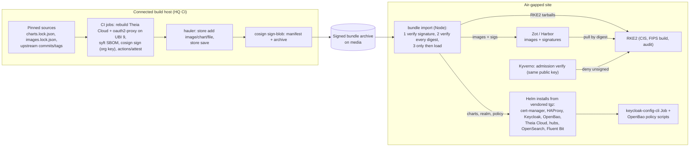

# Phase 47: On-premise deployment stack and offline bundle - Research

**Researched:** 2026-11-23
**Domain:** Kubernetes (RKE2) air-gapped platform deployment: Helm charts, Keycloak/OpenBao as code, signed offline bundle, supply-chain admission, compliance fit register
**Confidence:** MEDIUM overall. HIGH on Theia Cloud chart/operator behaviour, Keycloak WebAuthn behaviour and the checker mechanics (all read in source this session). MEDIUM on the seven picks (docs read, nothing run). LOW on the items marked `[unverified]`, each of which has a Wave 0 spike in the plan below.

**Marking (as the owner asked):** `[verified: <where>]` = read in source or official docs during this session (version/date facts come from the GitHub API on 2026-11-23). `[unverified]` = inference, training knowledge, or a third-party summary that no primary source confirmed. Nothing was installed or executed from downloaded content; every download was read as text only.

<user_constraints>
## User Constraints (from CONTEXT.md)

### Locked Decisions

### Accepted owner decisions that bind this phase (owner, 2026-11-23)
- **D-01 (owner, D2):** On-premise only, including fully air-gapped sites. Hosting, sign-in, secrets and session management never depend on the internet. Commercial cloud only for what your organization's signed policy allows (for example an approved model endpoint), never for the stack itself.
- **D-02 (owner, D3; revised 2026-11-24, owner):** The first goal is one connected HQ with about 400 concurrent people (was hundreds to thousands per site); edge sites stay disconnected and smaller, and the design still grows later. Charts are sized by per-site values; no capacity figure is stated until Phase 48 measures it. See 47-CONTEXT.md.
- **D-03 (owner, D4):** Self-hosted Eclipse Theia Cloud is the session orchestrator, one session per person (`sessionsPerUser: 1`).
- **D-04 (owner, D5):** OpenBao (MPL-2.0), never HashiCorp Vault (BUSL-1.1). One OpenBao cluster per site, no cross-site replication.
- **D-05 (owner, D6):** Sign-in by hardware security keys or device-bound passkeys only, through Keycloak WebAuthn passwordless. No password or OTP authenticator in any flow. PKI smart cards are an optional hardware flow.
- **D-06 (owner, D9):** Nothing is used until it has a passing entry (`pass` or `pass-with-conditions` with conditions written) in `compliance/resources.json` and `node scripts/resource-check.mjs` passes.
- **D-07 (owner, O2):** HAProxy Kubernetes Ingress is the ingress. ingress-nginx is never used (archived, fit `fail`). Traefik stays out until tested.
- **D-08 (owner, O3):** One shared WebAuthn relying-party ID across all sites (the owner accepted O3's default on 2026-11-23): one common parent domain of every site's host names, chosen once for your organization's deployment. `rpId` is entered in each site's install file but must be the same value at HQ and every edge site (never chosen per site); a key registered at one site works at the others because the person's credential records are copied by signed user export and import (DESIGN section 5), and import refuses a file whose `rpId` differs.
- **D-09 (owner, O4):** Recovery is administrator-attested re-enrolment that revokes old credentials and re-binds the person's OpenBao entity. No recovery codes where policy says hardware only (the default realm has none at all).
- **D-10 (owner, O5):** Pin Theia Cloud upstream at an assessed release or commit and rebuild it ourselves; fork only if a needed fix cannot land upstream. Never a `-next` pre-release.
- **D-11 (owner, O6):** Workspace volume size and idle timeout are per-site values set after the load test. Until then the chart values carry placeholders that a site must set: `requestedStorage` has no silent 250Mi default (the install check refuses an unset value), and idle values default to the design's Theia Cloud defaults (`timeout` 30 min) marked "provisional until Phase 48".
- **D-12 (owner, D1):** The Sterling image is published by digest. Every image in the bundle is referenced by digest, never by tag alone.

### Site stack and layout
- **D-13:** All deployment sources live under `deploy/`: `deploy/charts/` (vendored upstream chart tarballs, each with its source URL, version and SHA-256 in a lock file `deploy/charts/charts.lock.json`), `deploy/values/` (our values per component, with `site.example.yaml` for per-site settings), `deploy/keycloak/` (realm as code), `deploy/openbao/` (policies, auth, mounts, Transit and PKI as code), `deploy/bundle/` (bundle build, sign, import and check scripts), `deploy/images/` (Containerfiles for rebuilt third-party images), `deploy/hub/` (hub manifests), `deploy/rke2/` (RKE2 config, audit policy, registries), `deploy/runbooks/` (operator runbooks). Exact file names are the planner's; the folder split is fixed.
- **D-14:** RKE2 is the production Kubernetes: FIPS build with Canal, `profile: cis`, the DISA STIG settings applied, a Kubernetes audit policy that records Session, Workspace and AppDefinition records plus Secrets metadata, air-gap install from the bundle's RKE2 image tarball and `registries.yaml` pointing only at the site registry. k3s appears only in a lab profile, never in production values.
- **D-15:** Registry: Harbor at HQ and large sites, Zot at small edge sites. Images enter only by bundle import; signatures are checked at import and again at admission by one admission controller (the research step picks Kyverno or the sigstore policy-controller by fit, air-gap and FIPS; one only).
- **D-16:** Certificates: cert-manager with a `ClusterIssuer` of type CA whose key pair is the site's OpenBao PKI intermediate (issued under the HQ offline root). No ACME issuer exists anywhere in the rendered manifests; Theia Cloud's `letsencrypt-prod` issuer is disabled.
- **D-17:** Storage: one CSI storage class with encryption at rest is a site choice (Longhorn, Ceph or NFS). The bundle ships values for one reference class picked by the research step for fit and air-gap, and the install check refuses a storage class without encryption at rest declared. No secret is stored on a workspace volume.
- **D-18:** Postgres for Keycloak: one site-local Postgres per site, deployment method picked by the research step for fit, air-gap and image provenance (an operator such as CloudNativePG, or a plain StatefulSet on a UBI 9 Postgres image). TLS between Keycloak and Postgres; encryption at rest by the storage class.
- **D-19 (owner, 2026-11-23):** Metrics and logs: Prometheus-compatible metrics, and a log store that is **not** AGPL; Loki is not used. The research step chooses the store against the compliance fit check: a permissive or weak-copyleft licence (Apache-2.0, MIT, MPL-2.0, BSD), runs on-premise and air-gapped on RKE2, and can serve as the AU audit and log store (retention, access control, and tamper-evidence or export to a tamper-evident store). It compares at least OpenSearch (Apache-2.0) and VictoriaLogs (Apache-2.0) as the store and Fluent Bit (Apache-2.0) as the shipper, and records the choice with its fit verdict and conditions in RESEARCH.md and `compliance/resources.json`. Keycloak events, OpenBao audit, Kubernetes audit and registry audit logs go to that site-local store. Tamper-evidence of the audit sink remains gap G2 (a condition on the entry), not solved here.

### Theia Cloud (section 11 hardening list, all 12 items)
- **D-20:** Every image is mirrored into the site registry and referenced by digest: operator, service, conversion webhook, oauth2-proxy, landing page if used, wondershaper only if the bandwidth limiter is on (default off, so not bundled). `imagePullPolicy: IfNotPresent` everywhere (hardening 1).
- **D-21:** The Theia Cloud charts (`theia-cloud-base`, `theia-cloud-crds`, `theia-cloud`) are vendored as tarballs at a pinned version; no Helm repository is fetched at install (hardening 2, 11).
- **D-22:** oauth2-proxy settings: `ssl_insecure_skip_verify=false`, `cookie_secure=true`, a real client secret generated per site and held in a Kubernetes Secret written from OpenBao (never the sample `publicbutoauth2proxywantsasecret`), `pass_access_token=true`, `set_xauthrequest=true`, a pinned current release in place of v7.12.0 (hardening 4, 5). If the chart template cannot express these, we carry a patched template in our values or a small post-render patch, recorded with the reason.
- **D-23:** We rebuild, sign and SBOM the Theia Cloud operator, service and conversion webhook on UBI 9 with a FIPS-capable OpenJDK, and oauth2-proxy with the Go FIPS module (`GOFIPS140`), each from the pinned upstream source commit, in a CI workflow job, signed with your organization's key (no keyless signing), with a CycloneDX SBOM and GitHub artifact attestations (hardening 6).
- **D-24:** Persistence on (`ephemeralStorage: false`), one workspace volume per person on the encrypted storage class, size per site (D-11) (hardening 7).
- **D-25:** `sessionsPerUser: 1`; `timeout` and the activity monitor `notifyAfter` and `timeoutAfter` per site; operator eager start off and the prewarm pool at **0** until Phase 48 shows how a pooled pod gets a person's volume (hardening 8; section 7).
- **D-26:** Kubernetes audit on Session and Workspace records shipped to the site log store (hardening 9; in the RKE2 audit policy, D-14).
- **D-27:** The operator and service RBAC are reviewed for least privilege; any narrowing we apply is in our values and recorded with what upstream grants (hardening 10).
- **D-28:** Keycloak keeps emails unique and immutable for people (realm setting: duplicate emails off, email edit off for users), because session ownership is an email allowlist (hardening 12).
- **D-29:** One AppDefinition for the Sterling image, referenced by digest from Phase 46's release, with the environment Phase 46 needs (see "Interface with Phase 46"). The site's capacity limit is the AppDefinition `maxInstances`; the session start timeout is set so no session waits silently (section 7).

### Keycloak realm as code (section 6)
- **D-30:** One realm per site, as code in `deploy/keycloak/`, imported at install and re-applied on update. Version: a Keycloak 26.8.x release with CVE-2026-6856 fixed; the exact patched version is checked by the research step and pinned; if no fixed release can be confirmed, the entry is `pass-with-conditions` with "fixed version unverified" and Phase 48 closes it.
- **D-31:** Browser flow without a password step: username-less WebAuthn passwordless (or username then WebAuthn passwordless). The WebAuthn Passwordless Policy: user verification `required`, attestation conveyance `direct`, the vendor attestation roots imported into the truststore, **Acceptable AAGUIDs** set to the approved models (a site value list, empty refuses everyone), passkeys enabled only as device-bound (synced passkeys cannot attest and fail the allowlist), `rpId` from D-08. Password, OTP and recovery-code authenticators are removed from every flow and their required actions disabled.
- **D-32:** Optional X.509 smart-card flow as an alternative browser flow, off by default; when a site turns it on, revocation by a local OCSP responder or a scheduled CRL refresh (site value), and the ingress must request and forward client certificates.
- **D-33:** Enrolment: an administrator creates the person with the required action `webauthn-register-passwordless`; the action link goes through the site's own mail server, or the person enrols in person. Two registered keys are required before signing keys are usable: the realm enforces it with a second required registration, and OpenBao's jwt role only issues a token whose claims show two credentials (or, if Keycloak cannot express this as a claim, the runbook check plus a Phase 46 note; research decides which and records it).
- **D-34:** Step-up: the realm defines `acr` levels (Level of Authentication mapping) so a fresh WebAuthn ceremony yields a distinct `acr` and a new `auth_time`; `KeyService` (Phase 46) refuses signing without them. The OIDC client for oauth2-proxy allows `acr_values` and `max_age` requests.
- **D-35:** Events: login and admin events on, stored and shipped to the site log store via an event listener (syslog or JSON log) with retention set per site.
- **D-36:** Federation (section 5): when linked, the edge realm may broker HQ as an OIDC identity provider (off by default). A signed user export carries people and their WebAuthn credential records from one site to another (realm partial export omits users, so the export uses the admin REST API in our bundle scripts; research confirms the credential record fields survive import).

### OpenBao policies as code (section 6)
- **D-37:** 3-node Raft cluster per site (1 node at a small site), TLS from the site PKI, audit device on and shipped to the log store.
- **D-38:** Seal: the `kms-pkcs11` external KMS plugin (openbao-plugins v0.3.0 or newer, pinned by checksum) against the site HSM; **development and CI use SoftHSM2 through PKCS#11**, no hardware HSM required; the real HSM model is a site decision (FIPS 140-3 Level 3 in approved mode is the fit condition). Sites without an HSM use Shamir with the key ceremony runbook.
- **D-39:** Auth: `auth/jwt` bound to the site Keycloak (`oidc_discovery_url` or JWKS from the site's Keycloak, CA from the site PKI), role `sterling-workbench` with `bound_audiences` set to the oauth2-proxy client, `user_claim=sub`, short token TTL with renewal, and the Keycloak `sub` as the entity alias.
- **D-40:** Mounts and policies: KV v2 at `kv/` with a templated ACL so a person reaches only `kv/data/users/{{identity.entity.id}}/*` (and metadata); Transit at `transit/` with one non-exportable signing key and one key-encryption key per person, created at enrolment by an administrator script (names `<entity-id>-sign` and `<entity-id>-kek` unless Phase 46 states otherwise), templated ACL on `transit/sign/<own>`, `transit/datakey/wrapped/<own-kek>`, `transit/decrypt/<own-kek>`; PKI intermediate at `pki_int/` with roles for ingress TLS (cert-manager) and hub TLS; Control Groups requiring two approvers on Transit key export and import paths used for moving a person between sites.
- **D-41:** Static per-application secrets (oauth2-proxy client secret, hub key files) come from OpenBao into Kubernetes Secrets at install by our scripts (or the OpenBao CSI provider if research shows it is the leaner fit). Per-person secrets are never injected into pods; Phase 46's backend pulls them after sign-in.

### Sync hub on Kubernetes (section 4; MUS 10.1, 10.9)
- **D-42:** Each hub is its own single-replica workload with its own persistent volume (SQLite cannot be shared), several per site, each serving a set of projects (MUS 10.9: 10 projects, 150 people per hub). The design says "a Kubernetes Deployment"; a StatefulSet of one or a Deployment with `strategy: Recreate` and its own PVC both satisfy it; the planner picks one and states why.
- **D-43:** Same hardening as Compose: `runAsUser`/`runAsGroup` 65532, `runAsNonRoot`, `readOnlyRootFilesystem`, all capabilities dropped, `allowPrivilegeEscalation: false`, seccomp `RuntimeDefault`, a memory limit, an `emptyDir` `/tmp` of 16Mi, the health check `/nodejs/bin/node /app/bin.mjs --healthcheck` as liveness and readiness probe. Environment `HUB_HOST`, `HUB_PORT=8443`, `HUB_STATE_DIR=/var/lib/near-ai-hub`, `HUB_PUBLIC_ADDRESS`, and the four `*_FILE` settings pointing at a per-hub Secret mounted read-only with mode 0400 (`HUB_TLS_CERT_FILE`, `HUB_TLS_KEY_FILE`, `HUB_SIGNING_KEY_FILE`, `HUB_ENCRYPTION_KEY_FILE`). The TLS certificate is issued from the site PKI.
- **D-44:** The hub ends TLS itself (MUS 10.1): the ingress passes TCP through (HAProxy TCP mode or a `LoadBalancer`/`NodePort` Service), never terminates. Sessions reach the hub by cluster address.
- **D-45:** The hub image today is `gcr.io/distroless/nodejs26-debian13`, which fails the Protected B row for Debian bases (section 10). Its fit entry is recorded as `pass-with-conditions` with the condition "Protected B needs a UBI 9 base with the OpenSSL FIPS provider on a FIPS host; rebase coordinated with Phase 46 (P11, one Node major)". Phase 47 does not change `hub/Dockerfile`; it consumes whatever image the release publishes, by digest.
- **D-46:** `relay/compose.yaml` keeps working unchanged for single-machine and small installs; the Kubernetes manifests are an addition, not a replacement.

### Offline bundle (sections 5, 8)
- **D-47:** One bundle format for first install and every update: an OCI image layout holding every image (by digest), the vendored chart tarballs, the RKE2 air-gap artifacts, the realm and policy files, the plugin binaries (`kms-pkcs11`), and a manifest listing each item with its digest. The bundle is signed with your organization's key (cosign with a key pair, or our own signature; no keyless signing, which needs the internet). Copy tools (`oras` or `skopeo`) and the signer each get a fit entry; the research step picks the smallest set.
- **D-48:** Import refuses a bundle whose signature or any item digest does not verify, before anything reaches the registry or the cluster. The same check runs at admission (D-15).
- **D-49:** The same signed-file mechanism carries revocation lists, the signed Keycloak user export (D-36) and the PKI intermediate certificate between HQ and edge.

### PKI and federation (section 5)
- **D-50:** HQ holds an offline root CA kept off the network (created in a key ceremony, on an HSM or offline machine). Each site's OpenBao PKI intermediate is signed by that root offline and carried by signed file. No shared database between sites, ever.

### Compliance fit (section 10, D9)
- **D-51:** Every new component, image, chart and build tool gets an entry in `compliance/resources.json` with the section 10 verdict and conditions, and `node scripts/resource-check.mjs` passes. Components covered: RKE2, Harbor, Zot, the admission controller, HAProxy Kubernetes Ingress, cert-manager, Keycloak, Postgres, Theia Cloud operator/service/webhook, oauth2-proxy, OpenBao, the `kms-pkcs11` plugin, SoftHSM2 (test scope only), the storage class, the metrics and log stores, UBI 9 bases, the bundle tools, the sync hub image (re-assessed for Kubernetes, D-45). ingress-nginx, k3s in production and Debian/Alpine bases at Protected B are recorded as decisions in conditions, not adopted.
- **D-52:** The checker today discovers images only in `hub/Dockerfile`, `relay/Dockerfile` and `relay/compose.yaml`, and its schema allows only the kinds `npm`, `image`, `action`, `vendored`. One plan extends `scripts/resource-check.mjs` and `compliance/schemas/resources.schema.json` with a `chart` kind (id prefix `chart:`) discovered from `deploy/charts/charts.lock.json`, and discovers images from `deploy/` (values files' digest-pinned image references and `deploy/images/*/Containerfile` `FROM` lines), failing on any unpinned image there. **The register and the checker are gate files: this plan needs the owner's gate approval before merge.**
- **D-53:** The component id for new entries is a new value per area (for example `deploy-platform`, `deploy-identity`, `deploy-sessions`, `deploy-secrets`); because the checker validates component ids against `compliance/components/*.json`, the plan either reuses an existing component id where honest (`hub` for the hub) or adds minimal component files only if the checker requires them. OSCAL component content and evidence rules are Phase 48, not here.

### Runbooks (section 8)
- **D-54:** Runbooks under `deploy/runbooks/`: site install from the bundle (air-gapped), bundle update, key ceremony (HQ offline root, site intermediate, HSM initialisation or Shamir unseal with key custodians), person enrolment (two keys), administrator-attested re-enrolment and recovery (revoke credentials, re-bind entity, rotate or re-wrap Transit keys), moving a person between sites (Control Group approval), backup and restore (RKE2 etcd snapshots, OpenBao Raft snapshots, Keycloak Postgres backups, workspace volume snapshots, hub SQLite and blob folder per MUS 10.9), and the session states operators see (section 7). Plain words, "your organization", Sterling naming.

### Verification
- **D-55:** A lab end-to-end install on an air-gapped test cluster (no egress route; an egress-deny NetworkPolicy plus a check of the egress logs) from the signed bundle proves success criterion 1. CI can only render and statically check; the full install is a documented, repeatable lab script that runs under the project's memory caps (`systemd-run` MemoryMax, `choom`, `timeout`). The end-to-end sign-in and session run uses Phase 46's image when it is available; until then a placeholder image proves the stack, and the plan records that the Phase 46 run is pending.
- **D-56:** Static checks in CI: render every chart with our values offline (no repository fetch) and assert the hardening invariants on the rendered output (no ACME issuer, no `ingress-nginx`, no image without a digest, no `imagePullPolicy: Always`, oauth2-proxy flags as D-22, `sessionsPerUser: 1`, persistence on, prewarm 0, no password or OTP authenticator in the realm, OpenBao ACLs templated). Tests are added only for these invariants and for the extended resource checker; no tests restate schemas.

### Claude's Discretion

- Exact file names under `deploy/`, script language (Node scripts in the repository's style preferred, no new runtime), and how plans split the work into waves.
- Which of Kyverno or the sigstore policy-controller, which Postgres method, which reference storage class, which non-AGPL log store and shipper (within D-19's criteria), which bundle copy tool: decided by the research step on fit, air-gap, FIPS and footprint, one each, recorded in RESEARCH.md.

### Deferred Ideas (OUT OF SCOPE)

- Traefik ingress (until tested; Phase 48 verifies).
- Prewarm pool above 0 (until Phase 48 shows volume attach at claim).
- Hub-to-hub live federation (L5).
- Own session broker or a Theia Cloud fork (only if pinning upstream fails, O5).
- Per-session ServiceAccount with `auth/kubernetes` as defence in depth (needs an operator extension; not in the design's must list).
- OSCAL components, evidence rules, load test, capacity figures (Phase 48).

### Scope Fence (from CONTEXT.md)

- No change under `src/`, `media/`, `hub/src/`, `relay/src/` or the Theia extension package (Phase 46 and later).
- No change to `hub/Dockerfile` or `relay/compose.yaml` (D-45, D-46).
- No internet fetch at install or in CI render checks; build-time fetches happen only in the connected bundle build.
- No Loki or other AGPL log store, no ingress-nginx, no HashiCorp Vault, no k3s in production values, no ACME, no password or OTP authenticator.
</user_constraints>

<phase_requirements>
## Phase Requirements

| ID | Description (from 47-CONTEXT.md "Specific Ideas") | Research Support |
|----|---------------------------------------------------|------------------|
| DEP-01 | Signed offline bundle: build, sign, import with refusal on any bad signature or digest; one format for install and update | Decision 5 (cosign + hauler), "Bundle pipeline", Pitfalls 8, 16 |
| DEP-02 | Site base: RKE2 (FIPS, CIS profile, STIG, audit policy) and the site registry (Zot/Harbor) with signature checks at import and admission | "RKE2 answers", Decision 1 (Kyverno), Decision 8 (registry order), Pitfalls 1, 8, 12, 13 |
| DEP-03 | Ingress and certificates: HAProxy, cert-manager, no ACME, TCP passthrough for the hub | "Certificate model" (D-16 divergence), Decision 9 (NodePort for hub), Pitfall 9 |
| DEP-04 | Keycloak realm as code and its Postgres | "Keycloak answers", Decisions 2 and 10, Pitfalls 6, 7, 15 |
| DEP-05 | OpenBao: Raft, PKCS#11 seal, jwt auth, templated ACLs, PKI, Control Groups, audit | "OpenBao answers", Decision 6, Pitfall 14 |
| DEP-06 | Theia Cloud values and AppDefinition for the Sterling image | "Theia Cloud answers", Pitfalls 1 to 5 |
| DEP-07 | Rebuilt Theia Cloud and oauth2-proxy images, signed, SBOM, attestations | "Rebuilt images", Decision 11 (pin 1.2.0) |
| DEP-08 | Sync hub on Kubernetes | Decision 7 (StatefulSet of one), Decision 9 (NodePort) |
| DEP-09 | HQ and edge federation by signed file | "Bundle pipeline" (same signed-file mechanism), "Keycloak answers" (user export) |
| DEP-10 | Compliance fit entries and checker extension (gate files) | "Resource checker answers", "Fit table" |
| DEP-11 | Runbooks | "Install order", "Pitfalls" (each pitfall names the runbook it belongs to) |
| DEP-12 | CI render-and-assert plus an air-gapped lab install | "CI render answers", "Lab cluster", Validation Architecture |
</phase_requirements>

## Summary

Phase 47 is almost entirely integration work, and the research found six things that change how it must be planned.

1. **Theia Cloud's chart cannot express the hardening the owner wants, but the operator can be made to.** The chart hard-codes `ssl_insecure_skip_verify=true` and `cookie_secure="false"` in the `oauth2-proxy-config` ConfigMap and writes the client and cookie secrets into that ConfigMap as plain text; `demoApplication` is the only AppDefinition it can render and it hard-codes `maxInstances: 10`, `uid: 101`, `port: 3000`. The operator's built-in pod template (`templateDeployment.yaml`) has no `securityContext` on the oauth2-proxy sidecar or the Theia container and hard-codes `imagePullPolicy: Always`, which the RKE2 `profile: cis` Pod Security Admission (restricted) would **reject outright**. The upstream-documented override is to copy a customised `templateDeployment.yaml` into `/templates/` of a rebuilt operator image. We rebuild the operator anyway (D-23), so one custom template fixes the pull policy, the security context, the CA mount, the secret mount and the site environment. A small carried patch to one chart template fixes the oauth2 ConfigMap. No fork is needed.
2. **AppDefinitions have no environment field.** Environment variables exist only on the Session (`envVars`, `envVarsFromConfigMaps`, `envVarsFromSecrets`) and arrive in the launch request body, which any signed-in person can call. D-29's "AppDefinition with the environment Phase 46 needs" cannot be done as written; site environment must go in through the custom pod template (`envFrom` a site ConfigMap), and a Kyverno policy must stop a person naming Secrets in `env.fromSecrets`.
3. **Keycloak 26.8.2's source already contains the self-attestation fix** that CVE-2026-6856 describes (self-attestation is refused whenever an AAGUID allowlist is set, and `none` attestation is refused), but no advisory names the fixed release, so the fit entry stays `pass-with-conditions` with "fixed version unverified" as D-30 requires. An **empty** AAGUID list means "accept everything and allow self-attestation", so D-31's "empty refuses everyone" must be enforced by our own apply script.
4. **The D-16 certificate wording does not survive contact with the bootstrap order.** A cert-manager `CA` issuer needs the intermediate's private key in a Kubernetes Secret, and OpenBao needs its own TLS before its PKI exists. Recommended: a short-lived bootstrap CA issuer for OpenBao only, then a cert-manager `Vault`-type issuer pointed at OpenBao (`pki_int`) for everything else. Keys never leave OpenBao. This is flagged for the owner.
5. **Two registers' worth of mechanism are missing from the checker.** The checker cannot see charts, deploy images or CI tools, entries for things it cannot see are reported as stale, and `component` must name a file in `compliance/components/`. The lean fix is two lock files (`charts.lock.json`, `images.lock.json`) plus tool pins, one new `deployment` component file copied from the `appliance.json` pattern, and **one integration PR** for every gate file (register, checker, components, workflow jobs, `scripts/test/`).
6. **The "UBI 9 Postgres image" does not exist** (`registry.access.redhat.com/ubi9/postgresql-16` returns "Repo not found"); the Red Hat Postgres images are `rhel9/postgresql-NN` on `registry.redhat.io`, behind a Red Hat account and terms acceptance. The UBI 9 AppStream package is reported to be PostgreSQL 13 (end of life). The Postgres image therefore needs a Wave 0 spike.

**Primary recommendation:** Build everything under `deploy/` as vendored upstream charts + two small local charts (`sterling-site`, `sterling-hub`), a patched-and-repackaged Theia Cloud chart, one custom operator pod template, a Node bundle/verify toolchain (cosign + hauler + helm as the only new binaries), and land all gate files in a single early integration PR so every later plan is gate-free.

## Decisions for the planner

Each is final unless the owner objects. "Fit" is the verdict to write into `compliance/resources.json`; conditions are written so they can be pasted.

### Decision 1: Admission signature check = **Kyverno 1.20.x** (not the sigstore policy-controller)

| Criterion | Kyverno v1.20.0 (2026-11-12) | sigstore policy-controller v0.15.1 (2026-03-26) |
|---|---|---|
| Licence | Apache-2.0 [verified: GitHub API] | API reports `NOASSERTION` [verified: GitHub API]; LICENSE not read |
| Maintenance | 8.4k stars, pushed 2026-11-23 | 183 stars, last release 8 months ago |
| Static-key, no-Rekor verification | `ImageValidatingPolicy` with `attestors[].cosign.key.data`, `ctlog.insecureIgnoreTlog` [verified: kyverno.io IVP page, via fetch] | Key authorities with PEM/secretRef/KMS; Rekor optional for keys [unverified: search summary only] |
| Air-gap | Works with a static public key and signatures stored in the site registry; no outbound call needed for key mode [unverified: IVP page silent on offline; third-party source says key mode is the only fully offline mode] | Same, plus a fall-back to public Sigstore when no policy matches [verified: search summary of Red Hat/Sigstore docs] which is an outbound call to guard against |
| FIPS | Go binary, no FIPS build documented [unverified] | Same [unverified] |
| Footprint | Admission controller is mandatory; background, reports and cleanup controllers can probably be disabled [unverified] | One webhook deployment |
| Extra value | Same engine carries our "no secret env in session pods" policy (Pitfall 3) | Verify-only |

**Use:** `ImageValidatingPolicy` (`policies.kyverno.io/v1`), `validationActions: [Deny]`, key from the organization's cosign public key, `ctlog.insecureIgnoreTlog: true`, `matchImageReferences` globbed to the site registry. The older `ClusterPolicy.verifyImages` is deprecated from 1.18 per a third-party 2026 troubleshooting guide [unverified]; do not use it.
**Fit:** `pass-with-conditions`. **Conditions:** signatures (cosign `.sig` tags or OCI referrers) must be copied into the site registry with the images (Pitfall 16); Go crypto is not FIPS-validated unless rebuilt with `GOFIPS140` (gap, Phase 48); policy fails closed (`failurePolicy: Fail`) with `kube-system` and Kyverno's own namespace excluded; `ctlog.insecureIgnoreTlog` field semantics confirmed in the Wave 0 lab spike.

### Decision 2: Postgres for Keycloak = **plain StatefulSet (1 replica) on an image we build on UBI 9**; not CloudNativePG; never Bitnami

- **Bitnami is out.** Broadcom moved most of the catalogue to a paid "Secure Images" tier and legacy images to `docker.io/bitnamilegacy`, which "will no longer receive any updates" [verified: search results from Broadcom, Docker and heise coverage; the effective date is reported as 2025-08-28 or 2025-09-29 by different sources, immaterial here].
- **CloudNativePG v1.30.2** (Apache-2.0, 2026-11-17) is a fine operator but adds an operator pod and CRDs, and its operand images are Debian-based [unverified], which fails the D-45/D-51 "Debian base at Protected B" row. It also buys HA that one Keycloak per site mostly does not need. Keep as the HQ-scale follow-up if Phase 48 shows Keycloak availability is the limit.
- **The image is the real problem.** `registry.access.redhat.com/ubi9/postgresql-16` is **not found**; `rhel9/postgresql-16` exists but "requires terms acceptance and is only available on registry.redhat.io" and then wants Customer Portal credentials [verified: `podman search` errors this session]. A Red Hat Jira ticket reports the UBI 9 AppStream package is PostgreSQL 13.x, end of life [verified: search result text; ticket not opened].
- **Wave 0 spike (blocks the Postgres plan):** build `deploy/images/postgres/Containerfile` `FROM registry.access.redhat.com/ubi9/ubi-minimal@sha256:...` (that repository exists [verified: `podman search` lists tags]) and try, in order: (a) PostgreSQL 16+ from the PGDG EL9 RPM repository with RPM signature check [unverified that PGDG installs cleanly on UBI]; (b) the `rhel9/postgresql-16` image from `registry.redhat.io` with a Red Hat registry account, which needs the owner's decision on whether those images may be redistributed inside the bundle [unverified]. Default if (a) works: (a).
- **Shape:** StatefulSet, one PVC on the encrypted class, TLS from the site issuer (`ssl=on`, Keycloak `sslmode=verify-full`), liveness `pg_isready`, nightly `pg_dump` CronJob to a second PVC plus volume snapshots. Single point of failure, recorded as a condition.
**Fit:** `pass-with-conditions`. **Conditions:** image built by us on UBI 9 from signed RPMs and signed by our key; host in FIPS mode for the RHEL OpenSSL provider; no replica, restore by snapshot or dump; holds only WebAuthn public credentials and user records (no passwords by design).

### Decision 3: Reference CSI storage class = **Longhorn 1.13.0** with LUKS encryption

- Apache-2.0, v1.13.0 (2026-09-29) [verified: GitHub API]. Encryption is dm-crypt/LUKS: StorageClass parameter `encrypted: "true"` plus `csi.storage.k8s.io/node-{stage,publish,expand}-secret-name/-namespace`; the passphrase is `CRYPTO_KEY_VALUE` in a Secret; per-volume secrets are possible through `${pvc.name}` / `${pvc.namespace}` templating; backups of encrypted volumes are encrypted; in FIPS mode set `CRYPTO_PBKDF_FORCE_ITERATIONS` explicitly [verified: longhorn.io volume-encryption page, via fetch]. RWO block volumes fit Theia's per-person PVC.
- Prerequisites on every node: `dm_crypt` module and `cryptsetup` [verified]; also `open-iscsi` and NFS client tools for backup targets [unverified: from training; the Longhorn air-gap page returned 404]. In an air-gapped site these are host packages the site must have in its own OS repository (Pitfall 12).
- Longhorn needs privileged pods, so `longhorn-system` must be exempted in the RKE2 PSA configuration (Pitfall 1).
- Per-person volume keys would need a Secret per PVC created before binding; the Theia Cloud operator creates the PVC, so use **one class-level secret** and record it as a condition (the key sits in a Kubernetes Secret, protected by RKE2 secrets encryption).
- **Install check refuses** any class that does not carry `encrypted: "true"` (Longhorn) or a site value `storage.encryptionAtRest: "<how>"` for Ceph or NFS (D-17).
- Alternatives rejected: Rook-Ceph (many components, too heavy for a reference class), local-path (node-bound, no encryption), NFS (site-provided, encryption is the array's).
**Fit:** `pass-with-conditions`. **Conditions:** key in a Kubernetes Secret and RKE2 `secrets-encryption` on; Longhorn images are not rebuilt by us (Protected B base-image row open); host packages from the site's own repository; no secret stored on workspace volumes (D-17).

### Decision 4: Log store = **OpenSearch 3.10.0 (Apache-2.0) with Fluent Bit v5.2.0 (Apache-2.0)**; VictoriaLogs rejected

| Owner criterion (D-19) | OpenSearch | VictoriaLogs v1.54.0 |
|---|---|---|
| Licence | Apache-2.0 (core, security plugin, helm chart) [verified: GitHub API] | Apache-2.0 [verified: GitHub API] |
| On-prem, air-gapped on RKE2 | Helm chart `opensearch-3.10.0` in the project's helm-charts repo; JVM; no phone-home known [unverified] | Single binary, very small [unverified] |
| Retention | Index State Management policies [unverified: training; not read] | `-retentionPeriod` flag [unverified] |
| **Access control** | Security plugin: TLS, roles, role mapping, audit logging of access to the store [unverified: training; docs for FIPS config were found, RBAC page not read] | No built-in roles; access control is a proxy (`vmauth`: basic, bearer, JWT); client-certificate routing and IP filters are **enterprise** features [verified: search summary of docs.victoriametrics.com security and vmauth pages] |
| FIPS path | Documented FIPS configuration with BC-FJA, BCFKS keystores, JDK 11/17/21 for 3.2+ [verified: docs.opensearch.org FIPS pages 3.5 to 3.8, via search] | None found |
| Tamper-evidence | None native; export to a write-once target | None native |
| Footprint | Heavy (JVM; single node at a small site, 2 to 4 GiB heap [unverified estimate]) | Light |

**Use:** OpenSearch single node at small sites, three data nodes at large ones; Fluent Bit as a DaemonSet on workers (container logs, Keycloak JSON events via `--log-console-output=json`, OpenBao audit device to stdout, hub/registry logs) and a tail input on control-plane nodes for `/var/lib/rancher/rke2/server/logs/audit.log` (the path RKE2 documents) [verified: docs.rke2.io hardening guide]. Output plugin `opensearch` with TLS and a role limited to write-only on `audit-*` indices. No OpenSearch Dashboards in Phase 47 (a second JVM; reviewers query the API) unless the owner asks.
**Fit:** OpenSearch `pass-with-conditions`; Fluent Bit `pass-with-conditions`. **Conditions (OpenSearch):** FIPS mode needs BC-FJA and BCFKS keystores and is not enabled in Phase 47 (condition, Phase 48); audit indices are append-only by role and exported daily to a write-once target with a signed digest manifest (this is gap G2, **not solved here**); access limited to a named auditor role; image is not UBI-based (rebuild is a follow-up). **Conditions (Fluent Bit):** C binary and upstream image are not UBI/FIPS-validated; ships only to the site store; no outbound output configured.
**Metrics:** Prometheus v3.16.0 through the `prometheus-community/prometheus` chart (prometheus-30.0.0; server, kube-state-metrics, node-exporter; alertmanager off) [verified: GitHub API for versions; chart contents not read]. Needed by Phase 48's load test. Needs its own fit entries (Prometheus, kube-state-metrics, node-exporter).

### Decision 5: Bundle tooling = **cosign v3.1.4 (key pair, no keyless) + hauler v2.1.2 + helm**; fall back to oras if the spike fails

| Tool | Role | Why |
|---|---|---|
| cosign v3.1.4 (2026-10-20, Apache-2.0) | Sign images (registry), sign the bundle manifest and archive (`sign-blob --key`), verify at import; its public key is what Kyverno trusts | Key-based mode is the only fully offline mode [verified: search summaries of Sigstore guidance]; one signer for images and files |
| hauler v2.1.2 (2026-10-13, Apache-2.0, Rancher Government Solutions) | Fetch images, charts and files into one OCI-based store, `save` to one archive, `load` and push into the site registry | One tool covers images, charts and files (the RKE2 tarball, plugin binary, realm and policy files); validates cosign signatures before saving; keeps signatures, attestations and SBOMs [verified: docs.hauler.dev intro, via fetch]; the RKE2 air-gap page itself documents a Hauler path [verified: docs.rke2.io air-gap page] |
| helm v4.3.2 (2026-11-13, Apache-2.0) | `helm template` for CI and `helm upgrade --install` from vendored tarballs at the site | Needed regardless |

- **oras v1.4.0** (Apache-2.0) is the fallback: `oras copy -r --to-oci-layout` carries referrers. **skopeo** is rejected: an RPM install on every site and a GPG-centred signing model.
- **Spike (Wave 0, lab or connected host, blocks the bundle plan):** with cosign 3.1.4 confirm `cosign generate-key-pair`, `cosign sign --key ... --tlog-upload=false`, `cosign verify --key ... --insecure-ignore-tlog` against Zot, and `sign-blob`/`verify-blob` for the manifest; with hauler 2.1.2 confirm `store add image|chart|file`, `store save`, `store load`, `store copy registry://...` with no network, digest preservation and that cosign signature artifacts reach the registry. cosign v3 changed defaults (bundles, signing config) so exact flags must be proven on the pinned version [verified: search summaries; flags unverified].
- The import host is bootstrapped from install media that carries the cosign and hauler binaries and the organization's public key out of band. The bundle also carries them, but trust starts from the media (runbook item).
- `compliance/ci/install-tool.sh` already installs pinned, hash-checked binaries (`syft`, `grype`, `oscal-cli`) from `tool-pins.json` and allows only `repo1.maven.org` and `github.com`; helm is served from `get.helm.sh` [unverified], so the host allow-list needs one more host or a mirrored GitHub asset. [verified: compliance/ci/install-tool.sh lines 22-27]

### Decision 6: Static application secrets = **our install script** (Node, `node:https` with the site CA), not the OpenBao CSI provider

The CSI route needs the Secrets Store CSI driver (separate project, v1.6.2 [verified: GitHub API]), the OpenBao CSI provider (v2.0.3), a `SecretProviderClass` per workload, and per-pod Kubernetes auth. That is three moving parts for roughly five secrets (oauth2-proxy client secret, cookie secret, per-hub key files, Keycloak admin bootstrap, Postgres password). Script: logs in with a short-lived operator token produced at the key ceremony, reads `kv/apps/*`, writes Kubernetes Secrets with `kubectl apply`; re-run to rotate. Hub key files come from the hub's own `--generate-key signing|encryption` (existing, per `relay/compose.yaml` comments) and are written to OpenBao first, then to the per-hub Secret. Secrets reach etcd, so RKE2 `secrets-encryption` must be on (it is a CIS expectation) and the k8s audit policy must record Secrets at `Metadata` only. **Fit:** no new component.

### Decision 7: Hub workload = **StatefulSet of one replica** with a `volumeClaimTemplate`

SQLite in WAL mode must never be opened by two pods. A StatefulSet gives at-most-one semantics (a lost node does not start a replacement until the old pod is confirmed gone), a stable identity and a per-hub PVC; a Deployment with `Recreate` is correct on rollout but can start a second writer after a node failure when the volume can attach elsewhere. One Helm release of a small local chart `deploy/charts/sterling-hub` per hub (name, volume size, public address, project set). Security context, probes, env and secret files exactly as D-43; `Service` of type `ClusterIP` for sessions plus the NodePort of Decision 9.

### Decision 8: Registry order = **Zot first, Harbor as a second wave**

Zot (v2.1.23, Apache-2.0) is one Go binary and serves the lab and small sites; Harbor v2.15.5 (Apache-2.0) is about eight components plus Postgres and Redis (its own fit work). Plan Zot, the install order and the bundle import against Zot first; Harbor reuses the same import script with a different target. Both get fit entries. Registry bootstrap is a chicken-and-egg problem (Pitfall 8): the registry's own image must be loaded into containerd from a tarball in `/var/lib/rancher/rke2/agent/images/` before anything can be pulled from it.

### Decision 9: Hub exposure = **one NodePort Service per hub** (TCP passthrough with no extra component)

D-44 allows HAProxy TCP mode or `NodePort`/`LoadBalancer`. RKE2 ships no load balancer; a NodePort is core Kubernetes and the hub terminates TLS itself, so nothing can accidentally terminate it. Per-hub values carry the node port; the site's DNS points `HUB_PUBLIC_ADDRESS` at the nodes. HAProxy's TCP services ConfigMap is the alternative [unverified: the HAProxy documentation page returned 404; mechanism known from training only].

### Decision 10: Keycloak deployment and realm applier

- **Chart:** `codecentric/keycloakx` 7.4.0 (Apache-2.0, 2026-10-14, appVersion 26.8.1) vendored, with `image` overridden to the official `quay.io/keycloak/keycloak:26.8.2@sha256:...`. It is a StatefulSet, exposes `extraEnv`, `extraEnvFrom`, `extraVolumes`, `command`, `args`, `database`, `proxy`, `http`, `dbchecker` [verified: values.yaml top-level keys read]. Disable `dbchecker` (its busybox image is one more image to mirror) and use Keycloak's own readiness. The official image is `ubi9-micro` with `java-21-openjdk-headless` [verified: quarkus/container/Dockerfile at 26.8.2], so the UBI 9 base row is met; FIPS (BC-FIPS jars, `--features=fips`, `--fips-mode=strict`, OpenJDK 21) is a **condition**, not delivered in Phase 47 (the Keycloak `FIPS` feature is `DISABLED_BY_DEFAULT` and labelled "FIPS 140-2 mode" [verified: Profile.java line 125]). Not Bitnami; not the Keycloak Operator (its `KeycloakRealmImport` imports only once).
- **Realm applier:** **keycloak-config-cli v6.5.1** (Apache-2.0, 2026-05-22) as a Kubernetes Job run by the install script on install and on every update. It supports the latest four Keycloak releases [verified: its README], takes the realm JSON (flows included) and makes it idempotent, which is the whole requirement ("imported at install and re-applied on update", D-30). A Node script over the admin REST API would have to implement flow diffing (flows, executions, configs are separate endpoints), which is the same class of heuristic the owner already told us to avoid. First install can still use `kc.sh --import-realm` for the empty realm, but one applier for both keeps one path. The Job image must be mirrored and gets a fit entry (`pass-with-conditions`: JVM image not UBI, holds an admin credential only for the duration of the Job, no inbound port).

### Decision 11: Theia Cloud pin = **source tag 1.2.0 (2026-04-09) and chart tag `theia-cloud-1.2.0`**

Both `1.2.0` charts and the main branch charts render the same AppDefinition and the same oauth2 ConfigMap logic [verified: diff of `theia-appdefinition-spec.yaml`, `oauth2-configmap-oauth2proxy-keycloak.yaml` and values at tag `theia-cloud-1.2.0` against main]. The only value missing in 1.2.0 is `operator.oAuth2ProxyImage`, which we do not need because our custom pod template carries the digest-pinned oauth2-proxy reference directly. `main` is `1.3.0-next.3` and has moved weekly (last commits 2026-11-20); adopting a main commit means reviewing a moving target, and the owner decision O5 prefers an assessed release. If a post-April fix is needed, assess one commit then. **Owner to confirm (E1).**

### Decision 12: Certificate model (deliberate divergence from D-16's wording)

D-16 says "ClusterIssuer of type CA whose key pair is the site's OpenBao PKI intermediate". That needs the intermediate's **private key exported into a Kubernetes Secret**, and OpenBao cannot be running (needing TLS) before its PKI exists. Recommended:

1. `site-bootstrap-ca`: cert-manager `selfSigned` then a `CA` issuer, 90-day, used **only** for OpenBao's listener and Raft TLS and for the first Keycloak/OpenBao trust at install.
2. After init, unseal and the offline root signing the site intermediate into `pki_int/`, create `ClusterIssuer site-pki` of type **`vault`** (cert-manager's Vault issuer posts CSRs to `pki_int/sign/<role>`; the private key stays in the cluster only for the leaf and the intermediate's key stays in OpenBao) with `auth.kubernetes` and a role bound to the cert-manager ServiceAccount. A community demo shows OpenBao working with it, but no OpenBao document confirms compatibility [verified: search results; compatibility unverified, test in the lab spike].
3. Re-issue OpenBao's own listener certificate from `pki_int`, switch `BAO_CACERT` to the site chain, retire the bootstrap CA.
4. Theia Cloud: `issuerca.enable=false`, `issuerprod.enable=false` in `theia-cloud-base` (that removes both the self-signed CA and the `letsencrypt-prod` ACME issuer) and `ingress.clusterIssuer: site-pki` [verified: theia-cloud-base values and templates].

If the owner prefers the literal D-16 shape, the cost is exporting `pki_int`'s key (OpenBao `exported` intermediate) and a standing Kubernetes Secret holding a CA key. **Owner to confirm (E2).**

## Architectural Responsibility Map

| Capability | Primary Tier | Secondary Tier | Rationale |
|------------|-------------|----------------|-----------|
| TLS termination for sessions, Keycloak, registry | Ingress (HAProxy, in cluster) | cert-manager | Certs from the site issuer; ACME banned |
| TLS for the hub | Hub process (in pod) | NodePort Service | MUS 10.1: the hub ends TLS itself; ingress must not terminate |
| Sign-in (WebAuthn ceremony) | Keycloak | oauth2-proxy sidecar | Ceremony happens on Keycloak pages; sidecar only does the OIDC code flow |
| Session ownership check | oauth2-proxy sidecar (per-session email allowlist) | Keycloak (unique immutable emails) | Theia Cloud design |
| Per-person secrets and signing keys | OpenBao (KV v2, Transit) | Phase 46 backend (pulls after sign-in) | Never injected into pods (D-41) |
| Static app secrets | Install script to Kubernetes Secrets | OpenBao KV | Decision 6 |
| Image trust | Import-time verify (bundle script) | Admission-time verify (Kyverno) | Two checks, one key (D-48) |
| Capacity limit and refusal | Theia Cloud (`maxInstances`) | Landing page text | Message text is not a chart value |
| Workspace persistence and encryption | CSI class (Longhorn) | RKE2 secrets encryption | Volume holds no secrets |
| Audit and logs | Fluent Bit to OpenSearch | RKE2 audit policy, Keycloak events, OpenBao audit | G2 (tamper-evidence) stays open |
| Realm and policy as code | `deploy/` in git, applied by install scripts | keycloak-config-cli Job, OpenBao policy scripts | Re-apply on update |

## Standard Stack

### Core (all versions and dates read from the GitHub API on 2026-11-23 unless noted)

| Component | Version | Purpose | Notes |
|-----------|---------|---------|-------|
| RKE2 | v1.37.2+rke2r1 (2026-11-05) | Kubernetes | Apache-2.0; FIPS comes from the build (GoBoring) [verified: SUSE FIPS page]; `profile: cis`; `ingress-controller: none` [verified: docs.rke2.io server config] |
| Zot | v2.1.23 (2026-11-02) | Site registry (small sites, lab) | Apache-2.0 |
| Harbor | v2.15.5 (2026-11-12) | Site registry (HQ, large) | Apache-2.0, second wave |
| HAProxy Kubernetes Ingress | v3.4.1 (2026-11-19) | Ingress | Apache-2.0 controller; bundles HAProxy (GPL-2.0, unmodified separate container) [unverified licence detail]; chart version to be pinned in the lock file |
| cert-manager | v1.21.3 (2026-10-23) | Certificates | Apache-2.0 |
| Kyverno | v1.20.0 (2026-11-12) | Admission signature check + session-env policy | Decision 1 |
| Keycloak | 26.8.2 (2026-11-05) | Sign-in | Apache-2.0; chart codecentric keycloakx 7.4.0 |
| keycloak-config-cli | v6.5.1 (2026-05-22) | Realm as code applier | Decision 10 |
| PostgreSQL | 16+ (built by us) | Keycloak DB | Decision 2 |
| Theia Cloud | 1.2.0 (2026-04-09), chart `theia-cloud-1.2.0` | Sessions | EPL-2.0; operator, service, conversion webhook, landing page rebuilt by us |
| oauth2-proxy | v7.15.6 (2026-11-05) | Session sidecar | MIT; rebuilt with Go FIPS module |
| OpenBao | v2.7.3 (2026-11-19); chart openbao-0.30.8 (appVersion v2.7.3) | Secrets, PKI, Transit | MPL-2.0 |
| kms-pkcs11 plugin | v0.3.0 (2026-11-03) | HSM auto-unseal | MPL-2.0; release assets: `openbao-plugin-kms-pkcs11_linux_amd64_v1.tar.gz` (+ `.sig`, `.spdx.sbom.json`), `checksums-kms-pkcs11.txt` [verified: release API] |
| SoftHSM2 | 2.7.0 (2026-01-20) | Dev/CI/lab PKCS#11 token (test scope only) | BSD-2-Clause [unverified: API reports NOASSERTION] |
| Longhorn | v1.13.0 (2026-09-29) | Reference CSI | Decision 3 |
| OpenSearch / Fluent Bit / Prometheus | 3.10.0 / v5.2.0 / v3.16.0 | Logs and metrics | Decision 4 |
| cosign / hauler / helm | v3.1.4 / v2.1.2 / v4.3.2 | Bundle tooling | Decision 5 |
| Sterling hub | existing `hub/Dockerfile` image, by digest | Sync | Not changed (D-45, D-46) |

### Supporting

| Item | Purpose | When |
|------|---------|------|
| UBI 9 bases (`ubi9/ubi-minimal`, `ubi9/openjdk-21`, `ubi9/openjdk-21-runtime`, `ubi9/go-toolset`, `ubi9/nginx-126`) | Bases for rebuilt images | All repositories exist [verified: `podman search --list-tags` this session; `go-toolset` Go version unverified, needs 1.24+ for `GOFIPS140`; if older, use a pinned Go build stage and a UBI runtime stage] |
| kubeconform v0.8.0 | Schema-check rendered manifests | **Not recommended** (see CI answers); needs vendored CRD schemas |
| Node 24 built-ins | All deploy scripts and tests | No new runtime (CONTEXT discretion) |

### Alternatives considered

| Instead of | Could use | Tradeoff |
|------------|-----------|----------|
| Kyverno | sigstore policy-controller | Smaller, but less active and licence metadata unclear; no home for our extra policy |
| Plain Postgres | CloudNativePG | HA and PITR, but operator plus Debian operand images |
| Longhorn | Rook-Ceph, NFS, local-path | Heavier / site-provided / no encryption |
| OpenSearch | VictoriaLogs | Far lighter, but no RBAC without enterprise features |
| hauler | oras (+ helm pull + scripts) | Three tools instead of one; CNCF project with larger community |
| keycloak-config-cli | Node over admin REST | No extra image, but we own flow diffing |
| StatefulSet hub | Deployment `Recreate` | Looser at-most-one guarantee on node failure |

**Installation (connected bundle-build host only; nothing is installed at a site except through the bundle):**
```bash
# pinned, hash-checked, never piped into a shell; extend compliance/ci/tool-pins.json then:
sh compliance/ci/install-tool.sh helm   compliance/out/tools
sh compliance/ci/install-tool.sh cosign compliance/out/tools
sh compliance/ci/install-tool.sh hauler compliance/out/tools
```
**Version verification:** versions above were read from `api.github.com` (`releases/latest`) on 2026-11-23; chart versions for HAProxy, cert-manager, Kyverno, Longhorn, Harbor, Zot, OpenSearch, Fluent Bit are to be pinned and hashed in `deploy/charts/charts.lock.json` by the first plan that vendors them. [unverified: those chart tarballs were not downloaded]

## Package Legitimacy Audit

This phase installs **no npm, PyPI or crates packages**: scripts and tests use Node built-ins only, and no `yaml` dependency is added (invariants are asserted on rendered text with regular expressions and on JSON with `JSON.parse`; the `yaml` package exists only in `compliance/package.json`, whose register entry would otherwise need a `where` edit). The `gsd-tools query package-legitimacy` seam was not run because there is no package to submit. The supply-chain risk here is container images, charts and CLI binaries, so the audit table covers those, checked against the GitHub API (archived flag, licence, last push) and the plan requires each to be pinned by digest or SHA-256.

| Resource | Registry/source | Age / activity | Source repo | Verdict | Disposition |
|----------|-----------------|----------------|-------------|---------|-------------|
| kyverno, longhorn, cert-manager, rke2, zot, harbor, openbao, opensearch, fluent-bit, keycloak, oauth2-proxy, helm, cosign, oras, kubeconform, hauler, prometheus, codecentric keycloakx | GitHub releases / project registries | all pushed within days of 2026-11-23, none archived | official repos [verified: API] | OK (identity) | Approved subject to digest and hash pins; "fit" decided separately in the register |
| sigstore/policy-controller | GitHub | last release 2026-03 | official | OK | Not selected (Decision 1) |
| bitnami images and charts | Docker Hub | moved to `bitnamilegacy`, no updates | n/a | SLOP-equivalent for our purpose (unmaintained) | **REMOVED** |
| ingress-nginx | GitHub | archived 2026-03 [verified in prior research] | archived | fail | Never used (scope fence) |
| `registry.access.redhat.com/ubi9/postgresql-16` (assumed name) | Red Hat | **does not exist** | n/a | SLOP (non-existent) | **REMOVED**; see Decision 2 |

**Packages removed:** the assumed `ubi9/postgresql-NN` image name; bitnami. **Flagged suspicious:** none. Any package a plan later adds from a search result is `[ASSUMED]` and needs a `checkpoint:human-verify`.

## Architecture Patterns

### System Architecture Diagram (install-time data flow, connected build to air-gapped site)



### Recommended Project Structure (folder split fixed by D-13; names are suggestions)

```
deploy/
├── charts/
│   ├── charts.lock.json          # name, version, source URL, upstream sha256, our-patch sha256 (checker input)
│   ├── vendored/*.tgz            # upstream tarballs (Theia Cloud repackaged with our patch)
│   ├── patches/theia-cloud-oauth2.patch
│   ├── sterling-site/            # OUR local chart: AppDefinition, issuers, NetworkPolicies, Kyverno policies, site env ConfigMap
│   └── sterling-hub/             # OUR local chart: one release per hub
├── values/                        # per-component values + site.example.yaml (no ACME, digests only)
├── keycloak/realm.json  + apply.mjs
├── openbao/                       # policies/*.hcl, apply.mjs (mounts, jwt, transit, pki), enrol.mjs (two-key gate)
├── bundle/
│   ├── images.lock.json          # every third-party image by digest (checker + hauler + CI render all read this)
│   ├── build.mjs  sign.mjs  import.mjs  check.mjs  install.mjs
│   └── hauler-manifest.yaml
├── images/<name>/Containerfile    # theia-cloud-{operator,service,webhook,landing}, oauth2-proxy, postgres, openbao(+plugin)
├── hub/                           # hub notes + values only
├── rke2/                          # config.yaml, audit-policy.yaml, psa.yaml, registries.yaml
├── runbooks/*.md
├── lab/                           # run.sh (qemu), lab values profile
└── test/*.test.mjs                # invariants only; NOT under scripts/test (gate path)
```

### Install order (this ordering is what the install script and runbook must encode)

1. Host: FIPS mode, `etcd` user, sysctl file, Longhorn host packages, RKE2 tarballs + `registries.yaml` (`"*"` mirror to the site registry, `disable-default-registry-endpoint: true`) [verified: docs.rke2.io].
2. Registry image loaded into containerd from a tarball in `/var/lib/rancher/rke2/agent/images/`; Zot installed with `IfNotPresent`.
3. `hauler store load` then `store copy registry://` for the rest of the images and signatures, after signature and digest verification.
4. Kyverno (policy in `Audit` first, then `Deny` once the registry holds signatures), cert-manager, bootstrap CA, HAProxy.
5. OpenBao (Raft, plugin, seal) then init, unseal ceremony, PKI intermediate signed offline, `pki_int` roles, `site-pki` issuer, re-issue OpenBao's own certificate.
6. Postgres, Keycloak, keycloak-config-cli realm apply, jwt auth bound to Keycloak.
7. Install script writes static Secrets from OpenBao; Theia Cloud (base, crds, main), `sterling-site`, hubs, OpenSearch, Fluent Bit, Prometheus.

### Pattern 1: custom operator pod template carries every session-pod hardening item

**What:** `deploy/images/theia-cloud-operator/templates/templateDeployment.yaml` replaces the built-in template. **Evidence:** the upstream demo does exactly this (`FROM theiacloud/theia-cloud-operator` then `COPY ... /templates/`), and the operator image creates `/templates` [verified: demo-operator-custom-template/Dockerfile; dockerfiles/operator/Dockerfile at 1.2.0]. The built-in template keeps these placeholders that must stay: `placeholder-depname`, `placeholder-namespace`, `placeholder-app`, `placeholder-definitionname`, `placeholder-image`, `placeholder-pull-policy`, `placeholder-port`, `placeholder-monitor-port`, the CPU/memory limits and requests, `placeholder-uid`, the `placeholder-env-*` variables, `placeholder-configname`, `placeholder-emailsconfigname` [verified: templateDeployment.yaml and DefaultDeploymentTemplateReplacements.java].
**Change in the copy:** oauth2-proxy `image:` literal `registry/oauth2-proxy@sha256:...`, `imagePullPolicy: IfNotPresent`; container and pod `securityContext` (`runAsNonRoot`, `allowPrivilegeEscalation: false`, `capabilities.drop: [ALL]`, `seccompProfile: RuntimeDefault`, `readOnlyRootFilesystem` for the sidecar); a ConfigMap volume with the site CA at `/etc/ssl/site-ca` (oauth2-proxy `provider_ca_files`); a Secret volume `oauth2-proxy-secrets` (`client_secret_file`, `cookie_secret_file`); `envFrom: configMapRef: sterling-site-env` on the Theia container; keep `automountServiceAccountToken: false` (already set).

### Pattern 2: carried chart patch, not a Helm post-renderer

Helm 4 only accepts a post-renderer **registered as a plugin** by name; a bare executable path no longer works [verified: helm.sh Helm 4 overview and plugin migration pages, via search]. A post-renderer would also be skipped by the RKE2 `HelmChart` controller. Instead carry a unified diff of `oauth2-configmap-oauth2proxy-keycloak.yaml` that (a) sets `ssl_insecure_skip_verify=false`, `cookie_secure="true"`; (b) adds `pass_access_token=true`, `set_xauthrequest=true`, `provider_ca_files`, `client_secret_file`, `cookie_secret_file`, `pass_authorization_header` only if Phase 46 asks; (c) removes the plaintext `client_secret`/`cookie_secret` lines. `charts.lock.json` records the upstream SHA-256 and the patched tarball SHA-256, and the build script re-applies and re-packages, failing if the patch no longer applies. Names of the oauth2-proxy options: `ssl_insecure_skip_verify`, `cookie_secure`, `client_id`, `client_secret`, `cookie_secret` are in the current template [verified]; `pass_access_token`, `set_xauthrequest`, `provider_ca_files`, `*_secret_file` are oauth2-proxy options from training [unverified: oauth2-proxy docs not fetched; confirm against v7.15.6 in the lab spike].

### Anti-patterns

- **Helm post-renderer** (Helm 4 plugin requirement; Pattern 2).
- **Parsing values files in the checker** to find images; use `images.lock.json` (D-52's regex idea is the heuristic class the review-loop memory warns about; an invariant plus a render assertion replaces it).
- **A Keycloak realm with an empty AAGUID list** (accepts everything) or relying on `acr`/two-key counting in Keycloak (not natively expressible).
- **Putting infrastructure Secrets in the Theia Cloud session namespace** while launch requests can name `env.fromSecrets` (Pitfall 3).
- **New component per area** before Phase 48 (one `deployment` component; Decision 13 below).

### Decision 13 (checker mechanics, see "Resource checker answers")

One `compliance/components/deployment.json` reserved component, `images.lock.json` and `charts.lock.json` as discovery inputs, `kind: chart` and `kind: tool`.

## Don't Hand-Roll

| Problem | Don't build | Use instead | Why |
|---------|-------------|-------------|-----|
| Keycloak realm diff/apply | admin-REST flow diffing | keycloak-config-cli | Flows, executions and configs are separate endpoints; idempotency is hard |
| Image/chart/file packaging | custom OCI layout writer | hauler (fallback oras) | Digest preservation and referrers are subtle |
| Signing and verification | custom signature scheme | cosign key mode | Same key is trusted by Kyverno |
| Admission verification | own webhook | Kyverno `ImageValidatingPolicy` | Webhook failure modes |
| Certificates | scripts calling `openssl` | cert-manager + OpenBao PKI | Rotation |
| Passwordless flows | custom authenticators | Keycloak WebAuthn passwordless + LoA conditions | Script mappers are a `PREVIEW` feature [verified: Profile.java `SCRIPTS`] |
| Per-session hardening | forking the operator | custom `/templates/` file | Documented upstream override |
| Static-secret injection | CSI driver stack | one install script | Five secrets (Decision 6) |
| Chart rendering | custom templating | `helm template` | Offline, deterministic |

**Key insight:** where Phase 47 invents logic, it is in three small places only: the bundle import verifier, the two-key enrolment gate, and the render invariants. Everything else is configuration of existing tools.

## Keycloak answers

**Release and CVE-2026-6856.** Latest stable is 26.8.2 (2026-11-05) [verified: GitHub API and release-notes page, which lists 26.8.0 as the newest full entry and does not mention the CVE]. No vendor source names a fixed release: Red Hat Bugzilla 2460004 is `NEW` with "Patch in progress", affected "RHBK 26.4 and Keycloak 26.6", Fixed In empty; Debian's tracker lists none; the project's published advisories list no WebAuthn item [verified: fetches this session]. **However**, `services/.../WebAuthnRegister.java` shows the behaviour change: tags 26.6.0 has neither mechanism, 26.7.0 has `selfAttestationVerifier.setSelfAttestationAllowed(acceptableAaguids == null || acceptableAaguids.isEmpty())`, and 26.8.0, 26.8.1 and 26.8.2 additionally reject the `none` attestation format with `WEBAUTHN_ERROR_REGISTRATION_AAGUID_ATTESTATION_REQUIRED` ("Acceptable AAGUIDs require an attestation format other than 'none'.") [verified: source diff at tags 26.6.0, 26.7.0, 26.8.0, 26.8.1, 26.8.2]. Treat this as **strong circumstantial evidence, not an advisory**: pin 26.8.2, write the fit entry as `pass-with-conditions` with "CVE-2026-6856 fixed version unverified; source of 26.8.2 refuses self-attestation and `none` when an AAGUID allowlist is set", and have Phase 48 close it. Also re-read the advisory page at pin time: GHSA-6qm4-x97f-55fh (CVE-2026-18963, critical reset-credentials takeover) lists affected `>=26.7.0,<26.7.2` and patched 26.7.2 and does not mention 26.8.x [verified: advisory page via fetch]; its published date (2026-11-19) is after 26.8.2, so check for a 26.8.3.

**Passwordless-only flows in realm JSON.** Realm field names (all read in `RealmRepresentation.java` at 26.8.2, lines 136-164): `webAuthnPolicyPasswordlessRpEntityName`, `...SignatureAlgorithms`, `...RpId`, `...AttestationConveyancePreference` (set `direct`), `...AuthenticatorAttachment`, `...RequireResidentKey`, `...ResidentKey` (set `required`), `...UserVerificationRequirement` (set `required`), `...CreateTimeout`, `...AvoidSameAuthenticatorRegister` (set `true`), `...AcceptableAaguids` (list of AAGUID strings), `...ExtraOrigins`, `...PasskeysEnabled`, `...Mediation`. Others needed: `duplicateEmailsAllowed: false`, `editUsernameAllowed: false`, `loginWithEmailAllowed`, `registrationEmailAsUsername`, `verifyEmail`, `bruteForceProtected: true`, `eventsEnabled`, `eventsListeners`, `eventsExpiration`, `adminEventsEnabled`, `adminEventsDetailsEnabled`, `attributes` (a string map where the realm's `acr.loa.map` goes) [verified: field list read]. The browser flow is written under `authenticationFlows` and bound with `browserFlow`; a flow of: cookie, then a subflow containing only the WebAuthn Passwordless authenticator (`webauthn-authenticator-passwordless`) [unverified: provider id from training]. Remove password, OTP and recovery-code from every flow and disable the `UPDATE_PASSWORD`, `CONFIGURE_TOTP`, `CONFIGURE_RECOVERY_AUTHN_CODES` required actions; set `resetPasswordAllowed: false` and do not bind a reset-credentials flow. **Do not hand-write the flow JSON first**: build it in the lab Keycloak UI and export, then commit the export (flows are verbose).
**Empty allowlist = accept all** [verified: WebAuthnRegister.java lines 390-392, 612]. The apply script must refuse an empty or missing `acceptableAaguids` (D-31 "empty refuses everyone").
**Synced passkeys:** `webAuthnPolicyPasswordlessPasskeysEnabled` exists as a realm field; with an allowlist and direct attestation, synced passkeys fail attestation, which is the intended effect [verified: field; effect from line 612 logic]. The vendor attestation roots go into the Keycloak truststore (`spi-truststore-file-*`) [unverified detail].

**acr / LoA.** Realm attribute key `acr.loa.map` (JSON `{"<acr>":"<number>"}`), constant `Constants.ACR_LOA_MAP = "acr.loa.map"`, also readable per client [verified: Constants.java:206, AcrUtils.java]. Flow condition provider `conditional-level-of-authentication` with config keys `loa-condition-level`, `loa-max-age` (default 36000 seconds), `loa-store-in-user-session`; supported only when feature `STEP_UP_AUTHENTICATION` is on, which is `DEFAULT` in 26.8.2 [verified: ConditionalLoaAuthenticator(.Factory).java, Profile.java:108]. `acr_values` or the `claims` parameter request a level and the `acr` claim is returned in access and ID tokens [verified: admin guide text via fetch]. Design: level 1 (cookie or WebAuthn), level 2 a subflow with the same WebAuthn authenticator and `loa-max-age` 0 or short so a fresh ceremony is forced; `auth_time` presence in the **access** token needs checking in the lab [unverified], and oauth2-proxy passing `acr_values`/`max_age` is the open Phase 46 item.

**Unique immutable email.** Unique: `duplicateEmailsAllowed: false` [verified field]. Immutable: user-profile attribute `email` with `permissions.edit: ["admin"]`; when the email attribute is read-only the account console hides "Update email" and the `UPDATE_EMAIL` action is skipped [verified: admin guide text via fetch]; the exact user-profile JSON is [unverified] and goes in the realm's declarative user profile component.

**Two-key enforcement.** Keycloak has no minimum-credentials control that was found, and script mappers are `PREVIEW` (so no mapper that counts credentials) [verified: Profile.java:88; "no native control" is an absence, [unverified]]. Recommended enforcement that makes the rule an invariant: the **enrolment script creates the person's Transit keys only after** `GET /admin/realms/{realm}/users/{id}/credentials` shows at least two `webauthn-passwordless` credentials with distinct AAGUID-or-credentialId; until then there is no key to sign with. Runbook states the same; no token claim is required, which also avoids a Phase 46 dependency.

**Signed user export with WebAuthn credentials.** Realm partial export omits users [verified: prior research]. `CredentialRepresentation` carries `credentialData` and `secretData` strings, and a WebAuthn credential's data comprises the AAGUID, credential id, COSE public key, counter, attestation format and transports [verified: CredentialRepresentation.java, WebAuthnCredentialProvider.java lines 120-185]. So an export is: admin REST list users, per user `GET .../credentials`, sign the JSON with cosign `sign-blob`; import is `POST /users` with a `credentials[]` array. Whether the admin GET returns `credentialData` and whether user creation accepts raw WebAuthn credential data is [unverified]; **Wave 0 lab test**. Counters drift between sites (harmless) and the shared `rpId` (D-08) is what lets the credential work at both sites.

**Applier choice:** keycloak-config-cli (Decision 10). Secrets inside the realm (the oauth2-proxy client secret) must come in through its variable substitution from the Job's environment, not be committed [unverified: feature recalled from training].

## Theia Cloud answers (chart 1.2.0 = main for these templates; all read from source)

| Need | Can values express it? | Answer |
|---|---|---|
| Image overrides | Yes | `operator.image`, `service.image`, `landingPage.image`, `conversion.image` (crds chart), `operator.wondershaperImage` (unused, bandwidth limiter default `K8SANNOTATION`), `preloading.images`, `demoApplication.name` [verified: values.yaml]. oauth2-proxy image: `operator.oAuth2ProxyImage` only in main/1.3.0-next; `operator.oAuth2ProxyVersion` in both; the operator builds `image:version`, so `version: "v7.15.6@sha256:..."` would give a tag+digest reference [unverified]; **our custom template makes this moot** |
| imagePullPolicy | Mostly | root `imagePullPolicy` plus per-component overrides (`demoApplication`, `landingPage`, `operator`, `service`, `preloading`). **Not** the oauth2-proxy sidecar (hard-coded `Always` in the template) and the AppDefinition field `imagePullPolicy` (exists in the CRD) [verified] |
| CA issuer instead of letsencrypt | Yes (base chart) | `issuerprod.enable: false`, `issuerca.enable: false`, `ingress.clusterIssuer: site-pki` (theia-cloud chart); `ingress.certManagerAnnotations: true` keeps the annotation, `ingress.tls: true`, `ingress.addTLSSecretName: true` [verified: values and templates] |
| oauth2-proxy `ssl_insecure_skip_verify`, `cookie_secure` | **No** | Hard-coded `true` / `"false"` in the template [verified]. Needs the carried patch (Pattern 2) |
| oauth2-proxy client secret | Partly | `keycloak.clientSecret` and `keycloak.cookieSecret` render into the ConfigMap as text; chart ConfigMap not Secret [verified]. Patch to `*_secret_file` + Secret volume (Pattern 1) |
| `pass_access_token`, `set_xauthrequest` | **No** | Not in the template [verified]; patch |
| `sessionsPerUser` | Yes | `operator.sessionsPerUser: "1"` (default already "1") [verified] |
| `eagerStart` | Yes | `operator.eagerStart: false` (default; "Currently only false is fully supported") and AppDefinition `minInstances: 0` [verified] |
| Timeouts | Yes for tracker and app | `demoApplication.timeout` minutes (default 30), `monitor.activityTracker.timeoutAfter` and `notifyAfter` minutes ("Make greater than timeoutAfter to disable" for notify) [verified]. These live under `demoApplication`, so for our own AppDefinition they are fields we set in `sterling-site`. Session **start** timeout is a client-side `LaunchRequest.timeout` (minutes, default 3) [verified: LaunchRequest.md], not chart config |
| Persistence | Yes, partly client-side | Landing page `landingPage.ephemeralStorage: false`; operator `storageClassName` and `requestedStorage` (default "250Mi") [verified]. The install check refuses an unset `requestedStorage` and a class without encryption |
| AppDefinition fields | Not through the chart for a second app | Chart renders only `demoApplication`: hard-coded `uid: 101`, `port: 3000`, `ingressHostnamePrefixes: ["*.webview."]`, `minInstances: 0`, `maxInstances: 10`, memory/CPU, `mountPath` [verified]. Set `demoApplication.install: false` and ship our AppDefinition from `sterling-site` with the fields `name, image, imagePullPolicy, pullSecret, uid, port, ingressname, minInstances, maxInstances, timeout, requestsMemory, requestsCpu, limitsMemory, limitsCpu, downlinkLimit, uplinkLimit, mountPath, monitor, options, ingressHostnamePrefixes` [verified: AppDefinitionSpec.md and CRD properties]. API version `theia.cloud/v1beta10` |
| AppDefinition `env` | **Does not exist** | No env field on AppDefinition; Session has `envVars`, `envVarsFromConfigMaps`, `envVarsFromSecrets`, set from the launch request `env` (`fromMap`, `fromConfigMaps`, `fromSecrets`) [verified: CRD template, EnvironmentVars.md, SessionResource.java line 98]. Use Pattern 1 `envFrom` |
| Capacity refusal text | No | `landingPage.infoText`, `infoTitle`, `loadingText` exist; the refusal message is not a value [verified: values]. Record as a Phase 46/upstream item (owner confirm 4) |
| Keycloak wiring | Yes | `keycloak.enable: true`, `authUrl`, `realm`, `clientId`, `adminGroup` [verified]. The Theia Cloud realm doc needs an **Audience mapper** so the access token `aud` includes the client id (needed for OpenBao `bound_audiences`) and a groups mapper [verified: documentation/Keycloak.md] |
| RBAC review (hardening 10) | n/a | Roles live in `theia-cloud-base` (`operator-role.yaml`, `service-role.yaml`) and `theia-cloud` templates; narrowing is a patch or `sterling-site` override and is a plan item |

Hardening item 13 (new): launch requests are user-callable and pass `request.env` straight through [verified: SessionResource.java:98,114]; add the Kyverno policy of Pitfall 3.

## OpenBao answers

- **Plugin and seal config** (names verified on openbao.org docs this session; the `command`/`version` form is documented, `sha256sum` is required only for non-digest-pinned `image` plugins, so adding it for a `command` plugin is belt and braces):
```hcl
plugin_directory = "/openbao/plugins"          # not a symlink; only root-writable
plugin "kms" "pkcs11" {
  command   = "openbao-plugin-kms-pkcs11"
  version   = "v0.3.0"
  sha256sum = "<sha256 of the extracted binary, from checksums-kms-pkcs11.txt>"
}
seal "pkcs11" {
  lib         = "/usr/lib64/pkcs11/libsofthsm2.so"   # path differs per distro/HSM
  token_label = "OpenBao"
  key_label   = "bao-root-key"
  mechanism   = "AES_GCM"                              # or RSA_PKCS_OAEP
  # pin from env BAO_HSM_PIN (a Secret), never in the ConfigMap
}
```
  `seal` name must equal the `plugin` name; the plugin takes priority over any built-in; `kms` plugins cannot be registered through the API and must be available while sealed, so they are declared in the config file; `plugin_directory` default is empty and "cannot be a symbolic link"; the PIN may come from `BAO_HSM_PIN`; **OpenBao does not create key material**, the key (AES 256 or RSA 4096 via `pkcs11-tool --keygen`/`--keypairgen`) must exist before `operator init` [verified: openbao.org seal, seal/pkcs11, plugins and configuration pages].
- **SoftHSM2 in dev/CI/lab:** `lib` points at `libsofthsm2.so`; token directory must be on a **persistent volume**, because losing the SoftHSM token loses the root of trust and the whole Raft data set is unrecoverable (Pitfall 14). The binary: release asset tarball `openbao-plugin-kms-pkcs11_linux_amd64_v1.tar.gz` with a `.sig` and an SPDX SBOM [verified: release API]; verify with the checksums file and cosign-style signature before it enters the bundle (signature scheme [unverified]).
- **Helm (openbao-0.30.8):** `server.ha.enabled: true`, `server.ha.replicas: 3` (1 at a small site), `server.ha.raft.enabled: true`, `server.ha.raft.setNodeId: true`, `server.ha.raft.config` as an HCL string (default has `tls_disable = 1` and `storage "raft" { path = "/openbao/data" }`, so TLS settings must be replaced in the string), `server.extraInitContainers` to place the plugin binary in an `emptyDir` also listed in `server.extraVolumes`/`volumeMounts`, `injector.enabled: false`, `csi.enabled: false`; image defaults to `openbao/openbao` with empty tag meaning the chart appVersion, and `injector.agentImage`/`injector.image` (`hashicorp/vault-k8s`) show that disabling the injector avoids a HashiCorp-image pull [verified: values.yaml lines 60-82, 589-600, 1016-1075, 1239-1247]. The upstream image must be replaced by our UBI-based rebuild that includes the PKCS#11 library; production HSM client libraries are site-supplied via a volume (site decision).
- **jwt auth** (D-39): `bao auth enable jwt`; `bao write auth/jwt/config oidc_discovery_url=<keycloak realm URL> oidc_discovery_ca_pem=@site-ca.pem` (parameter names recalled from the API docs, the auth page fetched did not list them) [unverified]; role `sterling-workbench` with `role_type=jwt`, `bound_audiences`, `user_claim=sub`, short TTL (`token_ttl`/`token_max_ttl` in current docs; the fetched user guide still shows `policies`/`ttl`, so confirm against the API page) [verified: page fetched; names partly unverified]. Keycloak's default access-token `aud` is not the client id; add the Audience mapper (Theia Cloud's Keycloak guide does) [verified].
- **Templated ACLs:** `{{identity.entity.id}}` is a documented template parameter; the documented example is `path "secret/data/{{identity.entity.id}}/*"` and `path "secret/metadata/{{identity.entity.id}}/*"` [verified: openbao.org policies page]. For D-40: `kv/data/users/{{identity.entity.id}}/*`, `kv/metadata/users/{{identity.entity.id}}/*`, and Transit paths written with the entity id in the key name (`transit/sign/{{identity.entity.id}}-sign` is a template-in-path-segment use that must be tested; if a template cannot sit inside a longer segment, fall back to one policy per person generated at enrolment) [unverified].
- **Control Groups:** a `control_group` stanza in a path's policy with named `factor` blocks containing `identity { group_names, approvals }`, optional `controlled_capabilities`, `self_authorization` (default false); OpenBao does not notify approvers [verified: openbao.org control-groups concept page, which is the **next**-branch docs; 2.7.0 shipping Control Groups was verified earlier from the release notes]. Two approvers on the Transit key export/import paths; approver groups are OpenBao identity groups created at ceremony.
- **Transit keys:** created by `enrol.mjs` as `type=ed25519`, non-exportable, plus an AES-256-GCM KEK, named `<entity-id>-sign` and `<entity-id>-kek` (D-40). **Audit device:** `file` to stdout (container) shipped by Fluent Bit; tamper-evidence remains G2.

## RKE2 answers

- **Air-gap tarball install contents:** `rke2-images.linux-amd64.tar.zst` (includes Canal), `rke2.linux-amd64.tar.gz`, `sha256sum-amd64.txt`, `install.sh` (from `get.rke2.io`, fetched on the connected side); installed with `INSTALL_RKE2_ARTIFACT_PATH=/path sh install.sh`; extra image archives go in `/var/lib/rancher/rke2/agent/images/` and are imported at every start (an empty `.cache.json` there imports only changed archives); alternative split archives `rke2-images-core...` plus a CNI archive [verified: docs.rke2.io air-gap page]. SELinux enforcing needs the `rke2-selinux` RPM, which tarball installs do not include [unverified]; decide with the site OS image and put the RPM in the bundle if enforcing.
- **FIPS:** comes from the build (GoBoring) for the control plane, kubelet, etcd, containerd, runc and, as Helm charts, Flannel/Calico/CoreDNS/Traefik; **only Canal is rebuilt for FIPS among the CNIs** (so keep `cni: canal`); the page cites CMVP certificate **4968** for BoringCrypto; no host key or flag is documented and host FIPS mode is a separate site requirement [verified: SUSE FIPS page, via fetch, which also contradicts itself on Calico].
- **Config (verified flag names from docs.rke2.io server_config):** `profile: "cis"`, `audit-policy-file`, `secrets-encryption-provider` (the page lists the provider flag, not a boolean; `secrets-encryption: true` is the usual enabling flag [unverified]), `pod-security-admission-config-file`, `cni: canal`, `ingress-controller: none` (we install HAProxy ourselves), `system-default-registry`, `kube-apiserver-arg`, `disable` items limited to `rke2-coredns`, `rke2-metrics-server`, `rke2-snapshot-controller*`, `rke2-security-responder`, `rke2-gateway-api-crd`, `embedded-registry` (not used). STIG settings are applied by the DISA STIG content on the host plus the profile; the STIG page was not read [unverified].
- **`profile: cis` behaviour** [verified: hardening guide]: checks host requirements and exits if unmet; needs the `etcd` user and group (`useradd -r -c "etcd user" -s /sbin/nologin -M etcd -U`); the sysctl file `/usr/share/rke2/rke2-cis-sysctl.conf` (`/usr/local/share/rke2/` for tarball) must be copied to `/etc/sysctl.d/60-rke2-cis.conf` by the operator; kubelet `protect-kernel-defaults` forced true; network policies on built-in namespaces; **Pod Security Admission `restricted` everywhere except `kube-system`, `compliance-operator-system`, `tigera-operator`** (Pitfall 1).
- **Audit policy:** RKE2 writes a default `/etc/rancher/rke2/audit-policy.yaml` with `rules: - level: None` and logs to `/var/lib/rancher/rke2/server/logs/audit.log` [verified]. Ours (Kubernetes `audit.k8s.io/v1` Policy, standard schema [unverified: not re-read]): `theia.cloud` group resources `sessions`, `workspaces`, `appdefinitions` at `Request`; `secrets` and `configmaps` at `Metadata` (never body); authentication-related resources at `Metadata`; default `None` for noisy read verbs.
- **`registries.yaml`** at `/etc/rancher/rke2/registries.yaml`: `mirrors: "*": endpoint: ["https://<site-registry>"]`, `configs."<site-registry>".tls.ca_file`, and `disable-default-registry-endpoint: true` on nodes so nothing falls back to the internet [verified: docs.rke2.io private registry page]. Registry path mapping may need `rewrite` rules (Pitfall 17).
- **Bundled components to switch off or not install:** `ingress-controller: none`; RKE2 1.37 may bundle Traefik or ingress-nginx depending on this flag, whose default was blank [verified: flag table].

## Resource checker answers

**Facts** [verified: scripts/resource-check.mjs read in full]: `KINDS = ['npm','image','action','vendored']`; `IMAGE_FILES = ['hub/Dockerfile','relay/Dockerfile','relay/compose.yaml']`; the Dockerfile branch triggers on `file.endsWith('Dockerfile')`; an entry's `where` must equal the discovered `where` list exactly (line 173); an entry nothing discovers is "stale" and fails (line 176); `entry.component` must be a file name in `compliance/components/` when that set is non-empty (line 135); controls must exist in the catalogues (all of `ia-02`, `ia-05`, `ia-08`, `au-02`, `au-03`, `au-09`, `au-12`, `sc-07`, `sc-08`, `sc-12`, `sc-13`, `sc-23`, `sc-28`, `ac-03`, `ac-06`, `ac-12`, `cm-02`, `cm-06`, `cm-07`, `cm-14`, `cp-09`, `ra-05`, `sa-10`, `sa-15`, `si-02`, `si-07`, `sr-03`, `sr-04`, `sr-11` exist [verified: ran `knownIds` on this checkout: 1476 controls]); the register id pattern in the schema is `^(npm|image|action|vendor):\S+$` and `kind` enum has four values. `syft`, `grype`, `oscal-cli` installed through `compliance/ci/install-tool.sh` have **no** register entries today [verified: grep], i.e. CI tools are not discoverable at all.

**Design (one integration PR, owner gate approval once):**
1. `kind: chart`, id `chart:<name>`, discovered from `deploy/charts/charts.lock.json` (`where: ["deploy/charts/charts.lock.json"]`).
2. `kind: tool`, id `tool:<name>`, discovered from `compliance/ci/tool-pins.json` keys (helm, cosign, hauler added; syft, grype, oscal-cli backfilled with entries, three small additions). Scope `build`.
3. Images: discover `deploy/bundle/images.lock.json` entries (`image:<name without tag/digest>`, must be digest-pinned, else a problem string like the existing one) and extend the Dockerfile branch to match `Containerfile` and the glob `deploy/images/*/Containerfile` (`FROM` lines, stage names handled by the existing code). Do **not** parse values files in the checker; instead the CI render test asserts every `image:` in rendered manifests is `@sha256:` pinned **and** present in `images.lock.json` (the invariant replaces a regex over values).
4. Schema: add `chart`, `tool` to `kind`, extend the id pattern, keep `additionalProperties: false`.
5. Component: add `compliance/components/deployment.json` copied from `appliance.json` (a reserved boundary with one statement "No deployment implementation statement exists today..."; fresh UUIDs; `component-id` prop `deployment`), and update the literal list in `compliance/test/components.test.ts` line 49 (it asserts the exact six ids). Use `hub` for the hub image and `release-pipeline` for CI tools and rebuilt-image build tooling; everything else is `deployment`. OSCAL content stays Phase 48. This replaces D-53's four-component sketch with one (lean; Phase 48 splits it when there are statements to split).
6. Tests: extend `scripts/test/resource-check.test.mjs` only for the new discovery (chart, tool, lock-file images, Containerfile, unpinned image problem). Do not add tests restating the schema.
7. **Gate files touched** (`GATE_PATHS` in `scripts/lib/workflow.mjs`): `.github/**`, `scripts/test/**`, `scripts/resource-check.mjs`, `compliance/resources.json`, `compliance/components/**` [verified: workflow.mjs lines 595-619]. `compliance/schemas/` is **not** in that list although D-52 calls it a gate file; it travels in the same PR anyway. Therefore: **plan 1 of the phase is the gate PR** containing the checker, schema, component file, lock-file skeletons, every fit entry for the planned components, and the CI job definitions; every later plan then only touches `deploy/**` and `compliance/ci/tool-pins.json` (not gated) and need not wait on the owner. If entries land before their lock files exist the checker reports stale entries, so the lock files with real contents and the entries merge together.

### Fit table (entries to write; `component` in brackets; scope in parentheses)

| Id | Fit | Core conditions (paste into `conditions`) |
|---|---|---|
| RKE2 (release tarballs and system images are files and images inside the `rke2-images` archive, so the checker cannot see them; record RKE2 as a `chart:`-kind lock entry `rke2` in `charts.lock.json` with its version and SHA-256, or as a `tool:` pin) [deployment] | pass-with-conditions (a plain `pass` is not allowed for a runtime resource that is not `ok` air-gapped or has non-validated crypto; RKE2's crypto is `validated:BoringCrypto CMVP 4968`, so `pass` is possible if `airGap: ok`) | FIPS build; host FIPS mode; Canal only; STIG profile |
| image:Zot [deployment] (runtime) | pass-with-conditions | FIPS build with `GOFIPS140` unverified; signatures stored beside images |
| image:Harbor family [deployment] (runtime) | pass-with-conditions | no FIPS build documented; heavy; second wave |
| image:HAProxy ingress [deployment] | pass-with-conditions | FIPS only with validated OpenSSL on FIPS host; Alpine/Debian base not Protected B |
| image/chart:cert-manager [deployment] | pass-with-conditions | Go crypto not validated; no ACME issuer anywhere |
| image/chart:Kyverno [deployment] | pass-with-conditions | Decision 1 |
| image/chart:Keycloak, keycloakx chart, keycloak-config-cli [deployment] | pass-with-conditions | CVE-2026-6856 fixed version unverified; FIPS strict with BC-FIPS not shipped in Phase 47; passwords/OTP off; events shipped |
| image:Postgres (ours) [deployment] | pass-with-conditions | Decision 2 |
| image:Theia Cloud operator/service/webhook/landing, oauth2-proxy (ours) [deployment] | pass-with-conditions | rebuilt, signed, SBOM; oauth2-proxy defaults fixed by patch; Go FIPS module cert unverified; pinned to 1.2.0 |
| image/chart:OpenBao, plugin kms-pkcs11 [deployment] | pass-with-conditions | HSM FIPS 140-3 Level 3 model is a site decision; plugin v0.3.0 young; Shamir fallback; audit sink G2 |
| SoftHSM2 (test) [deployment] | pass-with-conditions | test scope only, never production values |
| Longhorn, OpenSearch, Fluent Bit, Prometheus family [deployment] | pass-with-conditions | Decisions 3 and 4 |
| UBI 9 bases [deployment] | pass-with-conditions | host in FIPS mode; RHEL OpenSSL certificate number unverified |
| tool:helm, cosign, hauler, syft, grype, oscal-cli [release-pipeline] (build) | pass or pass-with-conditions | pinned by SHA-256; hauler young (v2) with an oras fallback |
| existing hub image entries [hub, relay] | edit | `where` lists must add any new use (D-45: Kubernetes condition added; no change to hub/Dockerfile) |
| ingress-nginx, k3s production, Debian/Alpine at Protected B | recorded in conditions, no entries | per D-51 |

## Rebuilt images (hardening 6) pipeline

- Operator (`dockerfiles/operator/Dockerfile`) and service (`.../service/Dockerfile`) at 1.2.0 build with `eclipse-temurin:21-jdk` + Maven and run on `eclipse-temurin:21-jre-alpine` [verified]. Rebuild: builder `ubi9/openjdk-21` (or the same Temurin builder pinned by digest; it is build scope), runtime `ubi9/openjdk-21-runtime`, keep the same `ENTRYPOINT`/jar layout, `RUN mkdir /templates` plus our template [verified: Dockerfile lines]. The service Dockerfile has `ENV KEYCLOAK_CLIENTSECRET publicbutoauth2proxywantsasecret` baked in [verified: dockerfiles/service/Dockerfile]; our rebuild must remove that default and make the service refuse to start without a real value. Maven needs Central at build time (connected side only); record the dependency graph SBOM with syft.
- Landing page: `ubi9/nginx-126` instead of nginx-unprivileged Alpine; decide with the owner whether the landing page is the session start UI (it is how a person starts a session unless Phase 46 builds one) [unverified: Phase 46's entry point]. Default: yes, rebuild it. Owner confirm E4.
- oauth2-proxy v7.15.6: Go build with `GOFIPS140=v1.0.0` (Go 1.24+) on a UBI runtime [verified: Go FIPS module doc cited in prior research; `ubi9/go-toolset` Go version unverified].
- CI job (new, gate file): builds each image, `syft` CycloneDX SBOM, `cosign sign --key` with the organization's key from an environment secret in a protected environment, `actions/attest` (already in the register at v4.2.2, used by release.yml for artifacts [verified]) with `subject-name`/`subject-digest` for image attestations [unverified: the image-subject inputs]. The built images land in a CI registry first (the registry used for the connected side, which needs its own fit note) and the bundle build pulls them from there. No keyless signing.

## CI render answers (smallest addition)

- **Use `helm template` with vendored tarballs** (`helm template <name> deploy/charts/vendored/x.tgz -f ... --include-crds`), no repository access. Add helm to `compliance/ci/tool-pins.json`; add one CI job `deploy` (gate edit, in the integration PR) that installs helm through `install-tool.sh` (extend its host allow-list for `get.helm.sh` or pin a GitHub-hosted asset) and runs `node scripts/run-tests.mjs deploy/test/*.test.mjs`. Keep `deploy/test` out of the root `npm test` so a developer without helm is not blocked (mirror the separate `hub` job pattern in ci.yml).
- **Assertions are regex/JSON on rendered text** (no YAML library): split on `^---$`; for each document check `kind`. Invariants (each is a meaningful boundary, D-56): no `kind: ClusterIssuer` containing `acme:`; no `ingress-nginx`/`nginx.ingress.kubernetes.io`; every `image:` line matches `@sha256:[0-9a-f]{64}` and its name is in `images.lock.json`; no `imagePullPolicy: Always`; the oauth2 ConfigMap contains `ssl_insecure_skip_verify=false`, `cookie_secure="true"`, `pass_access_token=true`, `set_xauthrequest=true` and no `publicbutoauth2proxywantsasecret`; operator args show `--sessionsPerUser` `1`, `--eagerStart` absent/false; AppDefinition `minInstances: 0`; persistence (`ephemeralStorage: false`); every PVC storage class is the encrypted class; the realm JSON has no `password`/`otp`/`recovery` authenticator in any flow and a non-empty `webAuthnPolicyPasswordlessAcceptableAaguids` in the **site example** (the real value is a site input) with `duplicateEmailsAllowed: false`; OpenBao policy files contain `{{identity.entity.id}}` for every `kv/data/users` and Transit path; no `k3s`; `hostNetwork`/privileged only in the PSA-exempt namespaces list.
- **kubeconform is not added.** It needs CRD schemas vendored for Theia Cloud, cert-manager, Kyverno and Longhorn, which is a second maintenance burden for a weaker guarantee than the invariants above. Its absence is a deliberate scope choice.
- Run command (project memory cap): `systemd-run --user --scope -q -p MemoryMax=4G -p MemorySwapMax=0 choom -n 1000 -- timeout 300 node scripts/run-tests.mjs deploy/test/*.test.mjs`.
- Helm 3 vs 4: pin Helm 4.3.2 (current); there is no post-renderer in our design, so the Helm 4 plugin change does not bite [verified: Pattern 2].

## Lab cluster for the air-gapped end-to-end check

**Pick: RKE2 single node in a KVM virtual machine, no outbound route.** This host: 16 CPUs, 28 GiB total with about 11 GiB available at research time, 185 GB free disk, `/dev/kvm` readable and writable for the user through an ACL, QEMU 10.2.1, Podman 5.7.0 and Docker 29.1.3 present, `systemd-run` 259; no `helm`, `kubectl`, `cosign`, `hauler`, `softhsm2-util` yet [verified: probed this session]. kind is rejected as the primary lab (no RKE2, no CIS/PSA profile, no FIPS build, so it would not prove success criterion 1), although a kind cluster is acceptable for individual chart smoke tests.
- Guest: a RHEL-9-compatible cloud image (Rocky or Alma 9, carried in as a pinned file; boot with `fips=1` to exercise FIPS) [unverified: image and its checksum not selected]. VM 4 vCPU, `-m 8G`, 40 GB disk, `-netdev user,restrict=on` (guest has no route to the outside) plus guest `nftables` log rules and a `tcpdump` on the guest uplink as the **egress check**: the assertion is zero packets to any address outside the cluster and the VM's own host-only network, and an `egress-deny` NetworkPolicy in every namespace.
- Launch under the cap rule: `systemd-run --user --scope -q -p MemoryMax=10G -p MemorySwapMax=0 choom -n 1000 -- timeout 3600 qemu-system-x86_64 -enable-kvm -m 8G ...` and **one heavy run at a time** (project memory note: global OOM once killed VS Code). 10G exceeds the 4G test cap; this is a lab, not a test, and the owner should know.
- **Two profiles.** `lab-core` (RKE2, Zot, Kyverno, cert-manager, HAProxy, OpenBao 1 node with SoftHSM2 token on a PVC, Postgres, Keycloak, keycloak-config-cli, Theia Cloud with a placeholder AppDefinition image, one hub, `local-path` storage) fits 8 GiB [unverified estimate: RKE2 about 2 GiB, Keycloak 1, Postgres 0.3, OpenBao 0.3, Theia operator + service 1, Kyverno 0.3, cert-manager 0.2, HAProxy 0.2, Zot 0.1, one session pod 1, hub 0.2]. `lab-full` adds Longhorn (LUKS needs `dm_crypt`, `cryptsetup`, `open-iscsi` in the guest), OpenSearch, Fluent Bit, Prometheus and needs a 16 GiB+ machine, so it runs on separate hardware and in Phase 48, not on this host. Render invariants cover the storage and log store configuration until then.
- Repeatable script `deploy/lab/run.sh` (bash, no downloads): create the VM from a local image, copy the bundle in by file, run `deploy/bundle/import.mjs` and `install.mjs` inside, run the checks, tear down. The end-to-end sign-in needs a virtual authenticator: Chromium DevTools WebAuthn virtual authenticator or a software FIDO2 authenticator (device-bound, attested) driven by Playwright [unverified: the test harness is Phase 46's P9]; until the Phase 46 image exists a placeholder image proves the stack and the plan records that the Phase 46 run is pending (D-55).

## Common Pitfalls

1. **Pod Security Admission (restricted) rejects Theia Cloud session pods.** Under `profile: cis` every namespace except `kube-system`, `compliance-operator-system`, `tigera-operator` enforces `restricted` [verified], and the built-in template has no `securityContext`, drops no capabilities, and sets `imagePullPolicy: Always` [verified]. Fix: custom template (Pattern 1). Also supply `pod-security-admission-config-file` exempting `longhorn-system`, the log shipper's namespace (hostPath), and node-exporter's. *Check:* render test lists the exempt namespaces; lab pod creation succeeds.
2. **oauth2-proxy defaults** (insecure TLS, non-secure cookie, public sample secret, secrets in ConfigMaps) cannot be changed by values. Fix: carried patch (Pattern 2). *Check:* render assertion.
3. **A signed-in person can pass `env.fromSecrets`/`fromConfigMaps` in the launch request** and have any Secret in the session namespace appear in their own Theia container [verified: SessionResource.java:98,114; EnvironmentVars.md; whether the service validates it deeper in `K8sUtil` is [unverified]]. Fix: a Kyverno `ValidatingPolicy`/`ClusterPolicy` on Deployments in the session namespace denying `envFrom`/`env.valueFrom` other than the allow-listed `sterling-site-env`; keep infrastructure Secrets in other namespaces. This is hardening item 13.
4. **No AppDefinition env.** D-29 and Interface item 3/7 assume it. Use `envFrom` in the template (Pattern 1) and tell Phase 46 the variables arrive by site ConfigMap `sterling-site-env`.
5. **The chart's `demoApplication` AppDefinition hard-codes `maxInstances: 10`, `uid: 101`, `port: 3000`.** Set `demoApplication.install: false` and ship ours; match `uid` and `port` to Phase 46's image.
6. **Empty AAGUID allowlist accepts everything and allows self-attestation** [verified]. The apply script refuses an empty list. Also `none` attestation is rejected only when the list is non-empty.
7. **Two keys cannot be required inside Keycloak.** Gate Transit key creation instead (Keycloak answers).
8. **Registry bootstrap and import order.** The registry cannot be pulled from before it exists; load its image from a containerd tarball first, import only after signature and digest verification, and never let `registries.yaml` fall back to the internet.
9. **Hub TLS passthrough.** Anything that terminates TLS in front of the hub breaks the session binding (MUS 10.1). NodePort cannot terminate; also never publish the hub through the shared HAProxy HTTP frontend.
10. **Hub SQLite must never have two writers.** StatefulSet of one, no HPA, `Recreate` semantics, one PVC per hub, restore is a rollback (MUS 10.9).
11. **Realm import runs once.** `--import-realm` skips an existing realm [unverified: Keycloak behaviour from training]; updates must go through keycloak-config-cli or they are silently ignored.
12. **Longhorn needs host packages and a privileged namespace**; at an air-gapped site the OS repository must already carry `cryptsetup` and `open-iscsi`. Put the check in `install.mjs` preflight.
13. **RKE2 audit default is `level: None`.** An unchanged file records nothing. Do not log request bodies for Secrets.
14. **SoftHSM token loss destroys the OpenBao data set.** The token directory sits on a PVC with its own snapshot; production HSM models are a site test. The plugin is v0.3.0.
15. **`bound_audiences` fails with Keycloak's default `aud`.** Add the Audience mapper to the client scope (Theia Cloud's own Keycloak doc does) [verified].
16. **Signatures must travel with the images.** If `hauler store copy` drops cosign signature tags or referrers, Kyverno denies every pod after `Deny` is on. Test with the policy in `Audit` first (spike).
17. **Registry path mapping.** A wildcard mirror maps `docker.io/library/x` to `library/x` on the site registry; Harbor needs projects created first. The bundle should push everything under one site prefix and values should reference that prefix; the mirror is only a safety net for RKE2 system images.
18. **Gate-file churn.** Every plan that edits the register, a workflow, `scripts/test/` or the checker waits for owner approval; a stale entry fails `lint` for everyone. Land them once (see Resource checker answers).
19. **Hub image rebase (D-45).** The Debian distroless hub is `pass-with-conditions`; do not change `hub/Dockerfile` here. The Kubernetes values consume the image by digest from the release.
20. **Keycloak `proxy`/hostname settings behind HAProxy** (`KC_PROXY_HEADERS`, `KC_HOSTNAME`) are easy to get wrong and break the issuer URL OpenBao checks [unverified: names from training]; test jwt login in the lab.

## Code Examples

### Custom operator template fragment (sidecar and security context)
```yaml
# Source: derived from java/operator/.../templateDeployment.yaml (eclipse-theia/theia-cloud 1.2.0); change set per Pattern 1
containers:
  - name: oauth2-proxy
    image: REGISTRY/oauth2-proxy@sha256:DIGEST          # literal, not the placeholder pair
    imagePullPolicy: IfNotPresent
    securityContext: { allowPrivilegeEscalation: false, runAsNonRoot: true, readOnlyRootFilesystem: true, capabilities: { drop: [ALL] }, seccompProfile: { type: RuntimeDefault } }
    args: [--config=/etc/oauth2-proxy.cfg, --authenticated-emails-file=/emails/authenticated-emails-list, --gcp-healthchecks, --reverse-proxy, --skip-auth-route=/monitor/*]
```

### Kyverno static-key policy (shape per the IVP docs; condensed, not verbatim)
```yaml
apiVersion: policies.kyverno.io/v1
kind: ImageValidatingPolicy
metadata: { name: site-images-signed }
spec:
  validationActions: [Deny]
  matchConstraints: { resourceRules: [{ apiGroups: [""], apiVersions: [v1], operations: [CREATE, UPDATE], resources: [pods] }] }
  matchImageReferences: [{ glob: "registry.site.example/*" }]
  attestors:
    - name: org
      cosign: { key: { data: "<organization cosign.pub>" }, ctlog: { insecureIgnoreTlog: true } }
  validations:
    - expression: "images.containers.map(image, verifyImageSignatures(image, [attestors.org])).all(e, e > 0)"
      message: "Image is not signed with your organization's key."
```

### Checker extension: lock-file discovery (shape)
```js
// scripts/resource-check.mjs, inside discover(): same add() helper, new inputs
for (const chart of JSON.parse(read(root, 'deploy/charts/charts.lock.json')).charts ?? []) add(found, `chart:${chart.name}`, 'chart', 'deploy/charts/charts.lock.json');
for (const img of JSON.parse(read(root, 'deploy/bundle/images.lock.json')).images ?? []) {
  const { name, pinned } = parseImage(img.ref);                 // existing helper
  if (!pinned) problems.push(`deploy/bundle/images.lock.json: the image ${img.ref} is not pinned by a sha256 digest; pin it (name:tag@sha256:...).`);
  add(found, `image:${name}`, 'image', 'deploy/bundle/images.lock.json', { pinned });
}
```

### Realm fragment (field names verified in RealmRepresentation.java 26.8.2)
```json
{ "realm": "sterling", "duplicateEmailsAllowed": false, "editUsernameAllowed": false, "resetPasswordAllowed": false,
  "webAuthnPolicyPasswordlessRpId": "<site parent domain>",
  "webAuthnPolicyPasswordlessAttestationConveyancePreference": "direct",
  "webAuthnPolicyPasswordlessUserVerificationRequirement": "required",
  "webAuthnPolicyPasswordlessAcceptableAaguids": ["<approved model AAGUIDs; apply script refuses an empty list>"],
  "attributes": { "acr.loa.map": "{\"webauthn\":\"1\",\"webauthn-fresh\":\"2\"}" } }
```

## State of the Art

| Old approach | Current approach | Changed | Impact |
|---|---|---|---|
| ingress-nginx | HAProxy or Traefik | repo archived 2026-03 | Fit `fail`; RKE2 flag `ingress-controller: none` |
| Helm post-renderer = executable | post-renderer = named plugin | Helm 4 | Avoid post-renderers (Pattern 2) |
| Kyverno `ClusterPolicy.verifyImages` | `ImageValidatingPolicy` | deprecated in 1.18 (third-party) | Use IVP |
| OpenBao built-in PKCS#11 seal | external `kms-pkcs11` plugin | OpenBao 2.7.0 | Plugin stanza + `plugin_directory` |
| Bitnami images/charts | `bitnamilegacy` frozen, paid secure images | 2025 | Do not use |
| cosign v2 detached signatures | v3 bundles and signing config | cosign v3 | Pin and spike flags |
| Keycloak AAGUID allowlist accepted self-attestation | refused when allowlist set | 26.7.0 / 26.8.0 | Strengthens AAGUID control |

**Deprecated/outdated:** Theia Cloud `app.id` (use `service.authToken`); RKE2 `rke2-ingress-nginx` default; `-next` Theia Cloud tags.

## Assumptions Log

| # | Claim | Section | Risk if wrong |
|---|-------|---------|---------------|
| A1 | `ctlog.insecureIgnoreTlog: true` is how key-only Kyverno IVP avoids Rekor, and offline verification then works | Decision 1 | Admission would call out or fail; spike |
| A2 | Kyverno can run with only the admission controller | Decision 1 | More pods than estimated |
| A3 | PGDG EL9 RPMs install cleanly on `ubi9-minimal`, or `rhel9/postgresql-16` may be redistributed in the bundle | Decision 2 | No Postgres image; owner decision |
| A4 | Longhorn also needs `open-iscsi` and NFS client tools on nodes; images are SUSE-built | Decision 3 | Host prerequisites incomplete |
| A5 | OpenSearch ISM/security plugin give the retention and RBAC claimed; 2 to 4 GiB heap single node | Decision 4 | Fit verdict weaker |
| A6 | cosign 3.1.4 key mode and hauler 2.1.2 behave offline as described (flags, signature artifacts retained) | Decision 5 | Fallback to oras |
| A7 | helm is distributed from `get.helm.sh` | Decision 5 | Different tool-pin host |
| A8 | cert-manager's Vault issuer works against OpenBao `pki_int` with Kubernetes auth | Decision 12 | Need exported intermediate (D-16 literal) |
| A9 | oauth2-proxy v7.15.6 supports `pass_access_token`, `set_xauthrequest`, `provider_ca_files`, `client_secret_file`, `cookie_secret_file` | Pattern 2 | Patch content changes |
| A10 | Keycloak provider id `webauthn-authenticator-passwordless`; user-profile JSON for non-editable email; realm variable substitution in keycloak-config-cli | Keycloak answers | Realm JSON rework; found in lab export |
| A11 | Admin REST returns WebAuthn `credentialData` and `POST /users` accepts it | Keycloak answers | Signed user export design changes |
| A12 | `auth_time` is in the access token and oauth2-proxy can pass `acr_values`/`max_age` | Keycloak answers | Step-up needs Phase 46 work |
| A13 | Templates inside a longer Transit path segment (`{{identity.entity.id}}-sign`) work in OpenBao ACLs | OpenBao answers | One generated policy per person instead |
| A14 | `secrets-encryption: true` is the RKE2 flag and SELinux RPM is not in the tarball | RKE2 answers | Preflight gap |
| A15 | Operator loads `/templates/templateDeployment.yaml` by filename override | Pattern 1 | Template ignored; check operator source at build |
| A16 | `go-toolset` carries Go 1.24+ | Rebuilt images | Use a pinned Go stage |
| A17 | A Rocky/Alma 9 cloud image with `fips=1` and an 8 GiB VM suffice for `lab-core` | Lab | Larger machine needed |
| A18 | `actions/attest` accepts image subjects (`subject-name`, `subject-digest`) | Rebuilt images | Use checksums attestation like release.yml |

## Open Questions

1. **Postgres image source (A3).** What we know: no `ubi9/postgresql-NN`; UBI 9 AppStream is PG13; Red Hat's image needs a registry account. Unclear: redistribution rights, PGDG install. Recommendation: Wave 0 spike; owner decides if (b) is the only working path.
2. **Does `hauler` carry cosign signatures to the site registry (A6/Pitfall 16)?** Recommendation: spike first; fall back to oras.
3. **Who calls the Theia Cloud service to start a session?** The landing page or Phase 46's own entry. Affects the landing-page rebuild and the launch-request `env`/`timeout` handling.
4. **Step-up through oauth2-proxy (A12).** Phase 46 drives; the realm supplies `acr`/`auth_time`.
5. **HSM model and client library** are site inputs; lab uses SoftHSM2.
6. **Keycloak FIPS** (BC-FIPS jars, `--features=fips`) is not in D-23; confirm it is out of scope for Phase 47.

## For the owner to confirm (new, from this research)

- **E1** Pin Theia Cloud to the 1.2.0 release rather than a main commit (Decision 11).
- **E2** Certificate model: bootstrap CA then a `vault`-type issuer on OpenBao, instead of D-16's literal CA-type issuer holding an exported intermediate key (Decision 12).
- **E3** Fit entries for CI tools (helm, cosign, hauler, and a backfill for syft, grype, oscal-cli) and the new `deployment` component; all in one gate PR.
- **E4** Rebuild and use the upstream Theia Cloud landing page as the session start UI unless Phase 46 supplies one.
- **E5** The lab VM runs up to 10 GiB, above the 4 GiB test cap, one at a time.
- **E6** Keycloak FIPS delivery deferred as a recorded condition.
- Still open from CONTEXT: gate approval of the checker change; the capacity-refusal message (not a chart value, so it is a Phase 46 or upstream item); the shared rpId parent domain (one value for your organization, entered in every site file).

## Environment Availability

| Dependency | Required by | Available | Version | Fallback |
|------------|------------|-----------|---------|----------|
| node | scripts, tests | yes | v24.22.3 | none needed |
| podman / docker | image builds, `podman search` | yes | 5.7.0 / 29.1.3 | n/a |
| qemu-system-x86_64 + KVM | lab | yes (`/dev/kvm` rw via ACL) | 10.2.1 | none |
| systemd-run, choom | memory caps | yes | systemd 259 | n/a |
| helm | render tests | **no** on this host | install v4.3.2 via pinned tool | CI installs it |
| kubectl | lab, install script | no (RKE2 ships one at install) | n/a | RKE2's |
| cosign, hauler, oras | bundle | no | n/a | install pinned binaries; oras fallback |
| softhsm2-util, pkcs11-tool | lab/OpenBao spike | no | n/a | build SoftHSM2 2.7.0 in a lab image |
| go, syft, grype, trivy, skopeo, kind | rebuilds, scans | no | n/a | Go in UBI build stage; syft/grype via `install-tool.sh` |
| Memory | all heavy steps | 28 GiB total, ~11 GiB available | n/a | one heavy run at a time |

**Missing with no fallback:** none. **Missing with fallback:** helm, cosign, hauler, SoftHSM2 (all installed as pinned artifacts on the build side).

## Validation Architecture

### Test framework
| Property | Value |
|----------|-------|
| Framework | `node:test` through the repository runner `scripts/run-tests.mjs` (Node 24) |
| Config file | none; `deploy/test/*.test.mjs` is new |
| Quick run command | `systemd-run --user --scope -q -p MemoryMax=4G -p MemorySwapMax=0 choom -n 1000 -- timeout 300 node scripts/run-tests.mjs scripts/test/resource-check.test.mjs` |
| Deploy invariants command | `systemd-run --user --scope -q -p MemoryMax=4G -p MemorySwapMax=0 choom -n 1000 -- timeout 300 node scripts/run-tests.mjs deploy/test/*.test.mjs` (needs `helm`) |
| Full suite command | `npm test` (existing, includes `scripts/test`) then `node scripts/resource-check.mjs`; the new CI job runs the deploy tests |
| Lab (not CI) | `deploy/lab/run.sh` under the 10 GiB cap |

### Phase Requirements to test map
| Req | Behaviour | Type | Command | File exists |
|-----|-----------|------|---------|-------------|
| DEP-01 | Import refuses a bad signature or any wrong item digest before touching the registry; manifest lists every item | unit (temp dirs, no network; a test cosign key) | `node scripts/run-tests.mjs deploy/test/bundle-verify.test.mjs` | Wave 0 |
| DEP-02 | RKE2 config has `profile: cis`, `registries.yaml` only the site registry, audit policy records `theia.cloud` and Secrets at Metadata; PSA exemptions limited | unit | `deploy/test/rke2.test.mjs` | Wave 0 |
| DEP-03 | No ACME issuer, no ingress-nginx in any rendered chart; hub Service is NodePort/TCP | render | `deploy/test/render.test.mjs` | Wave 0 |
| DEP-04 | Realm JSON has no password/OTP/recovery authenticator, `duplicateEmailsAllowed: false`, passwordless policy fields as D-31, apply script refuses empty AAGUID list | unit on JSON | `deploy/test/realm.test.mjs` | Wave 0 |
| DEP-05 | Policies contain `{{identity.entity.id}}` on every per-person path; seal config has plugin + seal stanzas; Control Group stanza on export/import paths | unit on files | `deploy/test/openbao.test.mjs` | Wave 0 |
| DEP-06 | oauth2 ConfigMap flags, `sessionsPerUser`, `eagerStart`, AppDefinition `minInstances: 0`, persistence on, no `imagePullPolicy: Always`, every PVC class encrypted; `requestedStorage` unset is refused | render | `deploy/test/render.test.mjs` | Wave 0 |
| DEP-07 | Every image in manifests is digest-pinned and in `images.lock.json`; rebuilt images' Containerfiles use UBI 9 bases by digest | render + checker | `deploy/test/render.test.mjs`, `node scripts/resource-check.mjs` | Wave 0 |
| DEP-08 | Hub chart: runAsUser/Group 65532, read-only root, caps dropped, seccomp, `/tmp` emptyDir 16Mi, probes, four `*_FILE` env vars, secret mode 0400, StatefulSet replicas 1 | render | `deploy/test/render.test.mjs` | Wave 0 |
| DEP-09 | Signed export/import verify; revocation list signed-file verify uses the same check | unit (shared with DEP-01) | `deploy/test/bundle-verify.test.mjs` | Wave 0 |
| DEP-10 | Checker finds charts, tools, lock-file images, Containerfile `FROM`; unpinned image is a problem; stale/new entries fail | unit | `scripts/test/resource-check.test.mjs` (extended) and `node scripts/resource-check.mjs` | extend existing |
| DEP-11 | Runbooks exist and name each ceremony | none (document review at VERIFY); a link/exists check only if cheap | n/a | n/a |
| DEP-12 | Air-gapped lab install with zero egress; sign-in with a virtual authenticator when Phase 46's image exists | lab/manual-scripted | `deploy/lab/run.sh` | Wave 0 |

### Sampling rate
- Per task commit: the one test file touching the changed surface (commands above).
- Per wave merge: all `deploy/test` plus the extended resource-check tests plus `node scripts/resource-check.mjs`.
- Phase gate: `npm test`, `node scripts/resource-check.mjs`, the deploy CI job green, and one recorded lab run (`lab-core`).

### Wave 0 gaps (each also a spike that gates a plan)
- [ ] `deploy/test/` and its helm-dependent job; helm pinned in `compliance/ci/tool-pins.json`
- [ ] Spike S1: cosign 3.1.4 key-mode flags and hauler 2.1.2 save/load/copy against Zot, signatures retained (blocks DEP-01)
- [ ] Spike S2: Kyverno IVP static key with `insecureIgnoreTlog` verifying a digest pod from Zot (blocks DEP-02)
- [ ] Spike S3: Postgres image source (blocks DEP-04)
- [ ] Spike S4: cert-manager `vault` issuer against OpenBao `pki_int` (blocks DEP-03/05)
- [ ] Spike S5: kms-pkcs11 plugin with SoftHSM2 unseal on OpenBao 2.7.3 (blocks DEP-05)
- [ ] Spike S6: Keycloak export of the realm flows from the UI, AAGUID policy, signed user export/import round trip, `acr`/`auth_time` in the access token (blocks DEP-04)
- [ ] Spike S7: operator loads the custom `/templates/templateDeployment.yaml` and PSA admits the pod (blocks DEP-06)

## Security Domain

Security enforcement is not disabled in `.planning/config.json`, so it applies.

### Applicable ASVS categories
| ASVS category | Applies | Standard control |
|---------------|---------|------------------|
| V2 Authentication | yes | Keycloak WebAuthn passwordless, UV required, attestation direct, AAGUID allowlist; no password/OTP |
| V3 Session Management | yes | Keycloak session limits; oauth2-proxy secure cookie; Theia idle timeouts; OpenBao token TTL |
| V4 Access Control | yes | oauth2-proxy per-session email allowlist; OpenBao templated ACLs; Kubernetes RBAC reviewed; Kyverno policy on session env |
| V5 Input Validation | yes | Launch-request `env` restricted (Pitfall 3); realm/policy JSON validated by apply scripts; bundle manifest parsed with `JSON.parse` only |
| V6 Cryptography | yes | cosign key signatures; OpenBao/HSM keys non-exportable; TLS from site PKI; no hand-rolled crypto |
| V10/V14 Supply chain and config | yes | digest pins everywhere, signature at import and admission, SBOM, no unpinned images (checker) |

### Known threat patterns for this stack
| Pattern | STRIDE | Standard mitigation |
|---------|--------|---------------------|
| Person reads another's secret via launch `env.fromSecrets` | Information disclosure / Elevation | Kyverno deny; infra Secrets outside session namespace |
| Tampered or substituted bundle item | Tampering | Verify signature then every digest before load; admission re-check |
| Self-attestation passes AAGUID check | Spoofing | Keycloak 26.8.2 behaviour plus non-empty allowlist enforced by script |
| Synced passkey used where hardware is required | Spoofing | Attestation `direct` plus allowlist |
| Cookie or secret theft in oauth2 config | Information disclosure | Secrets in Kubernetes Secrets and mounted files, `cookie_secure`, TLS verify on |
| Root of trust loss or exposure (HSM token, org signing key) | Denial / Disclosure | Token on PVC with snapshot; org key held offline or in a protected CI environment, rotated with a new bundle |
| Two writers on hub SQLite | Tampering / Denial | StatefulSet of one |
| Audit log tampering | Repudiation | Append-only role, daily signed export (G2 stays open) |
| Egress from the cluster | Information disclosure | egress-deny NetworkPolicy, no default registry endpoint, lab tcpdump check |
| Archived or unpatched component | Elevation | Fit check; ingress-nginx never used |

## Project Constraints (from CLAUDE.md)

No `CLAUDE.md` exists in this repository (checked `./CLAUDE.md`; `.claude/` holds only `commands/`, which are gate paths). The user's global rules apply and are treated as binding: full GSD with lean implementation (every change traces to a requirement; tests only for meaningful invariants or the extended checker; prefer extending existing mechanisms; no speculative work); smallest relevant checks after an edit and the full suite once at the phase boundary; security/authz/data-integrity checks are blocking; **memory caps on every test or heavy run** (`systemd-run --user --scope -q -p MemoryMax=4G -p MemorySwapMax=0 choom -n 1000 -- timeout ...`, one heavy run at a time); parallel agents only on independent files with separate worktrees; ask before deleting anything; vocabulary "your organization", never "NEAR organization"; NEAR key files under `~/.near-credentials` are never touched (not relevant to this phase). Project memory adds: gate files need the owner's approval link sent immediately; land parallel PRs as one integration PR; review-loop findings of one class mean replace the heuristic with an invariant (applied in the checker design).

## Suggested plan decomposition (for the planner; each plan traces to DEP items)

1. **Gate PR (DEP-10, DEP-12 job definitions):** checker extension, schema, `deployment.json`, `components.test.ts` list, lock-file skeletons with real pins, **all** fit entries, `tool-pins.json` additions, the `deploy` CI job and rebuild-image CI job definitions. Owner gate approval once; first because later plans must not touch gate files.
2. **Spikes S1 to S7** in parallel worktrees (independent files, none modifies `deploy/` shared files except their own notes).
3. **Bundle pipeline (DEP-01, DEP-09)** after S1: `build/sign/import/check`, test with a fixture key.
4. **RKE2 + registry + Kyverno (DEP-02)** after S2: configs, PSA, audit policy, registries.
5. **Ingress, cert-manager, issuers (DEP-03)** after S4.
6. **OpenBao as code (DEP-05)** after S5; **Keycloak and Postgres (DEP-04)** after S3 and S6: parallel.
7. **Theia Cloud (DEP-06, DEP-07):** patch, template, rebuild Containerfiles, `sterling-site` chart, Kyverno session policy.
8. **Hub chart (DEP-08)** and **logs/metrics (Decision 4)**: parallel.
9. **Install script, runbooks (DEP-11), lab script and run (DEP-12).**

## Sources

### Primary (read this session)
- `.planning/phases/47-.../47-CONTEXT.md`; `.planning/research/multiuser-hosting/DESIGN.md` and `RESEARCH.md`; `.planning/research/multiuser-sync/DESIGN.md` 10.1 and 10.9; `.planning/ROADMAP.md` Phases 46 to 48
- `scripts/resource-check.mjs`, `compliance/schemas/resources.schema.json`, `compliance/resources.json`, `compliance/README.md`, `compliance/components/*.json`, `compliance/test/components.test.ts`, `compliance/ci/install-tool.sh`, `tool-pins.json`, `TOOLS.md`, `scripts/lib/workflow.mjs` (GATE_PATHS), `.github/workflows/ci.yml` and `release.yml`, `.github/CODEOWNERS`, `relay/compose.yaml`, `hub/Dockerfile`
- Theia Cloud Helm repo (`main` and tag `theia-cloud-1.2.0`): `charts/theia-cloud/values.yaml`, `templates/oauth2-configmap-oauth2proxy-keycloak.yaml`, `theia-appdefinition-spec.yaml`, `operator.yaml`, `theia-cloud-base/values.yaml` and issuer templates, `theia-cloud-crds` templates; Theia Cloud repo: operator `templateDeployment.yaml`, `templatePersistentVolumeClaim.yaml`, `TheiaCloudOperatorArguments.java`, `DefaultDeploymentTemplateReplacements.java`, `SessionResource.java`, `dockerfiles/operator|service/Dockerfile`, `demo/.../demo-operator-custom-template/Dockerfile`, API model docs, `documentation/Keycloak.md`
- Keycloak at tags 26.6.0, 26.7.0, 26.8.0, 26.8.1, 26.8.2: `RealmRepresentation.java`, `WebAuthnRegister.java`, `WebAuthnCredentialProvider.java`, `CredentialRepresentation.java`, `ConditionalLoaAuthenticator(Factory).java`, `Constants.java`, `AcrUtils.java`, `Profile.java`, `quarkus/container/Dockerfile`; GHSA-6qm4-x97f-55fh page; Red Hat Bugzilla 2460004; Debian tracker CVE-2026-6856
- openbao.org: seal/pkcs11, seal, plugins, configuration, configuration/plugins, plugins/plugin-installation, concepts/policies, auth/jwt pages; openbao-helm `values.yaml` and `Chart.yaml`; openbao-plugins `kms-pkcs11-v0.3.0` release metadata
- docs.rke2.io: install/airgap, security/hardening_guide, reference/server_config, install/private_registry; SUSE RKE2 FIPS page
- longhorn.io volume-encryption page; kyverno.io image-validating-policy page; docs.hauler.dev intro; keycloak-config-cli README; codecentric keycloakx `values.yaml` and `Chart.yaml`
- GitHub API releases/licence/archived/pushed for every version fact listed; `podman search --list-tags` for UBI and Red Hat Postgres repositories

### Secondary (search summaries, not opened pages)
- Bitnami catalogue change coverage (heise, Docker, Broadcom); OpenSearch FIPS docs 3.5 to 3.8; VictoriaLogs security and vmauth docs; Helm 4 post-renderer and plugin migration docs; cert-manager Vault issuer guides; cosign v3 offline guidance; policy-controller overview

### Tertiary (unverified, training knowledge)
- OpenSearch ISM/security details, Fluent Bit plugin names, HAProxy TCP services, PGDG-on-UBI, oauth2-proxy option names, Keycloak flow provider ids, realm-import-once behaviour

## Metadata

**Confidence breakdown:**
- Standard stack: MEDIUM (versions verified by API; chart contents mostly not read; seven picks reasoned from docs)
- Architecture and Theia Cloud findings: HIGH (source read)
- Keycloak behaviour: HIGH for registration/AAGUID/LoA names, MEDIUM for flow JSON and credential export
- OpenBao: MEDIUM (docs fetched through summarisation; plugin and jwt parameter details partly recalled)
- Checker/gate mechanics: HIGH (code read and run)
- Lab sizing: LOW (estimates)

**Research date:** 2026-11-23
**Valid until:** 2026-12-07 for version pins (Keycloak 26.8.3, Kyverno, OpenBao, Theia Cloud main move weekly); 2026-12-23 for structure and decisions.
