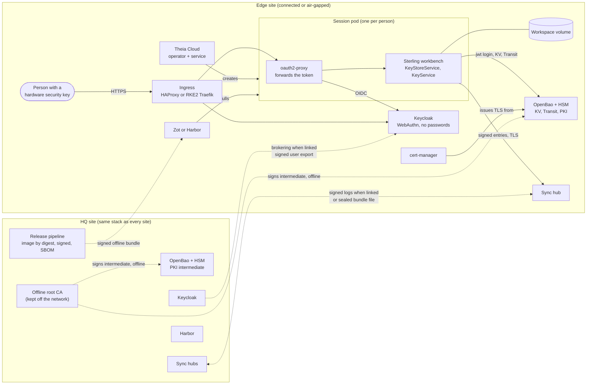

# Design: hosting Sterling on Theia for many people, on-premise and air-gapped

**Status:** design for the owner. Docs only: no code changed.
**Written:** 2026-11-23, against `origin/main` at 9d3ec09f (after #160).
**Inputs:** `RESEARCH.md` in this folder (the hosting research, with its sources); `.planning/ROADMAP.md` (Phases 32.1, 33, L1b, L6); `.planning/research/multiuser-sync/DESIGN.md` (MUS: the sync hub and signed replication); `.planning/research/compliance-dashboard/DESIGN.md` and `compliance/README.md`; `.planning/research/coherence/` (REVIEW.md and GLOSSARY.md: the vocabulary rules this design follows); the Theia spike on the local branch `docs/theia-container-release` (`.planning/spikes/theia-team-studio/README.md` and `MIGRATION.md`); the owner's decisions of 2026-11-23; the re-aim findings for Phases 32.1 and 33.
**Marking:** **[verified]** means read in source or official docs during the research. **[unverified]** means inference, estimate or not yet confirmed. Unmarked statements about this repository were checked on `origin/main` or the named branch.

## 1. Key points first

1. **Theia is now the only development target.** The product ships as a Sterling-branded Theia container image, published by digest. No more VS Code Marketplace releases.
2. **One person, one Theia session.** A Theia backend is single-user by design (`RESEARCH.md` section 1). Each person gets their own pod from self-hosted Eclipse Theia Cloud on your organization's Kubernetes.
3. **Every site runs the same stack, connected or not:** RKE2, a local image registry, an HAProxy or Traefik ingress, cert-manager with an OpenBao CA, Keycloak, Theia Cloud, OpenBao with an HSM, and the sync hub. HQ and edge sites trust each other through PKI and signed files, never through a shared database.
4. **No passwords.** People sign in with a hardware security key or a device-bound passkey through Keycloak. Smart cards are a hardware option.
5. **Secrets live in OpenBao, per person.** One backend contribution rebinds Theia's `KeyStoreService`, so every extension secret and AI service key is stored per person and survives restarts. A separate `KeyService` signs and unwraps through OpenBao Transit, so long-term private keys never enter the session.
6. **Phases 32.1 and 33 are rebuilt natively in Theia now,** not through the VSIX compatibility layer. Most of their executed work is host-neutral engine code and carries over unchanged.
7. **A native Theia foundation comes first.** Backend services, the key store, the key service and session identity are what both phases need. The deployment stack and the offline bundle can be built in parallel from day one.
8. **Nothing is adopted until it passes the compliance fit check.** Each component below has a verdict and conditions. None counts toward any claim until it is in `compliance/` and assessed.
9. **The main unknowns are scale and certificates.** Nobody has publicly run 1,000 or more Theia Cloud sessions. We load-test on our own hardware before stating a capacity figure.

## 2. Owner decisions (2026-11-23)

These are settled.

| # | Decision | What it means here |
|---|---|---|
| D1 | Theia (Sterling-branded edition; the Sterling and SovAI names are intended) is the sole development target. No more VS Code Marketplace publishing. Releases ship as a versioned container image published by digest. | The release pipeline, its evidence (installer SBOM, signatures) and the compliance package move from the VSIX to the image (section 8). |
| D2 | Defence deployment is on-premise, including fully air-gapped sites. Commercial cloud is used only for specific things your organization's signed policy allows (for example an approved model endpoint). | Hosting, sign-in, secrets and session management never depend on the internet. Images and charts arrive by signed bundle. |
| D3 | Scale: hundreds to thousands of concurrent people; connected HQ and disconnected edge sites. | Per-site capacity planning, a load test to 1,000+ sessions, and several hubs per site (section 12). |
| D4 | Self-hosted Eclipse Theia Cloud on your organization's Kubernetes is approved as the session orchestrator, one Theia session per person. | `sessionsPerUser: 1`; the hardening list in section 11 applies. |
| D5 | Secrets: an OS-keyring sidecar or your organization's KMS, working connected and disconnected. Research recommends OpenBao (MPL-2.0) with HSM auto-unseal per site. | One OpenBao cluster per site. Single-machine installs fall back to the OS keyring through the same interface. |
| D6 | Sign-in by passkeys or hardware security keys only, no passwords (Keycloak WebAuthn passwordless; PKI smart cards as a hardware option). | Password and OTP authenticators are disabled. "Passkeys" means device-bound passkeys where the policy requires hardware keys (section 6). |
| D7 | Model servers on the network come from your organization's policy (policy-listed servers). The session states which checks run in the session. | Hosted sessions do not scan or listen for servers; they offer only servers the policy lists, and the checks run in the session backend (section 9.1). |
| D8 | Phases 32.1 (guided setup) and 33 (live multi-user staff projects) are built natively in Theia now. 32.1 integrates with the existing Sterling Get Started page: the guide is what "Set up Sterling" opens; the checklist becomes a section of that page; no VS Code walkthrough; no second home page. | Section 9. |
| D9 | Every resource adopted must help pass the compliance requirements, checked before use. A compliance fit check is being built separately (`compliance/resources.json` and `scripts/resource-check.mjs`). | Section 10 lists the verdicts each entry starts from. |
| D10 | No generic word for what a work area holds. Each work area has its own landing page and kinds of work: Capability Development (program, product, project: major capital, minor capital, initiative), Planning (operational or administrative planning), Resource Management (the whole inventory), Exercises & Training (exercise, course, other training). "Project" is a capability development term only. | Section 9.1; the setup guide lands on the chosen work area's landing page. |
| D11 | One Defence Team mode for the Defence edition: CAF members and DND public servants work together, so the mode is not split into Military or Public service. | Section 9.1; a new mode in `src/domain/org/modes.ts`, with how each person serves on their record. |

## 3. Where we are

- **Today one install is one person.** Secrets go through VS Code `SecretStorage`; the device identity is one Ed25519 key per install (`src/team/identity.ts`, MUS 7.4). This model is already right per person; what is missing is a per-person session manager and durable per-person secrets in a container.
- **The Theia spike works for one person.** The local branch `docs/theia-container-release` holds a Theia 1.77 browser container with the Sterling Get Started page (`sterling-welcome-module.ts`), the rail, four Defence work-area pages, Portfolio, Compliance and Documentation, and the released VSIX running in the compatibility host. Its credential store is in memory by default (`MIGRATION.md`, "Confirmed host differences").
- **The sync hub targets 150 people per hub** (MUS 10.9) and runs today as a Compose service on Node 26 (`hub/package.json` requires `>=26.13.1 <27`). MUS already says: beyond that, a hub per site and L5 federation.
- **Phase 32.1** has most executed work in host-neutral engine code. Only `getStarted.ts`, `webview/openPanel.ts`, `webview/protocol.ts`, `extension.ts` and `package.json` import `vscode`.
- **Phase 33** has 33-01, 02, 04 and 19 done, and 05, 06 and 10 partly done on local branches (for example `feat/phase-33-05-version-acts`). Only `staffEditorBinding.ts` and `staffMultiUserCommands.ts` import `vscode`.

## 4. Reference architecture per site

HQ and every edge site run the same stack. A small site may shrink it (one control-plane node, one OpenBao node), but it has the same parts.

| Part | Choice | Notes |
|---|---|---|
| Kubernetes | **RKE2** | FIPS-built, DISA STIG and CIS profile, air-gap install from a tarball or private registry (`RESEARCH.md` 3, 7.5). k3s only for lab or demo kits. |
| Image registry | **Harbor** at HQ and large sites; **Zot** at small edge sites | Images enter only through the signed offline bundle. Signatures are checked on import and again at admission (Kyverno or the sigstore policy-controller). |
| Ingress | **HAProxy Kubernetes Ingress** (Theia Cloud's default) or **RKE2's FIPS-built Traefik** | Not ingress-nginx: its repository was archived after its final release in 2026-03. Traefik with Theia Cloud is untested. |
| Certificates | **cert-manager** with a CA issuer chained to the site's OpenBao PKI intermediate | No ACME, no Let's Encrypt. HQ holds the offline root. |
| Sign-in | **Keycloak 26.8.x** with Postgres | WebAuthn passwordless, attested hardware keys, AAGUID allowlist, X.509 smart-card flow, no passwords; one realm per site. |
| Sessions | **Theia Cloud** (pinned release or our own build) | One AppDefinition for the Sterling image; one pod per person (Theia plus a hardened oauth2-proxy sidecar), a workspace volume, idle timeout. |
| Secrets and keys | **OpenBao** 3-node Raft cluster, HSM auto-unseal (PKCS#11 KMS plugin) or Shamir at sites without an HSM | KV v2 for extension secrets, Transit for per-person signing keys and key-encryption keys, PKI for TLS and device certificates, jwt auth bound to Keycloak. |
| Sync | **Sync hub** (existing `hub/`) | Moves from Compose to a Kubernetes Deployment with its own volume. Several hubs per site, each serving a set of projects. Ends TLS itself (MUS 10.1), so the ingress passes TCP through. |
| Storage | A CSI storage class (Longhorn, Ceph or NFS) with encryption at rest | Not assessed in the research **[unverified]**. |
| Logs and metrics | Site-local (Prometheus, Loki or equivalent) | Loki is AGPL: needs the compliance fit check before use. |

Dotted lines are links that may be absent for days. Nothing in a site needs them to keep working.

## 5. HQ and edge federation

There is no cross-site database replication. OpenBao has none, Keycloak's multi-site mode needs low-latency links, and the hub's design does not assume one (`RESEARCH.md` 3, 4). Sites trust each other through three things.

1. **PKI.** HQ holds an offline root CA. Each site's OpenBao PKI is an intermediate signed by that root. Certificates and signatures made at one site verify at any other with no live link.
2. **Signed offline bundles.** Images, charts, the policy bundle, Keycloak user records and revocation lists travel as signed files (for example an OCI layout copied with `oras` or `skopeo` to media). The site checks the signature before import. The same bundle format serves the first install and every update.
3. **The sync hub.** Each hub keeps signed per-writer logs. When a link exists, hubs exchange entries; when it does not, a sealed bundle file carries the same logs (MUS section 9). Trust comes from signatures, so a hub never needs to call HQ. Hub-to-hub federation is L5; until L5, an edge hub and an HQ hub exchange through sealed bundles.

**People across sites.** Each person's keys are homed at one site. Signing and key-encryption keys live in that site's OpenBao Transit and are non-exportable. Moving a person to another site exports a wrapped key through Transit's import and export with a two-person Control Group approval **[design inference]**. For a hardware key to work at HQ and at an edge site, the sites must share a WebAuthn relying-party ID (a common parent domain), and the person's credential records must exist in each site's Keycloak, carried by signed export. Otherwise the person registers their key again at each site (open decision O3).

**Sign-in across sites.** When linked, the edge realm may broker HQ as an OIDC identity provider; local users and their keys keep working when the link is down. Realm partial export does not include users, so the signed user export needs the admin REST API or a user-storage extension **[unverified detail]**.

## 6. Identity and key flow

1. **Sign in.** The person opens the site address. oauth2-proxy sends them to Keycloak. Keycloak runs a WebAuthn ceremony with user verification required (PIN or biometric on the key), attestation `direct`, and the AAGUID allowlist of approved models. No password step exists in any flow.
2. **Session.** Theia Cloud starts or resumes the person's session pod. oauth2-proxy checks the person against the session's owner list and forwards the access token (`pass_access_token`, `set_xauthrequest`; not in the default template, section 11).
3. **Session identity.** A backend contribution reads the forwarded token and `THEIACLOUD_SESSION_USER`, checks they name the same person, and logs in to OpenBao with **auth/jwt** (`bound_audiences`, `user_claim=sub`). It gets a short-lived OpenBao token whose entity is the person, and renews it while the session is active. The token stays in backend memory only.
4. **Secrets.** `OpenBaoKeyStoreService` replaces Theia's `KeyStoreService` binding (`rebind(KeyStoreService)` in a backend module). Every `SecretStorage` call from the compatibility host and every Theia AI credential store then reads and writes `kv/users/<entity>/<service>/<account>`. A templated ACL lets each person reach only their own path. On a single-machine install (L1b, L6) the same interface falls back to the OS keyring.
5. **Long-term keys.** `KeyService` calls Transit: `transit/sign/<person>` for signatures, `transit/datakey/wrapped/<kek>` and `transit/decrypt` for wrapped data keys. The private keys stay in OpenBao, or in the HSM through External Keys.
6. **Device sub-keys [design inference].** Signing each typing batch through Transit would put a network call on the hot path. So at session start the session makes a fresh Ed25519 key in memory, and `KeyService` asks the person's Transit key to sign a short-lived certificate for it. The hub checks the chain from the person's key to the session key. The roster lists the person's key once per site, not each session, so session restarts do not churn the roster's device lifecycle (MUS 15.2). This needs a hub change (section 9.2).
7. **Cell keys [design inference].** Today each device has an X25519 key that cell keys are wrapped to (MUS 7.4, 8.2). For hosted people, cell keys are wrapped to the person's key-encryption key in Transit and unwrapped through `KeyService`, so a new session needs no rekey.
8. **Re-authenticate before signing decisions.** Approvals, version acts, roster changes and anything else signed with the person's long-term key need a fresh WebAuthn step: the workbench starts an OIDC re-authentication with `acr_values` or `max_age`, and `KeyService` refuses to sign unless the token's `acr` and `auth_time` are fresh. Theia Cloud has no step-up hook, so the workbench drives it **[how this passes through the oauth2-proxy sidecar is unverified]**.
9. **Enrolment and recovery.** An administrator creates the person with the required action `webauthn-register-passwordless`; the link goes through the site's own mail server, or the person enrols in person with a smart card and then registers their key. Two registered keys are required before signing keys are usable. Recovery is an administrator-attested re-enrolment that revokes old credentials and re-binds the person's OpenBao entity; there is no recovery code where policy says hardware only (open decision O4).

## 7. Session lifecycle

Each session is one state machine. A person has at most one session (`sessionsPerUser: 1`).

| State | Meaning | Leaves to (trigger) |
|---|---|---|
| `pooled` | A prewarmed pod with no person, no secrets and no person's volume | `claimed` (a person signs in and the pool has a pod); removed when the pool shrinks |
| `requested` | The person signed in; no pod yet | `starting` (operator creates the pod); `refused` (site at capacity: "All sessions are in use. Try again in a few minutes, or ask your administrator.") |
| `starting` | Pod and volume being attached | `identity` (pod ready); `failed` (pod did not start within the timeout; the reason is shown) |
| `claimed` | A pooled pod assigned to the person | `identity` (volume attached and owner list written) |
| `identity` | Session identity logs in to OpenBao with the forwarded token | `active` (OpenBao token issued); `failed` (token missing, person mismatch or OpenBao unreachable: the workbench says so and offers Retry; no secrets are read) |
| `active` | In use; the OpenBao token is renewed | `idle-warned` (no activity for `notifyAfter`); `stopping` (person signs out) |
| `idle-warned` | The person is told the session will stop | `active` (any activity); `stopping` (`timeoutAfter` reached) |
| `stopping` | Backend drops the OpenBao token and the session key, then the pod stops | `stopped` |
| `stopped` | No pod; the workspace volume is kept | `requested` (the person signs in again) |
| `refused`, `failed` | Shown with a plain reason and one action | `requested` (Retry) |

No state waits silently: `starting` and `identity` have timeouts, and `refused` and `failed` always show a reason.

**Prewarm pool limits.**
- Pooled pods hold nothing about a person. Secrets are fetched only after claim, by the session identity step. Static per-application secrets (for example the hub's trust anchors) may come from the OpenBao CSI provider at pod start.
- The pool is a fixed number per site, counted against site capacity, and defaults to **0** until phase (e) shows how a pooled pod gets the person's workspace volume. Theia Cloud lists eager start as "not fully supported"; EduIDE documents a working prewarm pool **[how volumes attach at claim is unverified]**.
- Cold-start time without a pool is measured in phase (e). If it is acceptable, the pool stays off.

**Volumes.**
- One workspace volume per person on an encrypted storage class, with persistence turned on (the Theia Cloud landing page defaults to ephemeral). The requested size is set per site (the chart default of 250Mi is too small for real projects **[inference]**).
- The volume holds the project files, the replica store and project state. It holds no secrets: those are in OpenBao.
- Backups: storage snapshots plus Velero or etcd snapshots for the Session and Workspace records.

**Capacity [estimate].** About 1 to 2 GiB of memory and 0.25 to 1 vCPU per active session, more for agents running local tools. 50 people need about 100 GiB plus 16 to 24 GiB of platform overhead; 1,000 people need about 1 to 2 TiB of worker memory. Phase (e) replaces these with measured figures.

## 8. Product changes and deployment work

**Product changes** (code in this repository):

| # | Change | Used by |
|---|---|---|
| P1 | Move the spike's Theia extension out of `.planning/spikes/` into a real workspace package with its own build, tests and CI job | everything |
| P2 | A backend JSON-RPC service pattern: one shared way for native widgets to call engine code in the backend | 32.1, 33 |
| P3 | `OpenBaoKeyStoreService` rebinding `KeyStoreService`, with the OS-keyring fallback for single-machine installs | durable secrets |
| P4 | `KeyService` for Transit sign, wrapped data keys and decrypt; refuses long-term signing without a fresh `acr` | 33, policy signing |
| P5 | Session identity contribution: forwarded token, `THEIACLOUD_SESSION_USER`, OpenBao jwt login, renewal, step-up re-authentication | P3, P4 |
| P6 | Session sub-keys certified by the person's key, and cell keys wrapped to the person's key-encryption key | 33 |
| P7 | Hub accepts certified session keys and person keys in the roster (a roster entry kind, a fold check and a hub append check) | 33 |
| P8 | Registry, Open VSX and model server addresses configurable to internal mirrors; every update check and telemetry off in the image | air gap |
| P9 | A browser test harness against the built container (Theia ships Playwright helpers **[fit unverified]**) | 32.1, 33 acceptance |
| P10 | Release pipeline: the image by digest, signed with your organization's key (no keyless signing, which needs the internet), a CycloneDX SBOM, GitHub artifact attestations; compliance evidence and the assessor package read the image, not the VSIX | D1 |
| P11 | One Node major for the workbench image and the hub (Node 26 for the hub today; Theia 1.77's supported Node range **[unverified]**) | 33 |

**Deployment work** (our charts and runbooks, not product code):
- Helm values for Theia Cloud, Keycloak, OpenBao, cert-manager and the ingress, with mirrored images, the CA issuer, persistent storage and the oauth2-proxy fixes.
- Vendored chart tarballs in the bundle; no chart pulled from the internet at install.
- Keycloak realm as code (flows without passwords, the WebAuthn policy, the AAGUID allowlist, events to the audit store).
- OpenBao policies as code (templated per-person ACLs, Transit keys, PKI roles, Control Groups for key moves, audit device).
- The signed offline bundle pipeline and its import and check scripts.
- The hub as a Kubernetes Deployment, several per site.
- The key ceremony runbook for HSM or Shamir unseal.
- The load test.

## 9. Phases 32.1 and 33, re-aimed

### 9.1 Phase 32.1: guided setup, native

**Carries over unchanged:** plans 01 to 07, 09 to 11 and 16 (registry, viability reducer, probes, discovery engine, audit chain, project layer, session reducer, screen models).

**Native work:**
- A backend JSON-RPC service exposing the setup controller (on P2).
- A native guide widget that draws the 11 screen models, reusing the logic of `getStartedScreens.js`.
- The checklist becomes a section of the Sterling Get Started page.
- `LANDING_TARGETS` gains `get-started` and the four work-area pages.
- Command ids `nearAi.setup`, `nearAi.projectSetup` and `nearAi.setUpStaffTeam` stay stable.
- Plan 17's walkthrough and title-bar entry are dropped. Plan 18's chat welcome button points at the Sterling entry. Plan 20's checks move to the browser workbench (P9).
- **Policy-listed servers only (D7).** In a hosted session, mDNS and range scans do not run (they could not see the person's network from a pod anyway). The guide offers only servers your organization's policy lists, and states which checks ran in the session. Single-machine installs keep discovery as planned.
- Phase 41 (organization-signed policy) is still a dependency: D7 relies on it.

**Naming to settle** (defaults proposed; the owner confirms, see O1):

| Clash | Default |
|---|---|
| The 32.1 panel vs the home page | The home page is **Get Started** (`sterling.getStarted`), the one front door. The guide is **Set up Sterling** (`nearAi.setup`), opened from it. The coherence review's "one front door" holds: there is one page, and the guide is reached from it. |
| `sterling.getStarted` vs `nearAi.setup` | Both stay: one opens the page, the other the guide. No alias between them. |
| "SovAI:" vs "NEAR AI:" palette categories | One category for every command in the Sterling edition: **SovAI**, as the spike uses. NEAR AI is only an AI service and no longer names commands. |
| "Kind of work" vs work areas | "Kind of work" stays the setup question. In the Defence edition its answers are the four work areas, and the landing is that work area's page. |
| What a work area holds | **Decided (owner, 2026-11-23): no single generic word.** Each work area has its own landing page and its own kinds of work. "Project" is a capability development term only. **Capability Development** leads to a landing page to choose a program, a product, or a project (major capital, minor capital, or initiative). **Planning** leads to a page to choose operational planning or administrative planning. **Resource Management** is the landing page for the whole inventory, of every type. **Exercises & Training** is the landing page for a new exercise, a new course, or other training. The spike's "Create to name a new work area" becomes each landing page's own create action. |
| Defence edition vs mode | **Decided (owner, 2026-11-23): one Defence Team mode.** CAF members and DND public servants work together as the Defence Team, so the mode cannot be split into Military or Public service. The **edition** is what ships (branding, work areas); the **mode** is "How your organization works", set by policy, and the Defence edition uses a new **Defence Team** mode. Everyone in it is tasked the same way: assigned to positions, report unable rather than decline, handover required. Each person's record says how they serve (Regular Force, Reserve Force, public servant, contractor), and only the few words that genuinely differ follow the person (for example "posted" for CAF members, "assigned" for public servants). The Defence Team words are confirmed by the owner, as the Military words were. A new mode id goes into `src/domain/org/modes.ts` with a policy section version; the existing Military and Public service modes stay for other organizations. |

### 9.2 Phase 33: live multi-user staff projects, native

**Done or reusable:** 33-01, 02, 04 and 19 done; 05, 06 and 10 partly done on local branches. The 33-04 binding core allows a host adapter other than VS Code.

**Native work:**
- Monaco co-editing binding: a backend service, a JSON-RPC channel for Yjs updates, and a frontend `BoundDocument` over `MonacoEditorModel`.
- Native presence and cursors with names.
- A native Staff Room widget (people, the sync sentence from MUS 15.3, offline banner, contested and join cards).
- **Share with people** on the Sterling work-area page.
- The sync word in the one Sterling status item.

**Blockers and how this design clears them:**

| Blocker | Cleared by |
|---|---|
| Durable secrets (`src/staff/replica/keyring.ts` and the `hubSync` witness use `SecretStorage`) | P3 in phase (a); the keyring moves to `KeyService` for long-term keys |
| Persistent volumes | Theia Cloud workspace volume with persistence on (section 7) |
| One person per session | Theia Cloud, `sessionsPerUser: 1` (D4) |
| Hub reachability | The hub runs in the site cluster; sessions reach it by cluster address; TLS passes through to the hub |
| Node 24 vs 26 | P11 |
| No Theia browser test harness | P9 in phase (a) |

## 10. Compliance fit per component

Targets: the ITSG-33 / ITSP.10.033 Medium profile (Protected A and B), the ITSP.10.171 overlay, CPCSC Level 1, and the Controlled Goods and ITAR overlays (`compliance/levels.json`). "Pass" needs the condition met in our deployment and evidence collected automatically. Every row becomes an entry in `compliance/resources.json` and passes `scripts/resource-check.mjs` before use (D9), then an OSCAL component in `compliance/components/` with evidence rules. Verdicts are from `RESEARCH.md` section 7 unless marked.

| Component | Verdict | Conditions |
|---|---|---|
| RKE2 | Pass | FIPS build with Canal and the bundled FIPS components; STIG profile; Kubernetes audit policy |
| k3s | Lab and demo only | Fails where validated cryptography is required (no FIPS build) |
| Keycloak 26.8.x | Pass with conditions | FIPS strict mode with BC-FIPS on a FIPS host, OpenJDK 21; a version with CVE-2026-6856 fixed; password and OTP authenticators disabled; events shipped to the audit store |
| Theia Cloud (operator, service, webhook) | Pass with conditions | Rebuilt from source by us on a FIPS-capable JRE (UBI 9), signed, SBOM and provenance; oauth2-proxy defaults fixed; Kubernetes audit on Session and Workspace records; pinned to the commit we assessed |
| oauth2-proxy | Pass with conditions | Rebuilt by us with the Go FIPS module; TLS verify on, secure cookies, a real client secret, token forwarding |
| OpenBao 2.7.x | Pass with conditions | Keys held in a CMVP-validated HSM through External Keys, or a self-built FIPS binary with the module certificate checked; audit device to a tamper-evident store; a documented key ceremony |
| HSM (PKCS#11) | Pass with conditions | A model with a FIPS 140-3 Level 3 certificate in approved mode; the `kms-pkcs11` plugin (v0.3.0, 2026-11-03) tested before use; export-controlled hardware handled under your organization's Controlled Goods and ITAR procedures |
| HAProxy Kubernetes Ingress | Pass with conditions | FIPS only when linked against a validated OpenSSL provider on a FIPS host |
| RKE2 Traefik | Pass with conditions | FIPS build from RKE2; works with Theia Cloud only through explicit annotations **[untested]** |
| ingress-nginx | Fail | Archived, no further patches |
| Harbor | Pass with conditions | Signature-enforced import and admission, scanning, SBOM storage, OIDC to Keycloak, audit log; no FIPS build documented **[unverified]** |
| Zot | Pass with conditions (small sites) | Same import rules; FIPS build with `GOFIPS140` **[unverified]** |
| UBI 9 base images | Pass with conditions | Host in FIPS mode; the RHEL OpenSSL FIPS provider **[certificate number unverified]** |
| Debian and Alpine bases | Fail for Protected B | No validated module |
| Sterling workbench image | Pass with conditions | UBI 9 base, Node with OpenSSL 3 and the FIPS provider on a FIPS host; our signing and unwrapping go through OpenBao or the HSM |
| cert-manager | Not assessed | The research gives no verdict; run the fit check before use |
| Sync hub | Existing component (`compliance/components/hub.json`) | Re-assess for Kubernetes deployment, several hubs per site, and certified session keys |
| Postgres, storage class, logs and metrics | Not assessed | Run the fit check before use; Loki's AGPL licence needs a decision |

Open evidence work: an OSCAL component per row; evidence rules for Keycloak events, OpenBao audit, Kubernetes audit and Harbor audit; the image SBOM, signature and provenance pipeline (extends gap G4); the hash-chained audit sink (extends gap G2). The existing VSIX evidence (installer SBOM, Marketplace signature) is replaced by image evidence under P10.

## 11. Theia Cloud hardening list

1. **Mirror every image** to the site registry: operator, service, landing page, conversion webhook, wondershaper (only if that limiter is used) and oauth2-proxy. Set `imagePullPolicy: IfNotPresent` or point it at the mirror (the chart default is `Always`).
2. **Vendor the Theia Cloud charts** into the bundle; no Helm repository fetched at install.
3. **Replace Let's Encrypt.** Disable the `letsencrypt-prod` ACME issuer and use the chart's CA issuer, backed by the site's OpenBao PKI intermediate.
4. **Fix oauth2-proxy:** `ssl_insecure_skip_verify=false`, `cookie_secure=true`, a real client secret (the sample `publicbutoauth2proxywantsasecret` is public), and a pinned current release in place of v7.12.0.
5. **Forward the token:** `pass_access_token=true` and `set_xauthrequest=true`, so the session identity step can log in to OpenBao.
6. **Rebuild, sign and SBOM every image on UBI 9:** operator, service and webhook on a FIPS-capable OpenJDK; oauth2-proxy with the Go FIPS module; signed with your organization's key, with SBOM and provenance.
7. **Turn on persistence** (the landing page defaults to ephemeral) and set a realistic volume size.
8. **Set `sessionsPerUser: 1`** and the idle timeout and activity monitor values per site.
9. **Kubernetes audit policy** on Session and Workspace records, shipped to the audit store.
10. **Check the operator and service RBAC** for least privilege.
11. **Pin to a release or our own build** of an assessed commit; never a `-next` pre-release.
12. **Keep emails unique and immutable in Keycloak**, because session ownership is an email allowlist.

## 12. Open risks and what must be verified

| Risk | What to verify |
|---|---|
| No public proof of 1,000+ Theia Cloud sessions | Load test to 1,000+ sessions on our own hardware: start bursts of 500+, operator reconcile rate, the single shared Ingress object's size (etcd's limit is about 1.5 MiB), etcd load per session, ingress reload time, cold-start time |
| Hub capacity (150 people per hub, MUS 10.9) | Several hubs per site, each serving a set of projects; measure under the same load test |
| Keycloak CVE-2026-6856 (AAGUID allowlist bypass with self-attestation) | The fixed version **[unverified]**; pin a 26.8.x release that has it |
| HSM certificates | The exact FIPS 140-3 certificate numbers of the chosen HSM models **[unverified]** |
| Go FIPS module | Its CMVP certificate status at build time **[unverified]** |
| Traefik with Theia Cloud | Untested; HAProxy stays the default until tested |
| OpenBao `kms-pkcs11` plugin is young (v0.3.0) | Test against the chosen HSM before relying on it |
| Theia Cloud project health | Bus factor about 3; last stable release 2026-04. We pin, and can fork the operator library (EPL-2.0) if needed. Fallback: our own broker modelled on KubeSpawner (about 4 to 8 engineer-weeks **[estimate]**) |
| Prewarm pool with personal volumes | How a pooled pod gets the person's volume at claim; pool stays at 0 until shown |
| Step-up re-authentication through the sidecar | That the workbench can force a fresh WebAuthn step and see the new `acr` |
| Synced passkeys | They cannot produce attestation, so they fail a hardware allowlist. Where policy says hardware only, "passkeys" means device-bound |
| Shared relying-party ID across sites | DNS layout per deployment (O3) |
| Large smart-card revocation lists | A local OCSP responder or scheduled CRL refresh at each site |
| Theia 1.77 supported Node range | Before settling P11 |

## 13. Proposed phases

Numbers are assigned when each is planned; Phases 32.1 and 33 keep theirs.

| Phase | Delivers | Depends on | Runs in parallel with |
|---|---|---|---|
| **(a) Native Theia foundation** | P1, P2, P3, P4, P5, P8, P9, P11; the image build of P10 | owner decisions only | (d) from day one |
| **(b) 32.1 native** | Section 9.1 | (a)'s P1, P2 and P9; P3 for saved connections; Phase 41 | (c) once (a) lands; the two own different sections of the Sterling pages (checklist vs Share with people) and agree that split before starting |
| **(c) 33 native** | Section 9.2 plus P6 and P7 | (a) in full; Phase 41; the build order put 32.1 before 33, so its release follows (b)'s | (b) |
| **(d) Deployment stack and offline bundle** | Section 8 deployment work, the hardening list (section 11), resource fit checks for every component | the fit check from D9; (a)'s image only for the end-to-end run | (a), (b), (c) |
| **(e) Load and accreditation verification** | The load test, OSCAL components and evidence rules for each component, measured capacity figures | (a) to (d) | the evidence-rule work can start as soon as each component in (d) is chosen |

Sequential because of real dependencies: (b) and (c) need (a)'s service pattern and key store; (e) needs a running stack.

## 14. Owner decisions still open

Owner, 2026-11-23: the defaults for O2 to O6 are accepted as listed (HAProxy until Traefik is tested; one shared parent domain for passkeys; re-enrolment only where policy says hardware only; pin Theia Cloud upstream and fork only if needed; volume size and idle timeout set per site after the load test). O1 is decided in section 9.1 except the Defence Team words (O1b), which are confirmed when that mode is planned.

| # | Question | Default |
|---|---|---|
| O1 | Confirm the remaining naming defaults in section 9.1 (Get Started vs Set up Sterling, the SovAI category). What a work area holds and the Defence Team mode were decided on 2026-11-23. | As listed |
| O1b | Confirm the Defence Team mode's words, and which words follow how a person serves (Regular Force, Reserve Force, public servant, contractor). | Proposed when the mode is planned |
| O2 | HAProxy or Traefik as the ingress. | HAProxy until Traefik is tested |
| O3 | One relying-party ID across sites, or a separate key registration per site. | One shared parent domain |
| O4 | Recovery for hosted people: administrator-attested re-enrolment only, or also a recovery code. | Re-enrolment only where policy says hardware only |
| O5 | Fork Theia Cloud's operator now, or pin upstream and fork only if needed. | Pin upstream; fork only if needed |
| O6 | Workspace volume size and idle timeout per site. | Set per site after the load test |

## 15. Where the inputs conflicted

1. **Front door name.** The coherence review calls the guided setup "Get Started" and makes it the one front door. D8 makes the Sterling page "Get Started" and the guide "Set up Sterling". Resolved in 9.1: one page, the guide reached from it.
2. **Brand in copy.** The copy lint (GLOSSARY.md section 5, rule 3) checks the brand is spelled "NEAR AI" and "VS Code". Under D1 the product brand is Sterling (and SovAI for commands). The lint's brand rule needs updating in phase (a); the rule "NEAR AI is only the provider" is unchanged.
3. **L6 says the VS Code extension keeps shipping.** D1 ends Marketplace publishing. L6's desktop app still stands; its "VS Code extension keeps shipping" sentence is superseded. L1b's research flag "one container per person until Theia Cloud is needed" is answered by D4.
4. **Phase 32.1's release line** says "Ship Get Started in its own release" as a VSIX. Under D1 it ships in the container image.
5. **Device keys.** MUS 7.4 has one device key per install in `SecretStorage`, and "My computers" uses a recovery code. Hosted sessions use certified session keys (section 6), and hardware-only policy argues against recovery codes (O4).
6. **Hub deployment.** MUS 10.1 places the hub in the relay's Compose stack; at these sites it runs on Kubernetes, several per site.
7. **Compliance evidence.** `compliance/README.md` reads the installer SBOM from the VSIX and cites the Marketplace signature. Under D1 these move to the image (P10).
