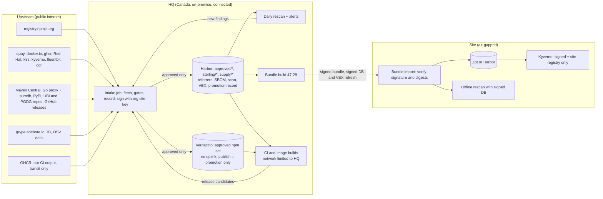

# Software supply registry: an organization-run, Canadian-hosted registry for every dependency and image - Research

**Researched:** 2026-11-25
**Domain:** software supply chain (package and image registries, SBOM/VEX, offline vulnerability data, promotion gates, HQ-to-site distribution)
**Confidence:** MEDIUM overall (HIGH on the current repository state and the registries already in the stack; MEDIUM on product features read from official docs; LOW on the commercial products' finer points, which are marked `[ASSUMED]`)
**Branch:** `docs/research-software-supply-registry` from `origin/main` at `fba66ee7`
**Not a phase directory:** no phase number is assigned yet. The planner or owner picks one (it depends on 47-29 and sits beside 48.2).

---

<user_constraints>
## Owner direction and constraints (verbatim from the request; there is no CONTEXT.md yet)

### Locked direction (owner, approved 2026-11-25)

- The owner wrote: "For the SBoM, we likely need to host them in our own package registry so we can manage updates to them/properly test them for vulnerabilities and trust."
- Goal: every dependency and image is pulled only from your organization's registry, after review. Each artefact carries its SBOM, signature and scan results. Artefacts are rescanned continuously against a vulnerability database we sync ourselves. The registry is mirrored into the offline bundle for air-gapped sites. Its evidence feeds the supply-chain controls (SR, SA, CM) and the coming sovereignty status badge.
- Owner rules that apply here:
  - all on-premise including air-gapped; cloud only where policy allows;
  - every added resource must contribute to passing compliance (ITSG-33 / CCCS), so check fit before adoption;
  - research before building; compare open-source options on design, licence, maturity and security;
  - downloaded code is untrusted.
- Research rules for this task: don't run or install any downloaded registry software (docs and source only); coordinate with `.planning/research/sovereignty-status/` on terms only and don't edit it.

### Claude's discretion

- The component choice, the architecture, what is built versus configured, the migration order and the defaults offered to the owner.

### Out of scope

- Editing the sovereignty-status research (branch `docs/research-sovereignty-status`; nothing pushed there yet at the time of writing, so only terms are proposed in "Terms shared with the sovereignty status research").
- Any change to `main`; no PR from this branch.
</user_constraints>

## Summary

Today every dependency comes straight from the public internet: npm packages from `registry.npmjs.org` (2,104 distinct name@version entries across the six lockfiles, 12 of them with install scripts), Maven artefacts from Maven Central inside the Theia Cloud builds, Go modules inside the oauth2-proxy build, RPMs from Red Hat's UBI repositories and the PostgreSQL PGDG repository, Python wheels from PyPI for trestle, Helm charts from 12 chart repositories (14 charts, vendored as tarballs with SHA-256), tools from GitHub releases (pinned with SHA-256), 39 third-party images from docker.io (23), quay.io (9), reg.kyverno.io, ghcr.io, registry.access.redhat.com, registry.k8s.io and cr.fluentbit.io (pinned by digest), and Containerfile bases from docker.io, registry.access.redhat.com, quay.io and gcr.io (pinned by digest). The repository already does a lot right: exact versions, lockfile integrity hashes, `--ignore-scripts`, digest pins, checksum pins, cosign key-mode signatures, CycloneDX SBOMs, Grype scans, a signed offline bundle, Kyverno admission that refuses anything not signed and not served by the site registry. What it does not have is a place where an artefact is **reviewed once, recorded, and then served only from there**, with its SBOM, signature, scan and VEX beside it, and rescanned every day.

The registries compared split into three groups. **OCI registries** (Harbor, Zot) already run in the stack and are the right home for images, Helm charts (as OCI), tools, the vulnerability database and every SBOM, signature, scan and VEX document (as OCI referrers). **Universal repository managers** (Nexus, Artifactory, Pulp) cover many formats, but the free Nexus and Artifactory editions now lack the features we need (Nexus Community Edition: no SSO, no HA, 40,000-component cap, proprietary EULA since 3.77; Artifactory JCR: Docker/OCI/Helm/Generic only, npm needs a paid edition), and Pulp is strong for RPM and Python but its npm support is a tech preview. **Single-format tools** (Verdaccio for npm, devpi for Python, Athens for Go, ChartMuseum for Helm) are small; of these only Verdaccio is needed, because npm is the only ecosystem with enough volume and developer traffic to need a live registry protocol. Gitea and Forgejo host many formats but cannot proxy or cache upstream (Gitea issue #21223 still open), so they cannot be the intake.

**Primary recommendation:** run the supply registry as **Harbor at HQ (Canada, on-premise) for all OCI content plus one Verdaccio instance for npm**, both fed only by an **intake job** that checks each artefact (age, name, install scripts, licence, provenance, integrity, malware, vulnerabilities), records the result, signs the approved artefact with your organization's key and attaches its SBOM, Grype scan and VEX as cosign attestations. Carry the small ecosystems (Go, Maven, PyPI, RPM) as **signed dependency snapshots stored as OCI artifacts in the same Harbor**, so builds run with the network off and no extra registry server is added. Sites keep Zot or Harbor exactly as Phase 47 planned; they receive approved content, the signed Grype database and VEX only through the signed offline bundle and signed refresh files. Keep Grype as the one scanner of record (Harbor's and Zot's built-in Trivy stay off). Keep GHCR only as the transit point for the first step; HQ re-verifies and promotes every release, and the owner decides when CI and publication move to runners in Canada.

## Architectural Responsibility Map

| Capability | Primary tier | Secondary tier | Rationale |
|------------|-------------|----------------|-----------|
| Intake checks (age, name, scripts, licence, provenance, malware, vulnerabilities) | HQ intake job (connected, Canada) | Upstream registries (read only) | The only place that may reach the internet; every decision is made once and recorded |
| Approved OCI store (images, charts, tools, snapshots, DB, SBOM/scan/VEX referrers) | HQ Harbor (storage + API) | Longhorn / object storage | Harbor is already the planned HQ registry (47 D-15); referrers keep evidence beside the artefact |
| npm protocol for CI, image builds and developers | HQ Verdaccio (approved set only, no uplink) | HQ Harbor (backup of the storage as an OCI artifact) | npm clients need the npm protocol; nothing else in the stack speaks it |
| Signing approved artefacts | HQ intake job with the organization site key (HSM; SoftHSM2 in development) | OpenBao (PKCS#11 path) | Key separation per G396 and 48.1-17/22 |
| Daily rescan and alerts | HQ rescan job (Grype over stored SBOMs) | Alertmanager, mail | SBOM-based rescans need no image pulls |
| Vulnerability database sync, signing and shipping | HQ intake job | Offline bundle and signed refresh files (47-29) | Sites cannot reach the internet |
| Site registry (serve, admit) | Site Zot or Harbor | Kyverno at admission | Unchanged from Phase 47 |
| Offline rescan at sites | Site import host (grype, signed DB) | Site change board | Already planned in 47-29 |
| Build isolation (only the registry) | CI runner and image build | Network policy / egress firewall | Enforcement belongs where the build runs |

## Current state on origin/main

All values below were read this session from the worktree at `origin/main` (`fba66ee7`).

| Area | What exists | Evidence |
|------|-------------|----------|
| npm config | `.npmrc` holds `save-exact=true` only | `[VERIFIED: .npmrc:1]` "save-exact=true" |
| npm volume | 2,104 distinct name@version across `package-lock.json`, `hub/`, `relay/`, `compliance/`, `workbench/`, `docs-site/`; every `resolved` URL is `https://registry.npmjs.org/...` except the local `extension` link | `[VERIFIED: lockfile count this session]` |
| Install scripts | 12 packages with `hasInstallScript`: `@parcel/watcher@2.6.0`, `@theia/ffmpeg@1.77.0`, `@vscode/vsce-sign@2.1.0`, `@vscode/windows-ca-certs@0.3.4`, `core-js@3.51.0`, `drivelist@12.0.2`, `esbuild@0.28.2`, `fsevents@2.3.3`, `keytar@7.9.0`, `msgpackr-extract@3.0.7`, `node-pty@1.2.0-beta.12`, `puppeteer@25.1.0` | `[VERIFIED: lockfiles, this session]` |
| npm audit | CI calls the public audit endpoint, e.g. `ci.yml:131` "- run: npm audit --omit=dev --audit-level=high"; also lines 187, 264, 346, 426, 758 and `compliance-scheduled.yml:51` | `[VERIFIED: .github/workflows/ci.yml:131]` |
| CI Node | `NODE_VERSION: '24'` in ci.yml, agent-review.yml, compliance-scheduled.yml, deploy-images.yml | `[VERIFIED: .github/workflows/ci.yml:25]` |
| Python | `pip install --require-hashes --no-deps --only-binary=:all: -r compliance/ci/trestle-requirements.txt` | `[VERIFIED: .github/workflows/release.yml:397]` |
| Maven | Theia Cloud operator, service and conversion webhook run `mvn -B clean install` / `package` inside `ubi9/openjdk-21` | `[VERIFIED: deploy/images/theia-cloud-*/Containerfile:11-18]` |
| Go | oauth2-proxy runs `go mod download` and `go build` in `ubi9/go-toolset:1.27` | `[VERIFIED: deploy/images/oauth2-proxy/Containerfile:8-17]` |
| RPM | `microdnf install` in postgres, workbench build and runtime; `dnf install` in openbao-softhsm; PGDG RPMs pinned by SHA-256 with the PGDG key fingerprint `D4BF08AE67A0B4C7A1DBCCD240BCA2B408B40D20` | `[VERIFIED: compliance/ci/tool-pins.json postgresql entry]` |
| Tools | syft 1.57.2, grype 0.122.1, cosign 3.1.4, hauler 2.1.2, helm 4.3.2, rke2 1.37.2+rke2r1, oscal-cli 3.2.0 from GitHub releases or Maven Central, each with a SHA-256; grype: `"version": "0.122.1"`, `"sha256": "f1ba7e2917ee1395618de20a98da0aa7c0fb1788927797651047c50502a37538"` | `[VERIFIED: compliance/ci/tool-pins.json:19-26]` |
| Charts | 14 charts from 12 repositories in `charts.lock.json`, each with the index SHA-256; 16 tarballs in `deploy/charts/vendored/` (two Sterling-patched Theia Cloud variants) | `[VERIFIED: deploy/charts/charts.lock.json]` |
| Third-party images | 39 refs by digest (47-29 was written when there were 38), form `<host>/<repository>:<tag>@sha256:<64 hex>`, the linux/amd64 manifest digest | `[VERIFIED: deploy/bundle/images.lock.json:2]` |
| Our images | built images pushed to GHCR by digest (`repo="ghcr.io/${GITHUB_REPOSITORY_OWNER,,}/sterling/$NAME"`); release image signed and SBOM-attested in key mode | `[VERIFIED: .github/workflows/deploy-images.yml:213; release.yml:634-639]` |
| Attestation form | `cosign attest --key env://COSIGN_PRIVATE_KEY --signing-config "$RUNNER_TEMP/signing-config.json" --type cyclonedx --predicate sbom/sterling-image-sbom.cdx.json -y "$IMAGE"` | `[VERIFIED: .github/workflows/release.yml:636]` |
| Site Zot | `"distSpecVersion": "1.1.1"`, `"compat": ["docker2s2"]`, `"dedupe": true`, anonymous `read`, writes only by user `import`, `"log": { "level": "info" }` (no audit log file), no extensions | `[VERIFIED: deploy/values/zot.yaml:35-53]` |
| Site Harbor | `trivy:` `enabled: false` because "its vulnerability database is downloaded from the internet" | `[VERIFIED: deploy/values/harbor.yaml:24-27]` |
| Harbor chart Trivy options | the vendored chart 1.19.4 offers `skipUpdate: false`, `skipJavaDBUpdate: false`, `dbRepository:` (default `"mirror.gcr.io/aquasec/trivy-db"`, `"ghcr.io/aquasecurity/trivy-db"`), `javaDBRepository:`, `offlineScan: false`; its comment: "You need to specify skipUpdate as well as offlineScan in an air-gapped environment." | `[VERIFIED: harbor/values.yaml in deploy/charts/vendored/harbor-1.19.4.tgz, lines 1011-1039]` |
| Admission | `site-images-signed` (ImageValidatingPolicy, `validationActions: [{{ $mode }}]`, `failurePolicy: Fail`, `insecureIgnoreTlog: true`) and `site-registry-only` (ValidatingPolicy) | `[VERIFIED: deploy/charts/sterling-admission/templates/image-policies.yaml]` |
| Offline rescan | 47-29 (not yet executed; no `deploy/bundle/scan.mjs` on main) plans SBOM + Grype per bundled image, the DB in the bundle, signed DB refreshes, a change and impact record | `[VERIFIED: 47-29-PLAN.md must_haves; ROADMAP.md:896 unchecked]` |
| Release evidence | 48.2 D-15: `/opt/sterling/evidence/` with `sbom/` and `scan/` (Grype JSON and `grype db status`), the scan dated by the DB build date | `[VERIFIED: 48.2-CONTEXT.md:62]` |
| Grype fit entry | `airGap`: "needs-mirror:the vulnerability database, downloaded on the connected build host and shipped in the signed bundle or a signed database file"; `cveResponse`: "No automated advisory feed for pinned tools." | `[VERIFIED: compliance/resources.json tool:grype]` |

## Ecosystems that must go through the registry

| Ecosystem | Where used | Volume | Live registry protocol needed? | Recommended carrier |
|-----------|-----------|--------|-------------------------------|---------------------|
| npm | root, hub, relay, compliance, workbench, docs-site; Containerfiles (`npm ci --ignore-scripts`); developer machines and agents | ~2,100 name@version | **Yes** (developers add packages; `npm ci` and `npm install`) | Verdaccio (approved set only) |
| OCI images | site stack, our built and released images, Containerfile bases | 39 + 9 built + 1 release + 14 distinct base images | Yes (already) | Harbor (HQ), Zot/Harbor (sites) |
| Helm charts | site stack | 14 | No (vendored tarballs already) | OCI charts in Harbor (Helm 3.8+ OCI; we use helm 4.3.2) |
| Tools (GitHub releases, Maven Central zip) | CI, bundle build, site import host | 7 | No | OCI artifacts (hauler `file` items, as the bundle already does) |
| RPM (UBI BaseOS/AppStream, PGDG) | 4 Containerfiles | tens of RPMs | Only inside image builds | Signed RPM snapshot (createrepo metadata, Red Hat and PGDG GPG signatures kept) as an OCI artifact |
| Maven | 3 Theia Cloud images | hundreds of jars and plugins | Only inside image builds | Signed Maven repository snapshot as an OCI artifact |
| Go modules | oauth2-proxy | tens of modules | Only inside image builds | Signed `GOMODCACHE/cache/download` snapshot as an OCI artifact (`GOPROXY=file://`) |
| PyPI | trestle in the release workflow | ~30 wheels, hashed | Only in CI | Signed wheelhouse snapshot as an OCI artifact (`pip --no-index --find-links`) |
| Debian packages | none installed by us (node:slim and distroless are pinned images) | 0 | No | n/a |

`[VERIFIED: Containerfiles and workflows read this session]` for "where used"; the "~" volumes for RPM, Maven, Go and PyPI are estimates `[ASSUMED]`.

## Option comparison

### Short table

| Product | Formats we need | Licence | Maturity (2026-11-25) | Security record | Air-gap | OIDC/Keycloak | Audit log | HA | FIPS posture | Jurisdiction / owner | Fit |
|---------|-----------------|---------|----------------------|-----------------|---------|---------------|-----------|----|-------------|---------------------|-----|
| **Harbor** | OCI only (images, OCI Helm, SBOM/signature accessories); no npm | Apache-2.0 | v2.16.0 (2026-11-10), v2.15.5 (2026-11-12); 29.8k stars; CNCF | 42 GitHub advisories, 16 in 2026; a 14-advisory batch on 2026-10-06 fixed in 2.15.3/2.16.0 (we pin 2.15.5) | Yes; proxy cache only when connected; Trivy DB can come from our own repo | Native OIDC, admin group claim | DB + syslog forwarding | Yes (external Postgres/Redis) | Go; no FIPS build documented | CNCF (Linux Foundation, US); started at VMware | **Adopt at HQ** (already planned) |
| **Zot** | OCI only; referrers; sync | Apache-2.0 | v2.1.23 (2026-11-02); CNCF Sandbox since 2022-12-13; Cisco origin | 25 advisories, 22 in 2026, mostly in extensions (search, sync, scale-out); all fixed at or before 2.1.23 | Yes; sync on-demand/periodic; Trivy `dbRepository` configurable | Native OpenID providers (generic `oidc`) | `log.audit` file | Scale-out mode | Go; `GOFIPS140` build unverified | CNCF (US); Cisco | **Keep at sites** |
| **Verdaccio** | npm only | MIT | 7.1.2 latest (2026-11-18), 6.11.3 maintained; 18k stars; 10 years | 2 advisories (2019 XSS; 2026-09 trailing-slash bypass of `packages` rules, fixed 6.10.1) | Yes (no uplinks) | Community plugins only | HTTP logs only `[ASSUMED]` | No native HA `[ASSUMED]` | Node; FIPS through RHEL OpenSSL on UBI `[ASSUMED]` | Community, unfunded for security research | **Adopt for npm at HQ** |
| **Nexus Repository** | npm, PyPI, Maven, Go, Helm, yum, apt, Docker `[ASSUMED]` | Binary: proprietary CE EULA since 3.77; source core EPL-1.0 (`nexus-public`) | 3.98.1 (2026-11-05) | CVE-2024-4956 unauthenticated path traversal (fixed 3.68.1); earlier RCEs `[ASSUMED]` | Yes `[ASSUMED]` | **CE: no SSO** (Pro+) | `[ASSUMED]` | **CE: no HA** (Pro+) | Java `[ASSUMED]` | Sonatype (US; private equity owned `[ASSUMED]`) | Reject (CE limits; Pro is commercial US lock-in) |
| **Artifactory** | JCR: Generic, Docker, OCI, Helm only; npm/PyPI/Maven need OSS or paid; OSS targets Maven/Gradle/Ivy/SBT/Generic | Proprietary (JCR free), OSS edition `[ASSUMED]` AGPL | current | not researched | Yes `[ASSUMED]` | Paid tiers `[ASSUMED]` | Paid `[ASSUMED]` | JCR: no HA | `[ASSUMED]` | JFrog (US/Israel `[ASSUMED]`) | Reject (paid for npm; Xray/Curation paid) |
| **Pulp** | RPM, container, Python, Maven, npm (pull-through is **tech preview**), Ansible, deb | GPL-2.0 | pulpcore 3.125.0 (2026-11-25); pulp_rpm 3.39.5; pulp_npm 0.11.0 (15 stars) | no GitHub advisories published for pulpcore | **Strongest**: repository versions, import/export tarballs (versions must match both sides) | Via web server / plugins `[ASSUMED]` | `[ASSUMED]` | Yes (API, content, workers) `[ASSUMED]` | Python on RHEL FIPS mode (Satellite) `[ASSUMED]` | Red Hat (IBM, US) | **Named upgrade path** for RPM/Python if volume grows |
| **devpi** | PyPI only | MIT `[ASSUMED]` | 1.3k stars; no GitHub release objects | 3 advisories in 2026 incl. 2026-10-27 zip-slip and unauthenticated file read | Yes | No `[ASSUMED]` | No `[ASSUMED]` | No `[ASSUMED]` | Python | Community (Germany `[ASSUMED]`) | Reject (one wheelhouse does not need a server) |
| **Gitea / Forgejo packages** | many formats incl. npm, PyPI, Maven, Go, Helm, Container, RPM, Debian | Gitea MIT; Forgejo GPL-3.0 | Gitea 59k stars; Forgejo v17.0.2 (2026-11-18) | not researched | Hosting only | Native OIDC `[ASSUMED]` | `[ASSUMED]` | `[ASSUMED]` | Go | Gitea Ltd (company); Forgejo under Codeberg e.V. (Germany) `[ASSUMED]` | Reject (no upstream proxy: Gitea #21223 open since 2022-09-20) |
| **Athens** | Go only | MIT | v0.20.0 (2026-10-22); 4.8k stars | none published | Yes (`NetworkMode = "offline"`, filter file) | No `[ASSUMED]` | No `[ASSUMED]` | Single server on disk | Go | gomods community | Reject (a `GOPROXY=file://` snapshot does the same for one build) |
| **ChartMuseum** | Helm (classic index) | Apache-2.0 | v0.16.6 (2026-08-14) | none published | Yes | No `[ASSUMED]` | No `[ASSUMED]` | No | Go | Helm project (CNCF) | Reject (Harbor removed it in 2.8; OCI charts replace it) |

Sources: GitHub API reads of each repository and its published security advisories on 2026-11-25 `[VERIFIED: api.github.com]`; Sonatype tiers page `[CITED: https://help.sonatype.com/en/nexus-repository-tiers-and-feature-availability.html]`; JFrog JCR docs `[CITED: https://docs.jfrog.com/artifactory/docs/jfrog-container-registry]`; Pulp npm guide `[CITED: https://pulpproject.org/pulp_npm/docs/user/guides/pull-through_cache/]`; Gitea issue `[VERIFIED: api.github.com go-gitea/gitea#21223 state=open]`; Forgejo licence `[VERIFIED: codeberg.org forgejo LICENSE header "GNU GENERAL PUBLIC LICENSE Version 3"]`; Harbor 2.8 ChartMuseum removal `[CITED: https://goharbor.io/blog/harbor-2.8]`; Zot CNCF `[CITED: https://www.cncf.io/projects/zot/]`.

### Notes per option

**Harbor (adopt at HQ).** Already the HQ registry in Decision 8 and the chart is vendored. Features that matter here: proxy-cache projects (pull-only projects that front an upstream registry) for the intake, OIDC with an admin group claim (Keycloak), audit logs in the database with a syslog forward endpoint (and a "skip audit log database" option that must stay off unless forwarding works), robot accounts, immutable tags, OCI accessories (cosign signatures, SBOMs) shown beside the artefact `[CITED: https://goharbor.io/docs/main/administration/configure-proxy-cache/, https://goharbor.io/docs/edge/administration/audit-log/, https://goharbor.io/docs/main/administration/configure-authentication/oidc-auth/]`. Harbor 2.11 added SBOM generation through Trivy `[CITED: https://goharbor.io/blog/harbor-2.11]`; we do not use it (Grype is the scanner of record and syft makes the SBOMs). The 2026-10-06 advisory batch included an SSRF in webhook delivery (GHSA-2phj-cp9f-qq6w), a path traversal in distribution endpoints (GHSA-qj39-pjf2-wmrc) and robot-account privilege escalations (GHSA-w5fq-xrhj-j7g2, GHSA-xq2m-cj8w-56v5), all fixed in 2.15.3; a 2026-10-28 unauthenticated crash (GHSA-x955-mxjx-g5cj) is fixed in 2.15.3 `[VERIFIED: api.github.com goharbor/harbor advisories]`. Our pin, v2.15.5, is past all of them. Conditions already on file: no FIPS build documented; G357 (Harbor cannot restart under Deny).

**Zot (keep at sites).** Our site config enables no extensions, which keeps most of the 2026 advisories (GraphQL search, sync, scale-out) out of reach `[VERIFIED: deploy/values/zot.yaml:35-53]`. Two of those advisories touch the core blob path (GHSA-82rc-37x2-7w36, an incomplete fix of CVE-2024-39897 with `dedupe` on; GHSA-c7hr-vm67-mm6v, HEAD creates a repository), both fixed by 2.1.21; we pin 2.1.23 `[VERIFIED: api.github.com project-zot/zot advisories]`. Zot can write an audit log with `"audit": "<path>"` under `log` `[CITED: https://raw.githubusercontent.com/project-zot/zot/main/examples/README.md]`; the site config does not set it today, which is a cheap addition for AU and G341.

**Verdaccio (adopt for npm, HQ only).** The only maintained, permissively licensed, npm-native option. Useful built-ins: the `@verdaccio/package-filter` plugin ("Filters package metadata from uplinks (block versions, quarantine, whitelist)", disabled by default, `minAgeDays`), the `verdaccio-audit` middleware that proxies `npm audit` to an uplink, `verdaccio-htpasswd` auth `[CITED: https://unpkg.com/verdaccio@6.9.0/README.md]`. Weak points: OIDC exists only as community plugins (`verdaccio-openid`, `@edyd/verdaccio-auth-oidc`, others) that we would have to review; the README says "There is currently **no funding available for contributions or security research**" `[CITED: https://raw.githubusercontent.com/verdaccio/verdaccio/master/README.md]`; the 2026-09 advisory GHSA-vjgw-2g79-p7w7 shows that a trailing slash bypassed the `packages` access rules up to 6.10.0 `[VERIFIED: api.github.com verdaccio/verdaccio advisories]`. We therefore use it in the smallest shape: no uplinks, no web UI sign-in, read tokens for CI and developers from OpenBao, one `promotion` account that may publish, run from our own UBI Node image.

**Nexus Repository (reject).** Since 3.77 the free binary is "Community Edition" under an EULA, while the EPL core stays in `nexus-public` and lacks some CE features `[CITED: https://community.sonatype.com/t/sonatype-nexus-repository-oss-is-now-community-edition/14324, https://community.sonatype.com/t/changes-to-nexus-repository-core-codebase/14341]`. The current tiers page lists Community Edition limits of "40,000 components" and "100,000 requests per day", with HA, SAML/OIDC SSO and replication only from Pro, and malware quarantine only from Pro+ `[CITED: https://help.sonatype.com/en/nexus-repository-tiers-and-feature-availability.html, read 2026-11-25]`. Our npm set alone is 2,104 name@version, and Maven plugins would add more. CVE-2024-4956 (unauthenticated path traversal, fixed 3.68.1) `[CITED: https://nvd.nist.gov/vuln/detail/CVE-2024-4956]`.

**Artifactory (reject).** JCR (free) supports Generic, Docker, OCI, Helm OCI and Helm only; Maven, npm, PyPI and others need Artifactory OSS or a commercial subscription; JCR has no Xray and no HA `[CITED: https://docs.jfrog.com/artifactory/docs/jfrog-container-registry]`.

**Pulp (upgrade path, not now).** Pulp's model fits promotion well (immutable repository versions, publications, import/export for disconnected systems) and pulp_rpm and pulp_container are mature (Red Hat Satellite builds on them) `[CITED: https://pulpproject.org/pulp_container/docs/admin/guides/import-export/]`. But: npm pull-through is "provided as a tech preview" and "backwards compatibility when upgrading is not guaranteed" `[CITED: https://pulpproject.org/pulp_npm/docs/user/guides/pull-through_cache/]`; import and export need matching pulpcore and plugin versions on both sides `[CITED: Red Hat Satellite docs and bugzilla 2067301]`; it adds Django, Postgres and workers; GPL-2.0 creates source obligations if we ever ship it to sites. Revisit if sites must build images offline or developers need pip and dnf proxies.

**devpi, Athens, ChartMuseum, Gitea/Forgejo (reject).** Each would be one more server for one format with little traffic. devpi had two high-severity zip-traversal advisories on 2026-10-27 `[VERIFIED: api.github.com devpi/devpi advisories]`. Athens offline mode and the filter file are sound `[CITED: https://docs.gomods.io/configuration/download/]`, but a module-cache snapshot served with `GOPROXY=file://` does the same for one image build `[CITED: golang-nuts and golang.org/issue/43646 via search; ASSUMED until a spike confirms with go 1.27]`.

## Attaching SBOMs, signatures, scans and VEX next to artefacts

**Use OCI 1.1 referrers, written by cosign in key mode, for every artefact class.**

- cosign 3.x uses the new Sigstore bundle format by default and stores signatures and attestations as OCI 1.1 referrers `[CITED: https://oneuptime.com/blog/post/2026-08-11-cosign-signature-storage-oci-referrers-separate-repositories/markdown (secondary); ASSUMED until confirmed on cosign 3.1.4]`. Our Zot serves referrers (`"distSpecVersion": "1.1.1"`) `[VERIFIED: deploy/values/zot.yaml:35]`; Harbor shows cosign signatures and SBOMs as accessories `[ASSUMED]`.
- The release already attests its SBOM: `cosign attest ... --type cyclonedx --predicate sbom/sterling-image-sbom.cdx.json` `[VERIFIED: .github/workflows/release.yml:636]`. Add, for every approved artefact:
  - `--type cyclonedx` (syft SBOM),
  - `--type vuln` (the Grype result, dated by the DB build time),
  - `--type openvex` (our VEX statements),
  - a promotion record as a custom predicate type (who approved, when, which gates passed, which DB).
  The predicate type names `vuln` and `openvex` are `[ASSUMED]` for cosign 3.1.4 and need a spike.
- **Non-image artefacts** (npm tarball sets, RPM/Maven/Go/PyPI snapshots, tools, the vulnerability DB) become OCI artifacts (hauler `file` items or ORAS pushes) so they get the same referrers. ORAS v1.4.0 (2026-11-17, Apache-2.0) is the recorded alternative to hauler in the fit register `[VERIFIED: api.github.com oras-project/oras; compliance/resources.json tool:cosign conditions]`.
- **npm tarballs in Verdaccio** cannot carry referrers. The intake therefore stores, for each approved npm set, one OCI artifact in Harbor holding the tarball list with integrity hashes, and attaches its SBOM, scan and promotion record there. The tarball's `integrity` (sha512) in the lockfile ties a downloaded tarball to that record.

**SBOM format: CycloneDX JSON (keep).** CycloneDX is Ecma standard ECMA-424 (first edition June 2024) `[CITED: https://ecma-international.org/wp-content/uploads/ECMA-424_1st_edition_june_2024.pdf]`; SPDX 2.2.1 is ISO/IEC 5962:2021 `[CITED: secondary, https://nhimg.org/spdx-vs-cyclonedx-guide]`. The stack already makes CycloneDX (syft, 47-29, 48.2 D-15), Grype reads it, and it carries vulnerability ratings (Grype 0.96+ writes EPSS and KEV into CycloneDX ratings) `[CITED: https://anchore.com/blog/time-to-take-another-look-at-grype-a-year-of-major-improvements/ via search]`. Produce SPDX only if a customer asks (syft can emit both `[ASSUMED]`). The 2026 joint "Minimum Elements for a Software Bill of Materials", which the Cyber Centre co-issued and which "updates and replaces the 2021 Minimum Elements", applies to "all software, including open-source software, artificial intelligence software, and software as a service" `[CITED: https://cyber.gc.ca/en/news-events/joint-guidance-minimum-elements-software-bill-materials, modified 2026-07-29]`; the planner should check our SBOM fields against it (the page itself does not list the fields; the CISA document does).

**VEX: author OpenVEX, sign it, attach it.** Grype supports OpenVEX ("OpenVEX support for filtering and augmenting scan results") `[CITED: https://raw.githubusercontent.com/anchore/grype/main/README.md]` through `vex-documents` (`GRYPE_VEX_DOCUMENTS`) and `vex-add` (`GRYPE_VEX_ADD`) `[CITED: https://oss.anchore.com/docs/reference/grype/configuration/]`. Trivy reads OpenVEX, CycloneDX VEX and CSAF `[ASSUMED]`. CSAF 2.0 (OASIS) is the format for publishing advisories to outsiders; produce it later only if customers ask. The VEX documents we would author:

| VEX status | When we author it | Example |
|-----------|------------------|---------|
| `not_affected` + justification (`vulnerable_code_not_present`, `vulnerable_code_not_in_execute_path`, `component_not_present`, `inline_mitigations_already_exist`) | A finding on a package we ship but cannot reach | a CVE in a test-only path of a bundled library |
| `affected` + action statement | We ship it, it is reachable, a fix is planned | a high finding awaiting an upstream release |
| `fixed` | A release removed or patched it | the release note for the version that fixed it |
| `under_investigation` | Triage started | a new KEV entry against a site image |

OpenVEX statements identify products by package URL (purl) or image digest `[ASSUMED]`; use the image digest for images and the purl for packages, so a statement cannot silently apply to a different build. vexctl (Apache-2.0, v0.4.4 2026-06-16) can create and merge OpenVEX `[VERIFIED: api.github.com openvex/vexctl]`; a short JSON writer in our own code is also acceptable because OpenVEX is plain JSON, but signing must go through cosign.

## A self-synced vulnerability database for air-gapped sites

**Recommendation: mirror Anchore's daily Grype DB at HQ now (as 47-29 plans), verify it, sign it with the organization site key, ship it; add OSV for malware; keep "build our own DB with grype-db and vunnel" as the owner's sovereignty option.**

Facts:
- Grype's DB settings: `update-url` default `"https://grype.anchore.io/databases"` (`GRYPE_DB_UPDATE_URL`), `ca-cert` (`GRYPE_DB_CA_CERT`), `auto-update` default `true` (`GRYPE_DB_AUTO_UPDATE`), `validate-age` default `true` (`GRYPE_DB_VALIDATE_AGE`), `max-allowed-built-age` default `120h0m0s` (`GRYPE_DB_MAX_ALLOWED_BUILT_AGE`), `require-update-check` default `false` `[CITED: https://oss.anchore.com/docs/reference/grype/configuration/]`.
- Schema v6 is current; the distribution file is `databases/v6/latest.json` with `{ "url": "...", "built": "...", "checksum": "...", "schemaVersion": 6 }`; the DB is rebuilt daily; Anchore states the DBs can be "mirrored for systems behind an air gap" and the distribution file can be "replaced with a service returning the distribution file contents" `[CITED: https://oss.anchore.com/docs/architecture/grype-db/]`. 47-29 already records `grype db list -o json`, `grype db import FILE` and `grype db status -o json` against grype 0.122.1 `[VERIFIED: 47-29-PLAN.md context facts]`.
- The v6 DB carries CISA KEV and EPSS; Grype ranks by a risk value that treats KEV entries as maximum `[CITED: https://anchore.com/blog/grype-db-schema-evolution-from-v5-to-v6-smaller-faster-better/, via search]`.
- Building our own: `grype-db` (Apache-2.0, v0.55.0 2026-11-16) pulls through vunnel (Apache-2.0, v0.68.0 2026-11-19), builds `vulnerability.db` (SQLite), and `package` makes the `tar.zstd` and `latest.json`; GitHub data needs a token `[CITED: https://raw.githubusercontent.com/anchore/grype-db/main/README.md; VERIFIED: api.github.com anchore/grype-db, anchore/vunnel]`. Named sources include NVD, GitHub, Red Hat, Debian, Canonical, Alpine and Amazon `[CITED: https://oss.anchore.com/docs/architecture/grype-db/]`.
- Trivy's DBs are OCI artifacts (`trivy-db`, `trivy-java-db`) that can be copied into a private registry and pointed at with `--db-repository`, `--java-db-repository`, with `--skip-db-update --offline-scan` offline `[CITED: https://trivy.dev/docs/dev/advanced/air-gap/]`; the Harbor chart and Zot both accept a `dbRepository` `[VERIFIED: harbor chart values 1025-1031; CITED: zot examples README]`. **Do not add Trivy**: one scanner of record avoids two conflicting answers, and Trivy's own release path was compromised in March 2026 (malicious v0.69.4 binary, 75-76 of 76-77 trivy-action tags force-pushed, malicious v0.69.5/0.69.6 Docker Hub images on 2026-03-22) `[CITED: https://github.com/aquasecurity/trivy/security/advisories/GHSA-69fq-xp46-6x23, https://www.aquasec.com/blog/trivy-supply-chain-attack/]`.
- OSV: osv-scanner (Apache-2.0, v2.7.1 2026-11-09) has `--offline` (no network at all) and `--offline-vulnerabilities --download-offline-databases <dir>` `[CITED: https://google.github.io/osv-scanner/usage/offline-mode; VERIFIED: api.github.com google/osv-scanner]`. OSV carries the OpenSSF Malicious Packages data under `MAL-` ids; OSV withdrew 157 false-positive malware reports on a 26 May, so MAL- records must be re-checked, not cached forever `[CITED: https://raw.githubusercontent.com/ossf/malicious-packages/main/README.md, https://socket.dev/blog/osv-withdraws-157-malware-reports]`.
- NVD alone is not enough (its enrichment backlog since 2024 `[ASSUMED]`); GHSA, OSV and the distribution feeds (Red Hat for UBI) carry most of what we need.

**How a DB reaches the offline bundle with its build date** (extends 47-29, does not replace it):
1. HQ intake job downloads `databases/v6/latest.json`, checks the archive's `checksum`, records `built` and `schemaVersion`.
2. It pushes the archive as an OCI artifact to HQ Harbor (`supply/grype-db:<built>`), signed with the organization site key, with a small JSON annotation `{ built, schemaVersion, checksum, source: "grype.anchore.io" }`.
3. It serves a `latest.json` from HQ (static) so HQ scanners use `GRYPE_DB_UPDATE_URL=https://<hq>/grype/databases` with `GRYPE_DB_CA_CERT` set to the HQ CA; nothing at HQ except the intake host reaches Anchore.
4. The bundle build adds the newest signed DB (47-29 `vulnerability-db.tar.zst`); between bundles, the signed refresh file from 47-29 `db-pack` carries newer DBs, and the same signed refresh carries the newest VEX set and the withdrawal list (see the promotion workflow).
5. Every scan result is dated by `built`, never by the scan time (48.2 D-15 `collectedAt` = DB build date) `[VERIFIED: 48.2-CONTEXT.md:62]`.

**Rescan scheduling and alerting:**
- HQ: daily, after the DB sync, Grype rescans every stored SBOM of every approved artefact and every supported release (SBOM scans need no image pull). Diff against the previous day. New finding at or above the policy threshold, any KEV match or any MAL- match → an alert (Alertmanager rule to mail, as 48.1-02 does at sites) and a review item for the artefact; the artefact's state becomes **Under review again** (see the state machine).
- Sites: the 47-29 offline rescan runs on import of a bundle or a DB refresh and reports the DB age; 48.2 D-03 flips the scan to out of date past the policy threshold.
- Schedule bounds for the owner (G78, G282): DB sync daily at HQ; site refresh at least as often as the site's policy says (default proposed: weekly while a courier route exists) `[ASSUMED]`.

## Promotion workflow and policy gates

### States (the implicit state machine, made explicit)

```
requested ──fetch──▶ fetched (quarantine) ──auto gates──▶ checks passed ──(no flags)──▶ approved
    ▲                     │                     │                 │
    │                     │ gate fails hard     │ flags           └─(flags)──▶ in review ──approve (2 people for flagged)──▶ approved
    │                     ▼                     ▼                                    └──refuse──▶ refused
    │                 refused            waiting (age gate) ──time passes──▶ checks passed
    │
approved ──new finding (KEV / MAL / threshold) or upstream yank──▶ under review again
under review again ──VEX not_affected / accepted risk──▶ approved
under review again ──confirmed bad──▶ withdrawn ──(sites)──▶ alert + change board decision
withdrawn ──superseded by a fixed version──▶ (stays withdrawn; the new version enters at "requested")
```

Rules that keep the machine free of stuck states:
- **waiting** always has a release time (published time + min age); a scheduled job moves it on, so nothing waits forever.
- **in review** and **under review again** carry an owner and a due date from policy; past due raises an alert, it never auto-approves.
- **approved** is the only state that Verdaccio and Harbor `approved` projects can serve, and the only state the organization site key signs. Signature = approval; there is no second "approved" flag that could disagree with the signature.
- **withdrawn** never deletes anything (owner rule: ask before deleting); at sites it alerts and the change board decides, matching the Grype fit condition "Scans are report-only; the site change board decides" `[VERIFIED: compliance/resources.json tool:grype conditions]`.

### Gates (npm first; the same shape for other ecosystems)

| Gate | Check | Outcome | Evidence kept |
|------|-------|---------|---------------|
| Age | Version published at least N days ago (default 7). Resolve with `npm install --package-lock-only --min-release-age=7` against registry.npmjs.org on the intake host | waiting until old enough; security fast lane needs a named approver | publish time, release time |
| Name | Package name never approved before; edit distance 1-2 from an approved or popular name; scope mismatch | in review | the similar names found |
| Install scripts | `preinstall`, `install`, `postinstall`, `prepare` in the tarball's `package.json`, or `hasInstallScript` | in review; approval is per exact version; CI keeps `--ignore-scripts` | the script text |
| Licence | SPDX expression against the allow-list | outside the list → in review | the expression and its source |
| Integrity and signature | tarball sha512 equals the packument's `integrity`; npm registry signature verified against npm's public keys (`/-/npm/v1/keys`), pinned on the intake host | mismatch → refused | key id, signature result |
| Provenance | If the version has an npm provenance attestation, verify it (Sigstore, public good instance, connected intake host only) and record repository, workflow and commit; if an earlier approved version had provenance and this one does not, or the source repository changed | regression → in review (strong compromise signal) | the verified statement |
| Maintainer | Publisher account differs from the previous approved version's publisher | in review | old and new publisher |
| Malware | OSV `MAL-` match (osv-scanner offline DB on the intake host); GHSA malware advisories | refused (re-checked if the MAL- record is withdrawn) | the MAL id |
| Vulnerabilities | Grype on the package SBOM: KEV match or critical with a fix → refused; high → in review; others recorded | per policy | Grype JSON dated by DB build |
| Source form | git, http or file dependencies (`allow-git=none`), tarball URL off the registry | refused | the URL |

`min-release-age`: "If set, npm will build the npm tree such that only versions that were available more than the given number of days ago will be installed"; "This config cannot be used with: `before`" `[CITED: https://unpkg.com/npm@11.13.0/docs/content/using-npm/config.md]`; it arrived in npm 11.10.0 (2026-02) `[CITED: https://socket.dev/blog/npm-introduces-minimumreleaseage-and-bulk-oidc-configuration]`. Local npm is 11.19.1 on Node 24.22.3 `[VERIFIED: npm --version this session]`. Verdaccio's `minAgeDays` filter does the same on the registry side `[CITED: verdaccio 6.9.0 README]`; we do not need it on the approved instance because nothing reaches it without the intake.

npm provenance: generated on GitHub Actions and GitLab CI/CD cloud runners, signed by Sigstore, logged in the public transparency log, verified with `npm audit signatures` `[CITED: https://docs.npmjs.com/generating-provenance-statements]`. Registry signatures use the `/-/npm/v1/keys` endpoint `[CITED: https://docs.npmjs.com/verifying-registry-signatures/]`. Because these checks need the public Sigstore and npm endpoints, they run **only on the connected intake host**; the result is recorded and signed by us, and sites trust our record, not the public services (consistent with D-47: no keyless signing anywhere, and with G476's "verify on a connected computer").

Why these gates: the 2025 Shai-Hulud worm waves ran malicious `preinstall` scripts in hundreds of compromised npm packages and published stolen secrets to public repositories (second wave around 2025-11-21 to 24, reported 600 to 800 packages and over 25,000 repositories) `[CITED: https://www.theregister.com/2025/11/24/shai_hulud_npm_worm/, https://www.kroll.com/en/publications/cyber/shai-hulud-returns-with-mass-credential-theft]`. Age, script and provenance-regression gates each stop that class before it reaches a build.

**Licence allow-list (default for the owner to confirm):** MIT, Apache-2.0, BSD-2-Clause, BSD-3-Clause, ISC, 0BSD, BlueOak-1.0.0, CC0-1.0, Unlicense, Python-2.0, Zlib; MPL-2.0 and LGPL-2.1/3.0 allowed for unmodified, separately loaded components; GPL and AGPL in review; missing or unknown in review `[ASSUMED: a common baseline; the owner's earlier "not AGPL" decision for the log store (47 D-19) is the only recorded licence rule]`.

**SLSA:** record the SLSA Build level the upstream provenance claims; GitHub artifact attestations correspond to SLSA v1.0 Build L2, L3 with reusable workflows `[ASSUMED]`. Do not set a minimum SLSA level as a hard gate yet; most of our 2,104 packages have no provenance at all `[ASSUMED]`, so a hard gate would refuse most of the tree. Use "provenance present then absent" as the hard signal instead.

### Forcing builds to use only the registry

| Where | Mechanism | Strength |
|------|-----------|----------|
| npm in CI and image builds | `NPM_CONFIG_REGISTRY=https://<hq-npm>/`; lockfiles keep `registry.npmjs.org` because `replace-registry-host` (default `"npmjs"`) replaces "package dist URLs from the default registry (https://registry.npmjs.org) to the configured registry" `[CITED: npm 11.13.0 config docs]`; `ignore-scripts=true`; `allow-git=none` ("prevents any git dependencies from being fetched and installed") `[CITED: same]`; a CI check that every `resolved` host is `registry.npmjs.org` and every entry has `integrity` | config + check |
| npm on developer machines and agents | user `.npmrc` with the HQ registry and a read token; onboarding writes it | config |
| npm audit | the approved Verdaccio has no uplink, so `npm audit` against it fails (`verdaccio-audit` only proxies to an uplink) `[CITED: verdaccio README]`; move the audit to the intake host and replace the CI `npm audit` steps with Grype or osv-scanner over the lockfile | change |
| Container builds | `FROM <hq>/approved/...@sha256:...` (same digest as upstream when copied with `docker2s2` compat); dependency snapshot copied in; `RUN` with network off (`RUN --network=none` in BuildKit, `--network=none` in podman/buildah) `[ASSUMED: flag spellings to confirm in a spike]` | strong |
| CI egress | GitHub-hosted runners cannot be egress-restricted by us; self-hosted runners at HQ behind an egress allow-list (HQ registry, GitHub for checkout) can | weak now, strong after the runner move |
| Sites | unchanged: RKE2 `registries.yaml` `"*"` mirror to the site registry with `disable-default-registry-endpoint: true`, `sterling-network` egress, Kyverno `site-registry-only` and `site-images-signed` `[VERIFIED: 47-RESEARCH.md:507; image-policies.yaml]` | strong |
| Kyverno allow-list | already "only signed images from the site registry"; the organization signature now means "approved", so no new policy is required. Attestation checks at admission (e.g. "scan younger than N days") are **not** recommended: they would stop pods from starting when a site misses a DB refresh; freshness is alerted, not enforced | already strong |

## HQ and site model



- **HQ is the only trusted source.** Sites never talk to HQ over a network in the air-gapped case; they take the signed bundle and signed refresh files (47 D-48, 47-29). Where a site is connected to HQ by policy, Harbor replication or Zot periodic sync from HQ is possible later, but the bundle remains the only path in the first cut.
- **Disconnected operation:** sites keep running on what they imported; rescans use the last signed DB and report its age; withdrawals arrive with the next refresh.
- **Two roles for the same design** (owner question 1): the build side (Sterling's own HQ, where npm, Maven, Go, PyPI and RPM dependencies are reviewed before our images are built) and the deployment side (each organization's HQ, which takes OCI content for its sites). Both run the same Harbor plus intake; Verdaccio and the snapshots are needed only where builds happen.
- **Where GHCR stays.** Step 1: CI keeps publishing to GHCR (owner-approved release gate unchanged); the HQ intake pulls each release by digest, verifies our cosign signature and SBOM attestation in key mode, verifies the GitHub attestations on the connected intake host (G476's "verify on a connected computer"), rescans with the HQ DB and copies the image with all referrers into `sterling/*` on HQ Harbor. Sites and organizations take releases only from HQ. Step 2 (owner decision): self-hosted runners at HQ build and publish straight to HQ Harbor; GHCR becomes an optional public mirror or is retired. GHCR is US-hosted and is one of the external services G390 asks to fit-check.

## Controls it supports

Control titles from the repository's NIST catalog `[VERIFIED: compliance/catalogs/nist-800-53-r5/catalog-min.json]`. "In profile" means selected by `itsp-10-033-01-medium.json`, which Protected A imports as-is and Protected B uses directly `[VERIFIED: compliance/profiles/protected-a.json; compliance/levels.json]`.

| Control | Title (catalog) | In Medium profile | What the registry supplies |
|---------|-----------------|------------------|----------------------------|
| SR-3 | Supply Chain Controls and Processes | yes (`sr-03`) | The intake gates as the documented process; refusals and reviews as operating evidence |
| SR-4, SR-4(3), SR-4(4) | Provenance; Validate as Genuine and Not Altered; Pedigree | **no** (cited by G4 at "now") | Verified upstream provenance, integrity and signature per artefact, kept as a signed record |
| SR-5 | Acquisition Strategies, Tools, and Methods | yes | "Only through your organization's registry" as the acquisition method |
| SR-6 | Supplier Assessments and Reviews | yes | Per-publisher history (maintainer changes, provenance regressions, advisories) feeding the supplier register (G402) |
| SR-11, SR-11(1) | Component Authenticity | yes | Authenticity checks at intake; organization signature at promotion; Kyverno at sites |
| SA-10, SA-10(1) | Developer Configuration Management; Software and Firmware Integrity Verification | yes | Every dependency change is an intake record tied to a lockfile change; signed SBOMs |
| SA-11 | Developer Testing and Evaluation | yes | Scans on every approved artefact and release |
| SA-15, SA-15(3) | Development Process, Standards, and Tools; criticality | yes | Tool pins and dependency criticality recorded at intake |
| CM-7(5) | Authorized Software — Allow-by-exception | yes (`cm-07.05`) | The approved set is the allow-list; nothing else is installable or admitted |
| CM-8, CM-8(3) | System Component Inventory; Automated Unauthorized Component Detection | yes | SBOMs of every artefact; a CI and site check that every component is in the approved set |
| CM-14 | Signed Components | **no** | The organization signature on every approved artefact |
| SI-2, SI-2(2) | Flaw Remediation; Automated Flaw Remediation Status | yes | Daily rescans, alerts, VEX and fix tracking |
| SI-7, SI-7(1) | Software, Firmware, and Information Integrity; Integrity Checks | yes | Digest and signature checks at intake, import and admission |
| SI-7(15) | Code Authentication | **no** | Same signatures; product-level evidence |
| RA-5, RA-5(2) | Vulnerability Monitoring and Scanning; Update Vulnerabilities to Be Scanned | yes | Scan coverage = the approved inventory; DB sync records with build dates |
| RA-5(3) | Breadth and Depth of Coverage | **no** | Coverage report (every artefact class scanned) |

`[VERIFIED: the "in profile" column from the profile's with-ids list, read this session: cm-07.05, cm-08, cm-08.03, ra-05, ra-05.02, sa-10, sa-10.01, sa-11, sa-15, sa-15.03, si-02, si-02.02, si-07, si-07.01, sr-03, sr-05, sr-06, sr-11, sr-11.01 are selected; sr-04, cm-14, si-07.15, ra-05.03 are not]`. The planner must keep statements on non-selected controls as product evidence (as G4 does), not as profile claims, and drop any id the profile does not select (the 48.2 D-27 rule).

**ITSP.10.171 / CPCSC:** 03.11.02 (vulnerability monitoring), 03.14.01 (flaw remediation), 03.14.02 (malicious code protection: the MAL- and script gates), 03.14.03 (security advisories: the DB sync is receipt, alerts are dissemination), 03.17.01 to 03.17.03 (supply chain risk management) `[VERIFIED: ids as used in compliance/gaps.json G221, G222, G282, G305 to G307, G318 to G320]`. CPCSC Level 1 includes 03.14.01 and 03.14.02 `[VERIFIED: compliance/profiles/cpcsc-level-1.json]`. Official CPCSC timeline: Phase 2 April 2026 to March 2027 with Level 1 to 3 requirements possibly in select contracts from summer 2026; Level 2 certification assessments from Phase 3 (April 2027 to March 2028) `[CITED: https://www.canada.ca/en/public-services-procurement/services/industrial-security/security-requirements-contracting/cyber-security-certification-defence-suppliers-canada.html, via search]`.

**CCCS guidance:** ITSM.10.071 "Protecting your organization from software supply chain threats" (effective 2023-02-08) asks for SBOMs, code authentication of updates, staying current on vulnerabilities and your own audits rather than vendor self-certification `[CITED: https://cyber.gc.ca/en/guidance/protecting-your-organization-software-supply-chain-threats-itsm10071]`; ITSAP.10.070 (assessing cyber supply chain risk) and ITSAP.10.059 (open source considerations) `[CITED: cyber.gc.ca pages via search]`; the joint "Shared Vision of SBOM" (2025-09-03) and "2026 Minimum Elements for an SBOM" (Cyber Centre co-author) `[CITED: https://cyber.gc.ca/en/news-events/joint-guidance-shared-vision-software-bill-materials-cyber-security, https://cyber.gc.ca/en/news-events/joint-guidance-minimum-elements-software-bill-materials]`.

### Gaps it closes or narrows (`compliance/gaps.json` on origin/main)

Titles quoted verbatim `[VERIFIED: compliance/gaps.json, read this session]`.

| Gap | Title | Effect |
|-----|-------|--------|
| G4 | "No build provenance or attestation for the VSIX, the relay image or the package" | Narrows: HQ re-verifies and stores attestations beside each release |
| G5 | "No vulnerability scan or SBOM for the relay container image" | Narrows: every approved image has SBOM and scan referrers |
| G10 | "Root install scripts and automated security update alerts still need closure" | **Closes the alerts half** (daily rescans and alerts replace the missing alert feed) and narrows scripts (script gate) |
| G78 | "Vulnerability monitoring needs current coverage and bounded scan authority" | Narrows: coverage reconciled to the approved inventory; DB update records |
| G91 | "Supplier assessments and treatment of supply chain findings need evidence" | Narrows: per-publisher findings and dispositions |
| G94 | "Component authenticity procedures and anti-counterfeit training need evidence" | Narrows the authenticity half; training stays |
| G112 | "Developer change control and security and privacy review need exact change evidence" | Narrows: each dependency change has an intake record |
| G113 | "Delivered software and firmware integrity verification needs a tested acceptance record" | Narrows: intake refusal of a mismatched artefact is the exercised refusal |
| G114 | "Developer control testing and verifiable flaw correction need reviewed release evidence" | Narrows: finding to fix to exact-version rescan |
| G115 | "Developer process, tools and criticality decisions need controlled records" | Narrows: tools and dependencies with criticality at intake |
| G117 | "Sovereignty and jurisdiction risk needs an approved sponsor assessment" | Input only: origin and serving jurisdiction per artefact |
| G221, G305 | flaw handling and remediation with dated release and installation records | Narrows: promotion and import timestamps |
| G282 | "Supplementary vulnerability monitoring needs authorized schedule and remediation records" | Narrows: schedule and records exist; owner approval stays |
| G307 | "Security advisory receipt and dissemination need operational evidence" | Narrows: DB sync and alerts |
| G320 | "Supply chain weaknesses and security requirements need operational evidence" | Narrows: gates are enforceable requirements; refusals are the record |
| G341 | "The image registry has no statements for its section 10 conditions" | **Supplies the evidence** for scanning, SBOM storage, OIDC and audit log statements (statements remain Phase 48's) |
| G390 | "External services are not fit-checked or in the hosted scope" | Narrows: public registries are reached only from the intake host |
| G402 | "Hosted suppliers are not assessed" | Narrows: publisher records |
| G357 | "A Harbor registry cannot restart when image admission is set to Deny" | Not closed; **becomes urgent** if HQ Harbor runs under Deny |
| G396 | "One signing key serves supplier releases and site trust files" | Must be respected: promotions use the organization site key |
| G404 | "No timestamp authority dates our signatures" | Not closed; approvals rely on signed record dates |

## Recommendation

### Components

| Component | Role | Built or configured |
|-----------|------|--------------------|
| Harbor v2.15.5 (chart 1.19.4, vendored) at HQ | Approved OCI store; proxy-cache projects for the intake; OIDC to Keycloak; audit log forwarded to OpenSearch; robot accounts | Configured (values for HQ: projects, OIDC, audit forward, Trivy off) |
| Zot v2.1.23 at small sites, Harbor at large sites | Unchanged; add Zot `log.audit` | Configured |
| Verdaccio (version that passes the age gate and is ≥ 6.10.1) at HQ | npm protocol for the approved set; no uplink; `promotion` is the only publisher | Configured; image **built** from the npm package on `ubi9/nodejs-22` (same base as the landing page) |
| Intake job (Node, in `deploy/supply/` or `scripts/supply/`) | Fetch, gates, record, sign, attach, publish | **Built** (policy evaluator, record format, glue) |
| syft 1.57.2, grype 0.122.1, cosign 3.1.4, hauler 2.1.2 (pinned) | SBOM, scan, sign and attest, package | Reused |
| osv-scanner (new pin, Apache-2.0) | MAL- and language advisories at intake | Configured (new tool pin and fit entry) |
| Grype DB mirror | Daily sync, signed, served from HQ, shipped to sites | **Built** on 47-29's `downloadDatabase` and `db-pack` |
| Rescan job + Alertmanager rules | Daily rescans, diffs, alerts | **Built** (job) + configured (rules) |
| Dependency snapshots (Go, Maven, PyPI, RPM) | Hermetic image builds | **Built** (one small script per ecosystem using the native tool: `go mod download`, `mvn -Dmaven.repo.local`, `pip download`, `dnf download` + `createrepo_c`) |
| Kyverno | Unchanged policies | None |

### Migration path from today (each step ships on its own)

1. **Decisions and fit (gate PR).** Owner answers the questions below; fit-register entries for Verdaccio and osv-scanner; Harbor's HQ fit entry updated for the supply role (47-26 pattern).
2. **HQ Harbor and OCI intake.** HQ Harbor in the lab with OIDC, audit forwarding, projects `intake-*` (proxy cache), `approved/*`, `sterling/*`, `supply/*`. The intake copies the 39 locked images and 9 built images into `approved` with SBOM, scan and promotion attestations signed with the organization site key. The bundle build reads from HQ `approved` instead of the upstream registries (identity stays the upstream ref and digest in `images.lock.json`). Depends on 47-29 (scan library) and 48.1-17/22 (site key).
3. **npm.** Verdaccio at HQ; baseline intake of the 2,104 locked name@version entries (bulk-approved where all gates pass, a list of flagged ones for review, the 12 install-script packages reviewed by name and exact version); CI switches with `NPM_CONFIG_REGISTRY`; the lockfile host check; `npm audit` moves to the intake host.
4. **Snapshots and hermetic builds.** Go, Maven, PyPI and RPM snapshots per built image; Containerfiles take them and run with the network off.
5. **Continuous rescans, VEX and withdrawal.** Daily rescans and alerts at HQ; OpenVEX authoring and attachment; the signed refresh file carries DB, VEX and withdrawals to sites; 48.2 shows them.
6. **CI in Canada (owner decision).** Self-hosted runners at HQ with egress limited to HQ; publish straight to HQ; GHCR optional.

### Risks

| Risk | Likelihood | Mitigation |
|------|-----------|-----------|
| Review load (2,104 packages at baseline, steady churn after) | high | Automated gates; human review only for flags; baseline approval recorded as such |
| Developer friction (a new dependency waits for the age gate) | medium | Fast lane with a named approver; dependency bots set to the same cooldown |
| Verdaccio is unfunded for security work, has no native HA and no first-party OIDC | medium | HQ only; no uplink; tokens from OpenBao; pin a fixed version; rebuild on UBI; storage backed up as an OCI artifact; CI fails closed if it is down |
| GitHub-hosted CI cannot be egress-restricted | certain until step 6 | Config + lockfile checks now; self-hosted runners later |
| Harbor at HQ under Deny cannot restart (G357) | certain if Deny | Exception form or preloaded images before HQ runs Deny |
| Wrong key signs approvals (G396) | medium | Promotion signs only with the organization site key via PKCS#11 |
| Dependence on Anchore's DB pipeline (US) | low-medium | Verified checksum and our signature now; grype-db/vunnel self-build as the sovereignty option |
| Signatures or referrers lost when copying (Pitfall 16 in Phase 47) | medium | Copy with referrers; verify after every copy |
| Scope creep into a universal repository manager | medium | Pulp only if sites must build offline or developer pip/dnf traffic appears |

## Standard Stack

### Core
| Library / product | Version | Purpose | Why standard |
|---------|---------|---------|--------------|
| Harbor | v2.15.5 (chart 1.19.4) | HQ OCI registry | Already pinned (`[VERIFIED: images.lock.json, charts.lock.json]`); OIDC, audit, proxy cache, accessories |
| Zot | v2.1.23 (chart 0.1.135) | Site registry | Already pinned |
| Verdaccio | ≥ 6.10.1; latest 7.1.2 (2026-11-18), 6.11.3 (`latest-6`) | npm registry | Only permissive npm-native registry; `[VERIFIED: npm view verdaccio dist-tags this session]` |
| cosign | 3.1.4 | Signatures and attestations (key mode) | Already pinned |
| syft / grype | 1.57.2 / 0.122.1 | SBOM / scan | Already pinned |
| hauler | 2.1.2 | Bundle store, file artifacts | Already pinned |

### Supporting
| Tool | Version | Purpose | When |
|------|---------|---------|------|
| osv-scanner | v2.7.1 (2026-11-09) | MAL- and language advisories offline at intake | Step 3 |
| ORAS | v1.4.0 (2026-11-17) | Push non-image artifacts if hauler cannot | Only if a spike shows hauler cannot push a referrer |
| vexctl | v0.4.4 (2026-06-16) | Create and merge OpenVEX | Optional; plain JSON + cosign is enough |
| grype-db / vunnel | v0.55.0 / v0.68.0 | Build our own DB | Only if the owner chooses DB independence |

### Alternatives considered
| Instead of | Could use | Tradeoff |
|-----------|----------|----------|
| Verdaccio | Nexus Pro / Artifactory Pro | One server for all formats, vendor support, Firewall/Curation; commercial, US/Israel vendors, licence cost, closed binaries |
| Snapshots for Go/Maven/PyPI/RPM | Pulp | Repository versions and import/export; adds Django + Postgres + workers, GPL-2.0, npm still preview |
| Grype only | Grype + Trivy | Second opinion; two answers to reconcile, Trivy's March 2026 compromise |
| Mirror Anchore DB | Build with grype-db + vunnel | Independence; needs tokens, compute, maintenance |

**Installation:** nothing is installed by this research. At execution, Verdaccio enters through the intake itself (`npm pack verdaccio@<version>` on the intake host, gates, then an image built on `ubi9/nodejs-22`); osv-scanner through `compliance/ci/tool-pins.json` with its SHA-256 and `install-tool.sh`.

## Package Legitimacy Audit

| Package | Registry | Age | Downloads | Source repo | Verdict | Disposition |
|---------|----------|-----|-----------|-------------|---------|-------------|
| `verdaccio` | npm | repository since 2016-04-15; latest 7.1.2 published 2026-11-18 | ~988k/week | github.com/verdaccio/verdaccio | SUS (reason: "too-new", the latest version is 7 days old) | Flagged: pin a version older than the age gate (or 6.11.3); planner adds `checkpoint:human-verify` |
| `@verdaccio/package-filter` | npm | published 2026-10-24 | ~565k/week | github.com/verdaccio/verdaccio | OK | Approved (bundled with Verdaccio; not needed on the approved instance) |
| `vunnel` | PyPI | latest 2026-11-19 | unknown | none in PyPI metadata (GitHub anchore/vunnel exists, Apache-2.0) | SUS ("too-new", "unknown-downloads", "no-repository") | Flagged; only for the deferred self-built DB option |

`npm view verdaccio scripts.postinstall scripts.preinstall scripts.install` printed nothing (no install scripts) `[VERIFIED: this session]`. The SUS verdict on `verdaccio` is the age gate this research recommends, working as intended.

**Packages removed due to SLOP:** none.
**Packages flagged SUS:** `verdaccio` (latest release age), `vunnel` (deferred option only).
Go and binary tools (osv-scanner, ORAS, vexctl, grype-db) come from GitHub releases with SHA-256 pins through `install-tool.sh`, not from a package registry.

## Don't Hand-Roll

| Problem | Don't build | Use instead | Why |
|---------|-------------|-------------|-----|
| npm registry protocol | a static packument server | Verdaccio | Scoped names, dist-tags, tokens, publish semantics |
| OCI storage of evidence | a custom evidence store | OCI referrers via cosign attest in Harbor/Zot | Evidence travels with the digest through hauler and the bundle |
| Signatures | own signing format | cosign key mode (empty signing config) | Already verified by Kyverno and 48.2 |
| Vulnerability matching | own CVE matcher | Grype (+ osv-scanner for MAL-) | Version-range semantics per ecosystem are hard |
| Version resolution with an age limit | own resolver | `npm install --package-lock-only --min-release-age=N` | npm's own resolver, transitive included |
| Provenance verification | own Sigstore verifier for npm | `npm audit signatures` on the intake host | Uses npm's keys and attestation formats |
| VEX format | own suppression file | OpenVEX | Grype reads it; signed and attached like any attestation |
| RPM repo metadata | own index | `createrepo_c` metadata, GPG-signed RPMs kept | dnf verifies Red Hat and PGDG signatures itself |
| Go proxy | Athens or own server | `GOPROXY=file://` over a module cache snapshot, `go.sum` committed | The proxy protocol is static files |

**Key insight:** the stack already holds every primitive (digest pins, cosign, syft, grype, hauler, Kyverno, signed bundle). The new pieces are the intake policy, the records and the npm registry; everything else is configuration.

## Common Pitfalls

### Pitfall 1: `npm audit` breaks or leaks after the switch
**What goes wrong:** CI's seven `npm audit` steps call the configured registry's audit endpoint; the approved Verdaccio has no uplink, so audit fails; pointing it at npmjs from CI sends our dependency list out.
**How to avoid:** run audit only on the intake host; in CI scan the lockfile SBOM with Grype or osv-scanner offline.
**Warning sign:** audit jobs fail on the first CI run after `NPM_CONFIG_REGISTRY` changes.

### Pitfall 2: Signatures and referrers lost in a copy
**What goes wrong:** a copy without referrers drops signatures, SBOMs and VEX; or a media-type conversion changes digests.
**How to avoid:** keep `compat: ["docker2s2"]`; copy with referrers; `cosign verify` and `verify-attestation` after every copy (Phase 47 Pitfall 16 and spike S1).

### Pitfall 3: The wrong key signs approvals
**What goes wrong:** using the supplier release key (`container-release`) for third-party approvals mixes supplier and site trust (G396).
**How to avoid:** promotions sign with the organization site key through PKCS#11; the release key signs only our releases.

### Pitfall 4: Install scripts and downloads that bypass the registry
**What goes wrong:** `puppeteer` downloads a browser, native modules fetch prebuilt binaries, `npm rebuild` runs scripts; any of these reaches the internet outside the registry.
**How to avoid:** keep `--ignore-scripts`; carry needed binaries as OCI artifacts; build with the network off.

### Pitfall 5: Hard SLSA or provenance gates refuse most of the tree
**How to avoid:** use provenance regression as the hard signal; record SLSA claims without a minimum.

### Pitfall 6: Scan dates that lie
**What goes wrong:** a scan dated by when it ran looks current while its DB is weeks old.
**How to avoid:** date every scan by the DB `built` time (48.2 D-15).

### Pitfall 7: Verdaccio access rules bypassed
**What goes wrong:** GHSA-vjgw-2g79-p7w7 (trailing slash) bypassed `packages` rules up to 6.10.0.
**How to avoid:** pin ≥ 6.10.1; put nothing secret in it (only public packages); test that unauthenticated and non-`promotion` publishes fail.

### Pitfall 8: Withdrawal that stops a site
**What goes wrong:** a withdrawn digest blocked at admission stops pods from restarting at a disconnected site.
**How to avoid:** withdrawal alerts; the change board decides; any admission deny-list is an explicit owner choice.

### Pitfall 9: Restarting the registry under Deny
**What goes wrong:** Harbor serves its own images, so under Deny it cannot restart (G357).
**How to avoid:** solve G357 before HQ runs Deny.

### Pitfall 10: Import/export version lock-in (if Pulp is ever adopted)
**What goes wrong:** Pulp import fails when pulpcore or plugin versions differ between HQ and site.
**How to avoid:** don't put Pulp on the site path; the bundle stays OCI and hauler.

## Code Examples

### CI npm configuration (environment, not committed to `.npmrc`)
```bash
# Keys from npm 11.13.0 config docs [CITED]; the host is a placeholder [ASSUMED]
export NPM_CONFIG_REGISTRY="https://npm.hq.example/"
export NPM_CONFIG_IGNORE_SCRIPTS=true
export NPM_CONFIG_ALLOW_GIT=none
# replace-registry-host stays at its default "npmjs": lockfile URLs on registry.npmjs.org are fetched from NPM_CONFIG_REGISTRY
npm ci --ignore-scripts
```

### Intake resolution with the age gate (connected intake host only)
```bash
# min-release-age: days; cannot be combined with --before [CITED: npm 11.13.0 config docs]
npm install --package-lock-only --ignore-scripts --registry=https://registry.npmjs.org/ --min-release-age=7
npm audit signatures --registry=https://registry.npmjs.org/
```

### Verdaccio package filter (from the README, only for a proxying instance)
```yaml
# [CITED: https://unpkg.com/verdaccio@6.9.0/README.md]
filters:
  '@verdaccio/package-filter':
    minAgeDays: 7
```

### Approved Verdaccio (shape; key names [ASSUMED] until checked against the pinned version's config reference)
```yaml
storage: /verdaccio/storage
auth:
  htpasswd:
    file: /verdaccio/conf/htpasswd
    max_users: -1
uplinks: {}
packages:
  '@*/*':
    access: $authenticated
    publish: promotion
  '**':
    access: $authenticated
    publish: promotion
```

### Attestations on an approved image (extends release.yml:636)
```bash
# --type cyclonedx is VERIFIED in release.yml:636; --type vuln and --type openvex are [ASSUMED] for cosign 3.1.4
cosign attest --key "$ORG_SITE_KEY" --signing-config "$CFG" --type cyclonedx --predicate sbom.cdx.json -y "$IMAGE"
cosign attest --key "$ORG_SITE_KEY" --signing-config "$CFG" --type vuln --predicate grype.json -y "$IMAGE"
cosign attest --key "$ORG_SITE_KEY" --signing-config "$CFG" --type openvex --predicate vex.json -y "$IMAGE"
```

### Grype pointed at the HQ DB mirror
```bash
# Env names and defaults [CITED: https://oss.anchore.com/docs/reference/grype/configuration/]
export GRYPE_DB_UPDATE_URL="https://hq.example/grype/databases"   # host [ASSUMED]
export GRYPE_DB_CA_CERT=/etc/pki/hq-ca.pem                         # path [ASSUMED]
export GRYPE_DB_AUTO_UPDATE=true                                   # HQ; sites keep false (47-29)
grype sbom:./sbom.cdx.json -o json
```

### Zot audit log at sites
```json
// key from the zot examples README [CITED]; path [ASSUMED]
"log": { "level": "info", "audit": "/var/log/zot/audit.log" }
```

## Terms shared with the sovereignty status research

Proposed so both pieces use the same words (the sovereignty-status research is not yet on any branch, so these are proposals to compare, not edits). The glossary forbids "sovereign region" and "residency" in the UI and asks for "must stay in Canada" `[VERIFIED: .planning/research/coherence/GLOSSARY.md:18]`.

| Term | Meaning | Feeds the badge as |
|------|--------|-------------------|
| your organization's software registry | Harbor + Verdaccio at HQ | "Served from: Canada" (HQ location) |
| approved | signed with the organization site key after intake | count of artefacts approved / total in the running release |
| in review, waiting, refused, withdrawn | the states above | count of withdrawn artefacts still running |
| origin | where the artefact came from (upstream host and its country) | "Comes from outside Canada: N artefacts, all reviewed" |
| database date | the Grype DB `built` time | the freshness word (Current, Ageing, Out of date, 48.2 D-12) |

## Assumptions Log

| # | Claim | Section | Risk if wrong |
|---|-------|---------|---------------|
| A1 | cosign 3.1.4 stores attestations as OCI 1.1 referrers by default and supports `--type vuln` and `--type openvex` | Attaching | Evidence layout changes; spike first |
| A2 | Harbor shows cosign attestations as accessories and keeps them on replication | Attaching | UI shows less; data still present |
| A3 | Verdaccio config keys (`storage`, `auth.htpasswd`, `uplinks`, `packages` access/publish) as shown | Code examples | Config fails to load; read the pinned version's reference |
| A4 | Verdaccio has no native HA and only HTTP logs | Comparison | Possibly better than stated |
| A5 | Node on `ubi9/nodejs-22` uses RHEL's OpenSSL and inherits FIPS mode | Components | FIPS posture of Verdaccio |
| A6 | `RUN --network=none` / `--network=none` spellings for BuildKit and podman | Enforcement | Build flags differ |
| A7 | `GOPROXY=file://` over a module cache snapshot works with go 1.27 and committed `go.sum` | Snapshots | Need Athens or a static HTTP server |
| A8 | Ecosystem volume estimates for RPM, Maven, Go, PyPI | Ecosystems | Snapshot sizes |
| A9 | Licence allow-list default | Gates | Owner decides |
| A10 | GitHub artifact attestations equal SLSA v1.0 Build L2 (L3 with reusable workflows) | Gates | Only a recorded field |
| A11 | Most npm packages in our tree have no provenance | Gates | If wrong, a stricter gate becomes possible |
| A12 | Nexus formats, CVE history, FIPS; Artifactory OSS licence, SSO, FIPS; Pulp auth and HA; devpi/Athens/ChartMuseum auth; vendor ownership and jurisdiction | Comparison | Only affects rejected options' write-ups |
| A13 | NVD enrichment backlog since 2024 | DB | Source weighting |
| A14 | Site DB refresh default weekly | Rescans | Owner sets the schedule (G282) |
| A15 | Harbor CNCF graduated status | Comparison | Maturity wording only |

## Owner questions (each with a recommended default)

1. **Where does the build-side registry run, and is it the same as an organization's HQ registry?** Default: one design, deployed twice: Sterling's build HQ in Canada (on-premise) holds the npm, Maven, Go, PyPI and RPM dependencies our builds use; each organization's HQ holds the OCI content for its sites. In the lab they are one instance.
2. **Minimum age before use?** Default: 7 days for every ecosystem, with a security fast lane that needs one named approver.
3. **What needs a human?** Default: auto-approve when every gate passes; a human for flags (new name, install script, licence off the list, provenance regression, maintainer change, high finding); two people for a flagged install script or a fast-lane approval.
4. **Licence allow-list?** Default: the permissive list above plus MPL-2.0 and LGPL for unmodified separate components; GPL and AGPL to review.
5. **CI and GHCR?** Default: step 1 keeps GitHub-hosted CI and GHCR as transit, with HQ re-verifying every release; step 6 moves CI to self-hosted runners in Canada and makes GHCR optional. Decide when HQ hardware exists.
6. **Do sites need language package registries** (developers building software inside the workbench at a site)? Default: not in the first cut; sites get OCI content only; a site npm mirror can later ship as a bundle item.
7. **Vulnerability DB source?** Default: mirror Anchore's daily DB with checksum and our signature, plus OSV for malware; self-build with grype-db and vunnel only if you want independence from Anchore's pipeline.
8. **Withdrawal at sites?** Default: alert and change board (report-only), no automatic admission block.
9. **Which key signs approvals?** Default: the organization site key (HSM; SoftHSM2 in development), never the supplier release key.
10. **VEX format?** Default: OpenVEX, signed and attached; CSAF only if a customer asks.
11. **Retention?** Default: nothing is deleted automatically; approved versions referenced by any supported release are kept; a retention policy for refused and old quarantined items comes back to you for approval.

## Open Questions

**All five RESOLVED by Phase 48.3's plans (2026-11-25):** 1 by spike S-C (48.3-06; the version rule in 48.3-CONTEXT D-13 and D-36); 2 by not relying on it (D-17, D-20: lockfile integrity plus our signed record, exact bytes through the publish API, proven in 48.3-06); 3 by spike S-B (48.3-03; ORAS only if hauler cannot); 4 by spike S-A for Zot (48.3-02) and the lab run for Harbor (48.3-22); 5 by 48.3-12 (the field check against the 2026 Minimum Elements, G523).

1. **(RESOLVED: 48.3-06, D-13, D-36) Verdaccio line: 6.11.x or 7.x?** The README names a maintained 6.x branch (Node 22+) and a 9-next master (Node 24+); npm's `latest` is 7.1.2. Recommendation: the planner reads the pinned version's changelog and Node requirement; pick the newest version older than the age gate that runs on `ubi9/nodejs-22`.
2. **(RESOLVED: not relied on; D-17, D-20, 48.3-06) Does Verdaccio keep upstream `dist.signatures` and attestations when a tarball is published into it?** Unknown. Recommendation: don't rely on it; consumers rely on lockfile `integrity` plus our signed intake record.
3. **(RESOLVED: spike S-B, 48.3-03) Hauler vs ORAS for pushing referrers on non-image artifacts.** Recommendation: spike with hauler 2.1.2 first (already pinned).
4. **(RESOLVED: spike S-A, 48.3-02, for Zot; the lab run, 48.3-22, for Harbor) Harbor accessory handling of `vuln` and `openvex` attestations.** Recommendation: lab spike in step 2.
5. **(RESOLVED: 48.3-12, G523) Field-by-field check of our CycloneDX against the 2026 Minimum Elements.** Recommendation: a small task in step 2.

## Environment Availability

| Dependency | Required by | Available here | Version | Fallback |
|------------|------------|----------------|---------|----------|
| Node / npm | intake, CI config | yes | v24.22.3 / 11.19.1 (`min-release-age` needs ≥ 11.10.0) | none needed |
| podman / docker | image builds, spikes | yes | 5.7.0 / 29.1.3 | |
| cosign, syft, grype, hauler, helm | intake, bundle | via `compliance/ci/install-tool.sh` pins (not on PATH here) | pinned | install-tool.sh |
| kubectl, a cluster | HQ Harbor and Verdaccio in the lab | no | | lab host (Phase 47/48) |
| Java | Maven snapshot spike | yes (openjdk 25.0.5.1) | | build inside `ubi9/openjdk-21` |
| go, mvn | snapshot spikes | no | | inside the UBI toolset images |
| Internet on the intake host | intake | yes (this host) | | none: the intake is the only connected part |

**Missing with no fallback:** a cluster for the HQ lab (the Phase 48 lab host covers it).

## Validation Architecture

### Test framework
| Property | Value |
|----------|-------|
| Framework | node:test through `scripts/run-tests.mjs` |
| Config file | none (runner script) |
| Quick run command | `node scripts/run-tests.mjs deploy/test/supply-*.test.mjs` |
| Full suite command | `node scripts/run-tests.mjs deploy/test/*.test.mjs` (CI `ci.yml:633`), plus `node scripts/resource-check.mjs` (CI `ci.yml:43`) |

### Proposed requirements to test map (ids are proposals for the planner)
| Req | Behaviour | Test type | Command | Exists? |
|-----|-----------|-----------|---------|---------|
| SSR-01 | The policy evaluator gives waiting / in review / refused / approved for each gate input (age, name similarity, scripts, licence, provenance regression, maintainer change, MAL, KEV) | unit | `node scripts/run-tests.mjs deploy/test/supply-policy.test.mjs` | Wave 0 |
| SSR-02 | Every state has an exit; no transition skips approval; withdrawal never deletes | unit | same file | Wave 0 |
| SSR-03 | The promotion record verifies with the organization site key and binds digest, gates and DB build date | unit | `deploy/test/supply-record.test.mjs` | Wave 0 |
| SSR-04 | Lockfile check: every `resolved` on registry.npmjs.org with `integrity`; no git/http/file deps | unit | `scripts/test/lockfile-hosts.test.mjs` | Wave 0 |
| SSR-05 | Harbor HQ values render: OIDC on, audit forward set, Trivy off; Zot sets `log.audit` | render invariant | extend `deploy/test/render.test.mjs` | partly |
| SSR-06 | Bundle carries the signed DB with its build date and the VEX and withdrawal refresh | unit | extend 47-29's `deploy/test/scan.test.mjs` | after 47-29 |
| SSR-07 | Fit entries for Verdaccio and osv-scanner pass | lint | `node scripts/resource-check.mjs` | existing check |
| SSR-08 | Intake against the real npm registry, a real Harbor and Verdaccio | lab (manual, not CI-blocking) | runbook | manual |

### Sampling rate
- Per task: the quick command above.
- Per wave merge: the full deploy suite and resource check.
- Phase gate: full suite once, plus the lab run (SSR-08).

### Wave 0 gaps
- `deploy/test/supply-policy.test.mjs`, `deploy/test/supply-record.test.mjs`, `scripts/test/lockfile-hosts.test.mjs`.
- Fixtures: a few packuments and tarball metadata (with and without scripts, with and without provenance), a small Grype JSON with a KEV match, an OSV MAL record.

## Security Domain

### Applicable ASVS categories
| ASVS category | Applies | Standard control |
|---------------|---------|------------------|
| V2 Authentication | yes | Harbor OIDC to Keycloak; Verdaccio read tokens from OpenBao; no shared passwords |
| V3 Session management | yes (Harbor UI) | Harbor's own sessions; OIDC logout |
| V4 Access control | yes | Robot accounts per job; only `promotion` publishes; intake projects not readable by CI |
| V5 Input validation | yes | Package names, tarball paths (zip-slip class seen in devpi), packument fields treated as untrusted |
| V6 Cryptography | yes | cosign key mode; HSM-held site key; nothing hand-rolled |
| V10 Malicious code | yes | Age, script, MAL- and provenance gates; network-off builds |
| V14 Configuration | yes | Pinned versions with fixed advisories; Trivy and search extensions off |

### Known threat patterns
| Pattern | STRIDE | Mitigation |
|---------|--------|-----------|
| Compromised maintainer publishes a malicious version (Shai-Hulud) | Tampering | Age gate, script gate, provenance regression, MAL- check |
| Typosquat or dependency confusion | Spoofing | Name gate; approved set only; no uplink |
| Mirror strips or forges signatures | Tampering | Verify upstream at intake; sign our record; verify after copies |
| Tampered vulnerability DB | Tampering | Checksum from the listing; our signature; sites verify before import |
| Insider approves a bad artefact | Elevation of privilege | Two people for flagged items; signed, audited records |
| Registry vulnerabilities (Harbor SSRF, robot escalation; Zot blob bypass; Verdaccio access bypass) | several | Pins at fixed versions; extensions off; daily rescans of our own registry images |
| Release tooling compromise (Trivy, March 2026) | Tampering | Checksum-pinned tools; actions pinned by SHA (already done) |

## Sources

### Primary (HIGH: tool-confirmed this session)
- Repository on `origin/main` `fba66ee7`: `.npmrc`, lockfiles, workflows, Containerfiles, `compliance/ci/tool-pins.json`, `deploy/bundle/images.lock.json`, `deploy/charts/charts.lock.json`, `deploy/values/zot.yaml`, `deploy/values/harbor.yaml`, vendored Harbor chart values, `deploy/charts/sterling-admission/templates/image-policies.yaml`, `compliance/gaps.json`, `compliance/resources.json`, `compliance/profiles/*.json`, NIST catalog, 47-29 and 48.2 plans and context.
- GitHub API (2026-11-25): repository metadata, releases and published security advisories for project-zot/zot, goharbor/harbor, verdaccio/verdaccio, sonatype/nexus-public, pulp/*, gomods/athens, devpi/devpi, helm/chartmuseum, anchore/grype-db, anchore/vunnel, google/osv-scanner, oras-project/oras, hauler-dev/hauler, openvex/vexctl, kyverno/kyverno; go-gitea/gitea issue 21223.
- npm registry (2026-11-25): `npm view verdaccio`, `@verdaccio/package-filter`; GSD package-legitimacy check.

### Secondary (MEDIUM: official docs, read 2026-11-25)
- https://help.sonatype.com/en/nexus-repository-tiers-and-feature-availability.html
- https://community.sonatype.com/t/sonatype-nexus-repository-oss-is-now-community-edition/14324 ; https://community.sonatype.com/t/changes-to-nexus-repository-core-codebase/14341
- https://docs.jfrog.com/artifactory/docs/jfrog-container-registry
- https://zotregistry.dev/v2.1.23/articles/mirroring/ ; https://raw.githubusercontent.com/project-zot/zot/main/examples/README.md ; https://www.cncf.io/projects/zot/
- https://goharbor.io/blog/harbor-2.8 ; https://goharbor.io/blog/harbor-2.11 ; https://goharbor.io/docs/main/administration/configure-proxy-cache/ ; https://goharbor.io/docs/edge/administration/audit-log/ ; https://goharbor.io/docs/main/administration/configure-authentication/oidc-auth/
- https://unpkg.com/verdaccio@6.9.0/README.md ; https://raw.githubusercontent.com/verdaccio/verdaccio/master/README.md
- https://pulpproject.org/pulp_npm/docs/user/guides/pull-through_cache/ ; https://pulpproject.org/pulp_container/docs/admin/guides/import-export/
- https://docs.gomods.io/configuration/download/
- https://unpkg.com/npm@11.13.0/docs/content/using-npm/config.md ; https://docs.npmjs.com/generating-provenance-statements ; https://docs.npmjs.com/verifying-registry-signatures/
- https://oss.anchore.com/docs/reference/grype/configuration/ ; https://oss.anchore.com/docs/architecture/grype-db/ ; https://raw.githubusercontent.com/anchore/grype-db/main/README.md ; https://raw.githubusercontent.com/anchore/grype/main/README.md
- https://trivy.dev/docs/dev/advanced/air-gap/ ; https://github.com/aquasecurity/trivy/security/advisories/GHSA-69fq-xp46-6x23 ; https://www.aquasec.com/blog/trivy-supply-chain-attack/
- https://google.github.io/osv-scanner/usage/offline-mode ; https://raw.githubusercontent.com/ossf/malicious-packages/main/README.md
- https://ecma-international.org/wp-content/uploads/ECMA-424_1st_edition_june_2024.pdf
- https://cyber.gc.ca/en/guidance/protecting-your-organization-software-supply-chain-threats-itsm10071 ; https://cyber.gc.ca/en/news-events/joint-guidance-minimum-elements-software-bill-materials ; https://cyber.gc.ca/en/news-events/joint-guidance-shared-vision-software-bill-materials-cyber-security ; https://cyber.gc.ca/en/guidance/cyber-supply-chain-approach-assessing-risk-itsap10070 ; https://cyber.gc.ca/en/guidance/security-considerations-when-using-open-source-software-itsap10059
- https://www.canada.ca/en/public-services-procurement/services/industrial-security/security-requirements-contracting/cyber-security-certification-defence-suppliers-canada.html
- https://nvd.nist.gov/vuln/detail/CVE-2024-4956

### Tertiary (LOW: secondary reporting, used only for context)
- Shai-Hulud second wave: https://www.theregister.com/2025/11/24/shai_hulud_npm_worm/ ; https://www.kroll.com/en/publications/cyber/shai-hulud-returns-with-mass-credential-theft
- npm `min-release-age` introduction: https://socket.dev/blog/npm-introduces-minimumreleaseage-and-bulk-oidc-configuration
- OSV malware withdrawals: https://socket.dev/blog/osv-withdraws-157-malware-reports
- cosign v3 referrer storage: https://oneuptime.com/blog/post/2026-08-11-cosign-signature-storage-oci-referrers-separate-repositories/markdown
- Grype KEV/EPSS: https://anchore.com/blog/grype-db-schema-evolution-from-v5-to-v6-smaller-faster-better/
- SPDX vs CycloneDX overview: https://nhimg.org/spdx-vs-cyclonedx-guide

## Metadata

**Confidence breakdown:**
- Standard stack: HIGH for Harbor, Zot, cosign, syft, grype, hauler (already pinned and reviewed); MEDIUM for Verdaccio (docs and advisories read, not run); LOW for the commercial options' details.
- Architecture: MEDIUM. It reuses decided pieces (Phase 47, 47-29, 48.2) and adds an intake; three spikes (cosign predicate types and referrers, hauler referrer push, Verdaccio config on the pinned version) remain.
- Pitfalls: HIGH for the repository-specific ones (npm audit, key separation, G357, referrer copying); MEDIUM for the rest.

**Research date:** 2026-11-25
**Valid until:** 2026-12-25 for versions and advisories (registries publish advisories often: Harbor and Zot both had batches in October and November 2026); the architecture holds longer.
