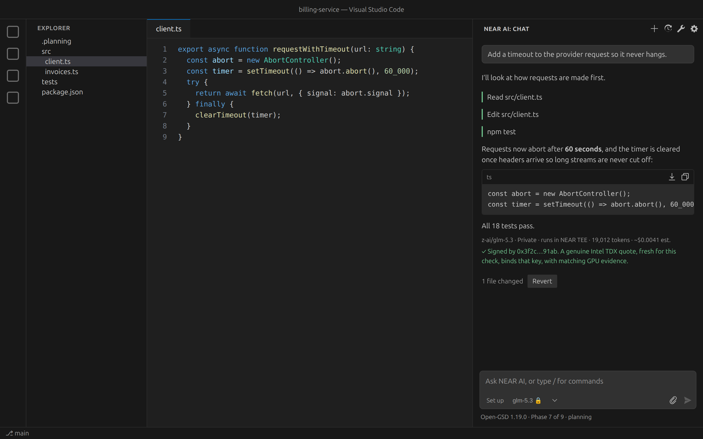
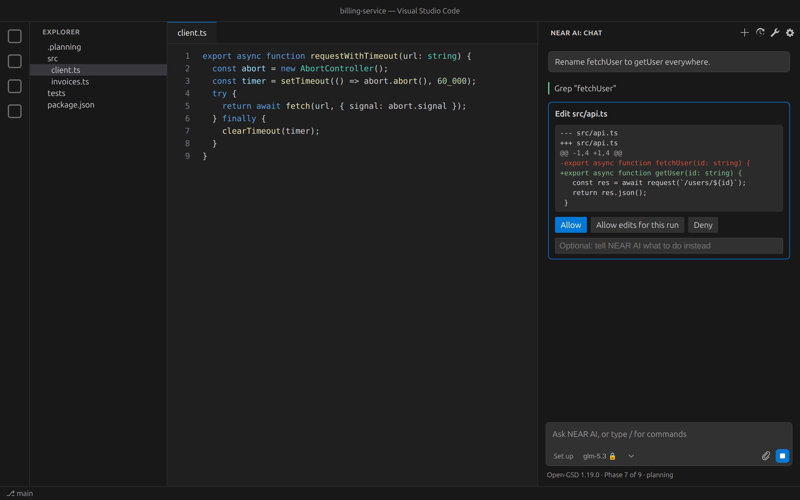
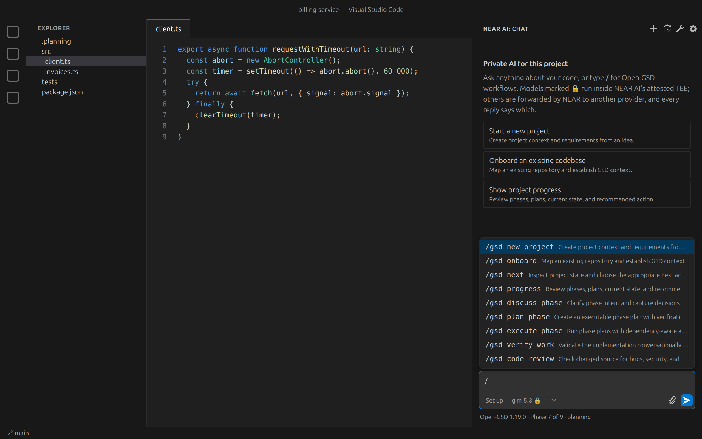
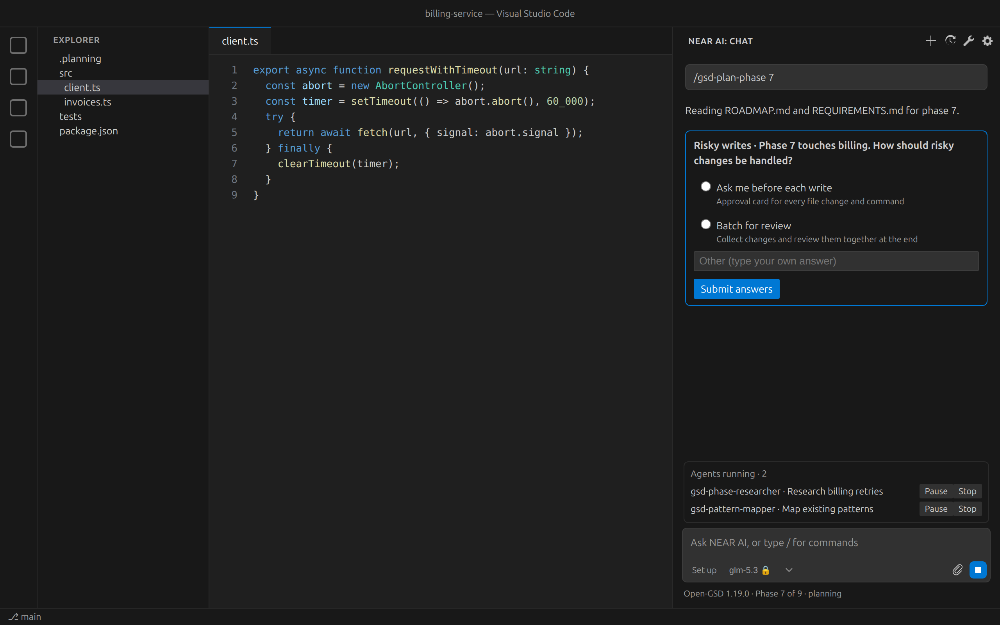

# Sterling Sovereign AI

**Private AI agents in the Sterling workbench for code, research, proposals,
writing, and data. Open the workbench in your browser.**

Work with models running in NEAR AI Cloud's confidential (TEE) inference, with
every model clearly labelled private or not. Agents plan and carry out whole
projects through built-in Open-GSD workflows, with a team suited to the kind of
project. You see the model, tokens, and cost of every answer, and decide
exactly what is allowed to leave your machine.



## What you can use it for

- **Software development.** Agents read your code, make changes, run your
  build and tests, and review, red-team, and verify the work. Dependency scans
  write an SBOM and check every package for known vulnerabilities.
- **Research and analysis.** Researchers search the web with the provider you
  choose, read pages, PDFs, and Office documents, verify quotes against their
  sources, and write cited findings. Hidden text and likely prompt injections
  in what they read are caught and reported.
- **Presales and solution design.** Turn requirements and RFP documents into
  solution designs, bills of materials, and proposals. Connect the MCP servers
  you already use for live product, pricing, or account data, and produce
  PowerPoint decks with diagrams.
- **Writing and content.** Plan, draft, edit, and fact-check long documents,
  with an editor and a red-team reviewer before anything is final.
- **Data analysis.** Read spreadsheets and data files, analyse them with your
  own tools, and write up the results with charts and graphics.

**SovAI: Set Up Project Team** asks which kind of project you have and sets
up a team and workflow for it. Your files stay in your workspace, and work is
sent only to the model you pick. After you connect a model provider, the extension
suggests this as your next step in the chat when the project has no team yet;
the same card offers **Set up a staff team** for a military staff project.
**SovAI: Project Setup** shows every setup step again: your project team, a
spending limit and web search. **SovAI: Set Up a New Profile** connects
another NEAR AI key or local runtime, and **SovAI: Select Profile** picks the
one this project uses. **SovAI: Use a Saved Profile** uses a profile you set
up in another project, without entering the key again.

## Why choose SovAI

- **You know where your work goes.** NEAR AI runs some models inside attested
  trusted execution environments and forwards others to third parties. Every
  model in the picker, and every reply, says which. Private models come first,
  and the default (GLM 5.3) is one of them. Transcripts are encrypted on disk,
  credentials are kept out of the agent's shell, and nothing is sent as
  telemetry.
- **Chat stays beside your work.** Open the SovAI chat drawer in the workbench
  to see replies and manage approval requests while you edit.
- **You always know the cost.** Every response shows the model, token count,
  and cost: estimated up front, then the actual amount when NEAR AI reports it.
  Each run has a cost budget and a daily spend limit you can adjust, and agents
  that repeat themselves are stopped before they waste money.
- **From idea to finished work, not just autocomplete.** Open-GSD turns a goal
  into requirements, phases, plans, and verified results. Agents do the legwork
  and you make the calls. The agents strip and Agent Activity show what every
  agent is doing as it works.
- **Pick models on evidence.** **Compare Models** runs the same coding,
  research, planning, and execution tasks on the models you choose, grades
  them with hidden tests, and ranks every model you have tested. One click
  puts the winner to work in any agent role.
- **You stay in control of what's sent.** Each message is checked before it
  leaves: likely secrets are held back, personal data asks first, TEE-only mode
  blocks forwarded models, and an emergency stop halts everything.

## Features

### An agent, not just a chat

Ask for a change and SovAI does the work in your workspace: it searches and
reads your code, edits files, and runs your build and tests, showing every step
as a row in the chat.

- **You approve what matters.** File edits show a diff and shell commands show
  the exact command before they run, with **Allow**, **Allow for this run**, or
  **Deny** (with a note on what to do instead). Reads and searches run freely.
  A command card also offers **Always allow "git push" in this workspace**,
  which adds a narrow rule to `nearAi.agent.allowCommands` and applies at once.
  Rules never cover `--force`, a typed URL, `rm`, `curl`, or an interpreter
  such as `node` or `bash`, and `npm run build` allows only that script. When
  a rule can never cover a command (it names a web address, chains another
  command, or uses an absolute path), the card offers no **Always allow** for
  it, so the button always does something when you see it.
- **A card says what the risk is.** Above the buttons, the card names the kind
  of risk in one plain sentence (it reaches outside this project, it can
  destroy work, it can send data off this machine, it reads keys, it installs
  software, or SovAI was not sure), then the rule's own reason, with
  **Show what will run** to expand the whole reason and the exact command or
  code.
- **Auto approve that stays out of your way.** In Auto mode, fixed rules clear
  everyday work on their own: reading and searching, builds and tests, git
  status, diff, commit, pull, fetch, switch, stash, merge, revert and
  cherry-pick, deleting single files or build output (`dist`, `node_modules`,
  `coverage`, …), installs from the lockfile, `sed` and `awk` that only print
  or substitute, and the project's own `node_modules/.bin` tools. Each part of
  a chained command such as `cd app && npm test` is checked on its own.
  Commands the rules can't decide go to a private safety model (with a second
  private model as fallback), which is told when the run has read web pages or
  MCP results and is stricter then; risky or uncertain ones ask, and the card
  says why. Web search and web fetch run by themselves, so research is not a
  stream of questions. A command that runs or reads outside this project is
  held unless you turn on **Auto allow outside the workspace**; nothing that a
  safety model says is fine can wave it through. Two switches let a project
  decide a whole kind of risk once: **Auto allow outside the workspace** and
  **Auto allow installs**. Destruction, publishing and reading keys always ask.
- **Undo a whole run.** Every file the agent changes is snapshotted first, so
  one **Revert** puts them all back.
- **A visible plan.** Multi-step work keeps a task list above the input box.
- **Sub-agents you can see and steer.** Workflows hand work to sub-agents,
  in parallel or in the background; each running one appears above the input
  box with what it is doing now, how long it has run, its tool calls, and
  **Pause**, **Resume**, and **Stop**. Click one to see its full activity. When
  a long run has shown nothing new for a minute, a progress line in the chat
  sums up the running agents and the spend so far.
- **Long sessions stay on track.** Old tool output is trimmed and, near the
  model's limit, earlier history is summarized automatically (with a handoff
  saved for GSD). **History** opens any earlier conversation as a tab, with
  every message (see [Your project's state follows the project](#your-projects-state-follows-the-project)).
- **Guard rails.** The agent can only touch files inside the workspace: a
  path outside it is refused at once. It asks before reading likely credential
  files (`.env`, keys) in every mode except Full auto, and once a run has read
  one, anything that could send data off your computer asks in every mode. In
  every mode, Full auto included, it asks before writing into `.git/` and NEAR
  AI's own project folders, publishing (git push, merging a pull request,
  GitHub API writes, package and release publishing, deploys), signing in or
  out of a registry or cloud account, and destroying work (recursive deletes,
  `git reset --hard`, history rewrites), with no "always allow". It never
  touches the project's own key folder (`.near-ai/state/keys/`) or your
  credential stores (`~/.ssh`, `~/.near-credentials`, cloud and registry
  credentials) and never runs a command that prints a stored token, in any
  mode, and never runs commands on your deny list.



### Chat that fits in your editor

- Streaming answers with formatted code and tables, plus **Copy** and
  **Insert at cursor** on every code block. Wide tables scroll sideways inside
  the message.
- **Panels fit narrow widths.** Make the chat or any SovAI panel narrow and
  it wraps, stacks or hides less important columns instead of scrolling
  sideways; on a very narrow panel each table row becomes a small card. Code
  and diffs keep their own sideways scroll so lines are never wrapped.
- Pick any model NEAR AI offers, or one from a local runtime such as Ollama or
  LM Studio, from the input box, with pricing and privacy shown.
- **Several conversations at once**, as in Claude Code. Start a new one with
  **+** while others keep running in the background; each has its own run,
  approvals, queued messages, task list, model, spend, and draft. The tabs
  above the chat show which are running, which are waiting for you (the view's
  badge counts every waiting prompt, and a notice takes you there in one
  click), which stopped, and which have new output. A waiting approval or
  question also shows a notice when the chat is hidden or VS Code (or its
  browser tab) is in the background, and again when you come back to the
  window if it was not announced yet; never twice for the same prompt.
  Ctrl+Shift+[ and ] (Cmd on macOS) switch between them; Stop stops the one
  on screen, the emergency stop stops them all. Up to eight are open; closing
  a running one asks first, and its transcript stays in **History**. The open
  conversations come back after a reload.
- **Runs cut off by a reload or by code-server are not lost.** A run cannot
  continue once its window reloads, crashes, or code-server closes it, but it
  saves its state after every step. The next time the chat opens, the
  conversation says "This run was cut off (the window or code-server closed
  it) at" the time, with **Resume** and **Dismiss**. Resume continues from the
  last saved step and tells the agent which steps had started but were never
  recorded, so it checks them instead of doing them twice. Nothing resumes
  until you click.
- **Stuck agents are caught, productive ones are not.** An agent counts as
  repeating itself only when it runs the same action and gets the same result
  each time; a command run again after a change, or one whose output changed,
  never counts, and neither does simply changing folder (`cd`) or printing it
  (`pwd`). A repeating agent is first nudged, then warned that its result
  has not changed and told to change approach, and stopped only if it keeps
  going. When a run stops short, the chat says why ("Stopped: the agent kept
  repeating ... with the same result." or "Stopped after reaching the turn
  limit (60 turns).") with a **Continue** button that sends "Continue." for
  you. Nothing continues until you click.
- **New Chat**, **History**, **Tools**, and **Set Up** live in the view's title
  bar, just like other VS Code views.
- **Tools** opens a directory of what the agents can use: every installed
  workflow and skill (grouped and searchable, with **Use in chat** to put
  `/name` in the chat box), agent roles and teams with the model each one
  gets, the built-in tools with whether each runs or asks under your current
  approval mode, your MCP servers and their tools, and the models your key
  can use with their privacy (TEE, local, or forwarded), context length,
  prices, and which settings use them. It updates when settings, the
  approval mode, the emergency stop, or MCP servers change.
- Keyboard-first, with screen-reader labels and reduced-motion support.

### Open-GSD workflows, one slash away



Type `/` for every installed Open-GSD workflow: start a project, onboard an
existing codebase, discuss, plan, and execute phases, verify work, review code,
map the codebase, and more, with arguments such as `/gsd-plan-phase 3`.
Workflows run on the SovAI agent runner with your chosen model: their
sub-agents appear as activity rows, file changes ask for approval and can be
reverted, and when a workflow needs a decision it asks you right in the chat.
Open-GSD installs itself into the extension's own storage the first time you
run a workflow and stays current; your `~/.claude` setup is never touched.



### Project types and red teaming

**SovAI: Set Up Project Team** first asks what kind of project this is:
software development, research and analysis, presales and solution design,
writing and content, data analysis, or general. Each type gets a tailored team
(for example architect, developer, reviewer, QA, security, and DevOps for
software; investigator, source verifier, analyst, writer, plagiarism checker,
and editor for research) and
guidance in `AGENTS.md`, which every agent reads, on how this kind of work goes
through the same Open-GSD cycle: plan, execute, **red team**, verify, audit,
release. The red-team member attacks the work before it is verified and
writes `RED-TEAM.md`; every finding is fixed or given a disposition with a
reason (accepted risk, deferred, disregarded), and verification and release
notes list the items not fixed. In these projects `/gsd-execute-phase`,
`/gsd-verify-work`, and `/gsd-autonomous` include the red-team step.

A research team works in a fixed order: investigator, source verifier,
analyst, writer, plagiarism checker, red team, editor. Each member has one
output file (`TEAM-FINDINGS.md`, `SOURCE-CHECK.md`, `TEAM-ANALYSIS.md`, the
report, `INTEGRITY-CHECK.md`, `RED-TEAM.md`, `EDITORIAL-REVIEW.md`) and a
stated definition of done, and all of them write for the audience and style
in `.planning/STYLE.md`. Reports are cited in the Chicago Manual of Style,
18th edition, notes and bibliography (a project can choose another style as a
recorded owner decision in `STYLE.md`), with footnotes or endnotes as fits the
report; reliability grades go in the audit annex, not in the notes. The
**plagiarism checker** is a permanent member of every research team: it
compares the draft with every source fetched in the run (CheckOriginality),
searches the web for distinctive sentences, checks every note against its
source and Chicago 18, never edits the report, and ends
`INTEGRITY-CHECK.md` with CLEAN or NOT CLEAN. The editor is the release gate:
it checks the report for coherence and comprehension, professional quality,
and that every note's verified source says what the sentence claims, makes
copy edits itself, sends factual problems back, and signs off with SIGN-OFF
or NOT READY. It cannot sign off while the integrity check says NOT CLEAN, is
missing, or checked an older draft. Nothing is released without SIGN-OFF,
and the delivered report carries its sources as real footnotes or endnotes
(CreateDocument and CreatePdf). The presales reviewer and the writing editor
are release gates in the same way. A project set up before this keeps its own
team file; run **SovAI: Update Team…** to pick up the new roles.

In a software project, the **DevOps** member sets up a protected way of
working: a CI workflow on every pull request (tests, a secret scan, and a
dependency audit), required checks and a review before anything reaches the
default branch, and releases that wait for your approval before publishing.
It never asks for or stores a token, and it never changes settings outside
the repository itself: for branch protection, environments, or secrets it
writes the exact commands and leaves them for you to approve and run.

**SovAI: Set Up a Staff Team** (also **Set up a staff team** in Team
Studio) makes a military staff section team for this project: choose the
section (J2 intelligence, J5 plans, J3 operations or J4 logistics), the doctrine profile (US Joint, US Army
MDMP or NATO/Canadian), the level, the nation and the kind of planning, then
check the roster before anything is written. Staff teams are marked private,
and the setup says: "The private models NEAR AI offers today come from developers in the People's Republic of China. Use this team only on fictional or exercise material until your organization approves a model for operational work."
A chat that runs a staff team says it once too. The team goes to your teams as
`<section>-<profile>-<level>.md` and runs with `/team:<that name>`; PROFILE.md
and the section's skills go under `.planning/staff/`, the staff settings into
`.planning/.near-ai/project.json`, and the section's guidance into `AGENTS.md`
between markers of its own, so teams of different sections can share a project. An
earlier team file of the same name moves to your teams archive. The team is
private, its members draft and recommend, and a named person decides: only
the **SovAI: Staff** commands approve, reject or release a product. It then
offers to load the starter scenario. The project records each section's team
(`staff.teams` in its settings), and the message when setup finishes names the
team, with **Task it now** (puts `/team:<name> ` in the chat's message box,
nothing sent) and **Open the Staff Room**. In a staff project the empty chat
shows a **Staff teams** card instead of "This project has no team yet": each
section with its team and a **Task** button, and **Set up** for sections not set
up yet. The card appears as soon as the setup finishes, even with the chat
already open; if the staff settings cannot be read, it says why and the reason
is in the **SovAI** output. The `/team` menu lists the project's staff teams first, labelled by
section, and each section card in the Staff Room has **Task in chat**. A team
file deleted or renamed in your teams shows as missing with **Set up again**. A
project set up before this was recorded is offered the matching teams already in
your teams to **Link**, after you confirm. Staff projects work on one machine
by default. Several people on their own computers sharing one staff project is
a preview: turn on `nearAi.staff.multiUserPreview` to try the invite, join and
admit commands, **Make This Staff Project Multi-User** and **Make a
Single-Machine Copy**. You can convert a project with labelled products when your
declared clearance covers those products. Operators can deploy the sync hub, and
live editing across computers comes in a later release. **SovAI: Update Team…** recognises a
staff team and brings it up to date for the project's current staff settings,
keeping members you changed. A J3 team's plan moves into execution only when
a person approves its transition brief; from then on the J3 keeps the
synchronization matrix, the DST and DSM and the assessment plan (in place,
where the J5 made them; the J5 then proposes changes), and every
FRAGO it drafts waits for a person to release it. The built-in staff servers (`mcp:staff-products`,
`mcp:guard-scan`, `mcp:intel-workbench`, `mcp:observations`, `mcp:cop-map`,
`mcp:logistics`, `mcp:orders`, `mcp:battle-rhythm`) are listed on the Tools page and in the Team
Studio tool picker; only a staff team's run gets them. `mcp:orders` gives the annex letters of your
doctrine profile, checks an order's annexes (wrong letter, missing owner, not yet released, stale
source), assembles an order or plan from released products and drafts FRAGOs, each a draft a
person releases. `mcp:battle-rhythm` keeps the battle rhythm calendar and exports it to an `.ics`
file, or imports one you put in the project. `mcp:observations` reads the feed reports kept in
`.planning/staff/observations/` (not committed), shows only what your
clearances cover, and says when a limit cut an answer. Its standing watch tools write files,
so only their own grant (`mcp__observations__watch_*`) gives them, never `mcp:observations`.
A J4 logistics team starts support planning at the first step, alongside force
planning, and every number in its products cites the calculator record that
produced it (`calc:<id>`, a record in `.planning/staff/calculator/`); the
release guard cannot clear a number without one, or with a record the
calculator did not write. Its members reach the built-in logistics server by
tool family (`mcp__logistics__calc*`, `logstat*`, `movement*`, `readiness*`):
- **The consumption calculator** (`calc_run`) multiplies planning factors you
  enter in `.planning/.near-ai/staff-factors.json` by the force list and the
  days, and gives days of supply from what is on hand. It ships no factor
  tables. Every result shows its formula and is kept as a record signed into
  the calculator ledger; `calc_read`, `calc_list` and `calc_factors` show them.
- **LOGSTAT** (`logstat_submit`, `logstat_read`, `logstat_validate`,
  `logstat_consolidate`): reports are entered as the units sent them, checked
  against the plausibility rules of the LOGSTAT definitions skill, sent back
  with the rule named, and consolidated only once they pass, with the colour
  bands you set and consumption against the calculator's forecast.
- **Movement** (`movement_table`, `movement_read`, `movement_route`): notional
  movement tables checked for lift and arrival against the required delivery
  date, and the shortest route on a road graph you keep in
  `.planning/staff/logistics/roads.json`, with no network.
- **Readiness** (`readiness_import`, `readiness_read`): readiness from a CSV
  you put in the project, by unit and equipment type, with stale figures
  marked.

For military staff teams, **SovAI: Load Staff Exercise Scenario** puts an
exercise scenario into `.planning/staff/scenario/` for the team to read. The
starter scenario, Exercise IRON LANTERN, is fictional and unclassified: a
peninsula with a coast and a strait, friendly and adversary orders of battle,
a mission with the higher commander's intent, and reports graded for
reliability and credibility (one left ungraded). Its grid references grow
northward like a real grid, and the scenario places its fictional grid over
empty ocean, far from any land, so positions can be written in real formats
without naming a real place. You can load a scenario file
of your own instead; it must be marked as fictional, unclassified exercise
data, and anything with a classification marking, a name on your real-entity
list (the one guard-scan uses: `.planning/staff/real-entities.txt` and the
names in `.planning/.near-ai/staff-guard.json`), or coordinates outside the
exercise area is refused. Beside the starter scenario the command writes J2 and J5
demo scripts in `.planning/staff/demo/`: the prompts for each step in your
staff profile's own terms, with a checklist of the headings, terms and
citations each product must contain. Loading again moves the earlier
scenario to `.planning/staff/archive/` rather than deleting it.

**SovAI: Staff: Start the Exercise Feed Simulation** replays Exercise IRON
LANTERN as live feeds for a J2 demo, on this machine only: Cursor on Target
tracks and spot reports, AIS sentences for ships in and near the Varn Strait,
RSS from fictional outlets, and a mock partner MCP server with fictional
HUMINT, SIGINT, MASINT and CI reports. Every message is marked SIM, every
ship has a made-up radio id that no real ship can hold, and the output panel
lists the addresses to connect an importer or MCP client to. The timeline
follows the J2 demo script and holds when the mid-demo report lands.
**Staff: Simulation Controls** (or the SIM item in the status bar) pauses,
resumes, steps and sets the speed: 0.5x, 1x, 2x or 4x. The inject script that
drives it, `resources/staff/scenarios/iron-lantern.sim.jsonl`, and the message
shapes are described in `src/domain/staff/sim/`.
**SovAI: Staff: Import Feed File...** brings your own GeoJSON, KML, Cursor
on Target, RSS, Atom or AIS (NMEA) file into the project's observation store.
The file is read in a separate process, never in the editor; you see how many
reports it holds, the format, the label and the time span, and what is held
back because it lies outside the exercise frame, and nothing is written until
you choose Import. Imported reports name the file they came from, and
importing the same file twice adds nothing.

**SovAI: Open Staff Room** (also **Open the Staff Room** in Team Studio once
you have a staff team) shows the project's staff run as a war room. The process
rail across the top shows each step in your profile's own words and whether it
is done, working now, next, or waiting for a named person. Below it, each staff
section is a squad of agents, each with its state in words; a token opens the
agent's card. On the right, **Human decisions** (in gold) lists every product
waiting for a person: **Approve…**, **Reject…** and **Release…** run the
**SovAI: Staff** commands, which ask who you are, confirm in a dialog and
sign, so nothing is decided in the page itself. Below it, the **Product
ledger** lists every product with its state; a row opens its provenance. The
workspaces share one map, the ledger, the decisions and one clock: **War room**
for the whole staff with what each section is doing, and **J2** with the
threat picture on the exercise map (adversary units with their grades, the
most likely and most dangerous courses of action as dashed red axes, NAIs and
control measures, layers each with the one section that writes it, and **Map
as table** for all of it in words), the source register, the PIRs with the
decision points they support, the collection plan and the standing watches
(`.planning/staff/products/j2/standing-watches.json`). The map in both
workspaces is the COP map: the scenario's synthetic geography, the product
layers and the observations your clearance covers, in 2D or on the globe, with
its time slider. It opens on **Imagery**: photo-like aerial imagery of the
exercise area with 3D terrain (drag with the right button or Ctrl to tilt;
the **3D terrain** switch and its height slider are in the drawer), and NASA
Blue Marble imagery on the globe. **Topographic** is one choice away in the
drawer's **Base map** (colour relief, land cover, hillshade, contours every
20 m with labelled index contours every 100 m, red roads and the blue KQ grid;
Natural Earth on the globe), and **Plain** keeps the flat 2D map. A margin on
the map gives the datum, the grid, the contour interval and a declination
diagram (the scenario's magnetic declination is fictional), with scale bars in
kilometres and nautical miles. On a computer that draws without a graphics
card, 3D starts off and the drawer says why. On the globe, **Spin** turns it
slowly until you touch the map (never under Calm or reduced motion); dragging
spins it too. All of it is bundled with the extension and drawn offline: no
map server is asked for anything. The exercise imagery and terrain are
synthetic, made from a seed, and not a real place. Hillshade, contours and the exercise weather (wind, fog, rain
and rough sea, for the time on the slider) are layers you turn on and off,
drawn offline from a bundled synthetic terrain and weather pack. Once a
scenario is loaded the map is the room's main panel: the process rail and the
section cards fold into one line (**Show the process and sections** opens
them, and **Staff teams** opens them at the first section's **Task in chat**
or **Set up**), and the map fills the rest of the panel. Its controls float over it:
the classification line, **Layers** (a drawer that slides in from the map's
edge, with the layers grouped as Picture, Environment and Reference, each
with its count and a SIM badge where the data is simulated), **Globe** (flies
out until the curve of the earth shows, with the exercise frame ringed in
gold; **Map** flies back), **As happened** or **As known**, **Map as table**,
**Full map** (the map over the whole Staff Room; Escape returns) and the time
slider. The map opens on the land, the named places and the units with a
margin, inside the exercise frame (its dashed line stays drawn), and units that would cover
each other draw as one stacked symbol with a count until you zoom in. Nothing
moves under reduced motion or Calm. Where WebGL or the map library is not available, the room
draws a 2D map instead, with the same drawer on its Topographic base (the
terrain pack's land cover, hillshade and contours), and says why in a line on the map. On either map a
name that would cover another name or a symbol moves to a free spot nearby,
is shortened, or is left off; the symbol always stays, and its name is still
in its description and in **Map as table**. The J2 workspace also lists the
live feed reports the project's observation store holds, newest first and
only what your clearances cover; a running exercise feed simulation fills it.
While the room is open it runs track decay, so tracks go stale and then lost.

The **J5**, **J3** and **J4** workspaces each show their section's real state,
read from the project: its products with owner, version and release state, the
decisions waiting for a named person in gold (the same signed buttons), and the
agents' work in violet. **J5** shows the COA cells with their themes and the
profile's validity tests, the comparison against the criteria and weights a
person approved (totals recomputed from the matrix), the wargame ledger turn by
turn (action, reaction, counteraction), the decision brief with every dissent
unedited, and the annex tracker held to the ledger by the orders check. **J3**
shows current operations (the event log with escalations and CCIR matches, on
the COP map), the decision support matrix and the synchronization matrix with
who owns them (the J5 while planning, the J3 once a person approves the
transition brief), fragmentary order drafts waiting for a person (FRAGORD, or
Frag O under NATO/Canadian), and the battle rhythm with open suspenses. **J4** shows LOGSTAT by unit with its bands, reports held
back until corrected, every calculator result with its formula, the movement
and readiness boards, supportability per COA and the logistics annex with the
profile's letter (the sustainment annex under US Army). Long
registers show a page at a time. **SovAI: Open Staff Room** opens on a
section when a command passes it one (`j5`, `j3`, `j4`).

**Standing watches.** A standing watch binds a PIR's indicator to an area, a
time window and the weakest source grade it counts, until the PIR's latest
time of value, and names the person it alerts. **SovAI: Staff: Create a
Standing Watch** creates and arms one; J2 watch members can only propose one,
which you arm with **Staff: Arm a Standing Watch**. Arming and retiring are
signed with your device key, so a watch written into the file by hand arms
nothing. A watch looks at each new observation only while a staff run or the
Staff Room is open; with neither, it pauses, and what came in meanwhile is
delivered as "missed while paused" when you are back. On a match it alerts you
(at most four alerts an hour, then a digest), and the watch officer drafts an
INTREP, and the threat analyst a course of action revision if the watch allows
it, as drafts for you in the release process. Nothing is released by a watch.
**Pause**, **Resume**, **Acknowledge** (once you have seen the drafts) and
**Reject or Retire** are commands of their own. Past its latest time of value
a watch expires. **Calm** stops all movement, as the system's
reduced-motion setting does; **Follow the action** moves the view to where the
work is; press **?** for the keys.

### MCP connections

**SovAI: Manage MCP Connections** adds Model Context Protocol servers, remote
(a URL) or local (a command), and shows each one's status, tools, calls,
errors, and last use. A server is off until you switch it on for a project.
Agents then get its tools as `mcp__<server>__<tool>`; a team member gets them
only if its `tools:` line lists `mcp:<server>`, so you can give a connection
to one team alone. Read-only tools follow your normal
approval rules; tools that can change data ask first in every mode unless you
mark the server Trusted, and the approval card shows exactly what is sent.
URLs (which may carry the access token), header values, and environment values
are stored in VS Code's encrypted secret storage.

Servers you add from this version on start with every tool undeclared: an
undeclared tool asks before every call in every mode, `fully-autonomous`
included, and it runs only while you are there. Servers you added before behave
as they did, except that a tool that changes data on a local server now asks
before every call in every mode, even on a trusted server, until you declare
what that server's tools may do in `nearAi.mcp.localServerEffects` (read, write
named project paths, reach named hosts). A declaration is your statement that you trust what that server's tools do: the gate does not check each call's arguments against it, so a declared tool runs without asking in Full auto. Only declare servers you trust like your own code. A tool that says it
may delete or reach the open world, or says neither way, keeps asking.
The MCP page has a "What it does" menu for each tool, so you can say whether it
only reads or changes data on the server. A local server runs on this machine
with your permissions. This is what you or the server declared it does. SovAI cannot check what a server does inside itself.

**The COP map** (`mcp:cop-map`) is a built-in local server for military
staff teams that reaches no network. Members read the COP layers and put
military symbols, control measures, overlays per adversary course of action
(ECOA-1 and so on, marked MLCOA or MDCOA) and decision points on the layer they
write, giving positions as grid references on the scenario's grid; anything
outside the exercise frame is refused. Each product layer (operations,
threat, terrain, logistics, plans) has one writer: anyone else's features
become a proposal in `.planning/staff/proposals/<layer>/` that the writer
merges, and every change is a new version a person decides on. Hostile and
other assessed symbols go on the J2's threat layer only; the plans layer is
kept apart from the current picture. Feed layers are views over observations
that nobody writes. The map component draws the picture in 2D or on the globe
offline, over the scenario's synthetic geography, with no map tiles fetched,
and a time slider on the shared clock.

**The intel workbench** is a built-in local server for military staff J2 teams
(a team whose file has a `staff:` block). It runs inside the extension, not as
a separate program, and reaches no network. A member uses it only when its
`tools:` line lists `mcp:intel-workbench`. It keeps the source register, the
PIR register and the collection plan as JSON files in
`.planning/staff/products/j2/`, one
entry per line. Reliability and credibility are graded separately; reports
that share an origin count once; every PIR names the decision point it
supports and its latest time of value; the collection plan holds
recommendations only, because the J3 approves asset allocation; and a PIR is
approved or rejected only by a named person, never by a tool. It also drafts
INTSUM and INTREP skeletons and checks a product for compilation risk, which
always ends with a question for a person and never with a clearance. Entries
take exercise labels only: org/Public, org/Internal, NATO Unclassified or
Protected A.

A server's tool descriptions are its own words, so they reach the model fenced
as untrusted text, cut to 1,024 characters, the way its results are, and a
description that looks like it tries to instruct the assistant is flagged to
you. The tools a server lists at its first connection are the ones you
approved; if it later adds a tool or changes a tool's description, inputs or
hints, those tools are not offered to agents until you choose **Approve tool
changes** on the MCP page. Pointing a server at a new address, transport or
program holds all its tools the same way. Your policy can also set the highest label each
server may receive (`ceiling.mcpLabelCeilings`, through **SovAI: Edit
Policy**): a call from a chat whose label is above it is refused before
anything is sent. See SECURITY.md, "MCP connections".

### Compare Models

**SovAI: Compare Models** (also on the Tools page) shows which models do your
kind of work best, measured on real tasks rather than published benchmarks.

- **Leaderboard first.** The top of the page ranks every model you have
  tested, using the latest result for each task: an overall score out of 10,
  scores for coding, research, planning, and execution, pass rate, speed, cost,
  stalls, privacy (TEE, Local, or Forwarded), and the roles it holds now.
  Results older than 30 days, from a task that has since changed, or for a
  model NEAR no longer lists are marked, so the ranking reflects what is known
  today.
- **Choose what to run.** Pick 2 to 6 models, the full or short task set,
  and how many times to run each task (up to 3). The tasks run in a temporary folder outside your
  workspace, and answers are graded by tests the models never see.
- **See the cost first.** The page estimates the cost from NEAR's prices
  before anything runs, and asks you to confirm. Each task run stops at
  `nearAi.agent.maxRunCostUsd`, and the comparison stops at your daily limit.
- **Quick or full.** **Reuse saved results** runs only what is missing, so
  testing a new model against ones you tested before costs only the new
  model's runs. **Run everything again** repeats every task.
- **Every run is saved** with the project (in its `.near-ai/state` folder) and
  listed under History in every editor, so you can reopen its report without
  running it again.
- **Use as…** puts a model into the chat's main model, the deep, standard, or
  fast tier, or an agent role in one click, with **Undo**. The choice is saved
  for the project, not only for this editor. Models that aren't
  private can't be chosen in TEE-only mode.

### Agent Activity

**SovAI: Open Agent Activity** (the pulse button on the chat view, or
**Activity** next to running agents) is an overview of agent activity; the chat
itself shows the work. **Now** lists the agents running: role, model (with a
TEE, Local, or Forwarded badge), what each is doing (thinking, writing, running
a tool, waiting for you, rate limited with the time until it retries, paused),
elapsed time, turns, tool calls, and cost so far, with **Pause**/**Resume**
(sub-agents), **Stop**, and **Show in chat**. Clicking an agent's label in the
chat opens the page on its row. The overview for **This conversation**,
**Today** (by `nearAi.spend.dayBoundary`), or the **Last 7 days** shows runs and
agents, where the time went (generating, tools and sub-agents, waiting for you,
waiting on NEAR), tokens in and out, cost (confirmed and pending, or NEAR's own
figure today), tool calls by tool, approvals (auto-allowed, asked, declined,
expired), and problems (429s, retries, errors, stopped runs) by model, so NEAR
capacity trouble on one model stands out. **History** lists past runs, newest
first: when, the first line of what was asked (redacted, about 80
characters), agents, duration, cost, and outcome; clicking one opens that
conversation in the chat. The page reads the project's activity history
(`.planning/.near-ai/activity.json`: ids, counts, tool and model names, no
content) and the spend ledger (below), so it survives reloads. **Export
details** saves the prompts, replies, and tool calls still kept in memory (for
`nearAi.activity.retentionMinutes`, 60, and up to `nearAi.activity.maxMegabytes`,
8 MB; secrets masked) as Markdown or JSON, for debugging.

**Now** also says what an agent waiting for you waits for (an approval, an
answer to a question, or an image to review), and shows an agent waiting for a
free slot as queued. An agent started by another agent is marked with an arrow
and names the agent that started it.

### Team Live

**Team Live** lets you watch a team work. Open it with **Watch the team** under
the running agents in the chat (next to a row of dots, one per agent, that
shows each one's state), with **Watch the team** in Agent Activity's **Now**,
with **Watch it live** on Team Studio's **Team shape** tab while that team is
running, or with **SovAI: Watch the Team Live**. It shows the newest team run
in the conversation on screen; when two runs go at once, pick one at the top.
Plain runs that start agents (an Open-GSD workflow, for example) show too.

- **The picture.** The lead is at the top and the members hang under whoever
  they report to. Members not asked to do anything yet are dimmed. Agents that
  are not members of the team (general-purpose helpers, Open-GSD agents) are
  smaller dashed cards in a row under the tree, each marked with who started
  it. A member asked several times is one card with a count. Cards never move
  while the run goes. In a narrow panel, or with **List**, the same team is an
  indented list.
- **Hand-offs.** When an agent is given a task, a dot carrying a short label
  of the task travels down the line to it, and the card wakes when it
  arrives. A working card breathes slowly and shows the tool it is using, what
  it is doing, how long it has worked, its model, and where the model runs
  (TEE, Local or Cloud). When it finishes, a dot travels back up with "Report
  ready" or "Did not finish". The lead counts the reports it has read.
- **States.** Queued, working, waiting for its helpers, needs you (amber, with
  **Answer in chat**), paused, retrying, done, failed, and stopped. Each has
  its own icon and words, so you never need to tell them apart by colour.
- **A card.** Click a card (or press Enter on it) for the member's card from
  Team Studio, this run's figures (task, model, time, turns, tool calls,
  approvals, cost), **Pause**, **Resume** and **Stop**, and the end of the
  agent's latest reply (the last 280 characters, with secrets removed).
  Escape closes it.
- **Calm.** Nothing moves when your system asks for reduced motion, or when
  you turn on **Calm** on the page (it is remembered). States still change, in
  words and icons. High-contrast themes drop the glow.
- **Keyboard and screen readers.** The team is a tree: arrow keys move
  between cards (Right to the first card under this one, Left to the one
  above), Home and End jump to the first and last. Hand-offs, waits for you
  and endings are announced politely; what an agent is doing moment to moment
  is not.
- **After a reload,** the last run in the project is drawn as it ended, from
  the activity history. An agent that was still working when VS Code
  reloaded shows as interrupted.

The page never shows prompts, files or tool results. Task labels are the short
descriptions the lead gives each agent, with secrets removed and cut to 80
characters.

**SovAI: Show Run Performance Report** opens, for this project, where its runs'
time went (model wait, tools and sub-agents, approval wait, idle), tokens in,
cached and out, model latency (p50, p90, max), input tokens per call, unanswered
approvals, and runs a reload cut off, with one row per run. From a terminal,
`npm run report:runs -- path/to/.planning/.near-ai/activity.json` prints the
same report for any project. The activity history keeps a run's events up to
256 KiB per run rather than its last 100 events.

**SovAI: Set Up Research Verifiers** applies the research profile to an
existing project: a block in AGENTS.md, coarse phases, and three scripts in
`scripts/verify/` (citation resolution, figure recompute from
`report/figures.json`, and an internal-path leak check) plus `verify-all.mjs`.
They read files only, so agents run them without asking; existing files are
never overwritten. You may edit them, but an edited verifier no longer matches
the hash recorded when it was scaffolded, so agents ask before running it until
you run **SovAI: Trust Research Verifiers**, which lists what changed and asks
before recording the new versions.

In a research project the plan checker is skipped only for plans that change
nothing but document, data and image files (judged from the plan and from what
has actually changed, using git); a plan that touches any source, script,
configuration, gate, test or CI file is checked. For a content-only plan the checker's reply starts with
Open-GSD's `## VERIFICATION PASSED` marker so the workflow carries on without
asking, and its next line says "PLAN CHECK SKIPPED (content-only plan): the plan
checker was NOT run" with the evidence: the marker means "carry on", not
"checked". See SECURITY.md, "Plan checks the research profile skips".

**SovAI: Export Usage and Activity** (also on the Agent Activity page and in
the Tools tab) saves usage for an organization, a project, or everything, over
today, the last 7 or 30 days, or custom dates, as CSV or JSON: one row per run
(time, organization, project, conversation and run IDs, the redacted first line,
agents, models, tokens in and out, cost confirmed and pending, outcome) and per
model (runs, requests, tokens, cost, 429s, retries, errors), with NEAR's own
total for today when a usage reporting token is set. No prompt or reply
content. The save dialog starts in Downloads, and it warns before saving into a
git work tree.

### Spend

Every billable NEAR AI response is recorded where the extension talks to NEAR,
whatever sent it: the agent and its sub-agents (foreground and background),
the auto mode's safety checks, context summaries, attachment reading
(vision and transcription), image generation, and the `@nearAi` chat
participant. Streams that break off or are stopped are recorded too, with
NEAR's request ID. Each API key has its own spend ledger on this computer
(in the extension's storage, shared by all VS Code windows; the key itself is
never stored), and every spend figure is a sum over it: the chat's status
line, **Spending Limits**, Agent Activity, the "about $X so far" progress
line, and the cost under each answer.

Each entry starts at its estimate (NEAR's per-token, per-request, and
per-image prices) and is then settled with NEAR's actual cost from
`/v1/billing/costs`: asked about 5 s, 30 s, 2 min, and 10 min after the
response, in batches, even after a reload. Figures say how sure they are:

- **confirmed**: NEAR's billing API reported the actual cost.
- **pending** (`~$`): waiting for NEAR to report it; shown at the estimate.
  A request NEAR still reports no usage for after 10 minutes is settled as $0.
- **est.**: NEAR returned no request ID to check (for example a request
  cancelled before NEAR answered), so only the estimate is known.
- **(NEAR)**: NEAR AI Cloud's own total for your API key today, from every
  computer using it, so the figure matches the NEAR AI console exactly. This
  needs a usage reporting token, which you add with **Set Usage Reporting
  Token** (stored in VS Code's encrypted secret storage, never in settings;
  **Clear Usage Reporting Token** removes it). The extension then asks NEAR
  once which organization and key ID your API key has (`/v1/check_api_key`)
  and reads the key's usage summary every minute while runs are going and
  every 5 minutes otherwise.

  As of November 2026, NEAR AI Cloud documents this usage summary but does not
  serve it yet: it answers HTTP 404. While that lasts, the token is kept, the
  figures are this computer's own, nothing is marked as failing, and NEAR is
  asked again every hour. NEAR's total appears without any action once NEAR
  turns the summary on.

**Where to set the usage reporting token.** Any of these runs **SovAI: Set
Usage Reporting Token**:

- **Settings** (search "SovAI" or "usage reporting"): `nearAi.spend.useNearUsageTotal`,
  next to the daily limit, has **Set usage reporting token** and **Clear**
  links. The setting itself is only an on/off switch (on by default) for using
  NEAR's total once a token is set; a token pasted into any SovAI setting is
  moved to secret storage and removed from settings.
- **The chat**: below the status line, "Match the NEAR console exactly: sign
  in to set up usage reporting" when no token is set. With a token set, the
  same link says how NEAR's total is doing: "Using NEAR's total" while NEAR
  answers, "Usage token set: waiting for NEAR's total" before the first
  answer, "Usage token set: NEAR does not offer its total yet" while NEAR
  answers 404, or "Usage token set: NEAR's total failed (fix token)".
- **Spending Limits**: **Set usage reporting token…** and **Clear usage
  reporting token**.
- **Agent Activity**, above the overview's cost, and **Elsewhere** in the Tools tab.
- The Command Palette: **SovAI: Set Usage Reporting Token**.

**How to get one: sign in once.** The token is not in the NEAR AI Cloud
console's UI, so the extension makes it for you. **Set Usage Reporting Token**
offers **Sign in with GitHub** or **Sign in with Google**:

1. NEAR AI Cloud's sign-in opens in your browser. Sign in as an owner or admin
   of the organization this project's API key belongs to.
2. NEAR sends the sign-in back to a one-time listener on `127.0.0.1` that
   only this sign-in can use. The page takes the sign-in out of the address
   bar and browser history.
3. The extension creates a read-only (`usage:read`) token named "Sterling
   Sovereign AI (date)" with no expiry, so it keeps working until it is revoked.
   It revokes the token the extension's previous sign-in made, then signs the
   session out, which revokes the sign-in itself. Only the read-only token is
   kept, in secret storage.
4. It tests the token right away and says what NEAR answered.

If NEAR ever rejects the token (revoked, or the API key moved to another
organization), the Spend section says so and **Fix token** signs in again. In
a browser-based VS Code such as code-server, VS Code also shows a box for the
sign-in address while it waits. If the browser is on the same computer, the
sign-in finishes on its own and the box closes. If it is on another computer
(for example code-server over Tailscale), the sign-in ends on a page that
won't load, because its `localhost` address is that computer's: copy that
page's whole address into the box. **Paste a token** takes one you already have (an owner or admin
can create one with `POST /v1/organizations/{org_id}/reporting-tokens`; see
NEAR's [Usage Reporting API](https://docs.near.ai/)). It starts with `rpt-`.

Without a token the status line reads like "$0.40 confirmed + ~$0.02 pending
today" for this computer; hover it for details. "Today" is the local calendar
day (`nearAi.spend.dayBoundary`: `local`, or `utc`). A reply's footer shows the
run's total (sub-agents, safety checks, and summaries included), replaced by
NEAR's confirmed figure once every request in the run is settled.

`nearAi.dailySpendLimitUsd` is checked before every request and before every
model turn against the larger of NEAR's total (when a token is set) and this
computer's confirmed plus pending spend; a run that reaches it stops and keeps
its work. `nearAi.agent.maxRunCostUsd` caps one run by its own ledger entries.
If NEAR itself refuses a request with HTTP 402 (credits or the key's spend
limit used up), the chat says "NEAR spend limit reached".

**Agent Activity** shows each run's agents, models, tokens, and cost, and
**Export details** saves them as Markdown or JSON. Its **Spend** section
answers "is my usage reporting token working?": it says whether figures are
NEAR's actual billing (the token works), settled per request, or estimated
from list prices, with **Test token now** and **Fix token**. It also shows
spend today, this week, this month, and this year, the 7-day burn rate, and
**Top up credits**, which opens the NEAR AI Cloud console. NEAR has no
top-up link that works without signing in, and its API doesn't give the
remaining balance to an API key or reporting token, so the balance and time
until it runs out aren't shown.

### Teams, attachments, images, and memory

- **Agent teams.** A team is a Markdown file you edit in VS Code: one
  `## member` section per member, with optional `role:`, `model:` (a model ID
  or deep/standard/fast), `privacy:`, and `tools:` lines. `privacy: private`
  keeps a member on a private model, one that runs in a NEAR TEE or on this
  machine: it gets the private model the run may use that is most capable
  for its tier, and if there is none the member does not run and the lead is
  told why, so its work is never sent to a forwarded model. To choose that
  model, set `nearAi.agent.deepModel` (or the standard or fast tier the
  member names) to a model whose picker label reads "Private · NEAR AI
  private hardware, checked each time it is used", or to a local model; if the configured tier model is forwarded, the
  next private tier model is used (deep, then standard, then fast for a deep
  member), then the most capable other private model. `privacy: any`, or no
  line, lets the member use any model the run may use. The picker's word only
  chooses the model: each request a private member sends goes only when the
  same check the labels use passes (a model on this computer, a model on a
  host your organization names exactly and reaches over https, or NEAR AI
  Cloud over a connection proven to end inside its private hardware), and is
  refused before anything is sent otherwise. The extension always
  writes `privacy:` as the member's last line before its instructions, so an
  older version that does not know it still reads the member's tools
  correctly; if you write it by hand, put it after `tools:` too.
  In a military staff team (a team file with a `staff:` block), the red team
  can write only its critique, the release guard only its verdicts, and the J3
  watch officer nothing at all: the extension refuses their other writes and
  gives them no shell.
  New research teams have `privacy: private` on every member (and presales
  teams on their reviewer), so client material stays on private models;
  change a member's line to `privacy: any` to relax it. Run one with `/team:<name> <task>`
  or **Manage Agent Teams**; a lead agent delegates to the members as
  sub-agents, each limited to its own tools. The lead runs members side by
  side wherever one does not need another's output, each on its own area
  (files, modules, or sections) and, when it changes files, in its own git
  worktree. It then merges their branches one at a time, sorts out conflicts
  (itself, or by handing one to the member who owns that area), runs the
  project's checks once after all the merges, and reports which branches
  merged and which conflicts came up; a member whose part fails does not hold
  up the others. Team Studio suggests, without blocking a save, giving members
  their own areas and naming who brings the parts together when a team has
  neither. The conversation keeps that team:
  later messages in it, and Open-GSD workflows run from it, give the
  specialist work to the team's members, while Open-GSD keeps the project on
  track (planning, checking, verification). Without a `/team` in the
  conversation, the project's own team is used the same way, and the chat
  says which team it works with. Because a project team file can come with a
  cloned repository, the first time a run would use it the chat lists its
  members and asks whether to use it; the answer is kept for that project and
  asked again when the file changes. A window VS Code does not trust never
  uses it. Saving a team file records a
  version. Teams can be duplicated, archived, restored, imported, and deleted.
  **Set Up Project Team** asks a few questions and drafts a team for the
  project in `.planning/.near-ai/team.md` for you to review. Your teams are
  kept in `.near-ai-teams` in your home folder, not inside the extension, so
  uninstalling the extension or installing it in another VS Code keeps them;
  teams saved before this move are copied across the first time the new
  version starts, and the old copies are left in place. In Team Studio,
  leaving the builder or the editor with unsaved changes asks first (Discard
  changes, or Save draft / Save); closing the tab keeps the unsaved team as a
  draft and says so the next time the studio opens.
- **Private teams.** Tick **Private team** on a team's Purpose step in Team
  Studio (it writes `privacy: private` in the team file's frontmatter) to keep
  every member on a private model, exactly as if each had its own
  `privacy: private` line. Marking a team private also writes
  `privacy: private` on every member, so an older version of the extension
  that reads only member lines still keeps each member private; unticking it
  removes only the team's line, and you remove a member's line yourself. A
  `privacy: tee` or `privacy: local` line you wrote by hand also keeps the
  team private; the studio shows it and leaves it alone. A
  team whose members are all private counts as private too. In a project
  with a knowledge base, Team Studio also treats every team as private when
  it asks AI about it (including one you are drafting with AI), and will not
  save a member on a model forwarded outside NEAR's TEE; the team is not
  marked private for runs unless you tick the box. Team Studio sends a
  private team only to a private model: a NEAR TEE model on NEAR AI Cloud's
  own endpoint whose attestation NEAR reports as supported or verified (a
  failed, unverified or unreported attestation does not count), or a model on
  this computer. Tick **Private team** when you ask
  the AI to draft a team and the description goes only to a private model,
  and the drafted team is marked private.
- **The local team check.** While you edit a team, Team Studio checks it
  for free, without a model, and shows what it finds as warnings (never as
  problems that stop a save): instructions that ask for something the
  member's tools cannot do (search the web, run commands, change files, make
  slides or PDFs), a member told not to edit files that still holds Write or
  Edit, instructions that do not say what the member hands back, a vague
  role, two members doing the same work, a reports-to line that names
  nobody or goes round in a circle, very long instructions, and anything that
  looks like a key, token or password.
- **Improve with AI.** **Improve with AI** in the team editor (and on the
  last step of the builder) shows the local check first. When you ask, it
  sends the team for one AI review and lists suggestions: each changes one
  field of one member (its instructions, role, reports-to line or tools) or
  adds or removes a member, with the reason and a line diff. Accept, Reject or
  Edit each one; **Accept all** takes only wording changes. Accepting changes
  the team in the editor only: **Save** writes it and keeps a version, as for
  any edit. A suggestion that adds a tool, or adds or removes a member, is
  labelled ("gives this member more power") and is accepted on its own. A
  suggestion whose field changed after the review (you typed, the file
  changed, or you accepted another suggestion for the same field) shows as
  **Stale**, and one that would break the team (a `## ` line, a 13th member,
  a reports-to loop) as **Invalid**; neither changes anything. The review
  never changes a member's model or privacy, leaves the plagiarism checker
  and members made from Open-GSD roles as they are, and turns a rename into
  advice. Which model may see the team follows its privacy: a private team
  only a private model; a team with some private members a private model,
  or, when there is none, the review leaves those members' text out and says
  so; any other team any model your settings allow. TEE-only mode, the daily
  spend limit and Emergency stop apply as they do in chat, and when no model
  is allowed the review says why and the local check still works. The panel
  names the model and the most the review can cost before you ask, or says
  the cost is unknown when NEAR gives no price for that model. An
  imported team you have not approved is reviewed as untrusted text. The
  model may add its own rating of the team before and after its suggestions;
  it is shown as the model's own opinion, not a measurement. **Cancel**,
  Emergency stop, or opening another team stops a review in progress.
- **Team Studio's dashboard.** Team Studio opens on your teams: a summary
  row (teams, running now, team runs and spend this week, and how many need
  attention), then a card for each of your saved teams and this project's
  team, all the same size (built-in teams are offered under **New team**).
  Each card shows the team's icon, name and kind, whether it is private, and
  its status: **Running now** (with **Watch it live**), **Ready**, **Needs
  attention** with the reason (an imported team not approved yet, problems
  the local check found, a member model your key does not offer, or a file
  that needs fixing) or **Never run**. It lists each member's model or tier,
  private or cloud, and flags a model that is not in the model directory.
  Its stats (runs, last run, success, average time, spend in total and per
  run) come from this project's run history: a run counts for a team when it
  was started with that team's `/team:` command, and its spend is the run's
  own figure from the spend ledger. Where nothing was recorded the card says
  "none yet" or "not recorded"; with no folder open there is no history. The
  health score is made from the local team check and the last role test that
  **Optimise all teams** ran (its scores only, kept on this computer), and
  shows each part. Your own 1 to 5 stars are set on the card (a group of radio
  buttons: Tab to it, then the arrow keys) and kept in this extension's
  storage on this computer, never in the team file, so a project team's
  rating never goes into the project or a code push. Ratings and role tests
  are kept by the team's identity: a team in My teams by its name there, a
  project's team by the project folder's real path. A `rating:` line an
  earlier build wrote into a team file is read once, and is left out of
  the file the next time you save that team in Team Studio.
  Archiving a team keeps its stars and health for Restore, and a new team
  under the same name starts without them. A member passes its role test
  only with full marks, as the model comparisons count a pass.
  Sharing or importing a team leaves out any `rating:` line. Sort by **Most used**, **Recently run**, **Rating** or **Name**, or
  show only the teams that need attention; Team Studio remembers your choice
  on this computer. Running
  now and the stats change as a team run starts or ends. With a project open
  and no project team, the first card says so and **Set up** starts one.
- **Building a team.** **New team** in Team Studio (and **Set Up Project
  Team**) first asks how you want to start: **Use an existing team**,
  **Create a new team** or **Recommend a team for me**. **Use an existing
  team** lists your own saved teams, from any project, next to the ones the
  extension provides; filter them with **All**, **My teams** or **Built-in**.
  Every card, here and in the team list, is the same size: the team's icon,
  name, where it came from, its member count, the first three lines of its
  description and its first four members with a count of the rest, with
  **Show more** to open that card and list every member. Select one for two buttons. **Use as is** asks for no name or description: with a
  project folder open the team becomes this project's team
  (`.planning/.near-ai/team.md`, run with `/team:project`), and if the
  project already has a team you are asked first and the old one stays in
  the team history; with no folder open it is put in the chat, and a
  built-in team is saved to My teams under its own name first (with a number
  added if that name is taken). **Clone and modify** opens the new team's
  Purpose step with the members filled in and its description copied. The
  copy starts with the name "<team name> copy" (with a number added if that
  name is taken), and it must keep a name of its own: if you type a name
  that one of your teams, a built-in team or this project's team already
  has, the studio says so under the name field and **Save** stays off until
  you change it. Names are compared ignoring capitals, spaces and
  punctuation, the way the team's file name is made. A copy never takes the
  icon of the team it came from: it starts with the default icon, and after
  you save it you can upload or generate its own on its Purpose tab. A built-in team made from your answers
  asks what the team is for and where its models may run, next to the
  buttons. **Recommend a team for me** asks the kind of work, its risk, where
  models may run and what the team is for, then shows the team it suggests,
  with the same two buttons; changing an answer clears it until you ask
  again. **Create a new team** starts **From scratch**, from
  **Clone an existing team** (the same list, to clone only), or from
  **Describe it, and AI drafts it** (say what the team should produce; AI
  proposes a team for you to look over before anything is saved; a drafted
  team waits on the main page and the New team screens until you use or
  discard it, even after Team Studio is closed, and reviewing it while you
  have unsaved changes asks about them first). Only a new team or a clone asks for its
  name, what it is for, **Private team** and **Save it as**. **Back** returns
  to the screen before from every step, and a saved draft opens on the step
  you left it. Saved as the project's team, a team is asked about before it
  first runs, like any project team. With no saved teams yet, **My teams**
  says so: save a team as one of your teams in Team Studio to reuse it
  anywhere.
- **Team icons.** Every team has an icon. On a saved team's Purpose tab,
  **Upload icon…** takes a PNG, JPEG or WebP picture of up to 2 MB (SVG is
  refused, because it can carry scripts); the picture is cropped to a square
  and kept as a 128 x 128 PNG of at most 64 KB beside the team file
  (`<team>.icon.png` next to your team's file, or
  `.planning/.near-ai/team.icon.png` beside a project's team), and the team
  file's frontmatter names it (`icon: <team>.icon.png`; older versions of the
  extension ignore the line). **Generate with AI…** asks an image model for
  one, starting with `nearAi.agent.imageModel`: it names the model and the
  cost first and makes the icon only when you agree, sending only the team's
  name and what it is for. A private team, a team whose members are all
  private, or any team in a project with a knowledge base can only use a
  private image model (a NEAR TEE model or one on this computer), and the
  button says why when there is none; TEE-only mode, the daily spend limit
  and Emergency stop apply as they do in chat. **Remove icon** goes back to
  the default; changing or removing an icon keeps the old one, and the
  **History** tab can restore it. A team without an icon, built-in teams
  included, shows its initials on a colour that comes from its name. Archive,
  restore, duplicate and **Use as is** keep a team's icon with it; **Clone
  and modify** does not. Each **Generate with AI…** also asks for a colour
  scheme and drawing style picked at random, so the same team can get a
  different picture; if the picture comes out exactly the same as another
  team's icon, one more is made, and if that one matches too, the icon is
  left as it was and the studio says so.
- **Sharing a team.** **Share…** on a team's card in Team Studio (or next to
  it when you build a team from an existing one) is the way to send a team
  (**Open as Markdown** opens the file itself). It saves the team as one file,
  `<team>.near-team.json`, for you to send. The file holds the team file
  exactly as saved, a short summary, a format version and a checksum; no
  file path from your computer, no setting, key or token. A team that holds
  something that looks like a key or password is refused, and one whose
  instructions name a folder on your computer is shared only after you agree.
  The team's knowledge graph stays behind unless you choose to include it, and
  then local paths, non-web sources and anything that looks like a secret are
  removed first. **Import…** takes a `.near-team.json` file (or a team `.md`
  file), checks it, shows its members, models and tools, and adds it to your
  teams only when you agree. A file changed after it was shared, or one that
  is not a team, is refused with a plain message. An imported team stays
  untrusted: the first time it would run, you are asked to approve it. Anything
  made from it before you approve it (a copy or clone, a team with a member
  copied from it, or a project team, including one made with Use as is) is asked
  about on its own, and a project team's question says where it came from. The checksum catches a
  damaged or hand-edited file but is not a signature; signed team files may
  come later. The `.near-team.json` format is JSON with `format`
  (`near-ai-team`), `formatVersion` (1, or 2 when it carries the team's icon),
  `team` (`name`, `description`, `members`, `markdown`), `knowledge` (null
  unless included), in version 2 `icon` (the icon as base64, or null),
  `listing` (reserved, always null) and `integrity` (`sha256-` and the base64
  SHA-256 of the team text and knowledge, and in version 2 the icon). A team
  without an icon is shared as version 1, which earlier versions of the
  extension import. Import checks a shared icon like any other and leaves out
  one that is not a valid icon, saying why, while still adding the team.
- **Update Team.** A team made from a built-in project type records where it
  came from in its frontmatter (`template`, `templateVersion`, and a
  `templateBase` list with a fingerprint of each member as generated), so it
  can pick up improved built-in roles later. **SovAI: Update Team…** (or
  **Update team…** on the team's card in Team Studio) previews the change
  member by member before anything is written: a member you never changed is
  replaced with the current definition; a member you changed is shown as a
  diff and you choose to take the new one, keep yours, or keep yours and add
  only what is new (a `privacy:` line, new tools, and new Output and Done-when
  sections), and a member you kept is not asked about again until its
  built-in definition changes; members you added are left alone; members no longer built in are
  kept and flagged; and new built-in members are offered. A permanent
  built-in member (the research team's plagiarism checker) is not offered
  but added, and the preview says whether the team was missing it or you had
  removed it; your own edits to it are merged like any member's. Team Studio's
  AI team builder adds the plagiarism checker to any team it drafts that
  gathers or checks sources. A project team's
  `AGENTS.md` guidance is updated the same way when the extension wrote it.
  Teams made before stamps existed are recognised by their member names, and
  a member that matches any released version exactly is treated as unchanged.
  The file is backed up to the team's version history first, and the result
  has an **Undo**. When a team is out of date you are told once per version
  ("Team update available", with Review, Later, and Don't ask for this team);
  turn this off with `nearAi.teams.updateNotifications`. Nothing is updated
  while a run is in progress; the update is offered when it ends.
- **Attachments.** Attach images, audio, documents, and text files to a
  message. Images are read by the chosen model if it reads images, otherwise
  by a vision model (`nearAi.agent.visionModel`); audio is transcribed with
  Whisper. The chat says which model handled each file. PDFs (with a text
  layer), Word (.docx), PowerPoint (.pptx, with speaker notes), and Excel
  (.xlsx, every sheet) are read on your machine, and only their text is sent.
  Scanned PDFs, the old .doc/.ppt/.xls formats, and video are not supported.
- **Graphics and slides.** Agents draw diagrams and icons as SVG, turn
  supplied images into SVG with VectorizeImage, render SVG to PNG, and build
  PowerPoint decks (.pptx) with CreatePresentation. All of this runs on your
  machine.
- **PDF and Word documents.** Agents deliver a finished report as a PDF with
  CreatePdf or as a Word document with CreateDocument, from Markdown they
  pass inline or from a `.md` file in the workspace (`source_path`). Both take
  headings 1-4, paragraphs, bold, italic, inline code, links, bullet and
  numbered lists (nested by indentation), block quotes, code blocks, pipe
  tables, and images on their own line (PNG, JPEG, or SVG in the workspace,
  relative to the Markdown file), and notes: cite with `[^id]` in the text
  and define each note once as `[^id]: Title, publisher, date. https://...`.
  Notes are numbered in order of first citation; a citation with no
  definition, a definition nothing cites, or a repeated definition stops the
  tool with an error naming the note, so no citation is dropped silently.
  Options: `title`, `author`, `page_size` (A4 or Letter), `date`, and `notes`
  (`endnotes`, the default, or `footnotes`). In the Word file the notes are
  real Word endnotes or footnotes, numbered and linked by Word; in the PDF
  they are superscript numbers that link to a Notes section at the end, or to
  the foot of the page that cites them, and the URLs in them are clickable. The PDF has bookmarks from the headings,
  numbered pages, clickable links, and its title and author in its
  properties; the Word file uses Word's own Heading 1-4 styles, so the
  Navigation pane and a table of contents work, with real tables, lists,
  links, and pictures. Both are written on your machine with no library, and
  the same input gives the same bytes: no date is written unless you pass one.
  Like every write, they stay inside the workspace, ask first where a write
  is protected, and **Revert** removes them. The PDF uses the standard PDF
  fonts (Helvetica and Courier), which cover Western European text;
  characters outside them are written as `?` and listed in the tool's result,
  so use CreateDocument for other scripts. Web images are not downloaded:
  save the image into the workspace first.
  Every team member that can build decks can also make these documents: a
  `tools:` line that lists `CreatePresentation` also grants `CreatePdf` and
  `CreateDocument` when the team is loaded, so existing team files gain them
  without being edited.
- **Image generation.** When the provider lists an image model, the agent can
  create PNGs in your workspace with its GenerateImage tool. It uses
  `nearAi.agent.imageModel` unless it asks for another image model on your
  key. It asks first and shows the model and price. You then see each image in
  the chat, with where it will be saved, the model, the attempt number and the
  prompt, and choose **Accept** (it is saved where the agent wanted),
  **Request changes** (your words go back to the agent, which makes a new
  version, editing the draft when the model can), **Discard**, or **Open full
  size**. Images made by helper agents show in the same chat, labelled with the
  agent. The agent waits for your answer in every approval mode. Past
  `nearAi.agent.approvalTimeoutMinutes` the run is paused on the image, as on
  an approval, and the card stays; only in Full auto and for a helper agent
  running in the background does the review time out then, with the draft
  kept and the run carrying on. The agent is told not to judge or remake
  images on its own. Waiting images are kept in the
  project's `.near-ai/drafts/images/` folder, which is never committed. A draft
  is removed once a new version of it is made, and ones left there are removed
  after 7 days. **Revert** removes an accepted image.
  Set `nearAi.agent.imageReview` to `off` to save images straight away.
- **Project memory.** The agent saves durable facts with Remember, looks them
  up with Recall, and starts each run with the facts relevant to your request.
  Memory stays on this machine and refuses secret-looking content. Review,
  correct, retract, export, or reset it with **Manage Project Memory**.

- **Staff products for military staff teams.** A staff section team (a team
  file with a `staff:` block, for exercise and fictional data only) works on
  products through three tool groups its members are granted:
  `mcp:staff-products` (propose a new version, give a gate verdict, submit
  for a decision, withdraw, status, list, the shared registers including the
  operations centre's event log (read with a read-only tool of its own), the wargame
  ledger and the tradecraft lint) and `mcp:guard-scan` (the release-guard's
  checks for markings, the exercise box, real names, decisions written as
  made, personal data and J4 numbers without a calculation). Every product
  follows one path: draft, guard-checked, awaiting decision, then approved or
  rejected, then released. No agent can approve, reject or release anything:
  only a named person can, with **SovAI: Staff: Approve a Product**,
  **Reject a Product**, **Release a Product** or **Withdraw a Product**,
  signed with this device's key. Your name and role are self-declared until
  verified credentials arrive. **SovAI: Staff: Show Products** lists every
  product, what waits for you, and its history. **SovAI: Staff: Decide a
  PIR** approves or rejects a PIR awaiting a decision, signed the same way; a
  decision written into the PIR register any other way does not count. After
  switching to a git branch with an older or different staff ledger, **NEAR
  AI: Staff: Use This Branch's Ledger** makes that branch's ledger the one
  SovAI checks, if its own signatures and chain verify. The
  exercise box and the
  real-entity list are yours to set in `.planning/.near-ai/staff-guard.json`
  and `.planning/staff/real-entities.txt`. Everything a staff team writes
  lives under `.planning/staff/`: products in
  `.planning/staff/products/<section>/`, with each gate's report beside them,
  and the signed ledger in `.planning/staff/ledger/`.

### Cybersecurity scans

**SovAI: Cybersecurity** opens a panel that tests a system you own for
security problems. Pick a target, a web address, a folder in your project, a
range of addresses, a running container, or a git folder, and the panel shows
the exact scope it will touch before anything is sent to a model: hosts, ports,
folders and exclusions.

Accept a short regional disclaimer once per engagement: twelve regions, each
with its own statement of the law that applies, detected from your locale and
changeable. The record names who accepted it, on which machine, and which
version of the text, so a later change asks you to accept again.

Then run a scan:

- **Defensive** checks response headers, TLS certificates, DNS, open ports,
  robots.txt, committed secrets, infrastructure-as-code, dependency
  vulnerabilities and fingerprints. These need no extra tools installed.
- **Offensive** can attempt exploits. It needs your grant once per engagement,
  then runs only inside a container or a temporary folder, under a rate limit
  and a time budget, with a Stop button that works within one step.

Every attempt ends in one of four verdicts, not vulnerable, exploit failed,
could not determine, or verified access, and a failure always says why. A check
that could not run is named, so a scan never reads as clean when it was only
incomplete. Each step is an entry in an append-only chain that proves the report
was not edited afterwards, and you can replay a finished run offline.

Export the result as Markdown, JSON, or SARIF, each carrying the authorization
record. Ten optional host tools (nmap, trivy, nuclei and others) add more
checks; the panel lists them with how strongly it recommends each and what
installing it changes on your machine.

A long scan can run in the panel or in the chat. A deep run goes to the chat by
default, so closing the panel does not end it and you can steer it by typing.

A scan runs on an abliterated model, one whose safety tuning was removed, so
the payloads a scan sends are not refused by the model's own guardrails. When
your organization offers one, the panel uses it and shows it in the Model list.
When it offers several, the panel asks which one this scan runs on, once per
engagement. When it offers none, the panel keeps your chat model and says so,
because a safety-tuned model may refuse a scan's payloads.

### Your project's state follows the project

Everything SovAI keeps for a project lives in one folder inside the project,
`.near-ai/state/`, which the extension keeps out of git. Every editor that
opens the folder on this computer (VS Code, code-server, another window) reads
and writes the same files, so they all show the same thing.

- **Every conversation, in full.** Each chat, including `@near` chats from
  VS Code's Chat view, opens with every message, reply and tool step in order.
  Nothing is summarized away, and tool steps open to their output. The one
  exception is a single tool result larger than 2 MiB, which is stored
  shortened with a visible "output shortened" marker.
- **Five live, the rest archived.** The 5 most recently used conversations stay
  open and instant (change it with `nearAi.history.liveConversations`). Older
  ones are archived inside the project, never deleted, and still listed in
  **SovAI: Show Chat History**; choosing one opens it whole and makes it live
  again.
- **Runs, checkpoints and spend history** for the project are kept there too,
  so an editor never mistakes another editor's live run for a cut-off one.
- **Model choices follow the project.** Compare Models results and the choices
  you apply with **Use as…** are saved with the project, so every editor shows
  them without running the comparison again. A setting you wrote in your
  workspace still wins, then the project's choice, then your user setting.
  Choices you applied earlier in one editor's user settings are offered for
  import once, never copied without a click. Compare Models lists what this
  project has chosen under **Chosen for this project**, with a **Use my
  settings** button on each row. To drop every choice at once, run **SovAI:
  Clear This Project's Model Choices**. A cleared choice stays cleared on every
  computer after sync. Putting a model into one role changes only that role.
- **Pick up where you left off.** When you open a project in another editor or
  on another computer, a card in the empty chat shows the last chat, how its
  run ended (finished, cut off, waiting) and the current Open-GSD phase with
  its next step. **Open chat** reopens that chat and starts nothing, so it
  spends nothing.
- **Your old chats come along.** The first time 0.4.20 runs in an editor, that
  editor's earlier chats, runs, comparisons and spend for the project are
  merged into the project folder. Nothing is overwritten or deleted, and
  opening a folder you never used SovAI in still writes nothing.
- **The same NEAR AI key, no set-up.** A second editor on the same computer
  uses the project's NEAR AI key without asking, because an encrypted copy of
  it lives in the state folder. It is opened only inside the editor on your
  computer, never written to disk in plain form. With
  `nearAi.sync.keepKeyInProject` off, that copy cannot be opened without the
  recovery code or that device's own secret storage.

### Sync between computers

Project sync keeps an encrypted copy of the project's state on its own git
host, so the same chats, runs, comparisons, model choices and NEAR AI key are
there on another computer. It is off until you turn it on. SovAI pushes only
its own encrypted `near-ai/state` branch there, plus your own branch when you
choose to put your code online (see below). Sync itself never touches your
branches and never pushes to `main`.

- **A sync control in the chat bar**, next to the profile control, from the
  moment the panel opens. It reads **Sync off · Turn on**, **Synced ·** and
  the clock time of the last sync (for example **Synced · 09:05**),
  **Syncing…**, **Needs attention** or **No online home · Set up**. When it
  says **Needs attention**, the reason is written in plain words on a line
  under the control. One click starts the right step. It works from the
  keyboard and in light, dark and high-contrast themes. While sync is off, the
  pick-up card and the first-run screen also offer **Keep this project on your
  other machines**. On a computer that has no AI profile yet it appears
  only after a model provider is connected, so **Connect AI to start** comes first.
  Dismiss it once and it never comes back.
- **Turn on** (**SovAI: Turn On Project Sync**). It first shows what your git
  host will and will not be able to see, and only after you agree does it make
  your recovery code.
- **The recovery code** is 52 characters in 13 groups of 4, shown once. It is
  never stored, logged or sent anywhere, and nobody, including SovAI, can
  recover it for you. Keep it in a password manager.
- **Sync is turned on in each editor you use.** Whether sync is on is decided
  in each editor, not by a file in the project. A second editor on the same
  computer shows **Sync off · Turn on** until you click it; there it shows the
  same consent screen and makes no new recovery code.
- **On another computer**, open the cloned project and run **SovAI: Enter
  Recovery Code**. Your chats, runs, comparisons and model choices appear, and
  the NEAR AI key is set up for that project. If that computer already has
  chats of its own, they are kept and added.
- **When it runs.** Saving on this computer is immediate. Sync runs after a
  run or chat reply ends, 60 seconds after you leave the window when nothing is
  running, every `nearAi.sync.intervalMinutes` minutes (10 by default, 0 turns
  it off) while the editor is open and idle, and on **SovAI: Sync Project
  Now**. It pulls when the project opens (the card says "Checking for
  updates…" and chatting is never blocked) and when you come back to the window
  after 5 minutes or more. A long chat does not hold sync back: while a run is
  in progress, sync runs when the run pauses (it is waiting for you, or between
  steps) once the last sync is older than the interval (10 minutes when the
  interval is 0), and **Sync Project Now** runs at once. The chat that is
  running is never changed by such a sync: what another computer saved for it
  is added when the run ends. Sync backs off when you are offline.
- **Sign-in.** Automatic syncs never ask you to sign in. If GitHub needs you,
  the control says "Sync needs you to sign in. Choose Sync Project Now." and
  that click may ask.
- **Archived chats on another computer** are listed from the encrypted index
  and downloaded only when you open one.
- **Size.** You get a warning from 500 MB. At 1 GiB, older archived chats stop
  going up and stay on this computer only, with a message saying how many.
  Nothing is deleted, and they go up once there is room.
- **Other commands:** **Show a New Recovery Code** (a new code does not lock
  out the old one; see the next point), **Turn Off Project Sync**, **Sync
  Project Now**, **Give This Project an Online Home**, and **Put This Project's
  Code Online** (see below).
- **A new recovery code does not lock out the old one.** Anyone who has your
  old recovery code and can read the project's repository can still open
  everything synced, including what is synced from now on, because your chats
  keep the same key. A new code only opens this project on a new computer. A
  way to change that key is planned. Treat a leaked code as a leak of
  everything synced.
- **Files in the project folder do not decide what sync does.** Sync's private
  mirror and hooks live in the editor's own storage, outside the project. The
  sync switch, the remote address and the online-home progress are kept per
  editor. A key file is used only when it is your own private file, is not
  tracked by git and passes a key check. A saved-state folder that came with
  the repository's files is not used. The agent asks before it writes anything
  under `.near-ai/` and before it reads the state folder. **Revert** touches
  only the project and the editor's own worktrees.
- **A deleted or rewound sync branch is rebuilt.** If the `near-ai/state`
  branch is deleted, replaced or set back, it is rebuilt from what your
  computers hold. Nothing is lost, and an older recovery code is never taken
  back.
- **Entering the recovery code is safe on a computer with chats.** It waits
  for running chats and syncs, keeps what it could not carry, and removes the
  folder from before the join only when everything in it is carried. What was
  kept sits in a folder named `.near-ai/state.previous-` and a time, beside
  the project's saved state. It can be deleted by hand once those
  conversations are open elsewhere.

### Give your project an online home

If the project has no git repository or no remote, turning on sync offers
**Give this project an online home**, or click **No online home · Set up**.
Nothing happens on your account until you click.

- **One click** starts git for the folder if needed, signs in to GitHub through
  VS Code, asks whether the repository is **public or private** (every time,
  with no default), creates it under your account, adds it as the project's
  remote and pushes the encrypted sync branch, saying each step in plain words.
- **Private or public.** A private repository is visible only to you and the
  people you invite, and GitHub's free plan limits some features for private
  repositories. On a public one, anyone can see your project's code, but your
  chats, keys and other state stay encrypted and unreadable.
- **SovAI pushes only two things.** Its own encrypted `near-ai/state`
  branch, and your own current branch when you choose to put your code online.
  It creates no other branch and never forces a push.
- **Pushing your own code is a separate step**, after sync. It shows exactly
  which files would go up and blocks likely secrets (`.env` files, keys,
  credential files). It also checks the earlier commits that would be
  published, not only the current files: a secret committed and later deleted
  still blocks the push, because the history would carry it. SovAI never
  rewrites your history for you. Declining the code push leaves sync working,
  and ends with a sentence saying how to do it later.
- **Put your code online whenever you choose.** Run
  **SovAI: Put This Project's Code Online** in the Command Palette. It runs
  the same checks as the setup (every file listed, secrets blocked, the history
  checked, your click on the summary, your own git name and email) against the
  project's online repository. Running **Give This Project an Online Home**
  again on a project that already has one offers the same push when your
  branch is not online yet, and otherwise tells you the online home has its
  code.
- **Your own records stay on this computer.** SovAI's account and run records
  in `.planning/.near-ai/` (your organization and profiles, activity, costs,
  resume points and the like) are left out of the code push, and the summary
  names them. Only the shared project files, `team.md`, `project.json` and
  `verifiers.json`, go up with your code.
- **The default branch.** While `near-ai/state` is the only branch in the
  repository, GitHub shows it as the repository's default branch. Once your
  code is pushed, SovAI makes your branch the default branch on GitHub when
  the default is still `near-ai/state`, using your GitHub sign-in. It never
  changes a default branch you chose yourself. On a pasted address SovAI
  cannot do this, so it tells you which setting to change (on GitHub:
  Settings, then Default branch).
- **A repository set up by an earlier version** may still show `near-ai/state`
  as its default branch. Run **Give This Project an Online Home** again: when
  your branch is already online, SovAI asks once, with a click, whether to
  make it the default branch. Nothing changes unless you click, and nothing is
  pushed.
- **Without GitHub sign-in** (for example in code-server without the GitHub
  provider) the extension says so and offers the `gh` command-line tool if it
  is installed, or the address of an existing empty repository you paste in.
  It never asks you for a token.
- **Errors are plain.** A taken repository name, being offline and a refused
  permission each get a sentence, and a half-finished setup can be resumed.

### What your git host can see

| Your git host and anyone who can read the repository | |
| --- | --- |
| Can see | That this project uses SovAI sync, roughly how much is stored, and when you save |
| Cannot see | Conversation titles or text, messages, ids, model names, your NEAR AI key, or your name |

Everything is encrypted on your computer before it leaves, and only the
recovery code (or a device you already unlocked) can open it. Sync commits use
a generic author, `near-ai-state`, not your git identity, and a constant
message. Chats at rest in the project folder are protected by file permissions
on that machine and are end-to-end encrypted everywhere they leave it. The
details are in [SECURITY.md](SECURITY.md#project-state-and-sync).

### Team Mode (preview)

Team Mode is for people working on one project together. It is not the agent
teams above. It is an early preview and is off until you turn on the setting
`nearAi.team.preview`. For now a team holds only its owner: inviting teammates
arrives in a later release.

- **SovAI: Enable Team Mode** creates a team for the open project. It asks
  for a team name and your name as teammates will see it, makes a signing key
  for this computer and keeps it in the editor's secret storage, starts a
  signed team log on its own branch of the project's git remote, and commits a
  small `team.json` so every clone can find the team. Your code branch is
  pushed only if you choose **Share with my team** afterwards.
- **SovAI: Verify Team Log** checks every entry in the team log (signatures,
  order and permissions) and reports who is in the team and anything it
  refused. It is shown when the preview is on or a team is running in this
  project.

Team Mode never asks for or stores your email address. Your private key never
leaves this computer's secret storage. The team log and `team.json` hold your
display name, your key's public half and its fingerprint, which anyone who can
read the repository can see. This computer remembers which team each project
belongs to: if `team.json` later names a different team or owner key, Team
Mode pauses and says so, and starts again only after you choose **Trust this
new team** and confirm it.

### Respects your projects

The extension only acts in projects you set up with it. Opening a folder,
the sidebar, or a status view never adds files. Open-GSD is installed only
when you run a workflow and it's missing, and the extension never adds its own
copy of Open-GSD to a project that doesn't already have one.

## The Sterling workbench

The Sterling workbench runs as a container on your computer. Open it in your browser.
The Eclipse Theia release image includes Sterling Sovereign AI Canadian Defence Edition:

- **A right-hand rail** with Get Started, Portfolio, Chat, Team Studio, Agent Activity,
  Standing Orders, Compliance and Documentation. Data Management and Model Factory are shown as
  planned. The rail's Chat shortcut slides the chat drawer in and out; closing the last
  conversation hides the drawer and keeps the conversation.
- **Get Started** with **Set up Sterling**, **Open Chat** and **Explore a sample agent team**,
  and four Defence work areas: Capability Development, Exercises & Training, Planning and
  Resource Management. Each opens its own page, where **Create** makes a new work area in a new
  folder and never overwrites one. Planning and Exercises & Training open the **Staff Room**.
- **Portfolio Room** for a local DND and CAF portfolio snapshot, and **Resource Inventory** for
  resources by source, which you can link to a work area.
- **Compliance** shows control states only from an evidence bundle checked for the same
  release, and **Documentation** shows these guides with their screenshots and diagrams,
  rendered when the image was built.
- After **SovAI: Generate SA&A Package…**, **Download ZIP** sends the package to your browser.

The image runs as a non-root user, keeps telemetry off and contacts no outside server unless
you configure one. It has no sign-in of its own, so run it on `127.0.0.1` only.

## Get started

1. Follow the [workbench setup guide](docs-site/content/using/getting-started.md) to start the
   release image on your computer and open it in your browser. Open or create a project folder in
   the workbench.
2. Open **SovAI Chat** and choose **Set up a new profile**, or run
   **SovAI: Set Up a New Profile** from the Command Palette.
3. Choose a local runtime such as Ollama, LM Studio, or another compatible model server
   that the container can reach. The local preview can use a server without an API key.
   Profiles that require a saved key need a workbench with a secret store.
4. Once the connection check passes, the chat comes into view and suggests what to do
   next. If the project has no team yet, it starts with setting up your
   project team. You can skip it and start chatting.
5. Open **Chat** on the workbench's right rail and start chatting, or type
   `/new-project` to plan something new.

## Security and privacy

Use **SovAI: Generate SA&A Package…** in the Command Palette to export a Security
Assessment and Authorization draft for a published release. Choose the version and
where to save the ZIP. The extension checks the published evidence archive against
its release digest and builds a consolidated editable sponsor Word draft and a
control-to-evidence workbook alongside the assessment documents and blank
administrative forms. The command downloads public release files from GitHub
and verified privacy forms from Canada.ca. It includes a publication approval
receipt when GitHub can verify it for the selected release: the container image approval from
0.4.37, the Marketplace approval for earlier releases. The evidence index
records missing and partial coverage. Your organization completes deployment
scope, findings, and approvals through its own review process.

- **Web research with guard rails.** Agents search with the provider you pick
  (**SovAI: Set Up Web Search**: your own SearXNG, Brave Search, or Tavily),
  read pages and documents with WebFetch, verify quotes with
  CheckCitations, and check a draft for copied or closely paraphrased
  passages with CheckOriginality (it compares the draft only with pages
  fetched in the same run). Hidden text is stripped, likely prompt injections are
  flagged, outside content is fenced as data, and after reading it, commands
  that could send data out always ask. Agent Activity shows each detection.
- **Cybersecurity scans** touch only the scope the panel showed you. Loopback is
  scanned only when you name it literally, an intrusive step needs one grant and
  is still refused if it strays outside the scope, and exploit payloads run in a
  container or temporary folder with no network, never on your machine.
- **Dependency checks.** **SovAI: Scan Dependencies for Vulnerabilities**
  writes an SBOM (`sbom.cdx.json`, CycloneDX) from your lockfiles and checks
  every package on OSV.dev and your runtimes on endoflife.date, after asking
  once per project; only names and versions are sent. Findings appear in
  Problems and the status bar, it re-checks when the project opens and when
  lockfiles change, and agents run the same check after changing
  dependencies. **Add Dependency Scan Workflow** adds a GitHub Actions scan.
- **Project state stays yours.** Chats at rest in the project folder are
  protected by file permissions on that machine and are end-to-end encrypted
  everywhere they leave it. Sync is off until you turn it on; what your git
  host can see is shown before it is, and the recovery code is shown once and
  never kept by anyone else.
- **Your Standing Orders.** A signed policy file in this extension's own storage, never
  in your project, sets the most the agent may do, and your settings only
  narrow it. Your organization can hand every computer its rules as a signed
  file: **SovAI: Add Your Organization's Rules** opens it and shows twelve
  words to compare with the ones your organization's security contact reads
  to you, and your own rules can then only narrow your organization's.
  **SovAI: Standing Orders** opens "Your organization's Standing Orders" or
  "Your Standing Orders" on a computer without them. The page is read-only.
  You see each change as a
  proposal first, applied to your own rules or saved as a file for your
  organization, and the page has **Edit my Standing Orders**, **Show as stored** and
  **Reset my Standing Orders**, which resets your own rules only. If the policy is
  missing, changed or expired, only reading and planning run until you choose
  **Reset my Standing Orders**, which asks first and keeps your old file. A policy
  written for a newer version of the extension is never reset for you: it
  says to update the extension, and until then only reading and planning run.
  Protected B sent to a server your policy names as local now needs a TLS pin
  and a Protected B authorization naming that server. Content marked
  Controlled goods (Canada), ITAR or US export-controlled (EAR) stays on this
  computer under the starting rules. A fresh install, and the renewal of
  starting rules nobody edited, get these entries: an upgraded install whose
  starting rules nobody edited gets them when its policy is next renewed, in
  the last 30 days before it ends, and an edited policy gets them through a
  change on the policy page. Your organization's rules can carry
  export-control decisions, but nothing grants access with them yet, and
  meeting those programs stays your organization's obligation. Every model request is checked against its routing before anything is
  sent and leaves a record in a log of its own; on a fresh install nothing
  changes where requests go. See [Your policy file and decision records](SECURITY.md#your-policy-file-and-decision-records).
- **Labels and clearances.** **SovAI: Set Label** labels a file, a folder or
  the project, and agents cannot read what your clearances do not cover. Add a
  clearance in **SovAI: Standing Orders** with **Edit my Standing Orders**, then **Apply my draft**.
  A chat's label rises with what its agents read and decides where its content
  is sent. Content at a level that needs a private cloud model goes to NEAR AI
  Cloud only over a connection proven to end inside its private hardware, and
  each such answer is checked afterwards; otherwise it stays on this computer.
  A host your organization names as local serves Protected B and the other
  local-only levels only when the policy names that exact host and it uses
  https, and Protected C, classified and NATO Confidential and above never
  leave this computer, whatever tier a policy gives them. Classified work on this computer says once per chat that
  the computer is not recorded as accredited. Labels show the scale's name with
  the level ("Organization: Internal"); the organization's Confidential level
  reads "Sensitive".
  Only you lower a chat's label, with **SovAI: Lower This Chat's Label** and a
  reason. Click the chat's label beside the model to run it, or use the button
  under a refusal that names it; lowering a file's label does not lower a chat
  that already read it. Labels and routing are an organizational control that helps prevent
  mistakes. See [Classification labels and routing](SECURITY.md#classification-labels-and-routing)
  and [Your policy file and decision records](SECURITY.md#your-policy-file-and-decision-records).
- API keys live in VS Code's encrypted **SecretStorage**, scoped to each
  project. They are never written to settings, workspace files, logs, history,
  or exports.
- Keys are only sent over **HTTPS**. Plain HTTP is allowed only for a model
  runtime on your own machine (`localhost`).
- A **privacy check** runs on every chat message before it is sent. Likely
  credentials and private-file paths are held back (you can send a message once
  anyway), personal data asks first, and `tee-only` mode blocks models NEAR
  forwards to other providers and holds every request to the private-hardware
  check.
- A **trust badge** under each cloud answer of the lead agent says **Verified private model**,
  **Model verified, connection not proven** or **Not verified**. It is set only
  from checks that ran: NEAR's signature over the exact request and response, a
  genuine, fresh Intel TDX quote that binds the signing key, and whether the
  connection was proven to end inside the private enclave. It is on the lead
  agent's answers only; a helper agent's answer has none. A request to NEAR AI
  Cloud goes over a connection held to its attested key whenever a fresh proof
  exists. At a level that needs an attested cloud a mismatch refuses the
  request; at other levels it is sent without the key held and the badge says
  so. Click it for the
  reasons, Check again and the full attestation. Escape anywhere in the chat,
  or a click outside, closes the details. **Show full attestation** opens a
  read-only JSON tab named for the answer, such as "Attestation: answer at
  14:32, glm-5.3". It is not a file: you cannot edit it, it never asks to be
  saved, and nothing is written to your project. It is kept for the last 20
  answers. See
  [what it does and doesn't check](SECURITY.md#the-trust-badge-on-each-answer).
- The chat view only receives display data; credentials and raw context stay
  in the extension host.
- The extension never reads `~/.near-credentials` or other local wallet files.

Read the full [security and trust report](SECURITY.md).

## Requirements

- Docker or a compatible container runtime that can run the released `linux/amd64`
  workbench image, and a browser on the same computer.
- An approved compatible model server reachable from the container for the first chat.
- For Open-GSD workflows: npm access, so Open-GSD can be installed the first
  time you run one.

## Settings

| Setting | Default | What it does |
| --- | --- | --- |
| `nearAi.defaultModel` | `z-ai/glm-5.3` | Model used for new chats. |
| `nearAi.actionPolicy` | `approve-risky` | `approve-risky`: edits and commands ask first. `mostly-autonomous`: edits run, commands ask. `auto`: edits run, and commands run when they pass the safety check (fixed rules for clear cases, a private TEE model for the rest; risky or uncertain commands ask, with the reason). `fully-autonomous`: everything runs except deny-listed commands, including reading credential files inside the project; writes into `.git/` and SovAI's state folders, publishing, signing in or out and destruction still ask with no "always allow", after a credential read anything that could send data out asks too, and the key folder and credential stores are refused (intended for throwaway workspaces; actions held after the agent read outside content still ask; see SECURITY.md, "What the agent can do without asking"). You can also switch it from the picker next to the model in the chat's bottom bar (Ask before edits / Edits auto / Auto / Full auto); it writes user settings, or the workspace or folder settings when the value is set there, asks before Full auto, and shows "Stopped" while the emergency stop is on. |
| `nearAi.agent.allowCommands` | `git status`, `git diff`, `ls`, … | Commands that run without asking, matched by their leading words (`git push` covers `git push origin main`, but never `--force` or a URL). The approval card's **Always allow** adds entries. In `auto`, each part of a chained command is matched on its own; in other modes, anything with `;`, `\|`, `>`, or `$( )` asks. |
| `nearAi.agent.denyCommands` | `rm -rf /`, `git push --force`, … | Commands the agent may never run. |
| `nearAi.agent.deepModel` / `standardModel` / `fastModel` | Kimi K3 / GLM 5.3 / Qwen3.6-35B-A3B | Models for Open-GSD's sub-agent tiers (opus / sonnet / haiku). By default only research, synthesis, and mapping roles use the fast tier; GSD's `budget` and `adaptive` model profiles also send checkers and the test-writing auditor there. |
| `nearAi.teams.updateNotifications` | `true` | Say once per version when a team made from a built-in project type has a newer template (**SovAI: Update Team…**). |
| `nearAi.agent.safetyModel` | the fast tier | With `auto`, the model that checks commands the rules cannot decide. Used only when it runs privately (TEE or local); otherwise those commands ask. |
| `nearAi.agent.imageReview` | `ask` | `ask`: each image the agent makes waits in the chat for you to accept, change or discard it, and is saved to its path only when you accept it (the agent waits too, in every approval mode; past `nearAi.agent.approvalTimeoutMinutes` the run is paused on it, except in Full auto and for a background helper agent, where the review times out, the draft is kept and the run carries on). `off`: images are saved straight away. |
| `nearAi.agent.maxParallelAgents` | `8` | Sub-agents that may run at once. |
| `nearAi.agent.maxTurns` | `60` | Model turns per run before it pauses for you; **Continue** in the chat carries on. |
| `nearAi.agent.unattendedAutoApprove` | `true` | In Auto and Edits auto, sub-agents run commands the safety rules call safe and verification scripts inside the project that no agent of the run wrote or changed without a card; pushes, deletes outside the project, publishing, network commands and credential paths still ask. See SECURITY.md, "Sub-agents nobody is watching". |
| `nearAi.agent.subagentApprovalWaitSeconds` | `20` | How long a sub-agent's approval card waits before the sub-agent is told "awaiting approval" and carries on; the card stays queued, and allowing it later allows that command for the run. |
| `nearAi.agent.approvalTimeoutsBeforePause` | `3` | Unanswered approvals in a row that pause the whole run with a message (0 never pauses). |
| `nearAi.agent.approvalTimeoutMinutes` | `15` | How long an approval in the main conversation waits before the run shows as paused on that step (it keeps waiting, up to a day). Questions the agent asks you and images waiting for your review pause the run the same way, and their card stays for you to answer. Only in Full auto and for a sub-agent running in the background do they close as timed out at this point and the run carries on (a question gets "(no answer, timed out)", an image's draft is kept). `0` waits indefinitely. |
| `nearAi.agent.compactAtTokens` | `70000` | Summarize a conversation's earlier history at this many tokens whatever the model's window (old tool output is trimmed from 80% of it). 0 uses only the window thresholds. |
| `nearAi.agent.modelStallSeconds` | `120` | A reply that sends nothing for this long (before its first token, or between chunks) is retried once on the backup model; a reply that keeps streaming is never cut (30-minute ceiling per reply). 0 turns it off. |
| `nearAi.agent.backupModel` | standard tier, then deep | The model a stalled reply is retried on; only a model at least as private as the chat's. |
| `nearAi.agent.maxParallelWorktrees` | `4` | Sub-agents that may work in their own git worktree at once (within `maxParallelAgents`). |
| `nearAi.agent.autoResumeAfterReload` | `true` | A run a reload cut off in the last 12 hours carries on by itself, with a notice; finished steps are not run again. |
| `nearAi.agent.roleModels` | research, mapping, fetch and extract roles → fast; planner, plan-checker, verifier, analyst, editor, red-team → deep | Model or tier per agent role, by name or `*` pattern; a team member's own `model:` line wins. |
| `nearAi.gsd.researchProfile` | `true` | Research and writing projects use the research profile for Open-GSD: coarse phases, quick mode for content edits, verifier scripts in `scripts/verify/`, and the plan-checker only for plans that change a gate or verifier. |
| `nearAi.agent.saveTranscripts` | `true` | Save full conversations, including file contents the agent read, encrypted in this project's git-ignored state folder, so History can resume them. Every editor on this computer shares them. They are never committed. |
| `nearAi.history.liveConversations` | `5` | How many of the most recently used conversations per project stay fully open (1 to 50). Older ones are archived inside the project, never deleted, and reopen in full when you choose them. |
| `nearAi.sync.keepKeyInProject` | `true` | Keep the project's chat key in a private file (mode 0600) in the project's ignored state folder, so every editor on this computer can open the chats and use the NEAR AI key with no set-up. Off: each new editor or browser asks for the recovery code. |
| `nearAi.sync.intervalMinutes` | `10` | How often, in minutes, a project with sync turned on syncs in the background while idle. 0 turns the background sync off (0 to 1440). Sync itself runs only after you turn it on. |
| `nearAi.baseUrl` | NEAR AI Cloud | OpenAI-compatible endpoint (HTTPS, or HTTP on localhost). |
| `nearAi.privacyMode` | `standard` | `tee-only` blocks models NEAR forwards to other providers, and sends a request only when it runs on this computer, on a host your organization names exactly over https, or over a connection proven to end inside NEAR AI Cloud's private hardware. |
| `nearAi.dailySpendLimitUsd` | `0` (none) | Stop sending requests once today's spend reaches this amount: the larger of NEAR's own total for the key (with a usage reporting token) and this computer's spend ledger. |
| `nearAi.spend.dayBoundary` | `local` | When "today" starts for spend figures and the daily limit: local midnight, or `utc`. |
| `nearAi.spend.useNearUsageTotal` | `true` | With a usage reporting token set, show NEAR's own total (and check the daily limit against it). Its description links to **Set usage reporting token** and **Clear**; the token itself lives in secret storage. |
| `nearAi.autoInstallGsd` | `true` | Install Open-GSD when a workflow needs it and keep it current in SovAI projects. |
| `nearAi.mcp.localServerEffects` | `{}` | What the tools of an MCP server that runs on this computer may do, by server id, declared once: `"read"`, `{ "workspaceWrite": ["docs/**"] }`, `{ "network": ["api.example.com"] }`. A declaration is your statement that you trust what that server's tools do: the gate does not check each call's arguments against it, so a declared tool runs without asking in Full auto. Only declare servers you trust like your own code. Until a local server is declared, its tools that change data ask before every call in every mode, and a tool that says it may delete or reach the open world, or does not say, keeps asking. A declaration that cannot be read is ignored with a warning. User settings only. See SECURITY.md, "MCP connections". |
| `nearAi.team.preview` | `false` | Shows **SovAI: Enable Team Mode** in the Command Palette. Team Mode is an early preview, and for now a team holds only its owner (see [Team Mode](#team-mode-preview)). |
| `nearAi.team.pollSeconds` | `15` | How often, in seconds, Team Mode checks the team log while this window is focused (5 to 3600); unfocused windows check every 2 minutes. |

## Good to know

- **Privacy labels come from NEAR's model catalog.** Each cloud answer of the
  lead agent has a **trust badge** (Verified private model; Model verified,
  connection not proven; Not verified), checked once in the background from
  NEAR's signature and a fresh Intel TDX quote in the editor; it does not check
  TCB status, enclave measurements or NVIDIA's verdict (see
  [what it does and doesn't check](SECURITY.md#the-trust-badge-on-each-answer)).
- **No wallet, staking, or NEAR account sign-in yet.** They wait for a
  documented NEAR AI contract; sign-in uses API keys.

## Troubleshooting

- **Chat says "Connect AI to start":** choose **Set up a new profile**.
  If it also offers **Choose a profile**, pick a saved profile; one whose key
  needs checking again is checked when you pick it. If it says "Open a folder
  to start", open your project folder first.
- **No models or costs shown:** check your API key and endpoint; prices appear
  when the provider publishes them.
- **A workflow won't start:** make sure npm can reach the registry, then run
  any workflow, such as `/gsd-progress`, to install Open-GSD.
- **Endpoint rejected:** use an `https://` URL, or `http://localhost` for a
  local runtime.
- **Local runtime unreachable:** start it (for example `ollama serve`) and
  check the URL ends in `/v1`, then run **SovAI: Set Up** again.
- **A model goes quiet mid-reply:** a reply that sends nothing new for 2
  minutes (keep-alive pings don't count; reasoning does), that NEAR cuts off
  before it finishes, or that runs past an hour is stopped and its request
  closed. The turn is tried again (each wait longer, and a stalled one gets
  twice the time); after 3 retries the chat says, for example, "moonshotai/kimi-k3
  stopped responding (no data for 240 s) — retried 3 times", Agent Activity
  shows the run failed, and the work so far is kept: send a message to continue
  or switch models. The cut-off requests are recorded with NEAR's request ID and
  settled with what NEAR bills.
- **NEAR AI is overloaded (HTTP 429 "service_overloaded"):** NEAR AI asks the
  extension to wait, and it does: every agent of the run waits together, then
  one request goes to that model to test it, and while NEAR keeps refusing the
  model only two requests at a time go to it, with longer waits each time it
  refuses again. A team member that keeps getting "overloaded" for about a
  minute, or whose model sends nothing twice in a row, moves to the next model
  and carries on, and Team Live, the Staff Room and the chat say so, for
  example "threat-analyst switched from Kimi K3 to Qwen 3.6: Kimi K3 is
  overloaded at NEAR AI". The next model is your backup model
  (`nearAi.agent.backupModel`), then the standard, deep and fast tier models,
  then the chat's own model, skipping any that is busy too, and only ones at
  least as private (a TEE model stays in the TEE; a `privacy: private` member
  stays private; TEE-only mode is respected). A member whose team file names
  its model moves too, and the notice says so. If no model is left, the member
  stops and says why in words ("GLM 5.3 is overloaded at NEAR AI", "Kimi K3
  gave no answer for 90 s", "refused by policy"), and the lead is told the
  same.
- **Runs pause or stop in code-server (VS Code in a browser):** two things
  in code-server affect long runs. First, VS Code's proxy support asks the
  browser tab which proxy to use for every new connection; when the browser
  pauses a background tab, nothing answers and runs wait until you come back.
  If you don't use a proxy, set `"http.proxySupport": "off"` in your user
  settings and reload (the extension offers to do this for you, once).
  Second, when a tab stays disconnected while another code-server tab
  connects, code-server closes the window's extension host after about 5
  minutes, which stops every run in it. Keep the tab open and in front during
  long runs; if a run is cut off, **Resume** it from the chat.
- **A conversation says "Locked conversation":** this editor cannot open its
  key. Run **SovAI: Enter Recovery Code** and paste the recovery code that was
  shown when sync was turned on. It happens when `nearAi.sync.keepKeyInProject`
  is off, or when the chat came from another computer that you have not
  unlocked yet.
- **"This project has no online home yet, so it cannot sync":** the project has
  no git remote. Click **No online home · Set up** in the chat bar, or run
  **SovAI: Give This Project an Online Home**.
- **Sync says "Sync needs you to sign in. Choose Sync Project Now.":** automatic
  syncs never open a sign-in. Run **SovAI: Sync Project Now** and sign in to
  GitHub when asked. If the message says git asked for a sign-in the editor
  cannot show, run `git fetch` once in a terminal in the project so your
  credential helper can save it.
- **I lost the recovery code:** nobody can recover it for you. On a computer
  that is still unlocked, run **SovAI: Show a New Recovery Code**. A new code
  does not lock out the old one: anyone who has your old code and can read the
  project's repository can still open everything synced, including what is
  synced from now on, because your chats keep the same key. A way to change that
  key is planned.
- **Chats are not saved in this project:** the project's saved-state folder is
  part of the project's files in git, so SovAI does not use it. Chats still
  work, but they are not saved until the folder is taken out of the repository.
  Nothing was changed. Take it out of git's index, for example with
  `git rm -r --cached .near-ai/state .near-ai/locks`, then commit. SovAI's own
  `.gitignore` files keep it out from then on.
- **"This conversation is running in another editor right now":** another
  editor on this project is running that conversation. Wait for it to finish
  there, or start a new conversation here. The conversation checks again every
  30 seconds while it is open and reloads itself when that run ends. If the
  other editor stopped without a sign of life for 3 minutes, Resume is offered.
- **Entering the recovery code says a chat is running:** "A chat is running in
  this project, in this editor or another one. Enter the recovery code again
  when it has finished. Nothing was changed." Enter it again once the run has
  finished. If it says a sync is running, wait a moment and enter it again.
- **"Some conversations could not be added":** they could not be opened on this
  computer, so they were kept beside the project's saved state, in a folder
  named `.near-ai/state.previous-` and a time. Nothing was deleted.
- **The agent changed something you didn't want:** click **Revert** under the
  run. Changes made by shell commands it ran are not included; use git for
  those.

## Build from source

```bash
npm ci
npm run check            # type check and tests
npm run verify:release   # package and verify the VSIX
```

Issues and contributions: [github.com/VitalPointAI/near-ai-vscode](https://github.com/VitalPointAI/near-ai-vscode). See [CONTRIBUTING.md](https://github.com/VitalPointAI/near-ai-vscode/blob/main/CONTRIBUTING.md) for branches, pull requests and reviews.

## License

MIT. See [LICENSE](LICENSE).
