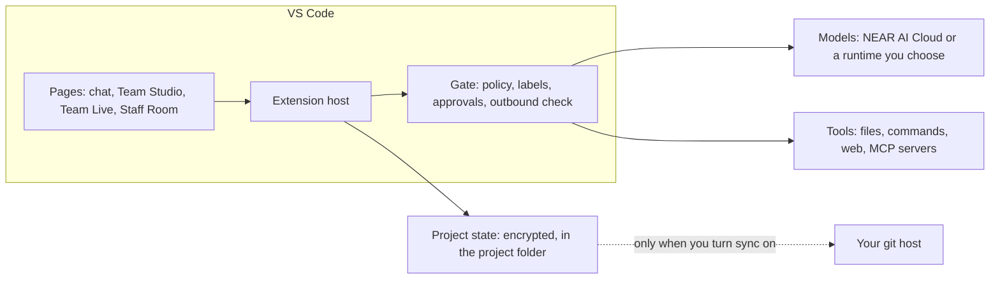

# Architecture overview

This section renders the repository's design documents as they are. Nothing here is a second copy
to keep in step: each page says which file it comes from, and that file is the one to edit.

## How the parts fit

The pages only display what the extension host sends them; keys and raw context stay in the host.
Every model request and every tool call goes through one gate, which applies your organization's
policy, the labels and the approvals before anything leaves. The [security policy](../security/policy.synced.md)
describes each of these in full.

## Where to read more

| Topic | Document |
| --- | --- |
| How the code is organized today | [Architecture](./codebase/ARCHITECTURE.synced.md), [Structure](./codebase/STRUCTURE.synced.md), [Integrations](./codebase/INTEGRATIONS.synced.md) |
| Platform direction: our own engine, sandbox and identity | [Platform direction research](./design/platform-direction/README.synced.md) |
| Model provenance, use tiers and Western defaults | [Model provenance](./design/model-provenance/DESIGN.synced.md) |
| Multi-user staff workspaces and signed replication | [Multi-user sync](./design/multiuser-sync/DESIGN.synced.md) |
| Guided setup and local model management | [Guided onboarding](./design/guided-onboarding/DESIGN.synced.md) |
| Assigned positions, organization modes and the portfolio view | [Portfolio and assignment](./design/portfolio-and-assignment/DESIGN.synced.md) |
| Staff team templates | [Staff teams design](./design/staff-teams/10-STAFF-TEAMS-DESIGN.synced.md) |
| The data platform | [Data platform design](./design/data-platform/00-DESIGN.synced.md) |

Every other design document and research note is in the menu under **Design documents**.

## Decision records

Decision records will appear in this section as they are added under `docs/decisions/` in the
repository; the site picks them up at the next build without any change here.
