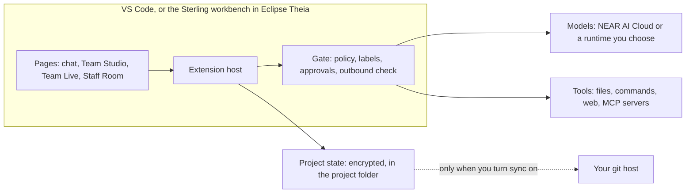
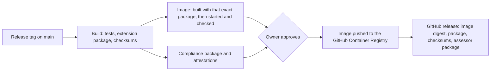
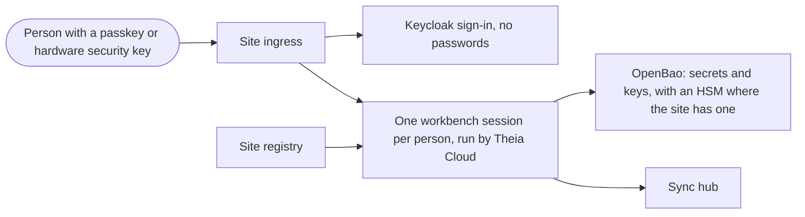

# Architecture overview

This section renders the repository's design documents as they are. Nothing here is a second copy
to keep in step: each page says which file it comes from, and that file is the one to edit.

## How the parts fit

The pages only display what the extension host sends them; keys and raw context stay in the host.
Every model request and every tool call goes through one gate, which applies your organization's
policy, the labels and the approvals before anything leaves. The [security policy](../security/policy.synced.md)
describes each of these in full.

The same extension runs in two editors. In VS Code you install it yourself. The Sterling workbench
is a browser-based editor built on Eclipse Theia: it opens the Sterling Get Started page and the
Canadian Defence Edition, and runs the same extension inside it. The workbench also has its own
views that are not part of the extension: read-only Team Studio samples, the bundled
documentation and a Compliance view.

## How a release is shipped

Each release is a versioned container image of the Sterling workbench, with the release's extension
inside it. Releases are no longer published to the Visual Studio Marketplace; version 0.4.37 is the
first release shipped this way.

1. A release tag on `main` starts the [Release workflow](https://github.com/VitalPointAI/near-ai-vscode/blob/main/.github/workflows/release.yml).
   It runs the tests, builds the extension package (VSIX) and records its SHA-256 checksum.
2. It builds the workbench image from
   [its Dockerfile](https://github.com/VitalPointAI/near-ai-vscode/blob/main/.planning/spikes/theia-team-studio/Dockerfile),
   with that same checked package inside, then starts the image and checks that the extension is there.
3. The image is pushed to `ghcr.io/vitalpointai/near-ai-vscode:vX.Y.Z` only after the owner approves
   it in the protected `container-release` environment. The older `marketplace` environment still
   exists but no release uses it.
4. The GitHub release records the image digest beside the VSIX, its checksum and the assessor
   package. Pull the image by that digest, so you get exactly the image that was tested.

## The compliance fit check

Nothing from outside the repository is used without a review. Every dependency, base image,
workflow action, Helm chart, tool and bundled library needs a reviewed entry in
[`compliance/resources.json`](https://github.com/VitalPointAI/near-ai-vscode/blob/main/compliance/resources.json).
Each entry says what the resource is for, its licence, which controls it touches, how it handles
cryptography and security fixes, whether it works without the internet, and whether it fits.
[`scripts/resource-check.mjs`](https://github.com/VitalPointAI/near-ai-vscode/blob/main/scripts/resource-check.mjs)
finds every resource the repository uses and fails the required `lint` CI job when one has no
entry.

## Hosting for many people (planned, not yet released)

Today the workbench image is a local preview for one person on one computer. It has no sign-in of
its own, so it must only be published on `127.0.0.1`.

The decided direction is that your organization hosts the workbench at its own sites: on-premise,
connected or fully air-gapped. Each person gets their own workbench session. The full design is in
[Hosting Sterling for many people](./design/multiuser-hosting/DESIGN.synced.md).

Every site runs the same parts:

- **Kubernetes:** RKE2.
- **Images:** a registry at the site (Harbor or Zot). Images and charts arrive as signed bundles,
  so nothing is pulled from the internet.
- **Sessions:** self-hosted Eclipse Theia Cloud starts one workbench session per person.
- **Sign-in:** Keycloak, with passkeys or hardware security keys only. There are no passwords.
- **Secrets and keys:** OpenBao, unsealed with a hardware security module (HSM) where the site has one.
- **Logs:** Fluent Bit sends logs to OpenSearch at the site.
- **Shared work:** the existing sync hub.

What exists today, and what does not:

- The `deploy/` folder pins each part's Helm chart by checksum, with its settings and a template
  for each site's own settings. It also holds the pinned base layers of the images we will build
  ourselves. None of this is released, and no site can be installed from it yet.
- The native workbench package is being built. It ties each session to the signed-in person and
  keeps each person's secrets in OpenBao. It is not on `main` yet.
- The sync hub exists today as a container your organization runs itself. Running several hubs
  at each site comes with the hosted stack.

## Where to read more

| Topic | Document |
| --- | --- |
| How the code is organized today | [Architecture](./codebase/ARCHITECTURE.synced.md), [Structure](./codebase/STRUCTURE.synced.md), [Integrations](./codebase/INTEGRATIONS.synced.md) |
| Hosting the workbench for many people at your organization's sites | [Multi-user hosting design](./design/multiuser-hosting/DESIGN.synced.md) |
| Platform direction: our own engine, sandbox and identity | [Platform direction research](./design/platform-direction/README.synced.md) |
| Model provenance, use tiers and Western defaults | [Model provenance](./design/model-provenance/DESIGN.synced.md) |
| Multi-user staff workspaces and signed replication | [Multi-user sync](./design/multiuser-sync/DESIGN.synced.md) |
| Guided setup and local model management | [Guided onboarding](./design/guided-onboarding/DESIGN.synced.md) |
| Assigned positions, organization modes and the portfolio view | [Portfolio and assignment](./design/portfolio-and-assignment/DESIGN.synced.md) |
| Staff team templates | [Staff teams design](./design/staff-teams/10-STAFF-TEAMS-DESIGN.synced.md) |
| The data platform | [Data platform design](./design/data-platform/00-DESIGN.synced.md) |

Every other design document and research note is in the menu under **Design documents**.

## Decision records

Decision records will appear in this section as they are added under `docs/decisions/` in the
repository; the site picks them up at the next build without any change here.
