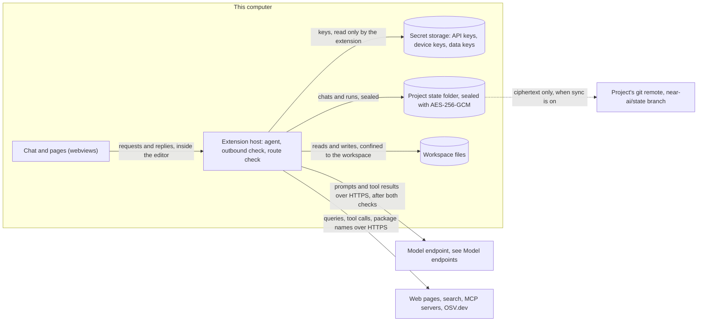
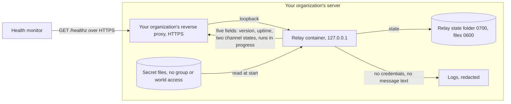
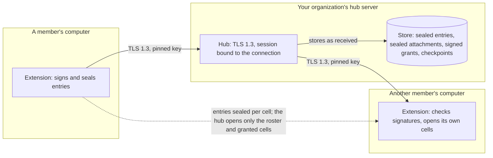
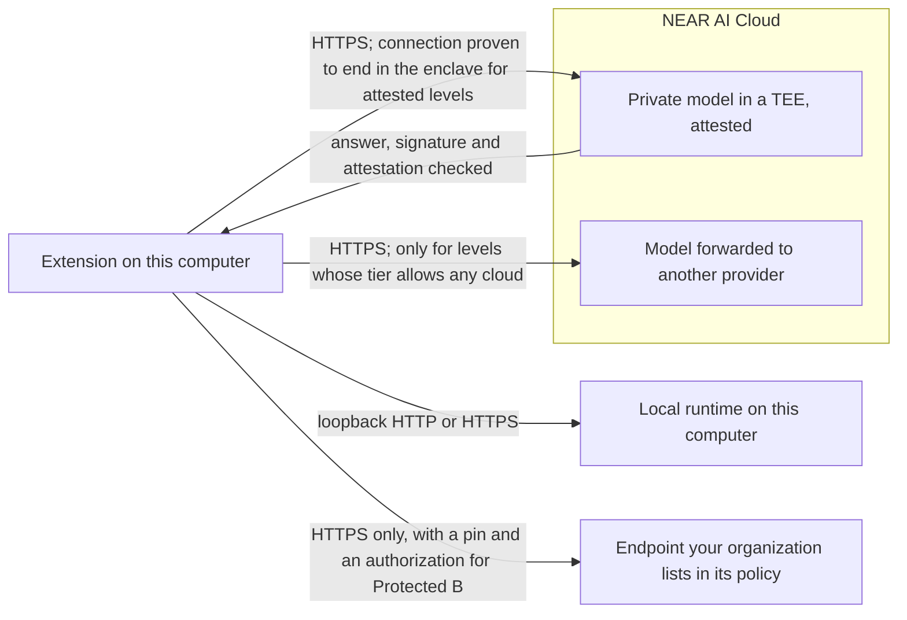

# Data flows

Last reviewed: 2026-11-21

One diagram per component shows what data crosses which boundary and whether it is encrypted on
the way. Dashed lines are boundaries the data crosses encrypted end to end, so the other side holds
only ciphertext; solid lines are TLS connections, where the other side reads what it receives, or
steps inside one computer. The [threat model](threat-model.md) says which threats each boundary
faces, and the [security policy](../../SECURITY.md) is the authority on every detail.

## Extension

Everything the extension sends to a model passes the outbound check and the route check first,
and what comes back from the web, a search or an MCP server is fenced as untrusted content. Project
state leaves the computer only as ciphertext, and no telemetry is sent.

## Messaging relay

In this version the relay handles no Teams or Signal message; its only endpoint is the health check,
which names no one. Public HTTPS ends at your organization's reverse proxy, and this diagram gains
the Teams and Signal flows in the phase that first receives messages.

## Sync hub

The hub holds the roster's key so it can check each change, and the key of any part the staff lead
grants it; every other part stays ciphertext to it. It makes no outbound connection and holds no
model credential.

## Release pipeline

```mermaid
flowchart LR
  DEV["Pull request"] -- "CI, secret scan, agent review" --> MAIN["main on GitHub"]
  MAIN -- "release tag, protected" --> BUILD["Release workflow: tests, build, SBOM, VSIX checks"]
  BUILD -- "VSIX and SHA-256 checksum" --> GHR["GitHub release"]
  GHR -- "same VSIX, checksum checked" --> PUB["Publish job, waits for the owner's approval"]
  PUB -- "HTTPS, publisher token held only in that environment" --> MKT["Visual Studio Marketplace"]
  MKT -- "signed extension over HTTPS" --> USER["VS Code on each computer"]
```

Every change reaches `main` through a pull request and its gates, and the VSIX that is published is
the one the build job made, checked by its checksum. The Marketplace signs the extension and VS Code
checks that signature when it installs it.

## Model endpoints

Which endpoint a request may reach is decided by the route check from the chat's labels, the
routing tiers and your organization's list of places. A model endpoint reads the prompt in the
clear to answer it, so the encryption on these lines protects the data on the way, not from the
endpoint.
