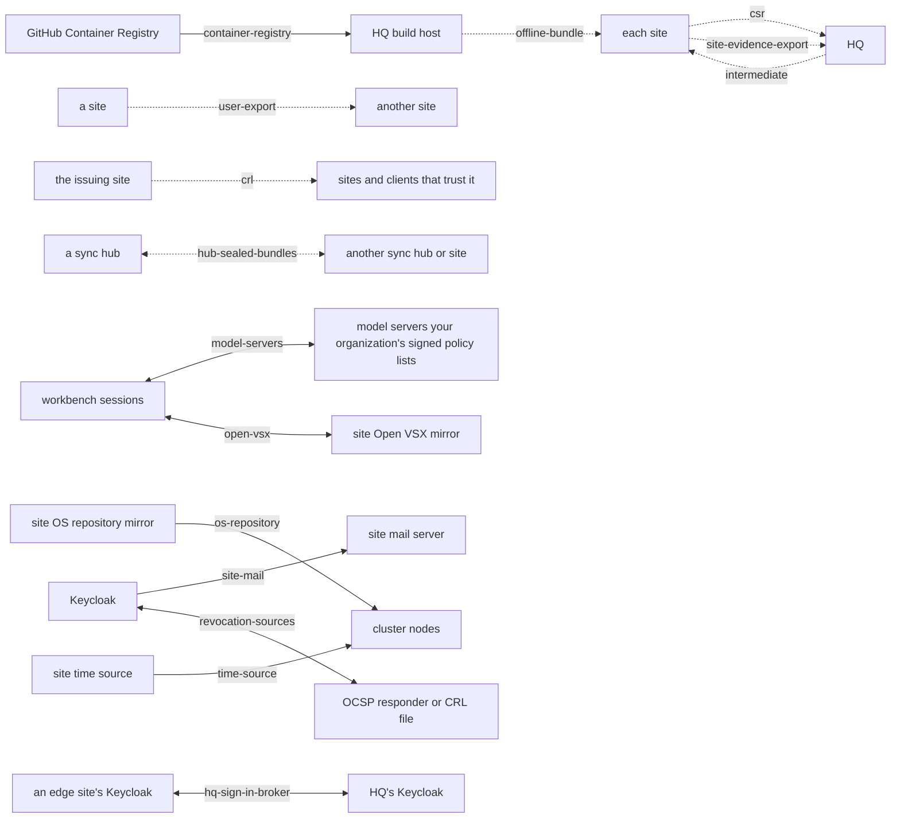

# Hosted deployment: exchanges and interconnections

Last reviewed: 2026-11-24

This register lists everything that crosses the boundary of a hosted site your organization runs, or passes between its sites: files carried between HQ and its sites, and network connections to services outside the cluster. It covers CA-3 (information exchange), CA-9 (internal system connections, with the ports, protocols and services list in `hosted-architecture.md`) and SA-9(2) (the functions, ports and protocols of external services).

The register and the diagram are generated from [`compliance/hosted/exchanges.json`](../../compliance/hosted/exchanges.json) by `node compliance/src/cli.ts hosted-docs --write`. Do not edit the text between the `generated` markers by hand: change the JSON file and run the command. CI's docs job fails when the two differ, and when a module under `deploy/` (tests excluded) calls one of the six signing helpers of `deploy/bundle/lib/cosign.mjs` and `deploy/bundle/signed-file.mjs` (`signFile`, `verifySignedFile`, `signBlob`, `verifyBlob`, `signImage`, `verifyImage`) without an exchange naming it. Signing or verifying by any other means is not detected, so such code must name its exchange by hand. An exchange marked planned names the plan or phase that builds it.

## Exchanges and interconnections

Each row says what crosses, between whom, how it is protected, how often, which site settings name its outside address, and which code does it. "Operator under" is the country whose law governs whoever operates the far end (the end away from your site), or "your organization"; "Far end" is where that end is, or "at the site". Both read "unknown" when the register cannot know, such as where HQ or another of your sites is: each site states its own place in its sovereignty declaration.

<!-- generated:exchanges begin -->
| Exchange | From and to | Operator under | Far end | Data and format | Protection | Frequency | Site settings | Status | Agreement |
|---|---|---|---|---|---|---|---|---|---|
| **Offline bundle** (`offline-bundle`) | HQ build host to each site, by file | your organization | unknown | Every image of the stack by digest, the vendored charts, the pinned tools (RKE2, helm, cosign, hauler) and the deploy tree (realm, policies, values, local charts, node files and scripts), listed with their digests in manifest.json. No personal information. Format: A hauler store archive with manifest.json (sterling-bundle/1) and its Sigstore signature bundle beside it, carried on media or copied. | manifest.json is signed with your organization's cosign key, and every image is re-signed with the same key at build. At the site, check.mjs verifies the manifest signature, the archive SHA-256 and every item digest with the public key from the install media before anything is loaded; import.mjs verifies every image signature again in the site registry. | The first install and every update (an update is a newer bundle). | `site.example.yaml#organizationPublicKey`, `site.example.yaml#registry` | Implemented: `deploy/bundle/build.mjs`, `deploy/bundle/check.mjs`, `deploy/bundle/import.mjs`, `deploy/bundle/signed-file.mjs`, `deploy/bundle/lib/cosign.mjs` | To be completed by your organization |
| **Person and passkey export** (`user-export`) | a site to another site, by file | your organization | unknown | Each named person's username, email, first and last name, enabled and email-verified flags, and their WebAuthn passwordless credential records (credential id, public key, AAGUID, sign count, attestation format, transports). No private key leaves the person's authenticator; OpenBao Transit keys are not in this file. Format: A sterling-users/1 JSON file with its Sigstore signature bundle beside it. | Signed with your organization's cosign key. The import verifies the signature with the public key from the install media and refuses an unknown format, an unread feature in requires, another relying-party id or a credential that is not passwordless WebAuthn, all before any Keycloak call. | When a person moves to or is enrolled at another site. | `site.example.yaml#rpId`, `site.example.yaml#siteName` | Implemented: `deploy/keycloak/users.mjs` | To be completed by your organization |
| **Site intermediate certificate request** (`csr`) | each site to HQ, by file | your organization | unknown | The certificate signing request of the site's pki_int intermediate (its public key and the site's names). The key is made and kept in OpenBao. Format: A PEM certificate signing request with its Sigstore signature bundle beside it. | Signed with your organization's cosign key so HQ knows which site sent it; HQ's offline root signs it in the key ceremony. | At install and at each intermediate renewal. | `site.example.yaml#domain` | Implemented: `deploy/openbao/pki-files.mjs` | To be completed by your organization |
| **Signed site intermediate certificate** (`intermediate`) | HQ to each site, by file | your organization | unknown | The site's intermediate CA certificate issued by HQ's offline root. No private key. Format: A PEM certificate file with its Sigstore signature bundle beside it. | Signed with your organization's cosign key. The import verifies the signature, that the certificate is a CA certificate issued and signed by the HQ root from the install media and that it is valid now, before any OpenBao call or file write. | At install and at each intermediate renewal. | None | Implemented: `deploy/openbao/pki-files.mjs`, `deploy/bundle/signed-file.mjs` | To be completed by your organization |
| **Certificate revocation list** (`crl`) | the issuing site to sites and clients that trust it, by file | your organization | unknown | The revocation list of the site's pki_int intermediate: serial numbers and revocation times. No personal information. Format: A PEM revocation list with its Sigstore signature bundle beside it. | Signed with your organization's cosign key; the import verifies it with the public key from the install media before writing anything. It stays valid for crlExpiry, which must outlast the time media takes to arrive. | On each revocation and before the list expires. | `site.example.yaml#crlExpiry`, `site.example/sterling-keycloak-realm.yaml#x509.crlPath` | Implemented: `deploy/openbao/pki-files.mjs` | To be completed by your organization |
| **Hub sealed bundle files** (`hub-sealed-bundles`) | a sync hub to another sync hub or site and back, by file | your organization | unknown | Sealed entries of shared staff projects carried between hubs that are not connected. Format: Sealed bundle files as the Phase 34 design defines them. | Sealed and signed as the Phase 34 design defines; the register is completed when that code lands. | When a disconnected hub or site exchanges project entries. | None | Planned in Phase 34 | To be completed by your organization |
| **Site evidence export** (`site-evidence-export`) | each site to HQ, by file | your organization | unknown | Allow-listed deployment facts (settings, counts and versions) read by collect.sh; names, realm contents, secrets and log text stay at the site. Also how a disconnected edge site reports to HQ. Format: A signed JSON envelope in the extension's signed-payload format, purpose site export. | Ed25519 signature by the site's export key, from a key file or an external signer such as an HSM; the reader refuses an export that does not verify. | At least weekly, inside the 7-day evidence window. | None | Implemented: `compliance/site-export/collect.sh`, `compliance/src/siteExport.ts`, `compliance/src/commands/site-export.ts` | To be completed by your organization |
| **Model servers** (`model-servers`) | workbench sessions to model servers your organization's signed policy lists and back, over the network | unknown | unknown | The prompts and context a person sends and the model's replies; this can include project content up to the level the policy allows for that server. Format: HTTPS requests to each listed model server. | TLS to the server. Pods reach only the addresses in egressAllow (sterling-network), and sessions use only the servers in modelServers. | On each model request. | `site.example.yaml#egressAllow`, `site.example/sterling-sessions.yaml#siteEnv.modelServers` | Implemented: `deploy/charts/sterling-sessions/templates/site-env.yaml`, `deploy/values/sterling-network.yaml` | To be completed by your organization |
| **Site mail server** (`site-mail`) | Keycloak to site mail server, over the network | your organization | at the site | Passwordless registration links that an administrator sends to a person's email address. Format: SMTP on port 587. | STARTTLS to the site's own mail server; the realm sends from the site's own address. | When an administrator sends a registration link. | `site.example/sterling-keycloak-realm.yaml#smtp.host`, `site.example/sterling-keycloak-realm.yaml#smtp.from`, `site.example.yaml#egressAllow` | Implemented: `deploy/keycloak/realm.json` | To be completed by your organization |
| **Operating system repository** (`os-repository`) | site OS repository mirror to cluster nodes, over the network | your organization | at the site | Operating system packages, such as container-selinux for the RKE2 SELinux package. No site data. Format: Packages from the site's mirror of the OS vendor's repository. | Packages signed by the OS vendor and checked by the package manager; the site supplies and runs the mirror. | At install and when the site patches its nodes. | None | Implemented: `deploy/rke2/install-node.sh` | To be completed by your organization |
| **GitHub Container Registry to the HQ build host** (`container-registry`) | GitHub Container Registry to HQ build host, over the network | US | unknown | Our built and released images, pulled by their recorded digests. No site data. Format: OCI images over HTTPS. | Pulled by digest over TLS, signed with the release key in the container-release environment when published, and re-signed with your organization's key at bundle build. A published digest enters the image lock only after its signature verifies (deploy/bundle/record-digests.mjs), and the workbench only from the Release workflow's GHCR repository. | Each bundle build. | None | Implemented: `.github/workflows/deploy-images.yml`, `deploy/bundle/build.mjs`, `deploy/bundle/record-digests.mjs` | To be completed by your organization |
| **Open VSX mirror** (`open-vsx`) | workbench sessions to site Open VSX mirror and back, over the network | your organization | at the site | Requests for extensions by name and version, and the extension packages. No project content. Format: HTTPS to the site's own Open VSX mirror. | TLS to the mirror the site names; sessions fetch extensions only from there. | When a person installs or updates an extension. | `site.example/sterling-sessions.yaml#siteEnv.openVsxUrl` | Implemented: `deploy/charts/sterling-sessions/templates/site-env.yaml` | To be completed by your organization |
| **Smart card revocation checks** (`revocation-sources`) | Keycloak to OCSP responder or CRL file and back, over the network | unknown | unknown | The serial number of a smart card certificate being checked. Off unless the site turns on smart card sign-in. Format: OCSP over HTTP to a local responder, or a CRL file refreshed on a schedule. | The OCSP answers are signed by the responder; the CRL is signed by its issuer. | At each smart card sign-in, when that sign-in is on. | `site.example/sterling-keycloak-realm.yaml#x509.ocspResponderUri`, `site.example/sterling-keycloak-realm.yaml#x509.crlPath` | Implemented: `deploy/keycloak/apply.mjs` | To be completed by your organization |
| **Sign-in through HQ** (`hq-sign-in-broker`) | an edge site's Keycloak to HQ's Keycloak and back, over the network | your organization | unknown | An OpenID Connect sign-in at HQ for a person who already exists at the edge site (linked by email). Off by default. Format: OpenID Connect over HTTPS. | TLS; the client secret is a Secret at the edge site, never in the site file; HQ's first sign-in only links an existing person, and signing always needs a fresh ceremony with a key registered at the edge. | At sign-in, when the edge is linked to HQ. | `site.example/sterling-keycloak-realm.yaml#hqBroker.issuer`, `site.example/sterling-keycloak-realm.yaml#hqBroker.clientId` | Implemented: `deploy/keycloak/apply.mjs` | To be completed by your organization |
| **Site time source** (`time-source`) | site time source to cluster nodes, over the network | your organization | at the site | Time. No site data. Format: NTP (chrony), optionally with Network Time Security; or a reference clock attached to a node (PHC, SHM or SOCK). | Every node's chrony.conf is generated from the site file and names only the site's own sources (no pool, no allow, command port off); NTS trusts the site CA when time.nts is on; with two or more sources chrony needs two to agree. The node install refuses a clock that is not synchronised, follows its own local clock or exceeds time.maxClockErrorMs, before RKE2 is installed, and the install preflight refuses the same on the import host. | Continuously. | `site.example.yaml#time.servers`, `site.example.yaml#time.refclocks`, `site.example.yaml#time.nts`, `site.example.yaml#time.maxClockErrorMs` | Implemented: `deploy/bundle/lib/clock.mjs`, `deploy/rke2/check-time.sh`, `deploy/rke2/install-node.sh`, `deploy/bundle/lib/preflight.mjs` | To be completed by your organization |
<!-- generated:exchanges end -->

## Exchange diagram

Each party is a box and each exchange an arrow labelled with its id. Dotted arrows are files, carried on media or copied; solid arrows are network connections.

<!-- generated:exchange-diagram begin -->

<!-- generated:exchange-diagram end -->

## Agreements

CA-3 asks that each exchange with another system is approved and documented in an agreement: an interconnection security agreement, a memorandum of understanding or agreement, a service level agreement or a contract. For exchanges with another organization, such as a model server run by a provider or an observer's organization, the agreement is also the basis of AC-21.400 and AC-21.401 in your organization's terms.

The product cannot make these agreements. Your organization's authorizing official or the person they name decides which exchanges need one, records its reference, and keeps it current. Until a reference is recorded, the agreement cell of each row reads "To be completed by your organization". To record one, set the exchange's `agreement` field in `compliance/hosted/exchanges.json` to the agreement's reference (never its text) and regenerate this page.

Exchanges between your organization's own sites (the offline bundle, person exports, certificates, revocation lists and evidence exports) are usually covered by your organization's own internal approval rather than a separate agreement; say so in the cell when that is the decision.
